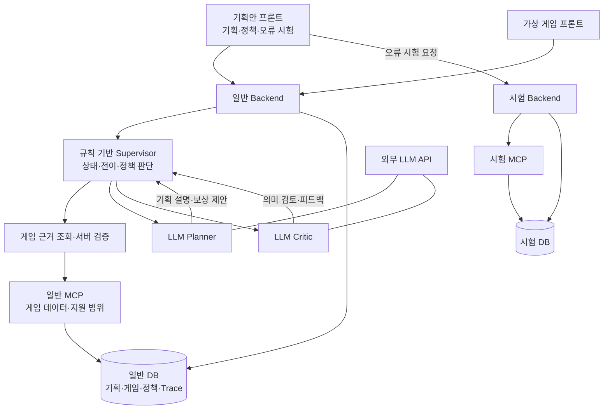

# 게임 이벤트 기획·검수와 정책 기반 오토힐링

가상 방치형 RPG **Opong Heroes**의 이벤트를 기획하고, 게임 데이터와 규칙으로 검증한 뒤 사람이 승인한 이벤트를 실제 게임 상태에 반영하는 시스템입니다.

LLM Planner와 Critic이 기획 설명과 의미 검토를 담당하고, **규칙 기반 Supervisor**가 상태·전이와 오류 대응 정책에 따른 다음 작업을 결정합니다. 게임의 진행도와 보상은 Backend API를 통해 DB에 저장됩니다.

**핵심 흐름:** 이벤트 요청 → 게임 근거 조회 → 기획·검증·검토 → 사람 승인 → 이벤트 공간 개방 → 플레이·보상 기록

기준 브랜치는 `ikonly`입니다. 상세 문서의 진입점은 [IK 문서 색인](docs/ik/README.md), 제출본은 [필수 산출물 대문](docs/ik/필수산출물_README.md)입니다.

## 1. 핵심 기능

| 기능 | 설명 |
|---|---|
| 이벤트 기획·검수 | 요청과 게임 데이터·지원 범위를 연결하고 계약·규칙 검증 및 LLM 의미 검토 결과 제공 |
| 승인·게임 적용 | 승인과 적용을 별도 단계로 처리. 특별 던전의 3개 공간 중 선택한 공간을 개방하고 미션·보상 연결 |
| 가상 게임 | 스테이지·던전 전투, 성장, 재화·보관함·스킨·상점과 이벤트 진행 |
| 정책 기반 오토힐링 | 오류 코드와 활성 정책에 따라 허용된 재시도·기획 수정·사람 검토·안전 중단 선택 |
| 운영 화면 | 기획 요청·결과·진행 기록·로그, 오류 정책 관리와 격리 오류 주입 시험 |
| 배포 수명주기 | GitHub Actions로 첫 배포, 선택 시스템 업데이트, 증거 확보 후 전체 초기화 |

현재 게임에서 지원하지 않는 요구는 개발 필요 항목을 포함한 제한 기획안으로 반환할 수 있습니다. 기획안 생성이나 Critic의 통과 판정만으로 승인·게임 적용이 이루어지지는 않습니다.

## 2. 시스템 구조

위 그림은 책임과 연결 관계를 요약합니다. 정확한 실행 순서·검증·복구 분기는 [아키텍처 설계서](docs/ik/산출물1_멀티에이전트_아키텍처_설계서.md)를 따릅니다. 권위 ID·지원 판정·승인·DB 쓰기는 서버가 통제합니다.

기획안 프론트는 일반·시험 Backend를 하나의 화면에서 사용합니다. 시험 Backend와 MCP는 별도 프로세스이며, 로컬 PostgreSQL 서버 하나 안에서도 일반·오류 시험·자동 검증 DB를 분리합니다. AWS는 프론트 2개·Backend 2개·MCP 2개의 EC2와 비공개 RDS 구성으로 배포 시험했습니다.

## 3. 로컬 실행

전체 설치·환경 설정·실행 절차는 [팀원 로컬 실행·사용자 가이드](docs/ik/팀원_로컬실행_사용자가이드.md)를 따릅니다.

- 준비 도구: Windows/PowerShell 7, Python 3.11, Node.js 22, pnpm 10.33.0, Docker Desktop, Edge 또는 Chrome.
- 로컬 Docker는 PostgreSQL 실행에 사용하며 Backend·MCP·프론트는 로컬 프로세스로 실행할 수 있습니다.
- 기본 모드는 **실제 DB·실제 MCP + 결정적 기획 생성**입니다. 실제 LLM 호출은 가이드 §6에 따라 개인 환경 파일에 OpenAI 키를 설정합니다.
- 기본 시험 API는 결정적 모드이며 실제 LLM 장애 실험은 별도 절차를 사용합니다.

| 구성 | 기본 로컬 주소 |
|---|---|
| 기획안 프론트 | `http://127.0.0.1:5177` |
| 게임 프론트 | `http://127.0.0.1:5173` |
| 일반 Backend | `http://127.0.0.1:8004` |
| 일반 MCP | `http://127.0.0.1:8010/mcp` |
| 시험 Backend / MCP | `8013` / `8014` |
| PostgreSQL | `127.0.0.1:5434` |

주소는 기본 설정이며 현재 프로세스가 실행 중이라는 뜻은 아닙니다. API 키와 개인 환경 파일은 커밋하지 않습니다.

## 4. 구현·검증 상태

아래는 **2026-10-13까지 보존된 실행 결과**입니다. 이번 README 변경에서 시험이나 AWS 배포를 다시 실행하지 않았습니다.

| 검증 | 결과 | 근거 |
|---|---|---|
| Linux CI | **731 PASS**, 명시적 허용 SKIP 1. source `530fd03`, run `38334819091` | [파이프라인 보고서](docs/ik/산출물3_파이프라인_구현결과_보고서.md) |
| AWS 정상 업무 | 실제 LLM 기획 → 승인 → 게임 적용·보상·중복 방지 등 **17개 확인 통과** | [배포·복구 보고서](docs/ik/산출물2_배포_및_장애복구_보고서.md) |
| AWS 정책 시험 | 결정적 오류 주입 **137 PASS** | [사례별 증거](docs/ik/검증산출물/산출물2_장애시험_사례증거.json) |
| AWS 실제 LLM·통신 시험 | 정상 4 + 오류 9 = **13 PASS**. 오류 중 자동 복구 6, 지속 오류 안전 중단 3 | [AWS 시험 요약](docs/ik/검증산출물/2026-10-13_AWS_시험요약.json) |
| 배포 화면 확인 | Edge 정상 2 + 복구 8 = **10 PASS** | [AWS 전체 경로 검증](docs/ik/검증산출물/2026-10-13_Actions_전체경로_AWS_검증.md) |
| 배포 수명주기 | 첫 배포·6개 서버 선택 업데이트·전체 초기화 검증, 소요 시간 기록 | [Actions 운영 절차](docs/ik/기획안설계/27_Actions_첫배포_초기화_운영.md) |

**자동 복구와 시험 통과는 다릅니다.** 정책대로 안전 중단한 사례도 시험은 통과할 수 있습니다. 선정 정책 표본의 자동 복구율은 51/127, 전체 혼합 정책 시험의 보조율은 51/137이며, 실제 LLM·통신 오류 표본은 6/9입니다. 기대 복구 성공률·평균 복구 시간·제외 기준은 [배포·장애 복구 보고서](docs/ik/산출물2_배포_및_장애복구_보고서.md)에 구분해서 기록했습니다. 서로 다른 환경·source·시험 계층의 개수를 합산하지 않습니다.

**AWS 현재 기록:** 2026-10-13 11:28–11:30 KST 독립 검사 기준 앱은 **ABSENT / 잔존 분류 17개 모두 0**입니다. 배포 인증 IAM/OIDC만 유지하며, 과거 시험 주소를 현재 접속 주소로 제공하지 않습니다. [초기화 근거](docs/ik/검증산출물/2026-10-13_Actions_AWS_잔존검사.json)

## 5. 필수 산출물·상세 문서

| 목적 | 문서 |
|---|---|
| 제출본·가이드 충족 여부 | [필수 산출물 대문](docs/ik/필수산출물_README.md) |
| 산출물 1: 역할·계약·상태·Handoff | [멀티 에이전트 아키텍처 설계서](docs/ik/산출물1_멀티에이전트_아키텍처_설계서.md) |
| 산출물 2: 배포·오류 검출·복구·측정 | [배포 및 장애 복구 보고서](docs/ik/산출물2_배포_및_장애복구_보고서.md) |
| 산출물 3: CI/CD·차단·실행 증거 | [파이프라인 구현 결과 보고서](docs/ik/산출물3_파이프라인_구현결과_보고서.md) |
| 현재 기능·운영 범위 | [현재 구현 상태](docs/ik/현재_구현상태.md) |
| 목표·경계와 상세 설계 | [최상위 설계서](docs/ik/최상위_시스템_설계서.md) · [기획안 설계](docs/ik/기획안설계/README.md) · [게임 설계](docs/ik/게임설계/README.md) |
| 실행별 증거·문서 대조 | [검증 색인](docs/ik/검증산출물/README.md) · [필수 산출물 재검사](docs/ik/검증산출물/2026-10-13_필수산출물_재검사.md) |
| 과목 기준 원문 | [보존 가이드](docs/ik/pre/멀티_에이전트_협업_및_서비스_운영_가이드.md) |

상세 문서는 [IK 문서 색인](docs/ik/README.md)에서 탐색합니다. `pre/`는 원문 보존 자료이고, 과거 계획·시험 기록은 당시 기준으로 읽습니다. 보호된 원본 로그·암호화 증거는 로컬에 보존하며 공개 JSON에는 비밀값·개인키·프롬프트/응답 원문을 포함하지 않습니다.

## 6. 한계와 후속 개선

- 성공·실패·지연 알림의 실제 수신과 담당자 에스컬레이션은 **미검증**입니다. 가이드 해당 항목은 부분 충족으로 남깁니다.
- 기술 재시도에서 이전 실패 문맥과 시도 횟수를 다음 에이전트의 Handoff 입력에 전달하는 부분은 보완이 필요합니다. Workflow 상태·Trace의 재시도 기록 및 Critic의 의미 수정 피드백은 별도로 존재합니다.
- 다중 사용자 RBAC, migration 후 자동 DB 복원, Redis 운영, 실제 RDS 중단·복합 장애·장기 부하는 이번 완료 근거에 포함하지 않습니다.
- 외부 상용 게임과 연결해 실제 계정·경제를 변경하는 기능은 이번 구현 범위에 포함하지 않습니다.

필수 보고서 3종은 실제 구현·시험 결과를 설명하는 제출본입니다. 모든 가이드 요구를 완전히 검증했다는 의미는 아닙니다. [마무리 기준과 후속 과제](docs/ik/문서_마무리와_루트_README_구성.md)

## 7. 개발 규칙

- 코드·브랜치 작업 규칙은 [AGENTS.md](AGENTS.md)를 따릅니다.
- Python 품질 검사는 루트 `pyproject.toml` 기준으로 `ruff check .`, `ruff format --check .`를 사용합니다. CI 품질 검사 실패 시 배포하지 않습니다.
- 동작·계약·설정·오류 처리·실행 절차가 바뀌면 관련 문서와 증거도 갱신합니다. 현행 상세 문서의 진입점은 `docs/ik/`이며 `pre/` 원문은 보존합니다.
- 커밋에는 의도한 변경만 포함하고 API 키·비밀번호·개인 환경 파일·인증서 비밀정보는 제외합니다.
