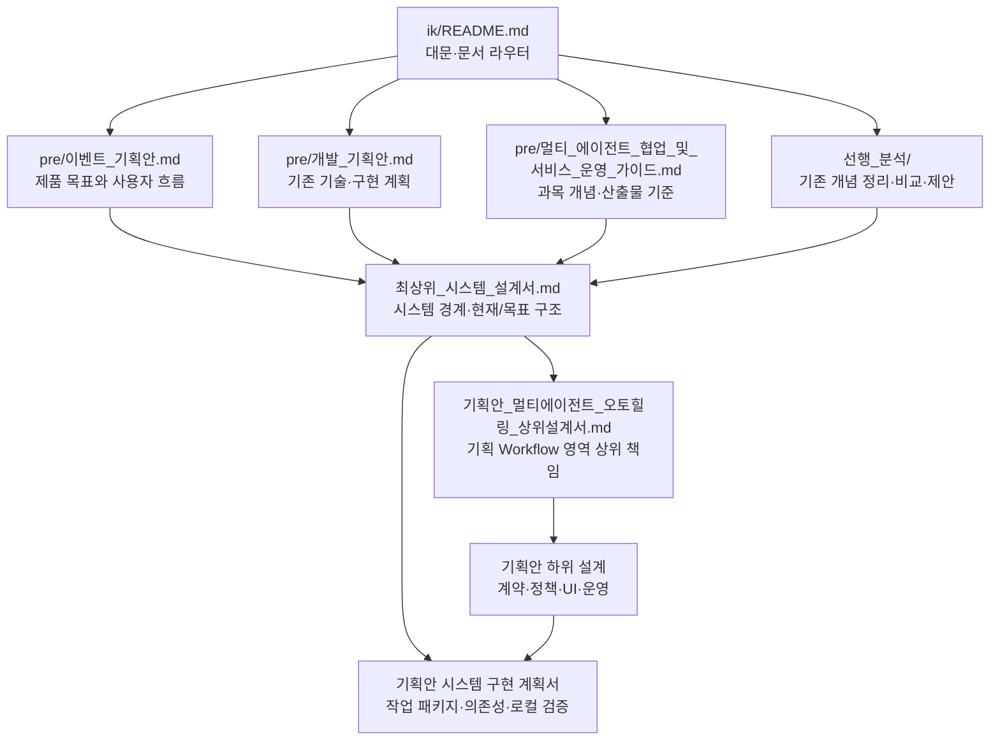

# IK 시스템 설계 문서

2026-10-13 최신 운영 검증: [Actions 전체 경로 AWS 검증](검증산출물/2026-10-13_Actions_전체경로_AWS_검증.md). 첫 배포·6개 서버 선택 업데이트·가이드 시험·전체 초기화 완료. 현재 AWS 앱은 **ABSENT / 잔존 0**이며 IAM·OIDC만 유지한다. 배포/정리 시간도 기록했다.

2026-10-13 운영 갱신: 현재 AWS 앱은 **ABSENT / 잔존 0**이다. 첫 배포·정리는 [Actions 운영 27](기획안설계/27_Actions_첫배포_초기화_운영.md), 실제 결과는 [전환·초기화 검증](검증산출물/2026-10-13_Actions_수명주기_전환과_AWS_초기화.md)을 따른다.

2026-10-13 현행 코드 **AWS 첫 배포·수용 완료**, 앱 **ACTIVE**. 실제 OpenAI Planner/Critic 2회와 암호화 DB 기록 2개, 기획 승인→선택 공간 2곳 등록→첫 클리어 보상·중복 방지 **16개 확인 PASS**, Edge **3 PASS** 및 이미지 로드 후 장면 확인을 완료했다. 접속 주소·새 CA·로그인 파일·메일 확인·검증 한계는 [최신 AWS 배포 결과](검증산출물/2026-10-13_AWS_현행코드_첫배포_검증.md)를 따른다. 아래 ABSENT 기록은 이번 재배포 전 이력이다.

2026-10-13 현행 코드 CI/CD 마무리: **원격 CI 707 PASS**(core 609·PostgreSQL 56·UI 36·운영 이미지 6), release-gate 및 실제 OIDC/CD 성공. core의 허용 skip 1건은 실제 PostgreSQL에서 통과했다. AWS 앱은 **ABSENT**, 자동 CD는 **INACTIVE / created_resources=false**로 끝났다. 첫 배포·전체 초기화·시스템별 업데이트 절차와 실패 차단 증거는 [최신 CI/CD 검증](검증산출물/2026-10-13_현행코드_CICD_마무리.md)을 따른다. 아래 실제 LLM/과거 배포 기록과 검증 모집단을 구분한다.

2026-10-13 두 문제를 보완한 실제 LLM 재시험 **19/19 PASS**, 변경 영향 Python **195 PASS**, Edge **5 PASS**를 확인했다. 미지원 3건은 개발 필요 결과를 보존한 COMPLETED, 일시 오류 6건은 자동 복구, 지속 오류 3건은 안전 중단됐다. 실제 호출·암호화 DB 기록 39개가 일치했다. [보완 후 결과](검증산출물/2026-10-13_실제LLM_보완후_재시험결과.md)가 최신이며 아래 중단 기록은 수정 전 이력이다.

가이드 기준 지표: **자동 복구율 6/9=66.7%**, **복구 기대 사례 성공률 6/6=100%**, **안전 중단 정책 준수율 3/3=100%**(전체 장애의 33.3%), 평균 자동 복구시간 **5.964초**다. 시험 통과율 19/19와 구분하며 분모·제외·수동 개입 기준은 [결과 §3.1](검증산출물/2026-10-13_실제LLM_보완후_재시험결과.md#31-가이드-기준-지표와-모집단)을 따른다.

2026-10-13 실제 LLM 재시험은 **7회 실행(6 PASS / 1 FAIL)** 후 중단했다. 미지원 공간의 Critic 판정이 개발 필요 완료 대신 사람 검토 대기로 이어졌고, 복구 시연 UI의 WAITING_REVIEW 표시 누락도 확인했다. 당시 실제 호출 14회·암호화 기록 14개, 남은 12회는 그 phase에서 미실행이었다. [실호출 중단 기록](검증산출물/2026-10-13_실제LLM_재시험_중단기록.md)을 먼저 확인한다.

2026-10-13 복구 시연 재시험: 이전 기대값 기준 정책 조합 **137/137 PASS**, Edge **15 PASS**, 정상화 예상 **51/51**, 평균 검출→완료 **1.068초**. 실제 DB/MCP·결정적 LLM을 사용했고 정책/시험 게임 데이터 보존과 CLEAN을 확인했다. [재시험 결과](검증산출물/2026-10-13_복구시연_재시험결과.md)를 따른다.

2026-10-13 사용자 확인용 로컬 환경을 실행했다. 기획안 5177·게임 5173, 실제 일반 DB/MCP/LLM 설정과 별도 오류 시험 DB가 연결되어 있다. [실행 상태·정책 보완 기록](검증산출물/2026-10-13_사용자테스트_로컬환경.md)을 따른다.

2026-10-13 통합 후 로컬 종합 검사: 기본 595 PASS, PostgreSQL 53 PASS 및 저장소 원자성 3 PASS, 화면 34 PASS, 전체 오류 28/28 PASS와 Edge 실제 복구 경로 8 PASS를 확인했다. 생성 JSON Schema/검사 기대값/브라우저 증거 경로를 보완했다. [종합 검증 결과](검증산출물/2026-10-13_통합후_로컬종합검증.md)를 먼저 확인한다. 유료 LLM·AWS 재배포는 이번 검증 범위에 포함하지 않는다.

2026-10-12 최신 분기 통합: 새 기획안 UI·수정 요청·복구 경로 표시를 통합했고 전체 오류 28개를 유지한다. Supervisor 수정 상태, 부모/자식 원자 저장, 버전별 게임 등록과 DB migration 018을 보완했다. [통합 검증 기록](검증산출물/2026-10-12_ikonly_브랜치통합_검증.md)을 따른다.

2026-10-12 배포 수명주기 완료: 실제 OIDC 인증·첫 배포·초기 실패 자동 정리·이미지 rollback·게임 웹 선택 업데이트·GitHub 전체 업데이트·전체 초기화 및 빈 환경 재초기화를 확인했다. 현재 AWS 앱/저장 자원은 ABSENT이며 제어 IAM/OIDC 연결만 유지한다. 다음 첫 배포는 로컬 키 공급 후 실행하고 이후 ikonly push는 활성 환경의 변경 역할을 업데이트한다. [운영 가이드 26](기획안설계/26_AWS_배포운영_실행가이드.md), [검증 기록](검증산출물/2026-10-12_AWS_배포수명주기_구현검증.md)을 따른다.

2026-10-12 후속 시험 전 정리 기록: 사용자 요청으로 AWS 실행 자원과 보존 자원 21개까지 모두 삭제해 전체 초기화를 완료했다. 시험 증거는 로컬에 보관·무결성 확인했고 기존 EIP는 해제됐다. 이번 환경의 실행/저장 자원 잔존 없음 조회를 완료했다. Windows 인증서 두 개 제거는 보류 상태다. [정리 결과](검증산출물/2026-10-12_AWS_정리결과.md)를 먼저 확인한다. 아래 배포/보존 기록은 전체 초기화 전 이력이다.

첫 배포·전체/시스템별 업데이트·전체 초기화 계약과 현재 구현 범위는 [배포 수명주기 25](기획안설계/25_AWS_배포수명주기_정리.md)를 따른다. 선택 업데이트와 fleet 실행을 연결했다. OIDC 실제 인증 검증과 새 배포 경로 수용 결과는 최신 실행 가이드를 따른다.

2026-10-12 Edge 사용자 시험: 실제 게임·기획안 생성/승인/두 공간 적용·첫 클리어 보상/중복 방지·복구/보안 종료 샘플을 확인했다. UI 표현 개선 5개와 미시험 범위는 [사용자 테스트 기록](검증산출물/2026-10-12_AWS_Edge_사용자테스트.md)을 따른다.

2026-10-12 정리 전 배포 수용: AWS 5개 stack·6개 서비스 배포와 두 웹 EIP HTTPS 접속 완료. 실제 RDS/MCP/OpenAI 기획 생성·승인·선택 공간 게임 반영 및 전투 저장, Windows CA 신뢰·Edge 화면 검사를 통과했다. 점검 모드는 해제했다. 자동 OIDC 배포·스냅샷 복원 시험은 미완료다. 실제 환경 정리는 상단 최신 기록을 따른다. [실제 배포 기록](검증산출물/2026-10-12_AWS_실제배포_진행기록.md#최종-배포연결-수용)에서 접속 주소·증빙·운영 범위를 확인한다.

팀원이 `ikonly`를 받아 로컬 DB·MCP·두 화면을 실행하고 게임 플레이, 기획안 승인·등록, 복구 시연을 확인하려면 [팀원 로컬 실행·사용자 가이드](팀원_로컬실행_사용자가이드.md)를 먼저 본다. 최초 설치와 실제 LLM 선택 설정, 종료·재실행을 구분했다.

AWS 배포와 CI/CD의 권장 구조·참고 workflow 비교·선행 보완·완료 기준은 [AWS 배포 계획 23](기획안설계/23_AWS_배포_CICD_계획.md)를 따른다. 최신 권장안은 웹만 공개하는 EC2 6대·private RDS·NAT 1개·Parameter Store 구성이다. 시간당 비용은 §4.1, 생성과 역순 정리·백업 보존은 §12에서 찾는다. 초기 실제 배포 수용 결과는 위 최신 기록을 따른다. 자동 배포·복원·정리 단계는 별도다.

배포 구현을 시작할 때는 [AWS 구현 계획 24](기획안설계/24_AWS_배포_CICD_구현계획.md)를 먼저 본다. §2는 코드·설계 차이, §3은 A0~A8 작업 파일/순서, §4~7은 설정·DB·CI/CD·정리 계약, §8은 검증 게이트다. 최신 CI·승격 계약은 §15와 [Linux CI·이미지 승격 검증](검증산출물/2026-10-12_LinuxCI_이미지승격_검증.md), 운영 이미지 실행 계약은 §14와 [운영 이미지 로컬 검증](검증산출물/2026-10-12_운영이미지_로컬검증.md)에서 확인한다. 원격 Actions/AWS 성공과 로컬 검증을 구분한다.

전체 테스트의 필요성 분류·정리, 신규 보충 검사와 CI 연결 범위는 [CI 테스트 분류 22](기획안설계/22_CI_테스트분류_정리.md)를 따른다. 기본 회귀·DB·UI·외부 실험을 분리했고 Linux CI 연결을 구현·로컬 검증했다. 원격 CI 성공은 실제 배포 기록에서 확인한다.

현재 기획안 UI는 5177 하나로 통합되어 일반·시험 Backend로 요청을 분리한다. [프론트 통합 구현·검증](기획안설계/21_기획안프론트_통합구현.md)에서 실행 방법과 격리 범위를 확인한다.

이 디렉터리는 프로젝트를 이해하고 설계·구현 방향을 정하기 위한 **독립 문서 공간**이다. 문서 조사와 문서 간 참조는 `docs/ik/` 내부에서만 수행한다. 저장소의 다른 문서에 연결하지 않는다.

## 문서 우선순위

1. [`최상위_시스템_설계서.md`](최상위_시스템_설계서.md)는 현재 합의 중인 시스템 경계, 현재 구현과 목표 구조의 차이, 미결 결정을 담는 설계 기준이다.
2. [`pre/이벤트_기획안.md`](pre/이벤트_기획안.md)와 [`pre/개발_기획안.md`](pre/개발_기획안.md)는 상위 설계 전의 기획 자료를 보존한 스냅샷이다. 현재 구현 사실이나 최신 설계 결정과 충돌하면 최상위 설계서의 `현재 상태·목표·주요 차이`와 `미결 결정`을 먼저 확인한다.
3. [`pre/멀티_에이전트_협업_및_서비스_운영_가이드.md`](pre/멀티_에이전트_협업_및_서비스_운영_가이드.md)는 과목 가이드 원문 스냅샷이다. 필수 산출물과 개념을 확인할 때 사용하되, 예시 기술이나 예시 아키텍처를 프로젝트의 확정 요구로 해석하지 않는다.
4. [`선행_분석/`](README.md#선행-분석-자료-라우터)는 최상위 설계 전에 작성한 검토·제안 문서다. 결정 근거와 하위 설계의 재사용 소재를 찾을 때 활용하되, 제품 경계와 목표는 최상위 설계서, 원래 기획·가이드 요구는 `pre/` 스냅샷을 기준으로 해석한다.

`pre/`는 입력 자료를 보존하는 곳이다. 문서 설계가 달라졌다고 스냅샷을 직접 수정하지 않는다. 변경된 기준은 최상위 설계서와 해당 하위 설계서에 기록한다.
복사 원문에 포함된 기존 외부 링크와 첨부 참조는 스냅샷 일부로 보존되어 있을 수 있지만, 이 문서 체계의 탐색 경로로 사용하거나 따라가지 않는다.

## 빠른 탐색

격리 오류 시험실의 현재 구현, 28개 오류 코드 시험 범위와 로컬 사용법은 [시험실 구현·검증 16](기획안설계/16_오류시험실_구현과_검증.md)을 먼저 확인한다. 전체 구조도와 실행 증빙, 미구현 범위를 구분했다.

오류 대응 정책과 실제 Workflow 연결의 최신 판정은 [정책 연결 재검사 15 §6](기획안설계/15_오류대응정책_Workflow_연결_재검사.md#6-정책-연결-보완-구현)을 우선 확인한다. 누락 경로의 보완, 정책 적용 한계와 검증 기록을 정리했다.

2026-10-11 Workflow 재검사 후 복구·transaction·실행 예약·진행 UI 수정을 구현하고 연결 검증했다. 현재 검증 증거와 적용 범위는 수정 계획 §7을 따른다. 수정할 문제·확정 계약·변경 파일·검증 기준은 [Workflow 검사 결과·설계 보완·수정 계획](기획안설계/14_Workflow_검사결과_설계보완_수정계획.md)을 먼저 확인한다.

| 알고 싶은 내용 | 먼저 볼 문서와 구간 |
|---|---|
| 시스템 목적·사용자·범위·경계 | [목표 §2](최상위_시스템_설계서.md#2-시스템-목표와-성공-기준) · [사용자 §3](최상위_시스템_설계서.md#3-사용자와-외부-이해관계자) · [범위 §4](최상위_시스템_설계서.md#4-기능-범위와-제외-범위) · [경계 §5](최상위_시스템_설계서.md#5-시스템-경계와-외부-컨텍스트) |
| 현재 구현, 목표 구조, 차이 | [구조 §6](최상위_시스템_설계서.md#6-논리-구성과-책임) · [차이 §16](최상위_시스템_설계서.md#16-현재-상태-목표-주요-차이) |
| 승인부터 가상 게임 등록·진행까지 | [흐름 §7](최상위_시스템_설계서.md#7-핵심-흐름과-상태-원칙) · [데이터 §8](최상위_시스템_설계서.md#8-데이터-영역과-소유권) · [계약 §9](최상위_시스템_설계서.md#9-컴포넌트-간-계약-원칙) |
| 외부 연동·오류·보안·운영 원칙 | [의존성 §10](최상위_시스템_설계서.md#10-외부-연동과-의존성) · [복구 §11](최상위_시스템_설계서.md#11-오류복구일관성-원칙) · [보안 §12](최상위_시스템_설계서.md#12-보안권한-원칙) · [관측 §13](최상위_시스템_설계서.md#13-운영과-관측) |
| 미결 결정·후속 설계서 순서 | [하위 산출물 §17](최상위_시스템_설계서.md#17-하위-설계서와-구현-계획) · [미결 결정 §18](최상위_시스템_설계서.md#18-미결-결정과-가정) |
| 기획 Workflow의 멀티 에이전트·오토힐링 상위 기준 | [기획안 멀티 에이전트·오토힐링 상위 설계서](기획안_멀티에이전트_오토힐링_상위설계서.md) |
| 기획 Workflow의 상세 계약·정책·UI·운영 설계 | [기획안 설계 라우터](기획안설계/README.md) · [하위 설계 완료 기준 §13](기획안_멀티에이전트_오토힐링_상위설계서.md#13-하위-설계-완료-기준) |
| 이벤트 공간별 기획·Runtime 동기화 변경 계획 | [선택 공간 동기화 계획](기획안설계/12_기획안_선택공간_Runtime_개방동기화_변경계획.md) · [이전 층별 계약 결정 이력](기획안설계/11_이벤트던전_층별_미션보상_변경작업.md) |
| 기획안 시스템 구현 순서·작업 패키지·수용 게이트 | [기획안 시스템 구현 계획서](기획안_시스템_구현계획서.md) |
| 가상 게임 도메인 하위 설계 7종·완료 게이트 | [상세 설계 작성 전략 (초안)](하위설계_작성전략_임시.md) |
| 가상 게임 도메인 기준 설계서 | [가상 게임 도메인 상세 설계서](가상게임_도메인_상세설계서.md) |
| 가상 게임 도메인 하위 설계 7종 | [게임 세부 설계 라우터](게임설계/README.md) |
| 가상 게임 구현 순서·완료 기준 | [가상 게임 구현 계획서](가상게임_구현계획서.md) |
| 현재 checkout의 구현 사실·미구현 범위 | [현재 구현 상태](현재_구현상태.md) |
| 단계별 오류 주입·정책 검증·복구 시연 확장 계획 | [오류 대응 시험 환경 변경 계획](오류대응_시험환경_변경계획.md) — [27개 코드 매핑 §5.1](오류대응_시험환경_변경계획.md#51-전체-오류-코드의-시험-매핑), [정적 그래프 §9](오류대응_시험환경_변경계획.md#9-복구-시연-ui-변경), [합의한 구현 계약 §14](오류대응_시험환경_변경계획.md#14-합의한-구현-계약-6종) |
| 원래 프로젝트 목표와 사용자 흐름 | [이벤트 기획안 §1–2](pre/이벤트_기획안.md#1-프로젝트-개요) |
| 원래 에이전트 역할·워크플로우 | [이벤트 기획안 §3–4](pre/이벤트_기획안.md#3-멀티에이전트-구성) |
| 가상 게임의 기존 설정·규칙 데이터 | [이벤트 기획안 §5](pre/이벤트_기획안.md#5-가상-게임-설정-및-테스트-데이터) |
| 상세 계약·검증·가드·복구 계획 | [개발 기획안 §6–14](pre/개발_기획안.md#6-output-contract) |
| MCP·게임 규칙·저장·API 계획 | [개발 기획안 §15–17](pre/개발_기획안.md#15-mcp-server-tool) |
| 테스트·CI/CD·배포 계획 | [개발 기획안 §20, §24–28](pre/개발_기획안.md#20-개발-전-평가-기준-및-테스트) |
| 과목 수행 단계와 요구 산출물 | [가이드 §3–4](pre/멀티_에이전트_협업_및_서비스_운영_가이드.md#3-권장-진행-순서) |
| 제출 전 점검 기준 | [가이드 §6](pre/멀티_에이전트_협업_및_서비스_운영_가이드.md#6-제출-전-체크리스트) |
| 이전에 정리한 설계 개념·팀장 결정·점검 흐름 | [선행 분석 자료 라우터](#선행-분석-자료-라우터) |

## 하위 설계 작성 참고 맵

아래 표는 시스템 하위 산출물과 가상 게임 도메인 하위 설계서를 작성할 때 필요한 구간만 찾아보도록 연결한 탐색표다. 가상 게임 도메인 상세 설계서는 그 도메인의 기준 문서이며, 그 아래 7개 게임 세부 설계서를 둔다. `pre/` 문서는 보존 자료이므로 직접 고치지 않는다. 기존 계획이 최상위 설계의 경계·목표와 다르면 차이를 기록하고, 현재 설계 기준은 최상위 설계서를 따른다.

| 다음에 만들 문서 | 최상위 설계에서 지켜야 할 기준 | 재사용할 이전 자료와 필요한 구간 |
|---|---|---|
| 가상 게임 도메인 상세 설계 | [범위·제외 §4](최상위_시스템_설계서.md#4-기능-범위와-제외-범위) · [데이터 책임 §8](최상위_시스템_설계서.md#8-데이터-영역과-소유권) · [미결 기준 §18](최상위_시스템_설계서.md#18-미결-결정과-가정) | [이벤트 기획안 §5 가상 게임 설정](pre/이벤트_기획안.md#5-가상-게임-설정-및-테스트-데이터) · [개발 기획안 §4-1 성장 기준](pre/개발_기획안.md#4-1-tiny_heroesjson-이벤트-대상별-mock-성장-기준-데이터) · [개발 기획안 §15 MCP·규칙 엔진](pre/개발_기획안.md#15-mcp-server-tool) |
| 가상 게임 Runtime 설계 | [런타임 경계 §5](최상위_시스템_설계서.md#5-시스템-경계와-외부-컨텍스트) · [상태·원자성 §7](최상위_시스템_설계서.md#7-핵심-흐름과-상태-원칙) · [데이터 소유권 §8](최상위_시스템_설계서.md#8-데이터-영역과-소유권) | [이벤트 기획안 §2 정상 흐름·승인](pre/이벤트_기획안.md#2-서비스-시나리오) · [개발 기획안 §16 저장 구조](pre/개발_기획안.md#16-postgresql-저장-구조) · [개발 기획안 §17 API](pre/개발_기획안.md#17-backend-api) · [개발 기획안 §20 상태 보존·멱등성 시험](pre/개발_기획안.md#20-개발-전-평가-기준-및-테스트) |
| 이벤트 기획 시스템 상세 설계 | [목표·범위 §2–4](최상위_시스템_설계서.md#2-시스템-목표와-성공-기준) · [흐름 §7](최상위_시스템_설계서.md#7-핵심-흐름과-상태-원칙) · [데이터·계약 §8–9](최상위_시스템_설계서.md#8-데이터-영역과-소유권) | [이벤트 기획안 §2–4 업무·에이전트 흐름](pre/이벤트_기획안.md#2-서비스-시나리오) · [개발 기획안 §6–10 Contract·State·Handoff·Validation](pre/개발_기획안.md#6-output-contract) |
| 시스템/API 계약 설계 | [컴포넌트 경계 §5–6](최상위_시스템_설계서.md#5-시스템-경계와-외부-컨텍스트) · [계약 원칙 §9](최상위_시스템_설계서.md#9-컴포넌트-간-계약-원칙) | [개발 기획안 §6–8 결과·상태·Handoff 계약](pre/개발_기획안.md#6-output-contract) · [개발 기획안 §17 Backend API](pre/개발_기획안.md#17-backend-api) · [가이드 산출물 1](pre/멀티_에이전트_협업_및_서비스_운영_가이드.md#산출물-1멀티-에이전트-아키텍처-설계서) |
| 에이전트·Workflow 설계 | [논리 구성 §6](최상위_시스템_설계서.md#6-논리-구성과-책임) · [흐름·상태 §7](최상위_시스템_설계서.md#7-핵심-흐름과-상태-원칙) · [계약 §9](최상위_시스템_설계서.md#9-컴포넌트-간-계약-원칙) | [이벤트 기획안 §3–4 역할·Workflow](pre/이벤트_기획안.md#3-멀티에이전트-구성) · [이벤트 기획안 §6 협업 설계](pre/이벤트_기획안.md#6-agent-협업-설계) · [개발 기획안 §5–9 Agent·Handoff·Routing](pre/개발_기획안.md#5-agent-설정-yaml) · [가이드 §3 단계 2–3](pre/멀티_에이전트_협업_및_서비스_운영_가이드.md#3-권장-진행-순서) |
| 보안·권한 설계 | [신뢰 경계 §5.3](최상위_시스템_설계서.md#5-시스템-경계와-외부-컨텍스트) · [보안 원칙 §12](최상위_시스템_설계서.md#12-보안권한-원칙) | [이벤트 기획안 §6 Guard·Trace](pre/이벤트_기획안.md#6-agent-협업-설계) · [개발 기획안 §5-1 보안 정책](pre/개발_기획안.md#5-1-security_policiesyaml) · [개발 기획안 §11 Guard](pre/개발_기획안.md#11-guard-설계) |
| 오류·복구 정책 설계 | [오류·일관성 원칙 §11](최상위_시스템_설계서.md#11-오류복구일관성-원칙) · [상태·원자성 §7](최상위_시스템_설계서.md#7-핵심-흐름과-상태-원칙) | [이벤트 기획안 §7 AutoHealing](pre/이벤트_기획안.md#7-autohealing-설계) · [개발 기획안 §12–14 Guard·Error·Retry](pre/개발_기획안.md#12-guard-validation-실행-순서와-autohealing-연결) · [가이드 §3 단계 5](pre/멀티_에이전트_협업_및_서비스_운영_가이드.md#3-권장-진행-순서) · [가이드 산출물 2](pre/멀티_에이전트_협업_및_서비스_운영_가이드.md#산출물-2배포-및-장애-복구-보고서) |
| 운영·관측 설계 | [관측 요구 §13](최상위_시스템_설계서.md#13-운영과-관측) · [품질 속성 §14](최상위_시스템_설계서.md#14-품질-속성과-제약) | [이벤트 기획안 §6-6 Trace·§15 지표](pre/이벤트_기획안.md#6-agent-협업-설계) · [개발 기획안 §19 Trace·운영 지표](pre/개발_기획안.md#19-trace-및-운영-지표) · [가이드 산출물 2](pre/멀티_에이전트_협업_및_서비스_운영_가이드.md#산출물-2배포-및-장애-복구-보고서) |
| UI·시연 시나리오 설계 | [사용자·흐름 §3, §7](최상위_시스템_설계서.md#7-핵심-흐름과-상태-원칙) · [현재/목표 UI 경계 §6](최상위_시스템_설계서.md#6-논리-구성과-책임) | [이벤트 기획안 §9 Frontend·§17 시연](pre/이벤트_기획안.md#9-frontend) · [개발 기획안 §18 Frontend](pre/개발_기획안.md#18-frontend-화면) · [가이드 §5 시연 준비](pre/멀티_에이전트_협업_및_서비스_운영_가이드.md#5-구현-결과-및-시연-준비) |
| 배포·CI/CD 설계 | [배포·변경 관리 §15](최상위_시스템_설계서.md#15-배포환경변경-관리) · [품질 속성 §14](최상위_시스템_설계서.md#14-품질-속성과-제약) | [이벤트 기획안 §11–12](pre/이벤트_기획안.md#11-배포-구조) · [개발 기획안 §24–28](pre/개발_기획안.md#24-cicd-테스트-기준) · [가이드 §3 단계 6·산출물 3](pre/멀티_에이전트_협업_및_서비스_운영_가이드.md#3-권장-진행-순서) |
| 통합 검증 계획 | [성공 기준 §2.3](최상위_시스템_설계서.md#2-시스템-목표와-성공-기준) · [품질 속성 §14](최상위_시스템_설계서.md#14-품질-속성과-제약) | [개발 기획안 §20–23 평가·시험](pre/개발_기획안.md#20-개발-전-평가-기준-및-테스트) · [가이드 §3 단계 7·§6 체크리스트](pre/멀티_에이전트_협업_및_서비스_운영_가이드.md#6-제출-전-체크리스트) |
| 기획안 시스템 구현 계획 | [기획안 시스템 구현 계획서](기획안_시스템_구현계획서.md) · [통합 검증 설계](기획안설계/09_통합검증_설계.md) | [현재 구현 상태](현재_구현상태.md) · [기획안 설계 라우터](기획안설계/README.md) |
| 가상 게임 구현 계획 | [가상 게임 구현 계획서](가상게임_구현계획서.md) · [미결 결정 §18](최상위_시스템_설계서.md#18-미결-결정과-가정) | [개발 기획안 §31 구현 순서·§32 DoD](pre/개발_기획안.md#31-구현-순서) · [가이드 §3 권장 진행 순서](pre/멀티_에이전트_협업_및_서비스_운영_가이드.md#3-권장-진행-순서) |

## 설계서 간 연결

기획안은 **무엇을 만들려고 했는지**, 개발 기획안은 **어떤 구조와 세부 계획을 제안했는지**, 가이드는 **과목에서 요구하는 개념·산출물이 무엇인지** 확인하는 데 쓴다. 최상위 설계서는 이 세 기준과 현재 구현을 대조해 **현재 방향과 아직 결정하지 않은 항목**을 정리한다. 상세 설계서와 구현 계획서는 최상위 설계에서 정한 경계와 책임을 구체화한다.

최상위 설계서의 §17은 후속 산출물과 선행 관계를 정한다. 실제로 문서를 시작할 때는 위 `하위 설계 작성 참고 맵`에서 상위 기준과 기존 기획·개발·가이드 자료의 필요한 절만 골라 확인한다.

## 선행 분석 자료 라우터

이 자료들은 최상위 설계 전 시점의 분석 기록이다. 특정 주장이나 구현 판정이 현재 기준과 다를 수 있으므로, 세부 설계의 **질문·체크리스트·대안**을 가져오고 최신 경계와 사실은 최상위 설계서에서 다시 확인한다.

| 문서 | 하위 설계에 재사용할 내용 | 적용할 때 주의할 점 |
|---|---|---|
| [`시스템_핵심개념_체계와_설계논의.md`](선행_분석/시스템_핵심개념_체계와_설계논의.md) | §2 핵심 개념 지도, §4 추가 개념, §5 협업 계약, §7 데이터·실제 API·캐시 경계, §8 CI/CD 개념. 하위 설계의 누락 점검에 사용 | 결론을 확정 요구로 보지 말고 최상위 설계서 §§4–15에 맞춰 개념별 책임을 배치 |
| [`가이드_핵심요소와_프로젝트점검목록.md`](선행_분석/가이드_핵심요소와_프로젝트점검목록.md) | §2 개념 전체 목록과 §4 점검 방식. 검증 계획·발표·운영 산출물의 체크리스트로 사용 | 가이드 예시와 필수 요구를 구분하고, 현재 구현 완료 판정에는 사용하지 않음 |
| [`기획안과_가이드_비교_팀장기준.md`](선행_분석/기획안과_가이드_비교_팀장기준.md) | §3–5의 기획·개발·가이드 기준 구분, §6 팀장 결정 항목, §7 결정 순서 | 원래 기획의 제품 경계는 최신 목표 Runtime 범위와 다를 수 있어 최상위 설계서와 대조 |
| [`체크포인트_코드확인_기획_가이드대조.md`](선행_분석/체크포인트_코드확인_기획_가이드대조.md) | §2–5 구현 경로와 요구사항 대조, §6 갭·결정 항목, §7 작업 순서의 역사적 근거 | `4ba7ef2` 기준 정적 검토 기록이다. 2026-10-10 `ikonly` 기준선의 구현 상태로 인용하지 말고 현재 구현 상태 문서를 사용 |
| [`체크포인트_구현현황과_개발방향.md`](선행_분석/체크포인트_구현현황과_개발방향.md) | §3 Trace 표현, §4 유지보수, §5 확장성, §6 담당별 작업 제안 | 해당 커밋 시점의 구현 상태를 설명한다. 담당 배정과 현재 완료 여부는 최신 기준으로 다시 결정 |
| [`에러분류와_복구정책_구성_제안.md`](선행_분석/에러분류와_복구정책_구성_제안.md) | §2 현재 코드 개념, §3–6 오류 원인과 정책 분리·Schema·복구 원칙, §7 도입 단계, §8 운영 정책 안전 조건 | §0의 제품 경계 설명은 문서 작성 시점의 가정이다. 지금 목표에는 승인 후 가상 Runtime 쓰기가 포함되므로, 해당 문구를 현재 범위로 재사용하지 말고 최상위 설계서 §§5, 7, 11에 맞춰 다시 설계 |

상세 작업을 시작할 때 이 표에서 관련 문서와 절만 열어본다. 체크포인트 구현 현황 문서 두 개는 현재 상태의 사실 근거가 아니라 비교 이력으로 취급한다. 오류 복구 제안은 시스템 경계가 정해진 뒤 유효한 부분을 추려 하위 오류·복구 설계로 옮긴다.

## 문서 작업 규칙

- 문서 작업은 `docs/ik/` 안에서만 한다. 새 설계 문서와 계획 문서는 이 디렉터리 또는 책임에 맞는 하위 디렉터리에 둔다.
- 내용을 작성하기 전에 이 README의 라우팅 표로 필요한 문서와 구간만 찾는다. 전체 원문을 매번 다시 읽지 않는다.
- 사실·요구·가정을 구분한다. `pre/` 자료에 적혀 있다는 이유만으로 기능이 현재 구현됐다고 보지 않는다.
- 상위 설계와 하위 문서가 달라지면 하위 문서의 해당 부분과 이 README의 탐색 경로를 함께 갱신한다.
- 새 문서가 생기면 README의 역할·상태·주요 절 링크를 추가하고, 오래되거나 중복된 라우팅을 정리한다.
- `pre/` 스냅샷을 교체해야 하는 경우에는 대상 문서와 기준 시점을 명시하고, 기존 설계 판단에 미친 영향을 최상위 설계서에 반영한다.

## 스냅샷 기준

- 복사 기준 저장소 상태: `feature/checkpoint`, 커밋 `4ba7ef27a305656dd38bea99b94a7b3f8b927b3b`.
- `pre/`의 기획안 두 문서와 가이드 문서는 위 기준 상태에서 복사한 원문 스냅샷이다.
- `선행_분석/`의 여섯 문서는 2026-10-09에 작성한 이전 분석 기록을 이 문서 공간으로 옮긴 것이다. 그 안의 구현 판정은 기록 당시의 커밋에 한정한다.
- 현재 구현 기준선은 [`현재 구현 상태`](현재_구현상태.md)에 기록한 `ikonly` 문서 커밋과 구현 코드 기준 커밋이다. 최상위 설계서도 같은 기준을 따른다. 이후 코드가 바뀌면 두 문서의 기준선과 As-Is 요약을 함께 갱신한다.

- 오류 시험 UI의 결과 해석·실행 경로 보기·기록 조회: [시험실 구현 §10](기획안설계/16_오류시험실_구현과_검증.md#10-2026-10-11-시험-ui-결과-해석과-실행-경로-분리).

- 배포 및 장애 복구 보고서의 장애 시험: 오류 주입·정책 적용·오토힐링 검증: [오토힐링 정밀 테스트 계획](기획안설계/17_오토힐링_정밀테스트_계획.md). 계획 문서이며 추가 시험 완료 보고서가 아니다.

- 오류 28개 / 137개 계획 조합의 요청·기대 대응·UI 검증·보완 목록: [오류 주입 시험표](기획안설계/18_오류주입_시험표.md). 사전 명세는 보존하며 [137개 본 시험 완료 결과](검증산출물/2026-10-11_단일오류_본시험결과.md)와 분리한다.

- 장애 주입 시험 준비 검증·실패 보완·측정·증빙 도구: [장애 시험 결과보고서](검증산출물/장애시험_결과보고서.md). 본 시험 전체 결과와 구분한다.

- 실제 LLM·통신 복구 추가 시험의 결정·준비·완료 기준: [19 추가 시험 계획](기획안설계/19_실제LLM_복구_추가시험계획.md).
- 실호출 CLI 준비 상태·실행 명령·예산·UI 조회: [20 실행 준비](기획안설계/20_실제LLM_시험실행_준비.md).
- 실제 LLM·통신 장애 본 실험 및 시연: [19/19 결과·39회 호출·실제 토큰/계산 비용·Edge](검증산출물/2026-10-11_실제LLM_복구추가시험결과.md). 기존 137개 결과와 구분한다.
