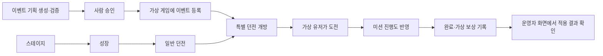

# 가상 게임 도메인 상세 설계서

## 문서 상태와 목적

- 상태: 설계 기준 합의, 수치·물리 스키마 미확정
- 목적: 이벤트 기획·검증과 가상 Runtime이 공통으로 사용할 최소 게임 규칙과 데이터 경계를 정의한다.
- 범위: 기준 게임 정체성, 게임 루프, 콘텐츠·미션·보상·세그먼트 모델, 데이터 출처와 버전 원칙
- 제외: 물리 DB 구조·최종 JSON Schema·API 경로와 요청/응답, Agent Workflow, 운영 오류 재시도·복구 정책, 배포 기술 선택
- 상위 기준: [최상위 시스템 설계서](최상위_시스템_설계서.md) §§2, 4–8, 18
- 문서 계층: 최상위 시스템 설계서의 하위 기준 문서이며, 게임 세부 설계서 7개의 상위 문서
- 하위 설계 전략: [가상 게임 도메인 하위 설계서 7종 작성 전략](하위설계_작성전략_임시.md)

게임 장르·최소 행동·논리 계약과 검증 방향은 상위 도메인 기준이다. 이 문서는 규칙의 의미, 책임, 허용 조합 및 상태 전이 원칙까지만 정한다. 구체 수치, 데이터 fixture, 최종 직렬화 형식, 물리 API·DB 구조·화면 동작은 7개 하위 설계서에서 구체화한다. 미결 항목은 결정 목록과 해당 하위 설계에 연결한다.

## 1. 상위 설계에서 상속한 기준

- 가상 게임은 기존 구현·기획의 컨셉을 이어받는 모바일 방치형 RPG로 설계한다. 특정 상용 게임을 복제하지 않는다.
- 시스템의 목적은 이벤트 기획안을 게임 규칙·데이터에 근거해 검증하고, 승인 후 가상 Runtime에서 진행·보상 기록을 확인하는 것이다.
- 설계 데이터(게임 규칙·콘텐츠·아이템)와 Runtime 상태(등록 이벤트·유저 진행·보상 기록)는 소유권을 구분한다.
- 상용 게임 계정이나 실제 경제에 쓰기 작업을 하지 않는다.
- 최상위 설계서의 구현 현황에는 Opong 데이터 경로와 Clash 공개 표본 경로가 함께 기록되어 있다. 이 하위 설계는 기존 컨셉을 잇는 자체 가상 게임 카탈로그를 목표로 삼고, Clash 경로는 현재 게임·시연 범위에서 제외한다.

## 2. 도메인 경계와 사용자

| 개념 | 책임 | 이 문서에서 정할 것 |
|---|---|---|
| 가상 게임 카탈로그 | 기획 생성·검증에 필요한 정적 규칙과 참조 데이터 | 게임 버전, 콘텐츠·아이템·세그먼트의 의미 |
| 이벤트 기획 | 목표·기간·대상·미션·보상을 게임 규칙과 대조 | 미션 판정 가능성 및 보상 유효성에 필요한 입력 |
| 가상 Runtime | 승인된 이벤트와 가상 유저 행동의 상태를 관리 | 이 문서에서는 도메인 의미만 정의하고 저장·처리 계약은 Runtime 설계에 위임 |
| 운영자 | 이벤트를 요청·검토·승인하고 진행 결과를 확인 | 운영자가 이해할 수 있는 규칙·제약 표현 |
| 가상 유저 | 정해진 행동을 수행하는 테스트 주체 | 세그먼트·성장 상태와 행동 측정 기준 |

## 3. 기준 게임 방향

### 기존 컨셉과 재사용 범위

| 설계 방향 | 확인된 입력 자료 | 기대 효과 | 후속 확인 |
|---|---|---|---|
| 기존 Opong Heroes 이름·세계관 컨셉을 이어받고 규칙 데이터를 재설계 | 보존 기획은 Opong Heroes를 모바일 판타지 RPG로 설정하고 이벤트 기획·검수, 성장·던전 규칙, 아이템 보상, 승인 흐름을 정의함. 최상위 설계는 자체 규칙의 가상 게임과 Opong 데이터 경로를 기록함 | 세계관 연속성을 유지하면서 이벤트 기획·검증에 필요한 데이터는 명시적으로 통제 가능 | 기존 규칙·성장·보상 데이터를 얼마나 재사용할지, 데이터 정확성과 기준 원천 |

**설계 기준 방향:** 기존 구현·기획에서 **게임 이름과 세계관 컨셉은 이어받고**, 게임 유형은 **모바일 방치형 RPG**로 한다. 게임 규칙·성장·콘텐츠·재화 데이터는 이벤트 기획과 검증에 직접 영향을 주므로 이름·세계관과 분리해 별도 규칙 데이터로 설계한다. 핵심 시연 목적은 승인된 이벤트 기획안이 게임에 적용되어 실제 미션 진행과 보상 기록으로 이어지는 모습을 명확하고 인상적으로 보여주는 것이다.

기존 이름·세계관 컨셉은 출발점으로 유지한다. 기존 규칙 데이터는 자동 승계하지 않고, 아래에서 정의할 게임 도메인·스키마·버전 기준에 맞는지 검토한 뒤 재사용하거나 재구성한다. 이로써 세계관의 연속성과 검증 가능한 게임 규칙의 권위를 분리한다.

외부 게임과의 연동 및 외부 게임 분석은 현 설계 범위에 넣지 않는다. 나중에 필요해질 경우를 위해 게임 기능과 이벤트 적용 계약을 분리하고, 어댑터를 추가할 수 있는 경계만 고려한다. Clash 공개 표본을 기준 규칙이나 현재 목표의 일부로 취급하지 않는다.

## 4. 최소 게임 구조

시연에 필요한 범위를 다음 네 축으로 제한한다. 이는 상용 RPG의 전체 시스템이 아니라 이벤트 적용을 보여주기 위한 가상 게임의 최소 플레이 구조다.

| 게임 축 | 최소 기능 | 이벤트 기획·시연에서의 역할 |
|---|---|---|
| 스테이지 | 순차 진행·클리어, 구간 해금, 권장 성장 기준 | 특정 구간 도달/스테이지 클리어 미션, 캠페인 성장 기준 검증 |
| 일반 던전 | 던전 유형·난이도, 입장 기준, 일일 도전 수, 완료 결과 | 던전 클리어·도전 미션, 유저별 입장 가능성과 기간 내 완료 가능성 검증 |
| 이벤트 특별 공간 | 승인 이벤트가 여는 특별 던전 1종, 단계/보스 진행과 결과 | 기획안 적용이 눈에 보이는 핵심 장면: 등록 후 공간이 열리고, 유저 도전 결과가 이벤트 미션에 반영 |
| 성장 | **영웅 레벨**을 MVP의 핵심 판정 지표로 삼고, 전투력은 레벨에서 파생되는 시각·전투 지표로 둠 | 성장 목표 미션과 일반 던전·스테이지 입장 가능성 검증을 하나의 성장 기준으로 설명 |

특별 공간은 우선 특별 던전 한 유형으로 시작한다. 시간과 구현 여유가 생기면 이벤트 구조를 바꾸지 않고 공간 유형을 추가할 수 있는지 검토한다. 출석·상점·수집 등 다른 유형은 현재 MVP에 포함하지 않는다.

### 4.1 MVP에서 지원할 게임 행동

최소 게임 구조를 이벤트 기획 포맷에 연결하기 위해 다음 행동을 게임의 정식 행동 카탈로그로 둔다.

| 행동 코드 | 발생 조건 | 판정·집계 필드 | 이벤트 미션 예 |
|---|---|---|---|
| `stage_cleared` | 스테이지 전투를 성공적으로 완료 | action_id, user_id, stage_id, stage_index, result, occurred_at | 최고 클리어 구간 도달 또는 기간 중 스테이지 X회 클리어 |
| `dungeon_cleared` | 입장 조건을 충족해 일반 던전을 성공 완료 | action_id, user_id, dungeon_id, difficulty_id, result, occurred_at | 지정 던전/난이도 N회 완료 |
| `special_dungeon_progressed` | 이벤트 특별 던전의 층을 완료하거나 보스를 처치 | action_id, user_id, event_id, venue_id, floor_id, floor_index, progress_type, result, occurred_at | 최고 층 도달 또는 보스 처치 |
| `growth_milestone_reached` | 게임 규칙에 따라 영웅 레벨 임계치를 통과 | action_id, user_id, before_level, after_level, milestone_level, occurred_at | 이벤트 기간 중 영웅 레벨 목표 달성 |

이벤트 기획자는 이 코드들을 임의 문자열로 작성하지 않고, 버전이 있는 행동 카탈로그에서 선택한다. 미션은 행동 코드와 허용된 콘텐츠·단위·목표만 조합한다. 현재 MVP 제안은 방치 보상 수령, 출석, 장비 강화를 제외하지만, 장르 정체성에 직접 영향이 있어 방치 보상 수령은 공개 사례 조사 후 포함 여부를 별도 결정한다(GD-09). 출석·장비 강화는 계속 범위 밖이다.

MVP 성장 규칙은 영웅 레벨을 유일한 권위 성장 지표로 두고, 성장 행동의 경험치 획득량과 레벨 임계치는 게임 데이터로 관리한다. 스테이지와 던전의 입장 조건도 우선 레벨을 기준으로 한다. 전투력은 시연 표현이나 전투 계산에 사용할 수 있지만, 별도 성장 판정 기준을 만들지 않아 규칙 중복을 피한다.

스테이지 N 도달 미션은 `stage_cleared` 기록 중 가장 높은 `stage_index`가 N 이상인지 평가한다. 스테이지 N회 클리어 미션은 기간 내 해당 스테이지의 성공 기록 수를 센다. 일반·특별 던전 행동은 MVP에서 성공적으로 완료한 도전만 미션 진척으로 집계하며, 입장·실패 시도 횟수 미션은 지원하지 않는다. 특별 던전의 `progress_type`은 `floor_cleared` 또는 `boss_defeated`로 제한한다. 성장 마일스톤은 레벨 임계치 통과만 판정하고, 한 행동으로 여러 레벨을 올리면 통과한 임계치 각각을 기록하되 같은 임계치는 한 유저에게 한 번만 인정한다.

모든 `occurred_at`, `start_at`, `end_at`은 UTC 시각으로 저장한다. 이벤트 비교는 UTC `[start_at, end_at)`로 한다. MVP 게임 일은 `Asia/Seoul` 00:00:00에 초기화하며 규칙 세트에 저장해 판정에 사용한다. 명령마다 서버 판정 시각을 한 번 고정하고 같은 원자 처리 안에서 이벤트 활성·시도권·행동 시각을 평가한다. `growth_milestone_reached`는 경험치가 적용된 원본 성공 행동에서 파생하며, 해당 원본 `action_id`를 참조한다. 한 행동으로 여러 임계치를 통과하면 임계치별 파생 기록을 만들고, 각 기록 ID는 원본 행동과 임계치 ID로 안정적으로 식별한다.

### 4.2 게임 규칙 데이터 계약

MVP 규칙은 데이터와 결정적 판정 로직으로 나눈다. 데이터는 콘텐츠 목록·레벨 임계치·행동별 경험치·입장 레벨·시도 제한·보상 경제 기준을 담고, 엔진은 이를 읽어 유저 행동의 허용 여부와 결과를 계산한다. LLM이나 화면 코드는 이 판정의 권위자가 아니다.

| 데이터 집합 | 필수 내용 | 판정에 쓰는 규칙 |
|---|---|---|
| 성장 규칙 | 시작 레벨, 누적 경험치 임계치, 게임 행동별 경험치 획득량 | 누적 경험치에서 영웅 레벨을 결정하고 레벨 임계치 통과 행동을 생성 |
| 스테이지 카탈로그 | 순번, 콘텐츠 ID, 해금 레벨, 클리어 레벨, 성공 보상/경험치 정의 | 직전 구간 해금 및 성공 클리어 후 최고 진행 구간 갱신 |
| 일반 던전 카탈로그 | 유형·난이도·입장 레벨·클리어 레벨·일일 시도 수·보상/경험치 정의 | 입장 가능 여부와 성공 완료 결과 결정 |
| 특별 던전 템플릿 | 템플릿 ID, 층 구성, 보스 층, 층별 입장/클리어 레벨, 시도 수, 연출 테마 참조 | 승인된 이벤트 설정이 지정한 템플릿 인스턴스 생성 |
| 세그먼트 프로필 | 자격 조건, 시작 레벨 분포/대표값, 기준 일일 행동량·도전 사용량 | 대상 자격 및 이벤트 유형별 기준 달성량 계산 |
| 경제 카탈로그 | 재화·아이템, 생성원·소비처, 보유 한도, 기간별 기준 획득량 | 보상 영향 계산과 가상 보상 지급 가능 여부 |

모든 실제 수치는 버전이 있는 게임 데이터 스냅샷에 둔다. 이 문서는 스키마·판정 방식과 필수 필드를 정하고, 밸런스 숫자는 예시 시나리오를 검토한 뒤 데이터 설계에서 채운다.

#### 판정 재현성과 기록 기준

- 한 플레이 명령은 하나의 `game_ruleset_version`과 `game_data_snapshot_id`를 고정해 판정한다. 배포 중 활성 버전이 바뀌어도 처리 중인 명령의 입력을 섞지 않는다.
- 성공/실패·경험치·행동 기록·미션 진척·보상 기록은 Runtime이 서버 상태에서 산출한다. 클라이언트가 제시한 결과, 수량, 시각은 권위 근거가 아니다.
- 행동 사실은 원 명령과 버전·서버 시각을 추적할 수 있어야 하며, 파생 성장·미션·보상 사실은 원 `action_id` 또는 완료 근거에 연결한다.
- MVP의 게임 판정은 난수를 사용하지 않는 결정적 규칙으로 둔다. 향후 권위 판정 난수가 필요해지면 규칙 버전을 올리고 난수 알고리즘/seed 재현 계약을 함께 추가한다.
- 기간은 UTC 기준 `[start_at, end_at)`로 판정한다. 일일 초기화는 규칙 버전에 시간대와 경계를 명시하며 호스트 로컬 시간에 의존하지 않는다.

물리 필드·멱등 키·원자 저장 방식은 7개 하위 설계서에서 확정한다. 위 항목은 그 구현 선택을 제한하는 도메인 불변 조건이다.

도메인 규칙은 재현 가능하도록 결정적으로 처리한다.

- 가상 유저는 지정된 유저 프로필의 시작 레벨과 누적 경험치로 시작한다. 스테이지·던전 성공 결과가 카탈로그의 경험치를 지급하고, 누적 경험치가 임계치를 넘으면 레벨을 갱신한다.
- 다음 미개방 스테이지는 직전 스테이지 클리어와 해당 스테이지의 `unlock_level`을 모두 만족하면 도전할 수 있다. `clear_level` 이상이면 성공, 그 미만이면 실패한다. 이미 클리어한 스테이지는 재도전할 수 있고, 반복 완료는 횟수 미션에서 별도 기록된다.
- 일반 던전은 `entry_level`을 충족해야 입장한다. 입장 시 일일 시도권을 소비하고, `clear_level` 이상이면 성공한다. 일일 초기화 경계는 ruleset의 게임 시간대 설정을 따른다. 성공만 `dungeon_cleared`를 생성하고 실패 시도는 미션 진척을 만들지 않는다.
- 특별 던전은 이벤트 스케줄과 승인된 템플릿 참조로 활성화한다. 각 층은 `entry_level`과 `clear_level`로 판정하고, 시도 시작 시 일일 시도권을 소비한다. MVP는 별도 입장 비용을 부과하지 않는다. 시도권은 ruleset의 게임 일 경계에 초기화되며, 층 완료/보스 처치만 `special_dungeon_progressed` 행동을 생성한다. 이벤트 미션 보상 외의 별도 특별 던전 보상은 카탈로그에 정의된 경우에만 지급한다.
- 한 유효 도전은 서버가 판정해 `ActionAttempt`로 남긴다. 성공한 도전만 미션 집계용 `ActionRecord`를 만들며, 실패는 Attempt/시도권 차감만 남긴다. 클라이언트가 보낸 `result`, 레벨, 보상 수량을 그대로 신뢰하지 않는다.

### 4.3 시연 루프



시연의 임팩트는 게임 콘텐츠의 양보다 **기획안의 설정이 등록 가능한 콘텐츠로 변환되고, 플레이 행동이 미션 진행과 가상 보상 기록을 바꾸는 인과관계**에서 만든다. 권장 연출은 잠긴 공간을 먼저 보여준 뒤 이벤트 등록 응답이 성공했을 때 특별 던전이 빛·문 개방 애니메이션과 짧은 효과음으로 열리는 장면, 도전 중 보스 체력·층 진행·미션 게이지가 행동 결과에 맞춰 변하는 장면, 완료 후 보상 카드가 공개되고 기록에 남는 장면이다. 시각·음향 연출은 실제 판정 상태를 표현해야 하며, 연출 자체가 진행이나 보상을 확정하지 않는다. 효과음은 끌 수 있게 하고, 네트워크 오류나 적용 실패 시 성공 연출을 재생하지 않는다.

## 5. 게임 구조와 이벤트 기획 포맷의 연결

게임 구조를 먼저 기능·행동 기준으로 정의하고, 이벤트 기획안은 그 기능을 조합해 유효한 이벤트를 표현하게 한다. 게임에 없는 콘텐츠나 측정할 수 없는 행동은 기획 포맷에서 선택할 수 없어야 한다.

권장 설계 관계:

1. **버전이 있는 게임 규칙 카탈로그**가 콘텐츠 유형, 행동 유형, 입장 조건, 성장 기준, 보상 정의를 제공한다.
2. **이벤트 기획 포맷**은 기간·대상·이벤트 공간·미션·보상 계획을 담고 카탈로그 식별자만 참조한다.
3. **검증기**는 스키마 유효성, 참조 유효성, 대상 유저의 성장·해금, 기간 내 달성 가능성, 보상 영향 분석 결과를 만든다.
4. **승인된 이벤트 설정**은 검증된 기획 결과와 참조한 스키마·게임 데이터 버전을 고정해 적용 요청으로 전달한다.
5. **가상 게임 Runtime**은 허용된 행동 결과를 이벤트 미션에 집계하고 진행도·완료·가상 보상 기록을 만든다.

이벤트 설정의 개념적 최소 필드는 아래와 같다. 이는 최종 JSON Schema가 아니라 후속 스키마 설계의 계약 경계다.

| 구성 | 의미 | 게임 구조가 제공해야 하는 근거 |
|---|---|---|
| 이벤트 유형 | `growth_progression`, `dungeon_challenge`, `special_dungeon` 중 어떤 검증 프로필을 적용하는가 | 버전 있는 event type 목록과 유형별 필수 필드·검증 규칙 |
| 대상·기간 | 누가 언제 참여할 수 있는가 | 세그먼트 스키마, 이벤트 기간 규칙 |
| 공간 설정 | 어떤 이벤트 공간 템플릿을 어떤 파라미터로 여는가 | `venue.template_id`와 해당 템플릿의 파라미터 스키마·개방 조건 |
| 미션 목록 | 어떤 행동을 얼마만큼 하면 달성되는가 | 행동 카탈로그, 콘텐츠 유형, 측정 단위, 집계·완료 규칙 |
| 보상 계획 | 완료 시 무엇을 얼마나 기록하는가 | 보상 카탈로그, 경제 영향 지표와 상한 |
| 검증 근거 | 왜 가능한 기획인지 | 스키마 버전, 게임 규칙·데이터 버전, 성장·해금·기간 근거 |

이벤트 기획 포맷은 게임 전체의 임의 규칙을 새로 만드는 언어가 아니다. 게임에서 허용한 기능을 설정하는 제한된 선언형 구성으로 두고, 이벤트 특별 던전은 사전 정의된 템플릿의 안전한 파라미터만 받도록 한다. 따라서 게임 구조 설계의 핵심 산출물은 기능 카탈로그, 템플릿별 입력 스키마, 판정 가능한 행동 계약이다.

### 5.1 논리 계약 예시

다음은 이벤트 계약의 자료형·참조 관계를 설명하는 예시다. ID와 날짜, 목표 수량은 구조 예시이며 밸런스 확정값이 아니다.

```yaml
event_id: "event.demo.special-dungeon"
event_schema_version: "1.0"
event_type: special_dungeon
schedule:
  start_at: "<ISO-8601 UTC 시작 시각>"
  end_at: "<ISO-8601 UTC 종료 시각>"
audience:
  segment_id: "segment.new-player"
venue:
  template_id: "venue.special-dungeon.v1"
  layout_id: "layout.floors.v1"
  theme_id: "theme.event.demo"
  difficulty_id: "difficulty.normal"
missions:
  - mission_id: "mission.clear-boss"
    action:
      action_type: special_dungeon_progressed
      filters:
        progress_type: boss_defeated
    goal:
      metric: count
      aggregation: count
      operator: gte
      target: 1 # 구조 예시이며 밸런스 수치 확정이 아님
rewards:
  - reward_id: "reward.clear-boss"
    mission_id: "mission.clear-boss"
    grant_on: mission_completed
    items:
      - item_id: "item.demo"
        quantity: 1 # 구조 예시이며 밸런스 수치 확정이 아님
references:
  domain_schema_version: "<게임 카탈로그 스키마 버전>"
  game_ruleset_version: "<규칙 세트 버전>"
  game_data_snapshot_id: "<검증에 사용한 데이터 스냅샷>"
```

`event_schema_version`은 이벤트 문서 최상위에서, `domain_schema_version`, `game_ruleset_version`, `game_data_snapshot_id`는 `references`에서 각각 관리한다. `event_type`은 `growth_progression`, `dungeon_challenge`, `special_dungeon` 중 하나다. 모든 미션은 action type에 맞는 `filters`와 `goal`을 가져야 한다. 각 reward는 하나의 `mission_id`와 `grant_on: mission_completed`에 연결되며, 완료된 미션당 유저별 한 번만 지급한다.

이벤트 유형별 필수 계약은 다음과 같다.

| 이벤트 유형 | 필수 미션 | 공간 설정 | 평가 프로필 |
|---|---|---|---|
| `growth_progression` | `growth_milestone_reached` 또는 `stage_cleared` 1개 이상 | 사용하지 않음 | 영웅 레벨·경험치·스테이지 해금 |
| `dungeon_challenge` | `dungeon_cleared` 1개 이상 | 사용하지 않음 | 시작 레벨·입장/클리어 기준·시도권·기준 도전 사용량 |
| `special_dungeon` | `special_dungeon_progressed` 1개 이상 | `venue` 필수 | 입장/클리어 기준·기간·층 구성·도전 가능량 |

한 이벤트에는 보조 미션을 추가할 수 있지만 모든 미션은 등록된 행동·집계 타입이어야 한다. 특별 던전 이외 유형에 `venue`를 넣는 것은 스키마 오류로 차단한다.

도메인 경계에서 정할 것은 어떤 의미와 참조가 필수인지다. 아래 예시는 허용 의미와 필수 제약을 표현하는 논리 계약이며, 필드 직렬화·필수성 표기·JSON Schema·API 요청/응답·DB 구조를 확정하지 않는다. 구체 모델은 데이터·스키마, 저장소·DB, Runtime·API 하위 설계에서 각각 정한다.

### 5.2 게임 행동과 이벤트 Runtime 간 논리 계약

이 절은 미션 진행 판정에 필요한 의미와 불변 조건을 정한다. 행동 레코드의 물리 필드명, 저장 테이블, API 경로·응답 본문은 하위 설계에서 결정한다.

- Runtime은 성공한 게임 행동을 식별 가능한 행동 기록으로 남긴다. 최소 의미 필드는 행동 ID, 가상 유저 ID, 행동 유형, 콘텐츠 ID, 결과, UTC 발생 시각, 사용한 규칙·데이터 버전이다. 파생 성장 기록에는 원본 행동 ID와 임계치 식별자를 둔다.
- 명령은 `stage_challenge`, `dungeon_challenge`, `special_dungeon_challenge`로 입력하고, 성공 사실은 기존 네 action type으로 기록한다. 유효한 도전 시도는 성공·실패 모두 `ActionAttempt`로 남긴다. 시도권을 소비한 뒤의 실패는 Attempt와 시도권만 확정하며 미션/성장/보상은 변경하지 않는다. 입장 조건을 충족하지 못한 거절은 시도권을 소비하지 않고 Attempt도 만들지 않는다.
- 행동 유형과 결과 필드는 버전 있는 게임 행동 카탈로그에 맞아야 한다. 미지원 행동이나 검증되지 않은 클라이언트 입력은 미션 진행 근거로 사용하지 않는다.
- 미션 정의는 카탈로그의 행동 유형과 필터, 집계 단위·목표·기간을 참조한다.
- MVP에서 허용하는 집계 타입은 `count`, `max`, 비교 연산자는 `gte`다. `count`는 조건에 맞는 성공 기록의 수, `max`는 해당 기간에 기록된 숫자 필드의 최댓값이다. 허용 조합은 아래와 같고, 목록에 없는 행동·집계 조합은 검증에서 차단한다.

| action_type | 허용 filters | metric / aggregation | 목표 의미 |
|---|---|---|---|
| `stage_cleared` | 선택적 `stage_id` | 필터 미지정 시 `stage_index` / `max`; stage_id 지정 시 기록 수 / `count` | 지정 구간 도달 또는 특정 스테이지 반복 클리어 |
| `dungeon_cleared` | `dungeon_id`, 선택적 `difficulty_id` | 성공 기록 수 / `count` | 지정 던전/난이도 완료 횟수 |
| `special_dungeon_progressed` | `progress_type`; 이벤트의 `runtime_event_id`가 해당 이벤트 venue 범위로 자동 제한 | `floor_index` / `max` 또는 보스 처치 기록 수 / `count` | 최고 층 도달 또는 보스 처치 횟수 |
| `growth_milestone_reached` | `metric=hero_level` | `after_level` / `max` | 이벤트 기간 중 영웅 레벨 도달 |

각 미션은 `goal: {metric, aggregation, operator: gte, target}`를 갖는다. 평가 구간은 이벤트의 `[start_at, end_at)`이며 개별 미션 기간은 MVP에서 따로 지정하지 않는다. 특별 던전 행동은 명령의 `runtime_event_id`로 현재 이벤트의 venue에 자동 범위화한다. 기획안은 아직 생성되지 않은 Runtime `venue_id`를 직접 정하지 않는다.
- 미션 평가 결과는 이전/새 진행도, 완료 여부, 사용한 행동 기록 ID와 평가 근거를 추적할 수 있어야 한다.
- 같은 행동 기록을 재전송해도 진행도와 보상이 중복 반영되지 않아야 한다. 구체 저장·트랜잭션 방식은 Runtime 설계에서 결정한다.
- 미션 완료와 보상 생성은 동일한 완료 근거와 보상 정의를 연결해야 한다. 오류·부분 실패 복구 방식은 별도 오류·복구 정책에서 정한다.
- MVP 보상 지급은 가상 인벤토리/재화 보유량 갱신과 불변 RewardRecord 생성을 함께 의미한다. 단순 영수증만 남기고 유저 보유 상태를 바꾸지 않는 것은 지급 완료가 아니다.

### 5.3 이벤트 특별 던전 계약

이벤트 기획안은 특별 던전의 동작 코드를 작성하지 않고, 사전 정의된 `venue.template_id`와 해당 템플릿 스키마에 맞는 `layout_id`, `theme_id`, `difficulty_id` 참조만 제공한다. 템플릿과 난이도 데이터는 최소한 입장 레벨, 기간 중 이용 가능 조건, 층/단계 목표, 도전 가능량, 완료 판정과 미션에 전달할 행동 결과를 정의한다. 승인된 설정에 고정한 `game_data_snapshot_id` 및 `game_ruleset_version`을 사용해 검증·활성화한다. Runtime은 승인된 이벤트 버전이 적용된 경우에만 공간을 활성화하며, 시각·음향 효과는 활성화·행동 판정·완료 결과를 표현한다.

MVP는 특별 던전 템플릿 1종을 지원한다. 이벤트 기획은 카탈로그에 있는 `template_id`, `layout_id`, `theme_id`, `difficulty_id`만 선택한다. 자유 실행 코드, 클라이언트가 임의로 지정한 레벨·보상 규칙은 받지 않는다. `layout_id`는 층 순서와 보스 위치를, `theme_id`는 배경·색상·효과음 등 표현 자산을, `difficulty_id`는 레벨 기준과 클리어 판정 데이터를 참조한다. 새 공간 유형 추가는 기존 이벤트 필드를 임의로 확장하지 않고 새 템플릿과 그 입력 스키마를 등록하는 방식으로 확장한다.

### 5.4 이벤트 적용 생명주기 계약

기획 Workflow의 승인 상태와 Runtime 이벤트 상태는 별도 상태로 관리한다. Runtime 이벤트의 최소 상태는 `scheduled`, `active`, `ended`다.

- Runtime은 승인된 `task_id`와 `result_version`을 입력으로 등록한다. 같은 승인 버전이 다시 전달되면 기존 이벤트를 반환해 중복 등록을 막는다. 같은 식별자에 다른 설정 내용이 오면 충돌로 거절한다.
- 등록 후 시작 시각 전에는 `scheduled`, `start_at <= now < end_at`이면 `active`, 종료 시각부터 `ended`다. 모든 시각은 UTC로 비교한다.
- 특별 던전은 해당 이벤트가 `active`일 때만 열리고, 이벤트 종료 이후에는 새 행동을 받지 않는다.
- 유저는 활성 시간 중 특별 던전 진입 또는 이벤트 미션 대상 행동을 처음 요청할 때 세그먼트 자격을 검사한다. 자격을 통과한 시점에 참여 스냅샷을 고정하고, 이후 진행도는 그 참여 기준과 이벤트의 고정 버전으로 계산한다. 자격 미충족 요청은 참여를 만들지 않으며 이후 재검사를 허용한다.
- 미션 완료 시 연결된 가상 보상 기록을 자동 생성한다. 동일 유저·이벤트·미션·보상 조합은 한 번만 지급한다.
- 보상 지급은 가상 유저 보유 상태와 원장을 함께 갱신하며, 완료 상태·보유량 증가·RewardRecord는 원자 처리한다.
- 종료 뒤 이벤트 설정·진행·보상 기록은 조회 가능하되, 진행·보상 변경은 허용하지 않는다. 수정이 필요하면 새로운 승인 결과 버전을 등록한다.

구체 API 경로, DB 유니크 키 및 트랜잭션 구현은 API·Runtime 상세 설계에서 정한다. 이 절은 상태 의미와 중복·시점 계약을 정의한다.

### 5.5 MVP에서 검증할 대표 이벤트

하나의 대표 시나리오로 모든 연결을 확인한다. 실제 수치와 명칭은 기준 데이터 설계 때 정한다.

이벤트 검증 프로필은 `growth_progression`, `dungeon_challenge`, `special_dungeon` 세 유형으로 둔다. 유형은 주된 콘텐츠와 달성 가능성 평가 규칙을 고른다. 각 이벤트는 해당 프로필의 필수 미션 하나 이상을 포함하고, 다른 프로필에서 허용한 보조 미션을 함께 둘 수 있다. 모든 미션은 동일한 이벤트 기간·대상 유저·고정된 규칙 및 데이터 버전을 사용한다. 특별 던전 프로필은 `venue` 설정이 필수이며 다른 두 프로필은 특별 공간 설정을 받지 않는다.

- 신규 또는 선택된 가상 유저 세그먼트를 지정한다.
- 이벤트 기간과 특별 던전 접근 조건을 설정한다.
- 특별 던전 단계 진행과 일반 던전 완료/성장 중 지원 행동을 미션으로 구성한다.
- 이벤트 유형에 맞는 가상 유저 성장 프로필·해금 조건·도전 가능 횟수와 대조해 달성 가능성을 검증한다.
- 사람이 승인한 이벤트가 특별 던전을 활성화한다.
- 가상 유저 행동 결과가 진행도에 반영되고 완료 시 가상 보상 기록을 남긴다.
- 운영 화면에서 승인 결과, 열린 공간, 진행도와 보상 기록을 연결해 보여준다.

미션 판정은 브라우저의 임의 화면 연출만으로 확정하지 않는다. 행동 이벤트와 판정 결과는 승인 후 Runtime 설계에서 정의할 서버 측 상태 변경 계약에 연결한다.

## 6. 핵심 도메인 개념 초안

| 개념 | 의미 | 최소 설계 속성(초안) | 결정 필요 |
|---|---|---|---|
| GameDefinition | 기준 게임의 정체성·표시 정보 | game_id, display_name, theme_id | 이름·세계관 메타데이터 |
| GameRuleset | 플레이·성장 판정에 적용되는 규칙 묶음 | game_ruleset_version, game_day_timezone, daily_reset_time, progression_rules, content_rules | MVP 기본 게임 일은 Asia/Seoul 00:00:00; 규칙 버전 |
| GameCapability | 게임이 지원하는 콘텐츠·행동의 기능 카탈로그 | capability_id, content_type, action_type, rule_version | MVP 지원 목록과 확장 호환성 |
| Content | 스테이지·던전·이벤트 특별 공간 | content_id, type, unlock_condition, availability | 특별 던전 구성과 개방/입장 조건 |
| VenueTemplateDefinition | 특별 던전에서 선택 가능한 레이아웃·테마·난이도 조합 | template_id, layout_id, theme_id, difficulty_id, floors | 파라미터 스키마와 허용 조합 |
| GameActionDefinition | Runtime이 지원하는 가상 유저 행동의 카탈로그 정의 | action_type, payload_schema, allowed_content_types, result_schema | 행동 명칭, 입력·결과 검증, 카탈로그 버전 |
| ActionAttempt | 유효 도전 명령의 성공/실패와 소모 시도 기록 | attempt_id, request_id, user_id, command_type, content_id, result, occurred_at, ruleset_version, data_snapshot_id | 유효 도전과 시도권 중복 방지 |
| ActionRecord | 성공 판정되어 미션 집계에 쓰이는 플레이 행동 사실 | action_id, attempt_id, user_id, action_type, content_id, occurred_at, ruleset_version, data_snapshot_id | 성공 사실 ID와 중복 집계 방지 |
| ProgressionRule | 경험치 획득과 레벨 임계치 규칙 | action_type, xp_delta, level_thresholds | 성장 데이터와 레벨업 규칙 |
| MissionDefinition | 행동을 목표 진척도로 바꾸는 이벤트 미션 | mission_id, action, filters, metric, aggregation, target | 집계·완료 규칙; 평가 기간은 이벤트 기간 |
| EventDefinition | 승인되어 Runtime에 전달하는 불변 이벤트 설정 | event_id, event_type, period, segment, venue, missions, rewards, version_refs | 승인 결과 버전과 적용 가능한 게임 설정의 경계 |
| RuntimeEventInstance | 이벤트 설정의 실제 게임 등록 상태 | runtime_event_id, source_task_id, result_version, status, effective_period | `scheduled`/`active`/`ended` 상태와 중복 등록 |
| EventParticipation | 해당 이벤트에 참여한 가상 유저와 자격 스냅샷 | runtime_event_id, user_id, eligibility_result, profile_snapshot_id | 참여 기준과 상태 고정 시점 |
| MissionProgress | 유저별 미션의 계산된 진척 상태 | runtime_event_id, user_id, mission_id, current_value, completed_at | 집계·완료·재처리 의미 |
| RewardRecord | 콘텐츠 성공/미션 완료로 생성되는 가상 보상 원장 | reward_record_id, grant_source_type, source_id, user_id, item_id, quantity, occurred_at | 유저 보유 상태 반영·source별 중복 방지 |
| ItemDefinition | 보상으로 참조 가능한 아이템 | item_id, name, type, stack_limit | 타입·한도·비활성 아이템 처리 |
| RewardDefinition | 미션 완료 시 기록할 보상 | item_id, quantity, grant_condition | 수량 한도와 중복 지급 조건 |
| EconomyDefinition | 재화 생성·소비·보유·획득 기준 | currency_id, sources, sinks, caps, segment_baseline | MVP 경제 범위와 기준 기간 |
| RewardImpactAssessment | 보상안이 게임 경제에 미치는 계산 결과 | event_id, segment_id, issuance, baseline_ratio, cap_risk, explanation | 추정 참여 인원과 허용 임계치 |
| ValidationIssue | 기획 검증 문제 또는 경고 | severity, code, field_path, message, evidence | 오류 코드 체계와 차단/경고 정책 |
| ValidationResult | 이벤트 전체 검증의 요약 결과 | status, issues, feasibility, reward_impact, version_refs | 필수 검증 단계와 승인 가능 상태 |
| UserSegment | 기획 대상 가상 유저 집합 | segment_id, eligibility, growth_profile | 신규·복귀 정의와 대표 성장 상태 |
| SegmentEvaluationProfile | 가능성 평가용 기준 유저 특성 | segment_id, start_level_profile, daily_action_budget, daily_attempt_usage | 기준 프로필 자료와 보정 방법 |
| GameDataSnapshot | 기획 검증에 사용된 데이터 집합의 식별 | source, version, retrieved_at, checksum | 스냅샷 보존 수준·출처 메타데이터 |

속성 목록은 개념 수준의 용어 사전이다. 필수 논리 필드·허용값·상태 전이는 하위 설계서 계약을 기준으로 하며, 최종 JSON Schema/API 기술 문법만 구현 인터페이스 단계에서 생성·고정한다.

## 7. 미션 판정 설계 기준

### 7.1 검증 파이프라인과 결과

기획 결과는 아래 순서로 검증한다. 앞 단계에서 구조가 유효하지 않으면 뒤 단계의 계산을 수행하지 않고, 각 문제를 필드 경로와 근거에 연결한다.

1. **스키마 검증:** 필수 필드·자료형·허용 이벤트 유형과 템플릿 파라미터 검사
2. **참조 검증:** 행동·콘텐츠·세그먼트·아이템·재화 ID의 존재 및 활성 상태 확인
3. **규칙 검증:** 기간, 입장 조건, 미션 집계 방식, 목표 범위, 보상 제약 확인
4. **달성 가능성 검증:** 이벤트 유형별 성장·해금·기회량·기간에 따른 판정 및 설명 근거 생성
5. **경제 영향 분석:** 예상 지급량과 세그먼트 기준 획득량·보유 상한 비교
6. **승인 가능 상태 산출:** 전체 차단 오류·경고를 취합해 승인 화면에 제공

검증 결과는 공통적으로 `severity`, `code`, `field_path`, 사용자 설명, 계산 근거, 사용한 규칙·데이터 버전을 제공한다. 전체 상태는 `valid`, `warning`, `blocked` 중 하나로 표현한다. `blocked`는 구조·참조·필수 규칙 오류 또는 핵심 평가 입력 누락으로 승인 판단이 불가능한 경우다. 필수 성장·입장·보상 영향 입력이 없으면 차단한다. `warning`은 규칙상 유효하지만 달성 가능성이 위험 경계에 있거나 선택적 집계 정보(예: 예상 참여자 총수)가 없어 일부 경제 지표만 산출할 수 있는 경우다. `valid`는 필수 검증이 모두 완료되고 차단 오류나 경고가 없는 경우다. 차단 오류가 있으면 승인을 진행할 수 없다. 경고를 승인자가 감수할 수 있는 범위와 감사 방식은 승인·권한 설계에서 정한다. 여기서 정의한 것은 기획안의 도메인 유효성·검토 결과이며, 서비스 오류 분류, 재시도, 자동 복구, Safe Stop 정책은 별도 시스템 설계의 책임이다.

| 사례 | 기대 결과 | 이유 |
|---|---|---|
| 특별 던전 유형, 허용된 템플릿/행동/미션/보상 참조, 유효 기간·버전 포함 | `valid` 또는 계산상 `warning` | 계약 구조와 필수 게임 데이터가 유효 |
| 특별 던전 유형인데 `venue` 누락, 미지원 행동/집계 조합, 존재하지 않는 item ID | `blocked` | 구조·참조·규칙 위반은 승인할 수 없음 |
| 목표 층수가 기간·도전 한도에서 가능한 최대 층보다 큼 | `blocked`, feasibility=`unreachable` | 규칙상 목표를 달성할 수 없음 |
| 목표가 프로필 기준 달성량보다 높지만 규칙상 최대치 이내 | `warning`, feasibility=`at_risk` | 낙관적 행동량 또는 성공률이 있어야 달성 가능 |
| 세그먼트 성장곡선 또는 기준 일일 도전 사용량이 없어 가능성 계산 불가 | `blocked`, feasibility=`insufficient_data` | 핵심 달성 가능성 근거가 없음 |
| 예상 전체 참여자 수만 없고 유저별 경제 입력은 있음 | `warning` | 유저별 영향은 제공하고 집단 총량만 생략 |

미션은 자연어 설명만으로는 실행·검증할 수 없으므로 최소한 다음 요소를 갖춰야 한다.

1. **측정 행동:** 어떤 게임 행동이 진척도를 바꾸는가.
2. **대상·조건:** 어떤 콘텐츠, 난이도, 유저 세그먼트에서 유효한가.
3. **목표와 단위:** 횟수, 수량, 완료 여부 등 무엇을 얼마만큼 달성하는가.
4. **집계 규칙:** 누적·최고 기록·연속 달성 중 무엇인가.
5. **기간 규칙:** 이벤트 기간과 일일/주간 초기화의 관계.
6. **완료 의미:** 목표 도달 시 완료가 고정되는지, 취소·정정이 가능한지.
7. **검증 가능성:** 기준 데이터와 Runtime 행동 기록만으로 판정 근거를 재구성할 수 있는가.

미션 유형과 각 요소의 허용값은 기준 게임 루프 및 Runtime의 행동 계약과 함께 정의한다. `unreachable`는 차단 오류, `at_risk`는 경고, 필수 입력 부족에 따른 `insufficient_data`는 차단으로 매핑한다. 예상 참여자 수처럼 선택 집계 지표만 부족하면 보상별·유저별 지표를 제공하고 전체 상태에 경고를 남긴다.

## 8. 세그먼트·달성 가능성 기준

세그먼트는 마케팅 라벨만으로 정의하지 않고 게임 상태에서 판정할 수 있어야 한다. 신규·복귀·기존 유저는 후보 세그먼트다. 달성 가능성은 이벤트 유형별 규칙으로 계산한다. 일반 던전 이벤트는 시작 레벨, 던전 해금 레벨, 이벤트 기간, 일일 시도 횟수와 완료 조건을 고려한다. 성장 이벤트는 시작 레벨과 행동별 경험치·레벨 임계치를 사용하고, 특별 던전 이벤트는 입장 레벨과 단계별 목표를 사용한다.

달성 가능성 계산에 필요한 입력은 세그먼트 자격 규칙, 이벤트 시작 시점의 가상 유저 레벨/상태, 이벤트 기간, 행동별 성장량과 성장 임계치, 콘텐츠 입장·클리어 레벨, 일일 시도 한도, 프로필의 기준 일일 행동량·도전 사용량이다. 각 입력은 규칙 세트 또는 데이터 스냅샷에 출처를 두고, 평가 결과에서 참조할 수 있어야 한다.

MVP는 확률을 가장하지 않고 기준 프로필과 규칙상 최대 가능량을 비교한다. 기준 가능량은 세그먼트 프로필의 기준 일일 행동량·도전 사용량과 레벨 규칙을 적용한 달성량이고, 최대 가능량은 이벤트 기간·일일 제한 안에서 가능한 모든 시도가 기준 클리어 레벨을 충족한다고 가정한 상한이다.

- `reachable`: 입장·해금 조건을 충족하고 목표가 기준 가능량 이내다.
- `at_risk`: 목표가 기준 가능량을 넘지만 규칙상 최대 가능량 이내다. 기준보다 많은 플레이 행동 또는 도전 사용량이 필요하다.
- `unreachable`: 필요한 입장 조건을 기간 안에 충족할 수 없거나 목표가 규칙상 최대 가능량을 넘는다.
- `insufficient_data`: 필수 세그먼트, 성장, 제한, 기준 행동량 데이터가 없거나 버전이 맞지 않아 계산할 수 없다.

이벤트 전체 결과는 필수 미션 결과를 종합한다. 하나라도 `unreachable`이면 전체도 `unreachable`; 그 외 필수 입력 누락이 있으면 `insufficient_data`; 그 외 하나라도 `at_risk`면 `at_risk`; 모든 필수 미션이 `reachable`일 때 `reachable`이다. 수치는 테스트 데이터와 실제 플레이 시나리오로 검증한 뒤 채우고, 확률 기반 평가는 보정 데이터가 확보된 후 별도 확장한다.

## 9. 보상 제약 기준

기획 검증과 Runtime 지급은 같은 보상 카탈로그를 참조하되 책임은 분리한다. 보상 유효성만 확인하는 데 그치지 않고, 가상 게임 경제에 미칠 영향을 계산할 수 있는 데이터 구조를 둔다.

- 기획 검증: 아이템/재화 존재·활성 여부, 수량 범위, 대상 미션 참조, 예상 지급 규모와 게임 경제 대비 영향 계산
- Runtime: 완료 조건 확인 후 가상 보상 기록을 한 번만 생성
- 운영 확인: 어떤 이벤트·미션·유저 행동으로 보상 기록이 생성됐는지 추적

경제 영향 분석 입력은 재화별 생성원·소비처·보유 상한, 세그먼트별 기준 획득량(이벤트와 같은 기간), 미션 보상량, 유저별 예상 수령 횟수, 참여자 수와 산정 근거다. 유저별 최대 지급량은 `미션 보상량 × 그 미션의 최대 수령 횟수`를 보상별로 합산한다. 세그먼트 총 지급량은 `유저별 예상 지급량 × 예상 참여자 수`로 계산한다. 영향 지표는 최소한 (a) 유저별 예상 이벤트 지급량 대비 해당 기간 기준 획득량 비율, (b) 세그먼트 총 지급량, (c) 기존 보유량을 포함한 보유 상한 초과 가능성으로 한다. 예상 참여 인원은 운영자 입력 또는 명시된 추정 규칙과 근거를 함께 보존한다. 필수 보상·기준 획득량·상한 데이터가 없으면 결과는 `insufficient_data`이며, 보조 참여자 추정치만 없는 경우에는 집계 영향을 산출하지 않고 유저별 지표만 제공한다. 영향 지표는 위험 검토 근거이고 정책 임계값은 경제 정책 결정으로 남긴다. MVP는 무료 플레이 핵심 재화 1종과 기존 아이템 보상으로 시작하되, 재화 종류·생성·소비 규칙과 임계값은 밸런스 데이터 검토 후 결정한다.

## 10. 데이터 출처와 버전 원칙

- 기획안 검증 결과는 사용한 게임 데이터 버전 또는 스냅샷 식별자를 참조해야 한다.
- 데이터 출처, 버전, 기준 시점, 검증에 사용한 규칙 버전을 구분한다.
- 이후 외부 게임을 연동하는 경우에는 이 도메인의 자체 규칙 카탈로그와 분리된 어댑터 경계를 둔다. 외부 공개 표본은 현재 MVP 입력이나 권위 있는 게임 규칙으로 사용하지 않는다.
- 오래되거나 불완전한 데이터로 검증한 경우 이를 결과에 표시할 수 있어야 한다.
- 기준 데이터가 바뀌어도 이미 승인된 기획 결과를 사후에 조용히 변경하지 않는다. 새 버전으로 재검증할지 여부는 기획·Runtime 설계에서 결정한다.

게임 데이터와 계약을 코드 상수에 숨기지 않고 명시적인 스키마로 관리한다. 적어도 다음 버전 식별자를 분리한다.

| 식별자 | 버전 대상 | 목적 |
|---|---|---|
| `domain_schema_version` | 게임 카탈로그·행동·콘텐츠·재화 구조의 스키마 | 데이터 구조 해석과 마이그레이션 |
| `event_schema_version` | 이벤트 기획 입력·승인된 설정 구조 | 이벤트 생성·검증·Runtime 적용 간 호환성 |
| `game_ruleset_version` | 게임 규칙·성장·입장·미션 판정 규칙 | 동일한 기획의 검증 결과 재현 |
| `game_data_snapshot_id` | 특정 시점의 카탈로그 데이터 | 검증과 승인에서 실제 사용한 게임 데이터 보존 |

승인된 이벤트는 이 식별자들을 참조해야 한다. 구조 변경은 스키마 마이그레이션·호환성 검증을 거치고, 규칙/데이터 변경은 스키마 버전과 구분한다. 스키마 레지스트리의 파일 형식, 호환성 정책, 저장 위치는 시스템/API 계약 설계에서 결정한다.

## 11. 현재 구현과 목표의 구분

코드 상태의 세부 근거는 [현재 구현 상태](현재_구현상태.md)를 기준으로 보고, 전체 구조와 As-Is/To-Be 요약은 최상위 설계서 §6과 §16을 따른다. 이 도메인 문서는 코드 구현이 완료됐다고 주장하지 않는다. Opong 데이터 조회 경로와 Clash 공개 표본 경로는 코드에 존재하지만, 이 문서의 최종 게임 모델·데이터 품질·Runtime 판정이 구현됐다는 뜻은 아니다.

구현 상세를 다시 확인해야 할 때는 `ik/` 내 최상위 설계서의 확인 경로와 기준 커밋 정보를 갱신한 뒤 그 기준을 사용한다. 이 문서 작업 중 `ik/` 밖의 문서를 기준 자료로 삼지 않는다.

## 12. 결정 목록

| ID | 결정 질문 | 현재 상태 | 완료 기준 |
|---|---|---|---|
| GD-01 | 기존 이름·세계관을 유지하면서 규칙 데이터를 어떤 수준으로 재구성할 것인가? | 이름·세계관 컨셉 계승; 규칙 데이터는 별도 카탈로그로 정의 | 재사용 자산 목록과 버전 있는 기준 데이터 확정 |
| GD-02 | 최소 지원 행동과 미션 유형은 무엇인가? | 네 행동 코드, 서버 권위 판정·기록 근거·결정적 MVP 판정 기준 정의 | 논리 action schema와 경계/중복 행동 기록 fixture 확정 |
| GD-03 | 특별 던전 개방·입장·진행·종료 계약과 연출은 무엇인가? | 템플릿 선택, 등록 멱등성, 예약/활성/종료 및 미션·보상 연결 의미 정의 | 물리 API·저장 계약과 화면 상태 연결 확정 |
| GD-04 | 이벤트 유형별 달성 가능성은 어떻게 판단할 것인가? | 기준 가능량/최대 가능량 비교와 결과 상태 정의 | 프로필 데이터 fixture와 유형별 수용 사례·수치 검증 |
| GD-05 | 재화 시스템과 보상 영향 계산의 기준은 무엇인가? | 유저별 지급량, 기준 획득량 비율, 집단 총량, 보유 상한 지표 정의 | MVP 재화·아이템 수치와 경제 기준 데이터 채움 |
| GD-06 | 게임 도메인 및 이벤트 포맷 스키마와 버전을 어떻게 관리할 것인가? | 네 버전 식별자, 이벤트 참조 구조, 판정 입력 버전 고정 원칙 정의 | 최종 JSON Schema·호환성·저장·마이그레이션 정책 확정 |
| GD-07 | 신규·복귀 등 유저 세그먼트의 최소 판정 기준은 무엇인가? | 자격·시작 레벨·기준 행동량·도전 사용량을 입력으로 사용 | 최소 세그먼트 정의와 테스트 프로필 데이터 확정 |
| GD-08 | 외부 게임 분석·연동을 언제 어떤 경계로 검토할 것인가? | 현재 범위 제외, 향후 확장 여지만 고려 | 필요 시 별도 착수 결정 |
| GD-09 | 모바일 방치형 RPG의 장르 정체성을 위해 최소 방치 보상 적립·복귀 수령을 MVP에 포함할 것인가? | 현재 제안에서는 제외. 공개 사례상 오프라인 진행·복귀 보상이 대표적으로 표방되므로 재검토 필요 | 포함/제외 결정과 근거 기록. 포함 시 행동, 데이터, 저장, API, 경제, 검증, 화면 설계를 함께 갱신 |

## 13. 하위 설계서로 넘길 기준

이 문서는 게임 도메인의 상위 상세 설계 기준이다. 아래 하위 설계서는 이 문서의 규칙·경계·논리 계약을 구현 가능한 상세로 구체화하며, 상위 기준과 다른 선택이 필요하면 이 문서의 결정 목록과 최상위 시스템 설계를 함께 갱신한다.

| 하위 설계서 | 이 문서에서 이어받는 기준 | 하위 설계에서 확정할 사항 |
|---|---|---|
| 1. [게임 규칙·플레이 루프](게임설계/01_게임규칙_플레이루프.md) | §§3–5의 게임 유형, 콘텐츠 축, 행동 의미, 이벤트 유형 | 플레이 순서·전투 및 클리어 판정·성장 수치 적용 방식·대표 시나리오 |
| 2. [게임 데이터·스키마](게임설계/02_게임데이터_스키마.md) | §§4.2, 5.1–5.3, 6, 10의 데이터 의미·참조·버전 | 정규 데이터 모델, 실제 필드·제약, JSON Schema, 유효/무효 fixture, 호환성 |
| 3. [게임 저장소·DB](게임설계/03_게임저장소_DB.md) | §§2, 5.2–5.4, 6의 데이터 소유권·상태 개념·불변 조건 | 카탈로그와 Runtime 저장 분리, 테이블/키/관계, 트랜잭션, 초기화·마이그레이션 |
| 4. [게임 Runtime·API](게임설계/04_게임Runtime_API.md) | §§5.2, 5.4, 6의 행동·집계·상태 전이 의미 | API 요청/응답, 서버 판정 순서, 멱등성 키, 진행·완료·보상 처리 |
| 5. [이벤트 적용 계약](게임설계/05_이벤트적용_계약.md) | §§5.1, 5.3–5.5의 승인 결과 참조·공간 구성·적용 의미 | 기획 결과에서 Runtime 설정으로의 매핑, 호환성 검사, 적용·거절 응답 및 원자성 |
| 6. [게임 화면·시연](게임설계/06_게임화면_시연.md) | §§3–5의 시연 목표와 대표 게임 흐름 | 화면 정보 구조, 입력·상태·피드백, 연출과 실제 Runtime 결과 간 연결 |
| 7. [게임 검증·밸런스](게임설계/07_게임검증_밸런스.md) | §§7–10의 유효성·달성 가능성·보상 영향·버전 원칙 | fixture 수치, 세그먼트별 계산 예시, 위험 임계값 제안, 재현 가능한 수용 시나리오 |

하위 설계 전반에 걸친 미결 항목은 §12의 GD-01–GD-08에서 추적한다. 물리 저장·요청/응답·재시도·복구 수단은 관련 하위 설계와 시스템 오류·복구 설계에서 정하며, 이 문서의 논리 규칙을 물리 구현 결정으로 간주하지 않는다.

## 참고 문서

- [최상위 시스템 설계서 §§4, 8, 18](최상위_시스템_설계서.md#4-기능-범위와-제외-범위)
- [하위 설계서 작성 전략 (임시)](하위설계_작성전략_임시.md)
- [가상 게임 도메인 작성 참고 맵](README.md#하위-설계-작성-참고-맵)
- [방치형 RPG 공개 자료와 설계 참고 패턴](게임설계/참고자료_방치형RPG_패턴.md)
- 보존 자료: [이벤트 기획안 §5](pre/이벤트_기획안.md#5-가상-게임-설정-및-테스트-데이터), [개발 기획안 §4-1](pre/개발_기획안.md#4-1-tiny_heroesjson-이벤트-대상별-mock-성장-기준-데이터), [개발 기획안 §15](pre/개발_기획안.md#15-mcp-server-tool)
