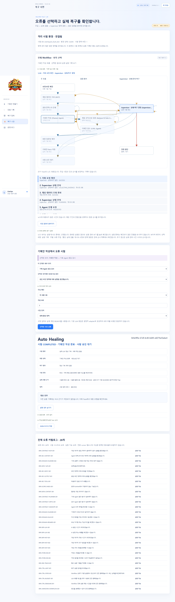
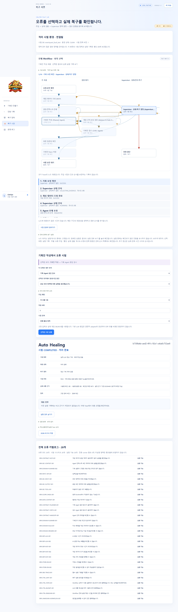
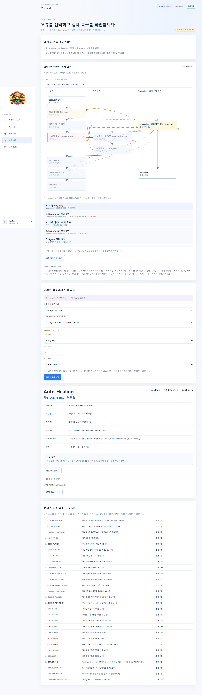
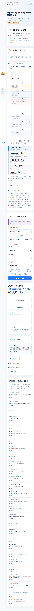
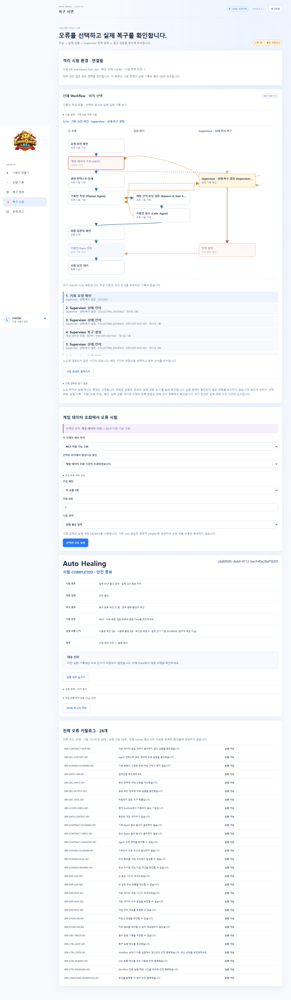

# 실제 LLM 보완 후 재시험 결과

상태: **19/19 PASS · 변경 영향 Python 195 PASS · Edge 5 PASS** · 2026-10-13

## 1. 목적과 보완

[중단 기록](2026-10-13_실제LLM_재시험_중단기록.md)의 6 PASS/1 FAIL을 보존하고 문제를 수정한 뒤 기존 실제 LLM 시험 방식으로 19건을 새로 실행했다. 기존 FAIL을 PASS로 덮어쓰지 않았다. 가이드 「배포 및 장애 복구 보고서」의 장애 주입 증거와 현재 복구 시연 UI의 결과 일치를 함께 확인한다.

1. Critic에 `findings(kind, field_path, reason)`를 추가하고, 이미 기록된 미지원/데이터 부족과 별도의 의미 모순을 구분하도록 프롬프트와 provider 계약을 수정했다.
2. Supervisor가 기존 SCOPE blocking finding과 경로가 일치하는 중복 REVIEW만 조정한다. 원래 REVIEW·사유·finding과 암호화 원문은 보존하고 서버 대조 근거를 기록한다. 의미 모순·보안·알 수 없는 경로·실행 가능한 Plan은 조정 대상이 아니다.
3. 복구 시연 UI에 `WAITING_REVIEW=사람 검토 대기`를 추가했다. 기존 실패 기록은 FAIL로 보존하면서 종료 설명만 올바르게 표시한다.
4. 설명 오류 주입도 실제 Critic 출력 계약에 맞는 SEMANTIC finding을 전달한다. 단위 시험을 CI core 목록에 등록했다.

세부 계약: [검증·평가 설계](../기획안설계/03_검증_평가_피드백_설계.md#2026-10-13-미지원-결과와-critic-검토의-구분), [Workflow](../기획안설계/02_멀티에이전트_Workflow_설계.md), [게임 기능 계약](../기획안설계/01_기획안_게임기능_계약_설계.md).

## 2. 실행 환경과 증거 구분

- 브랜치 ikonly, HEAD `a0a40f466c79b1502e6e160dee6c5b35b2285fef`에 이번 수정이 있는 작업 트리에서 실행했다.
- 19건 공통 실행 source digest: `176bd0d2d377589f8a91a01fbc20bd6efe4b9786b0477f9dc9aeccb14685167a`. 실행 후 Supervisor 표현식의 Ruff 줄바꿈만 정리했고 해당 11개 단위 시험을 다시 통과했다. 기능 코드를 추가 변경하여 실호출 결과를 재사용하지 않았다.
- 실제 PostgreSQL `eventquest_fault_test`, 실제 MCP 8014, OpenAI `gpt-4.1-mini` Planner/Critic을 사용했다. 일반 사용자 DB `eventquest_test`와 분리했다.
- 기획안 UI 5177 하나에서 시험 API 8013 결과를 조회했다. 일반 API 8004/MCP 8010 및 게임 UI 5173은 유지했다.
- 캠페인 `00e0b553-2b5c-4445-b3d5-05016cc86348`의 동일 예산 장부를 계속 사용했다. 이전 14호출을 포함해 상한 90호출/$3를 유지했다.
- 응답 형식·설명 오류는 실제 모델 응답을 받은 후 시험 경계에서 변형한다. LLM timeout은 호출 전 상황 주입이며 실제 OpenAI 장애를 발생시킨 것은 아니다. MCP 오류는 소유한 HTTP 프록시의 503·연결 끊김·지연으로 재현했다.
- 요청 fixture는 이전 시험과 같은 명시적 보상·연결 계약이다. 최신 자동 보상 선택 UI의 실호출 수용이나 게임 승인·적용·보상 지급을 이번 19건이 모두 검증한 것으로 해석하지 않는다.

## 3. 사례별 결과

| 순서 | 사례 | 종료 | 실제 호출 | 판정 | 실행 ID |
|---|---|---|---:|---|---|
| 1 | normal_unsupported | COMPLETED | 2 | PASS | `b7308a6e-aed2-491c-92a1-ceba0c752ae8` |
| 2 | normal_unsupported | COMPLETED | 2 | PASS | `89a3f9c7-3498-45c9-9fdc-148d7a36ca1e` |
| 3 | normal_unsupported | COMPLETED | 2 | PASS | `1d2aebab-a981-4d23-93f9-0fd28f18fb5f` |
| 4 | normal_single | WAITING_APPROVAL | 2 | PASS | `3b9e9f9e-67df-4c48-b689-e6079a50a6e4` |
| 5 | normal_single | WAITING_APPROVAL | 2 | PASS | `9a2b4b96-8aad-40a6-80b4-847d9357dc42` |
| 6 | normal_single | WAITING_APPROVAL | 2 | PASS | `e70ec13a-35ef-471c-82d0-64507209a3d2` |
| 7 | normal_multi | WAITING_APPROVAL | 2 | PASS | `b9cbd559-2797-48f2-bd5e-2c12140e8b89` |
| 8 | normal_multi | WAITING_APPROVAL | 2 | PASS | `845f60a3-d23b-441a-9082-96d8aca27044` |
| 9 | normal_multi | WAITING_APPROVAL | 2 | PASS | `5285173c-fd5b-4fb8-a63f-4d3d6120b087` |
| 10 | planner_format_once | WAITING_APPROVAL | 3 | PASS | `2e54943b-9720-4f84-a5e1-f1b2c04d6e64` |
| 11 | planner_explanation_once | WAITING_APPROVAL | 4 | PASS | `dcf504aa-5dfb-42d2-89a4-b6c2bdbdd0b6` |
| 12 | llm_timeout_once | WAITING_APPROVAL | 2 | PASS | `c49553a8-d514-413d-aa86-61cd09c1b960` |
| 13 | planner_format_always | SAFE_STOP | 4 | PASS | `9e95f50d-7ecf-4972-8ded-edda7a9f459e` |
| 14 | llm_timeout_always | SAFE_STOP | 0 | PASS | `323d4373-b1e2-423a-be86-6da54b0e41d4` |
| 15 | mcp_503_once | WAITING_APPROVAL | 2 | PASS | `0998cc19-b3e2-4c9d-b66b-d76abff50efb` |
| 16 | mcp_disconnect_once | WAITING_APPROVAL | 2 | PASS | `8d96262b-62f4-4eef-82fa-91d349ead4c0` |
| 17 | mcp_delay_once | WAITING_APPROVAL | 2 | PASS | `fd51a620-447b-4a66-8431-ac010678b832` |
| 18 | mcp_503_always | SAFE_STOP | 0 | PASS | `c6d04585-deb6-4112-becf-40a28af78205` |
| 19 | normal_single | WAITING_APPROVAL | 2 | PASS | `9cf72936-3014-4e17-b63b-6aae4c596ee6` |

지원 공간 정상 요청 7건(오류 후 재확인 포함)은 WAITING_APPROVAL, 미지원 공간 3건은 개발 필요 결과와 런타임 차단을 보존한 COMPLETED다. 일시적 오류 6건은 자동 복구하여 WAITING_APPROVAL로 진행했다. 지속 오류 3건은 SAFE_STOP으로 끝냈다. 중단을 복구 성공으로 계산하지 않는다.

### 3.1. 가이드 기준 지표와 모집단

계산 기준은 [가이드 산출물 2의 결과 지표](../pre/멀티_에이전트_협업_및_서비스_운영_가이드.md#4-결과-지표-작성-예시)를 따른다. 이번 보완 후 19건만 집계하며, 이전 중단 phase와 결정적 137개 시험은 합산하지 않는다. 반복 실행은 각각 한 건이며 시험 종류의 수와 실행 건수를 혼동하지 않는다.

| 지표 | 분자 / 분모 및 계산 | 이번 결과 |
|---|---|---:|
| 시험 통과율 | 사전 기대 결과·독립 검사를 만족한 실행 / 판정 가능한 전체 실행 | 19/19 = 100% |
| 자동 복구율(가이드 기준) | 수동 개입 없이 정상화된 장애 실행 / 전체 장애 실행 | 6/9 = 66.7% |
| 복구 성공률(복구 기대 사례) | 정상화된 복구 기대 실행 / 사전에 복구를 기대한 실행 | 6/6 = 100% |
| 안전 중단 정책 준수율 | 추가 실행 없이 기대대로 SAFE_STOP한 실행 / 안전 중단 기대 실행 | 3/3 = 100% |
| 전체 장애 중 안전 중단 비중 | SAFE_STOP한 장애 실행 / 전체 장애 실행 | 3/9 = 33.3% |
| 평균 자동 복구시간 | 자동 복구 성공 6건의 검출→정상화 완료 시간 합 / 6 | 5.964초 |

- **장애 모집단 9건:** 표의 10~18번. 일시 오류 6건(10~12, 15~17번)과 지속 오류 3건(13~14, 18번)을 모두 자동 복구율의 분모에 포함한다. 지속 오류가 의도된 안전 중단이라고 분모에서 제거하지 않는다.
- **제외 10건:** 무주입 정상 요청 7건(4~9, 19번)과 무주입 미지원 공간 업무 결과 3건(1~3번). 미지원 공간의 개발 필요 완료는 자동 복구가 아니다.
- **복구 기대 모집단 6건:** 사전 계획의 일시 오류 사례만 사용한다. 실패가 발생했을 때 사후에 분모에서 제외하지 않는다. 이번에는 모두 재검증을 통과하고 승인 대기까지 진행했다.
- **안전 중단 3건:** 정상화하지 못했으므로 자동 복구 성공은 0건이다. 시도 한도와 종료 정책을 지켰으므로 시험 판정은 PASS다. `19/19 PASS`를 자동 복구율 100%로 표현하지 않는다.
- **수동 개입:** 19건의 개별 Workflow 실행 중 수동 복구 개입은 0건이다. 시험 전 코드 수정·서버 재시작은 준비/개선 이력이며 개별 장애의 자동 복구로 계산하지 않는다. SAFE_STOP 뒤 사람이 서비스를 복구하거나 새 요청을 실행하는 운영 복구와도 구분한다.
- **시간:** 자동 복구 성공 6건에만 측정값이 있으며 측정 누락은 0건이다. 첫 장애 검출부터 재검증 후 정상 단계 완료까지의 단조 시계 기록을 사용한다. 전체 처리 시간이나 안전 중단 시간을 복구시간에 넣지 않는다.

이 지표는 정해진 로컬 주입 표본의 결과이며 실제 운영 장애 발생 빈도에 따른 서비스 복구율은 아니다. 한 번의 의미 오류는 Planner 설명 재작성 1회 후 재검증·Critic 평가로 복구했다. 형식 오류는 제한된 재호출, MCP 통신 오류는 제한된 재조회로 복구했다. 최종 정상 요청으로 시험 후 가용성도 확인했다. 분자·분모와 사례별 분류는 [재시험 명세의 metrics](2026-10-13_실제LLM_보완후_재시험명세.json)에 함께 기록한다.

이번 미지원 실호출은 Critic 프롬프트의 정상 PASS와 결과 완료를 확인했다. 중복 SCOPE REVIEW를 Supervisor가 조정하는 분기는 합성 응답의 전체 Workflow 회귀와 단위 시험으로 별도 확인했으며, 실제 모델이 해당 분기를 발생시켰다고 주장하지 않는다.

## 4. DB·예산·격리 대조

실제 DB를 별도로 읽어 19건 workflow_id의 provider 기록 **39개**, 프롬프트/응답 암호화 기록 **39개**와 provider usage 장부를 대조했다. 입력 **185,265**, 출력 **8,228**, 합계 **193,493토큰**으로 일치했다. 원문·키를 공개 보고서에 복사하지 않았다.

| 항목 | 결과 |
|---|---:|
| 이번 phase 실제 호출 | 39 |
| 이번 설정 단가 비용 | $0.0872708 |
| 이전 중단 포함 누적 호출 | 53 |
| 누적 설정 단가 비용 | $0.1183372 |
| 누적 최악 비용 예약 | $1.7122816 |
| 허용 상한 | 90호출 / $3 |

비용은 장부의 입력 $0.40/백만·출력 $1.60/백만 단가로 계산했다. 실제 청구서 금액이나 최신 가격 확인 결과는 아니다. 불확실 사용량 기록은 없었다.

모든 사례 cleanup_ok=true, 최종 시험 환경 CLEAN/owner=null이다. 각 사례와 최종 DB의 아이템 단위 런타임 스냅샷이 시험 시작과 일치했다. 시험 활성 정책 version 1·내용은 보존됐다. 일반 활성 정책 version 167/hash `802b1206d426022aa9805980486832ab5ded5ae85a2941a77080b39784fdfe34`를 확인했다. 서버 재시작 후 LLM 한도를 반영한 effective hard-limit 메타데이터가 이전 결정적 시험과 달라 전체 정책 조회 JSON 해시까지 같다고 판정하지 않는다.

## 5. 변경 영향 회귀와 화면 검증

- Python 195 PASS: Critic scope 분류/격리 11건, 전체 기획 흐름, provider schema, 실제 시험 준비, 오류 주입/실행 경로, 정책 연결 및 Workflow 실행 경계. 포맷 정리 후 scope 11건 재실행도 PASS이며 중복 합산하지 않는다.
- Edge 5 PASS: 기존 실제 FAIL의 사람 검토 표시 1건, 상태 표시 fixture 2건, 이번 실제 결과 19건 데스크톱 대조 1건, 실제 복구 결과 모바일 대조 1건.
- 실제 화면 조회는 POST 0으로 결과를 다시 실행하거나 추가 LLM 비용을 발생시키지 않았다. 최종 상태, usage 회수, 독립 체크 일치, 실행 경로 표시, 모바일 가로 넘침을 확인했다.
- 변경 Python Ruff check/format check, EventBrief/EventPlan JSON Schema 최신성 검사, 기획안 Vite build 통과.
- FastAPI TestClient/httpx 사용 중단 예정 경고와 SQLAlchemy 메타데이터의 기존 순환 FK 정렬 경고는 남아 있다. 이번 읽기 대조와 시험 실패는 발생하지 않았다.

### 화면 증거

## 6. 증거 위치와 완료 범위

공개 가능한 [실행 명세·집계](2026-10-13_실제LLM_보완후_재시험명세.json)에는 사례·실행 ID·집계·지문만 둔다. 원본은 로컬 `backend/test-results/live-retest-after-fix-2026-10-13/`의 plan/summary/run별 JSON·로그·db-crosscheck이며, 공통 예산 장부는 `backend/test-results/fault-lab/live/campaign-00e0b553-2b5c-4445-b3d5-05016cc86348.json`이다. 화면 원본은 `frontend-web/test-results/live-retest-after-fix-2026-10-13/`의 browser-live/read/failure JSON과 screenshots다.

[이전 결정적 137개 재시험](2026-10-13_복구시연_재시험결과.md)은 수정 전 source의 별도 증거다. 실제 LLM 19건과 합산하거나 수정 후 137개 전부를 다시 실행한 것처럼 표시하지 않는다. 이번 수정 영향 회귀 195개와 실호출 19개로 확인했다.

계획한 실호출 재시험과 확인된 두 문제의 보완은 완료했다. 복합 오류·새 정책 임의 조합·외부 게임·AWS 재배포는 이번 범위 밖이다. 사용자 확인용 서버는 실행 상태를 유지한다.
