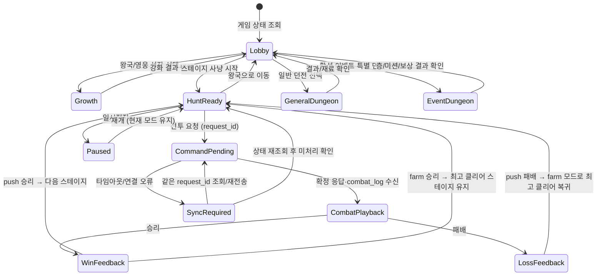

# 게임 화면·시연 설계서

## 목적과 경계

- 상태: Phaser 3 Scene과 HTML/CSS HUD 구현. 지역 선택 화면에 영웅/몬스터/체력 바/대기 모션을 표시하고, Edge에서 승인 적용→스테이지 성장→이벤트 특별 던전→보상 반영 흐름 확인
- 목적: 승인된 이벤트가 게임에 반영되고 실제 행동·진행·보상 기록으로 이어지는 것을 이해하기 쉽게 보여준다.
- 상위 기준: [가상 게임 도메인 상세 설계서](../가상게임_도메인_상세설계서.md) §§3–5
- 의존: [Runtime·API](04_게임Runtime_API.md), [이벤트 적용 계약](05_이벤트적용_계약.md)
- UI는 권위 판정을 하지 않는다. 연출은 서버 결과를 시각화한다.

## 사용자 유형과 시연 목표

운영자는 승인·적용 상태와 실패 원인을 확인한다. 게임 사용자/시연자는 MVP에서 고정된 단일 가상 유저로 콘텐츠를 플레이하고 진행도·보상을 확인한다. 별도 유저 선택 UI는 MVP에 포함하지 않는다. 발표자는 기획 결과와 게임의 실제 상태 변경 사이의 연결을 짧은 흐름으로 설명할 수 있어야 한다.

시연의 주 무대는 **게임 플레이 화면**이다. 운영자 정보는 승인·적용 근거를 확인할 때 짧게 사용하고, 플레이 중에는 관객이 RPG를 직접 진행한다고 느낄 수 있도록 게임 세계·유저 상태·행동 피드백·이벤트 목표를 일관된 화면 안에 보여준다. 이벤트 진행은 게임 화면 위에 붙인 별도 관리 대시보드처럼 보이지 않고, 게임의 퀘스트/이벤트 UI와 플레이 공간에 자연스럽게 들어가야 한다.

## 관객에게 남길 인상

### 핵심 기억 문장

> **“AI가 만든 기획이 사람의 승인을 거쳐 게임 안의 새로운 도전이 되고, 실제 플레이와 보상 기록까지 이어진다.”**

처음 보는 관객은 시스템 구성요소 이름보다 **기획 전후로 게임이 어떻게 달라졌는지**, **내 행동이 이벤트 목표를 어떻게 바꿨는지**, **보상이 실제 기록으로 남았는지**를 기억하면 된다. 신뢰를 위해 AI가 임의로 게임을 변경하는 인상을 주지 않고, 사람의 승인과 게임 규칙 검증을 거친 뒤 반영되는 흐름을 짧게 보여준다.

### 원하는 감정의 흐름

1. **호기심:** “저 이벤트 기획이 게임에서 어떻게 보일까?”
2. **발견:** 승인·적용 직후 봉인된 공간이 특별 던전으로 바뀐다.
3. **몰입:** 가상 유저의 도전과 보스 처치가 게임 플레이처럼 이어진다.
4. **납득:** 미션 진행도와 보상 기록을 확인해 연출만이 아니라 실제 상태가 바뀌었음을 이해한다.

### 임팩트를 만드는 연출 장치

임팩트는 화면 효과의 양보다 **관객이 알아차리는 변화의 크기와 인과관계**에서 만든다.

1. **강한 전후 대비:** 적용 전에는 포털이 닫혀 있고 이벤트 목표도 없다. 적용 후에는 같은 공간이 열리고, 이벤트 배너·특별 던전·퀘스트가 함께 나타난다. 동일 화면의 상태 변화로 “무엇이 바뀌었는지” 즉시 보인다.
2. **원인 한 번, 변화 한 번:** 승인/적용 버튼 한 번이 Runtime 등록으로 이어지고, 등록 성공이 포털 개방을 촉발한다. 설명 문구와 전환 효과를 이 한 지점에 모아 인과관계를 놓치지 않게 한다.
3. **플레이에 목표와 긴장 부여:** 이벤트 퀘스트는 보스 처치처럼 한눈에 이해되는 핵심 목표 하나를 전면에 둔다. 층 진행과 보스 체력/상태를 보여주고, 목표 근접 시 시각·음향 피드백을 높인다.
4. **분명한 보상 순간:** 보스 처치 후 전투 결과, 미션 `0/1 → 1/1`, 보상 획득을 순서대로 짧게 연출한다. 보상은 실제 기록 확인 뒤에 확정 표현한다.
5. **감정 뒤에 증거:** 큰 연출 직후 작은 확인 지점에서 적용 버전, 행동 ID, 미션 진행, 보상 기록을 연결해 보여준다. 관객은 몰입을 유지하면서 시스템이 진짜 상태를 바꿨음을 이해한다.

권장 리듬은 **정적(잠긴 공간) → 단일 강조(적용/개방) → 상승(층 진행/전투) → 절정(보스 처치) → 짧은 정리(미션·보상·기록)**다. 포털 개방과 보스 처치에 가장 큰 시각·음향 강조를 배치하고, 나머지 화면은 정보를 읽기 쉽게 유지한다. 화면 흔들림·점멸·긴 애니메이션을 반복해 강조가 무뎌지지 않도록 한다.

효과음·음악은 완성도에 도움이 되지만 필수 상태 증거를 대신하지 않는다. 사운드 리소스가 없거나 무음 환경이어도 문구, 아이콘, 진행 변화로 같은 인과관계를 이해할 수 있어야 한다.

### 시각 설계의 네 기준

아래 네 기준은 화면·시연 설계의 확정 방향으로 사용한다.

1. **한눈에 게임으로 보이게:** 운영 화면보다 게임 플레이 화면을 주 무대로 둔다.
2. **이벤트 적용이 눈에 띄게:** 평온한 거점과 이벤트가 적용되어 열리는 특별 던전을 시각적으로 대비한다.
3. **성과는 실제 상태로 증명:** 전투 결과 뒤에 미션 완료와 보상 기록을 연결한다.
4. **시연 환경에 맞게 구성:** Edge 화면에서 게임 장면을 크게 보여주고 운영 근거는 필요할 때 확인한다.

이 기준은 시각 스타일을 좁히되, 특정 색상·폰트·아트 리소스나 최종 레이아웃을 미리 확정하지 않는다. 구체 시안은 화면 프로토타입에서 비교·검토한다.

## 시각·상호작용 방향

### 아트 디렉션

- 방향: 자체 세계관을 가진 판타지 모바일 방치형 RPG. 기존 프로젝트의 게임 정체성과 연결하되 특정 상용 게임의 화면·캐릭터·아이콘을 복제하지 않는다.
- 분위기: 평상시 로비는 따뜻하고 안정된 거점, 이벤트 특별 던전은 대비가 강한 위험 지역으로 설정한다. 봉인 전후의 색·빛·환경 변화를 통해 이벤트 적용 효과를 즉시 알아보게 한다.
- 시각 우선순위: `현재 플레이 공간 → 유저/전투 상태 → 이벤트 목표와 진행도 → 보상 → 세부 설명` 순서로 시선을 유도한다.
- 브라우저 시연에서는 Edge 창 안에 게임 화면 프레임을 구성하되, 관리 정보가 게임 장면을 압도하지 않도록 한다. 운영자 추적 화면은 필요할 때 별도 전환/접이 패널로 보여준다.
- 캐릭터·배경·이펙트 리소스는 프로젝트 자체 에셋 또는 사용 권한이 확인된 리소스를 사용한다. 리소스 미확정 상태에서는 색·도형만으로도 상태와 상호작용이 이해되는 대체 비주얼을 설계한다.

### 화면 구성 원칙

| 화면 영역 | 항상 또는 상황별 표시 | 설계 목적 |
|---|---|---|
| 상단 HUD | 유저 레벨·경험치·핵심 재화·현재 이벤트 상태 | 플레이 맥락과 성장 변화를 계속 인지 |
| 메인 장면 | 로비, 스테이지 경로, 던전, 특별 던전 중 현재 위치 | 실제 게임 공간을 탐험하는 인상 제공 |
| 행동 영역 | 자동 사냥 상태, 일시 정지/재개, 다음 스테이지 도전, 로비 복귀/성장 | 자동 진행과 플레이어가 개입할 지점을 구분 |
| 이벤트 퀘스트 패널 | 미션 이름·현재/목표·완료 상태·보상 미리보기 | 이벤트 조건을 플레이 목표로 전환 |
| 피드백 레이어 | 전투 결과, EXP/재화 획득, 레벨업, 미션 완료, 이벤트 보상 획득 | 서버 상태 변화를 감각적 피드백으로 표현 |
| 운영 추적 뷰 | 적용 버전·이벤트 ID·행동 및 보상 근거 | 시연 사실을 검증하고 실패를 조사 |

게임 화면은 단순한 KPI 카드 격자나 JSON/로그 뷰를 기본 레이아웃으로 삼지 않는다. 미션 수치와 보상은 게임 UI 언어로 보여주되, 운영 추적 화면에서 원본 상태와 식별자를 확인할 수 있어야 한다.

### 상태 기반 렌더링 계약

| 보이는 표현 | 권위 데이터 | 표현 트리거 |
|---|---|---|
| 이벤트 배너 | 적용된 Runtime 이벤트와 기간 | API 조회에서 현재 유효한 이벤트 확인 |
| 특별 던전 잠금/개방 | 이벤트 상태, venue 설정, 자격 | 등록·활성·자격 판정 결과 |
| 층/보스 클리어 | 서버 판정 action result | 성공 응답 또는 결과 재조회 |
| 미션 진행도/완료 | Runtime MissionProgress | 진행 조회 응답의 상태 변경 |
| 레벨업 | 유저 상태와 경험치 임계치 결과 | Runtime 응답에서 레벨 증가 확인 |
| 보상 획득 | 가상 인벤토리/재화 잔액 변경과 RewardRecord | 지급 원장 생성 및 유저 상태의 수량 증가 확인 |

진행 중 애니메이션은 응답 대기 상태를 표현할 수 있지만, 완료 연출·숫자 변화·보상 소유 표시를 서버 결과보다 먼저 확정하지 않는다. 데이터 재조회 후에도 이전 상태면 연출은 성공으로 전환하지 않는다.

### 상호작용·감각 피드백

- 탐험: 로비에서 스테이지·일반 던전·이벤트 공간을 선택하고, 잠금 조건과 입장 가능 여부를 바로 확인한다.
- 전투: 아래의 전투 모션 순서와 화면 상태 흐름을 따른다. Runtime 판정 응답이 오기 전에는 피해량·승패·보상을 확정 표시하지 않는다.
- 적용: 이벤트가 열릴 때 봉인 문양 해제, 포털 조명, 이벤트 퀘스트 등장 등 일관된 시각 변화로 연결한다.
- 성장: 경험치 변화와 레벨업은 HUD 및 결과 화면에서 함께 표시하고, 이벤트 미션에 반영된 점을 알아볼 수 있게 한다.
- 로비 성장: 영웅의 현재 능력치, 강화 비용, 강화 전후 변화를 보여주는 성장 상호작용을 제공한다. 강화 결과와 재화 차감은 서버 응답을 받은 뒤 표시한다.
- 완료: 미션 완료와 보상 기록은 서로 다른 상태로 취급한다. 미션 완료 피드백 다음에 보상 확정 피드백을 보여준다.
- 재화 획득: 콘텐츠 보상 응답과 보유 상태를 확인한 뒤 몬스터/보상 위치의 재화 아이콘과 `+수량 GOLD` 획득 표시를 지갑 HUD로 이동시키고, 보유량 숫자를 이전 값에서 새 값까지 올린다. 이벤트 미션 보상은 일반 사냥 골드와 출처가 구분되는 보상 카드/알림으로 표시한다. 실패 전투에서는 보상 획득 연출을 하지 않는다.
- 접근성: 색만으로 잠금/성공/오류를 구분하지 않고 아이콘·텍스트·모션을 함께 사용한다. 모션을 줄인 환경에서는 과도한 화면 흔들림/점멸을 대체 표현한다.

## 화면 목록

| 화면 | 핵심 기능 | 서버 데이터 |
|---|---|---|
| 게임 로비 | 유저 성장 요약, 해금 콘텐츠, 활성 이벤트 진입점 | user state, active events |
| 스테이지 사냥 | 현재 스테이지/몬스터, HP, 전투 액션, 자동 진행/정지, 최고 클리어 단계 | catalog, 전투 결과, stage progress |
| 왕국 성장 | 영웅 레벨/전투 능력치, 강화 선택, 비용 및 강화 결과 | user state, growth action response |
| 일반 던전 | 현재/최고 층, push/farm, 보스 전투, 보상과 강화 재료 조회 | dungeon progression, combat result, inventory ledger |
| 전투 결과 피드백 | 성공/실패 토스트, 획득 성장, 행동 ID/진행 변화 요약. 이벤트 보스/최종 보상만 전체 화면 결과 | authoritative action response |
| 이벤트 특별 던전 | 이벤트 테마, 층/보스 진행, 도전 버튼 | active runtime event, venue config |
| 이벤트 진행 | 미션별 현재/목표, 완료 상태, 보상 기록 | mission progress, reward records |
| 원정대 보관함 | 화폐·재료 지갑, 스킨 컬렉션/장착, 최근 획득·소비 기록 | inventory balances, item ownership, equipped skin, InventoryLedgerEntry |
| 왕국 꾸미기 상점 | 고정 스킨 상품 3종, GEM 가격, 보유/구매 상태 | ShopOffer catalog, GEM balance, ShopPurchase receipt |
| 운영 적용 확인 | 승인 버전, 적용 영수증, 검증/오류 상태 | source result, application receipt |

게임 장면은 Phaser 3, 퀘스트·운영 정보와 HUD는 HTML/CSS로 구현하며 파일 구조는 [가상 게임 구현 계획서 §6](../가상게임_구현계획서.md#6-구현-대상-파일과-책임)을 따른다. 세부 화면 좌표·반응형·아트 리소스와 애니메이션 프레임은 착수 전 시각 기준에서 확정한다. WP-09에는 고정 스킨 상점과 화폐/재료 보관함을 제공하며, 소모품 효과·전체 장비 관리·랜덤 판매는 포함하지 않는다.

### 원정대 보관함 화면 계약

상단 게임 지역 메뉴의 `보관함`에서 원정대 보관함을 연다. 반응형 단일 화면에 지갑 요약, 스킨 컬렉션, 최근 변경 기록을 위에서 아래로 배치한다.

| 화면 영역 | 표시 내용 | 동작 |
|---|---|---|
| 지갑 요약 | 활성 GOLD, MOON_SHARD, GEM 잔액 | 서버가 반환한 현재 잔액 표시 |
| 스킨 컬렉션 | 스킨 카드, 미리보기, 현재 장착 표시 | 보유 스킨 장착 및 기본 외형으로 해제; 전투 능력치에는 영향 없음 |
| 최근 변경 기록 | 획득·소비 item, 수량 delta, 출처, 처리 시각 | 원장 기준 최신 순 조회; 잔액은 권위 잔액 값으로 표시하고 최근 목록 합계로 계산하지 않음 |

구현된 보관함은 GOLD·MOON_SHARD·GEM 지갑, 스킨 소유/장착, 최근 원장을 표시한다. 소모품 사용과 전체 장비 인벤토리는 범위에 포함하지 않는다. 표시 내용은 서버의 현재 잔액·고유 스킨 소유·장착 상태·원장을 기준으로 하며 브라우저 저장소를 권위 상태로 쓰지 않는다.

스킨 아트는 현재 게임의 귀엽고 친근한 컨셉을 이어간다. 기존 영웅·몬스터의 둥근 실루엣과 표정, 밝고 장난스러운 인상을 알아볼 수 있게 유지하며 색상 변형·작은 장식·테마 의상처럼 원형을 살리는 변화를 우선한다. 얼굴과 주요 실루엣을 가리거나 전투 중 캐릭터 식별·공격 모션을 방해하는 장식은 피한다. 스킨은 외형 보상이며 전투 능력치나 판정 규칙을 바꾸지 않는다.

현재 스킨은 색 필터 대신 별사탕 의상, 버섯 모자와 숲 망토, 토끼 귀 후드와 달빛 망토를 각각 별도 투명 이미지로 표현한다. 같은 캐릭터의 얼굴과 둥근 체형을 유지하면서 모자·망토·신발 실루엣으로 구별하며, 상점/보관함 미리보기와 Phaser 로비/전투 장면에서 동일한 스킨 에셋을 사용한다.

상점과 보관함의 `로비` 복귀 버튼은 화면 제목·재화 영역에 배치한다. 카드 목록의 그리드 항목으로 배치하지 않아 제목, 이동, 상품 카드의 시선 순서를 유지한다.

### 왕국 꾸미기 상점 화면 계약

로비의 `꾸미기 상점`에서 고정 스킨 3종을 확인한다. 상품은 별사탕 모험가, 숲버섯 여행자, 달토끼 수호자 콘셉트로 구성하고 각각 1 GEM에 판매한다. 상품 카드에는 전신 미리보기, 이름, 가격, 보유 상태, 구매 가능 여부를 표시한다. 보유한 상품은 `보유 중`으로 바꾸고 구매 입력을 막는다. 구매 전 GEM 잔액과 차감량을 보여주며, 성공 응답이 온 뒤에만 스킨 획득 연출과 지갑 잔액 변경을 표시한다. 잔액 부족 시 필요한 수량과 현재 수량을 안내한다.

GEM은 stage 5·10·15의 첫 클리어에서 각 1개씩 지급한다. 반복 farm은 같은 milestone GEM을 다시 지급하지 않는다. 구매는 고정 가격·확정 상품이며 랜덤 뽑기, 현금 결제, 기간 한정 판매는 없다. 시연 fixture는 상점 구매 흐름을 반복 확인할 수 있도록 시작 GEM/보유 상태를 재설정할 수 있어야 한다.

스테이지는 기존 5개 시각 슬롯(슬라임·고블린·박쥐·수호자·정령)을 반복하고 영웅 1명 대 몬스터 1마리로 보인다. 일반 던전 별무리 폐광은 스테이지와 구분되는 지하 광맥 배경·수정 조명·층 표식 아래 영웅 1명 대 폐광 전용 적 3마리의 전투를 보여준다. 적은 영웅 주변의 앞/중/뒤 위치에 배치하고 각자 이름·현재/최대 HP·생존 상태를 읽을 수 있게 한다. 5층마다 `별무리 광맥룡`과 호위 2마리가 등장하며, 보스 이름·몬스터 ID·아트가 같은 광맥룡을 가리켜야 한다. 폐광 적 아트는 스테이지 슬롯 에셋을 재사용하지 않는다. 층 진행, push/farm 상태, 반복 보상·재료를 함께 표시하고 별도 탑 화면은 만들지 않는다. 이벤트 특별 던전은 이 폐광 전투를 자동 상속하지 않고 승인 템플릿의 적 구성을 표시한다. 게임 단독 시연용 로컬 특별 던전 fixture 경로와 승인 이벤트 경로를 제공한다.

### 스테이지 사냥 모션 사양

전투는 서버가 계산한 결과를 Phaser가 재생하는 짧은 반복 장면이다. 모든 결과는 DB 확정 뒤에 표현한다. API 응답을 기다리는 동안에는 대기/경계 모션과 `전투 결과 확인 중`만 보여주며, 실제 HP 감소와 명중 타격은 확정 결과를 받은 뒤 재생한다.

| 순서 | 주체·모션 | 화면 피드백 | 결과 데이터와의 연결 |
|---|---|---|---|
| 1. 대기 | 영웅 호흡/무기 흔들림, 몬스터 호흡/시선/몸 흔들림 반복 | 현재 스테이지, 몬스터명, 양측 HP, 자동 사냥 모드(`push`/`farm`) | 조회된 현재 유저·스테이지 상태 |
| 2. 명령 대기 | 영웅과 몬스터가 경계 자세, 짧은 빛/기운 효과 | 로딩 표시, 중복 입력 방지 | `request_id`로 서버 명령 제출·조회 |
| 3. 영웅 공격 | 준비 동작 → 전진/무기 휘두름 또는 투사체 → 원위치 | 타격 프레임에 피해 숫자와 몬스터 HP 감소 | 서버 `combat_log`의 영웅 공격 이벤트와 `target_hp_after` |
| 4. 몬스터 반응/공격 | 피격 경직·넉백 후 공격 준비 → 공격 → 영웅 피격 반응 | 피해 숫자와 영웅 HP 감소, 피격 플래시 | 서버 `combat_log`의 몬스터 공격 이벤트와 `target_hp_after` |
| 5. 반복/종료 | 전투 로그 이벤트를 순서대로 재생하다 결과에 해당하는 종료 모션 | HP 바가 서버 확정 최종값에 도달 | 같은 Attempt의 순서 있는 전투 로그와 최종 승패 |
| 6a. 승리 | 몬스터 사망/퇴장, 영웅 승리 포즈 | `STAGE CLEAR`, XP/재화, 레벨업, 이벤트 미션 변화를 짧은 결과 토스트로 표시 | 성공 Action 및 실제 보상/미션 상태 |
| 6b. 패배 | 영웅 피격 경직/무릎 꿇기, 몬스터 승리 자세 | `DEFEAT`, 실패 스테이지와 최고 클리어 사냥 복귀를 표시. 실패 자체 보상은 표시하지 않음 | 실패 Attempt, 자동 사냥 모드 전환 결과 |

영웅/몬스터 모션은 현재 보유 에셋에 맞춰 구현한다. 전용 프레임이 없으면 위치 이동, 회전, 스케일, 색상 플래시, 잔상/타격 이펙트를 Tween으로 조합한다. 공격·피격·사망을 구별할 수 있어야 하며 대기 모션만 재생되는 화면을 전투 완료로 표현하지 않는다. 모션은 응답의 전투 이벤트 순서를 따라가고, 각 피해 숫자/HP 변경은 해당 이벤트의 값과 일치한다.

몬스터도 영웅을 직접 공격한다. 스테이지 한 라운드는 영웅 공격 후 단일 몬스터가 생존했을 때 반격한다. 일반 던전 한 라운드는 영웅이 가장 앞선 생존 적을 공격하고, 파티가 남아 있으면 정해진 회전 순서의 생존 적 한 명이 반격한다. 적의 타깃은 영웅이며 쓰러진 적은 공격 순번에서 건너뛴다. 영웅 HP가 0이 되면 피격 모션 직후 전투를 멈추고 패배 모션으로 연결한다. 마지막 적 HP가 0이 되면 후속 반격 없이 층 승리와 파티 처치 연출로 연결한다. 공격 순서와 HP 0 경계는 서버 `combat_log`와 승패 결과에 의해 결정된다.

던전 1:N 장면은 1.3.0 화면 코드에 반영했다. 폐광 적 파티와 개별 HP 표시, 적 ID 기반 공격/피격 모션, 서버 로그 재생, 결과 상태 스냅을 구현했다. API/UI 테스트 서버는 각각 `8002`/`5174`에서 실행하고 층별 파티 구성 응답을 확인했다. 실제 전투 애니메이션과 Edge 화면 배치는 아직 확인하지 않았다. 요청 실패나 응답 조회 전에는 적 처치·층 보상 장면을 확정 연출하지 않는다.

#### 재화가 쌓이는 화면 피드백

1. 서버가 승리와 콘텐츠 보상 지급을 확정하고 최신 유저 보유량/보상 기록을 반환한다.
2. 전투 장면의 몬스터 처치 위치나 보상 상자에서 골드 아이콘과 `+N GOLD` 텍스트를 띄운다.
3. 아이콘은 상단 지갑 HUD로 이동하고, 보유량은 요청 직전 수치에서 응답으로 확인한 새 수치까지 짧게 카운트업한다. 지갑은 획득 순간 잠깐 강조해 누적을 알아보기 쉽게 한다.
4. 이벤트 미션 완료 보상은 미션 게이지 완료 후 별도 보상 연출로 보여준다. 콘텐츠 골드와 이벤트 보상을 한 획득 메시지로 합치지 않아 출처를 구분한다.

연속 사냥에서는 한 전투 결과마다 서버 원장 기록을 유지한다. 화면 갱신이 빨라 여러 획득 표시가 겹치면 짧은 표시 큐에 넣거나 같은 재화 팝업을 잠시 합산해 가독성을 지키되, 각 행동의 결과·보상 이력은 상세 패널에서 확인할 수 있어야 한다. 네트워크 오류나 패배에서는 획득 연출과 지갑 증가를 확정하지 않는다. 화면 숫자는 권위 응답의 잔액을 따라가며 로컬에서 임의로 더하지 않는다.

### 화면 상태 흐름

#### 전환 규칙과 결과 표시

- `push`는 다음 미개방 스테이지를 연속 도전하는 모드다. 승리할 때마다 최고 클리어와 사냥 대상을 갱신하고 결과 토스트 뒤 다음 전투를 요청한다.
- `push` 중 패배하면 실패한 스테이지를 다시 자동 요청하지 않는다. 실패 결과를 짧게 보여준 뒤 `farm`으로 전환하고 최고 클리어 스테이지에서 사냥한다.
- 첫 스테이지에서 아직 클리어가 없을 때 패배하면 카탈로그 첫 스테이지를 farm 대상으로 삼는다.
- `farm`은 최고 클리어 스테이지를 반복한다. 승리 결과를 누적 표시하고 같은 스테이지를 유지한다. 플레이어가 `다음 스테이지 도전`을 누르면 `push`로 바꾼다.
- 승리/패배 토스트는 게임 장면 위의 비차단 HUD로 표시해 사냥 루프를 멈추지 않는다. 기본 정보는 스테이지/몬스터, 승패, 얻은 XP·재화, 레벨업, 이벤트 미션 변화다. 누적 기록은 결과/운영 패널에서 다시 확인할 수 있다. 전체 화면 결과 화면은 이벤트 보스 처치나 이벤트 최종 보상처럼 시연 절정에만 사용한다.
- 일시정지는 진행 중인 요청이나 결과 모션을 취소하지 않는다. 해당 처리가 끝난 뒤 다음 전투 요청을 중단한다. 재개하면 정지 전 `push`/`farm` 모드를 유지한다.
- API 오류나 결과 불명 상태는 승리/패배로 가장하지 않는다. 화면은 대기/동기화 상태를 유지하고 같은 `request_id`로 조회한 뒤, Runtime 상태를 재조회해 재개한다.
- 스테이지 카탈로그의 마지막 정의 단계에 도달하면 자동 전투를 멈추고 `현재 시연 데이터의 마지막 스테이지` 안내와 최고 클리어 사냥 복귀/로비 이동 선택을 표시한다. 카탈로그 범위를 벗어난 스테이지를 클라이언트에서 만들어내지 않는다.

## 대표 시연 흐름

1. 운영자 화면에서 승인된 특별 던전 이벤트 결과 버전과 적용 상태를 확인한다.
2. 가상 게임 로비에서 이벤트 배너와 특별 던전이 활성화된 상태를 확인한다.
3. 대표 가상 유저로 특별 던전 도전을 실행한다.
4. 게임 Runtime이 계산한 결과를 전투/층 완료 연출로 보여준다.
5. 이벤트 진행 화면에서 해당 행동으로 미션 수치가 증가한 것을 확인한다.
6. 목표 완료 시 아이템/재화 수량 증가, 보상 지급 기록 ID와 근거 행동을 함께 보여준다.
7. 운영 확인 화면에서 행동·미션·보상의 연결 근거를 추적한다.

연출 타이밍은 실제 API 상태 응답에 연결한다. 저장 실패나 도메인 거절이 발생하면 성공 애니메이션을 재생하지 않고 설명 가능한 상태 화면을 표시한다.

## 임팩트 시나리오: 닫힌 균열에서 보상까지

이 시나리오는 이벤트 기획안 적용이 게임 세계의 상태를 바꾸고, 플레이 결과가 기록으로 남는 것을 짧고 선명하게 보여주기 위한 시연 후보다. **“월광 균열: 심연의 파수자”**는 데모용 임시 이벤트명이며 게임 세계관의 확정 설정은 아니다. 시연 길이는 약 90–120초를 목표로 한다.

### 관객이 이해해야 할 한 문장

> 승인된 이벤트 기획이 게임 안의 새 도전을 열고, 플레이 결과를 미션 완료와 보상 기록으로 바꾼다.

### 장면 구성

| 장면 | 화면·연출 | 실제 시스템 상태와 증거 | 목표 시간 |
|---|---|---|---:|
| 1. 닫힌 공간 | 게임 로비에서 균열 포털은 봉인 상태이고 “승인된 이벤트를 기다리는 중”으로 보인다. | 해당 이벤트 Runtime 등록 전이거나 `scheduled` 상태. 비활성 특별 던전은 진입 불가. | 8–12초 |
| 2. 기획안 검토 | 운영 화면에 복귀 유저 대상, 기간, 3단계 특별 던전, 보스 처치 미션, 보상이 담긴 기획 결과와 검증 근거를 보여준다. | `task_id`, `result_version`, 검증 상태, 게임 데이터/규칙 버전이 표시된다. 미결 입력이나 차단 결과가 있으면 승인하지 않는다. | 15–20초 |
| 3. 승인과 적용 | 운영자가 승인하고 적용한다. 화면의 상태가 승인 대기에서 적용 완료로 바뀐다. | 승인 증거와 적용 영수증의 결과 버전이 일치하고 `runtime_event_id`가 발급된다. 설정 스냅샷과 적용 시각을 확인할 수 있다. | 10–15초 |
| 4. 포털 개방 | 게임 화면으로 전환한다. 봉인 문양이 빛나고 포털이 열리며 특별 던전 카드가 활성화된다. | 화면은 적용 완료된 Runtime 이벤트를 다시 조회한 뒤 열린다. API가 이벤트를 활성화하지 않았다면 개방 연출을 하지 않는다. | 8–12초 |
| 5. 보스 도전 | 가상 유저가 1·2층을 지나 보스에 도전한다. 짧은 전투 연출 뒤 서버 판정 결과에 따라 보스를 처치한다. | 각 완료 행동에 `action_id`가 있고 `runtime_event_id`, 사용자, 층, 규칙/데이터 버전과 연결된다. 성공은 서버 판정 결과다. | 25–35초 |
| 6. 미션·보상 확인 | 보스 처치 후 미션이 `0/1 → 1/1`로 바뀌고 보상 획득 연출과 완료 표시가 나온다. | 진행도 완료와 보상 원장 기록이 조회된다. `reward_record_id`와 근거 행동 ID를 확인한다. | 12–18초 |
| 7. 운영 추적 | 운영 화면에서 적용 영수증부터 보스 행동, 미션 진행, 보상 기록까지 같은 이벤트 버전으로 연결해 보여준다. | 추적 식별자와 기록의 버전/상태가 일치한다. | 8–12초 |

### 시연용 이벤트 설정 후보

- 이벤트 유형: `special_dungeon`
- 대상: 미리 정의된 복귀 유저 세그먼트 1종
- 공간: 카탈로그에 등록된 특별 던전 템플릿, 3개 층과 보스 1명
- 핵심 미션: 해당 이벤트의 보스 처치 행동 1회
- 보상: 카탈로그에 등록된 단일 보상 1종
- 가상 유저: 시작 레벨·성장 상태·참여 자격이 사전 fixture로 고정된 데모 유저 1명
- 기간: 시연 시각을 포함하는 유효 기간으로 설정하고, 서비스 시간과 동일한 UTC 판정을 사용

이 설정은 시연을 설명하기 위한 후보이지 최종 밸런스·경제 결정이 아니다. 세부 ID, 기간, 성장·입장 수치, 보상 수량은 게임 데이터와 검증·밸런스 설계의 fixture로 확정한다. 시연 직전 같은 승인 버전과 카탈로그 스냅샷을 사용하는지 확인한다.

### 임팩트 연출 원칙

- 핵심 변화는 봉인/개방의 화면 차이로 보이게 하되, 개방의 원인은 실제 적용 완료 상태로 증명한다.
- 전투 연출은 짧게 압축할 수 있지만, 층 완료·보스 처치 행동은 서버가 확정한 결과만 표현한다.
- 이벤트 기획안의 대상·미션·보상 설정이 게임 UI와 운영 추적 화면에서 같은 이름·버전으로 이어진다.
- 결과 화면은 진행도 숫자, 보상 아이콘, 지급 기록을 함께 보여줘 시각 효과와 시스템 결과를 연결한다.
- 프리셋 데이터와 고정된 fixture로 반복 가능한 시연을 제공한다. 화면만 바뀌고 Runtime 저장 상태가 변하지 않는 연출은 성공 시연으로 취급하지 않는다.

### 장애·실패 시 대체 표현

적용이 거절되거나 조회가 실패하면 포털은 잠긴 상태로 유지하고, 운영 화면에 원인과 상관관계 식별자를 보여준다. 행동 요청의 결과가 불확실하면 승리/보상 연출을 재생하지 않고 같은 요청 결과를 재조회한다. 보스 처치는 성공했지만 미션/보상 반영이 실패한 경우 보상을 미리 보여주지 않으며, 오류·복구 설계에 정의된 상태와 운영자 안내를 표시한다. 성공 흐름을 위해 데이터베이스를 직접 수정하거나 UI 상태만 강제로 바꾸지 않는다.

## 구현 계획에 반영할 화면·디자인 작업

구현 계획은 Phaser 3 기반 장면과 HTML/CSS 정보 패널을 선택했다. 화면 작업을 API 연결 이후의 마감 단계로만 두지 않고 시각 방향과 상태 계약을 먼저 프로토타입으로 확인해 게임 장면·이벤트 UI·서버 연동을 반복해서 맞춘다.

1. **경험/시각 기준 확정:** Edge 시연 창 크기, 화면 계층, 색·타이포그래피·간격·버튼·상태 표현, 에셋 출처를 합의한다.
2. **핵심 흐름 와이어프레임/프로토타입:** 로비→잠긴 특별 던전→적용 후 개방→보스 전투→미션/보상 완료 장면을 먼저 연결해 관객 이해도를 확인한다.
3. **게임 화면 구현:** HUD·로비·콘텐츠 선택·특별 던전·전투 결과·퀘스트/보상 표현을 공통 디자인 기준으로 만든다.
4. **Runtime 상태 연결:** 각 시각 요소를 위 상태 기반 렌더링 계약의 API 데이터에 바인딩하고, 로딩·거절·장애·중복 상태도 구현한다.
5. **연출·접근성 마감:** 포털 개방, 전투, 레벨업, 미션 완료, 보상 획득 피드백을 다듬고 모션 감소/대체 표현을 확인한다.
6. **발표 리허설·시각 QA:** 고정 fixture로 전체 시연을 반복해 보고, 실제 DB/API 결과와 화면 문구·숫자가 일치하는지 점검한다.

### 화면 구현 수용 기준

- 처음 보는 사람이 짧은 관찰만으로 현재 게임 공간, 목표 미션, 다음 행동을 파악할 수 있다.
- 승인 전후 차이가 게임 장면에서 분명히 보이고, 개방은 실제 적용 상태에 의해 발생한다.
- 전투 성공·미션 완료·보상 획득이 각각 해당 Runtime 상태/기록과 연결된다.
- 성공 장면 외에도 잠금, 처리 중, 입장 불가, 버전 불일치, 네트워크/저장 오류의 화면이 정의되어 있다.
- Edge 시연 환경에서 주요 게임 장면과 운영 근거 화면을 오가도 유저·이벤트·버전 맥락이 유지된다.
- 시각 QA에서 화면 크기별 잘림, 대비, 읽기 순서, 중복 클릭, 응답 지연 중 잘못된 성공 연출이 발견되지 않는다.

## 상태·오류 표시

화면 상태는 loading, ready, empty, action pending, success, domain rejected, retryable service failure, stale version으로 구분한다. 버튼을 눌렀을 때 중복 요청을 막고, 응답이 불확실한 경우 같은 idempotency ID를 사용할 수 있도록 한다. 미션 완료/보상 표시는 서버 응답 또는 재조회 결과가 확인된 뒤에만 완료 상태로 전환한다.

운영 화면은 `task_id`, `result_version`, `runtime_event_id`, action/progress/reward 식별자를 연결해 보여준다. 내부 stack trace, 비밀값, 불필요한 프롬프트 원문은 노출하지 않는다.

## 완료 기준

- 승인·적용·플레이·미션·보상 흐름을 데이터 근거와 함께 시연할 수 있다.
- 성공·도메인 거절·서비스 실패·중복 제출을 화면이 구별한다.
- 화면의 완료 연출이 실제 Runtime 상태와 일치한다.
- 임팩트 시나리오가 고정 fixture로 반복 가능하며, 각 장면의 주장에 대응하는 상태/기록 근거가 있다.

