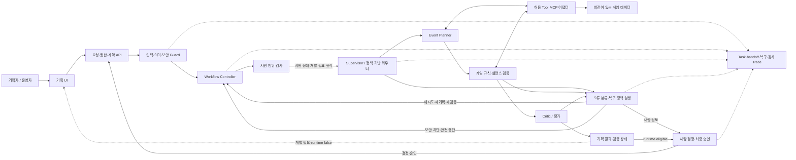
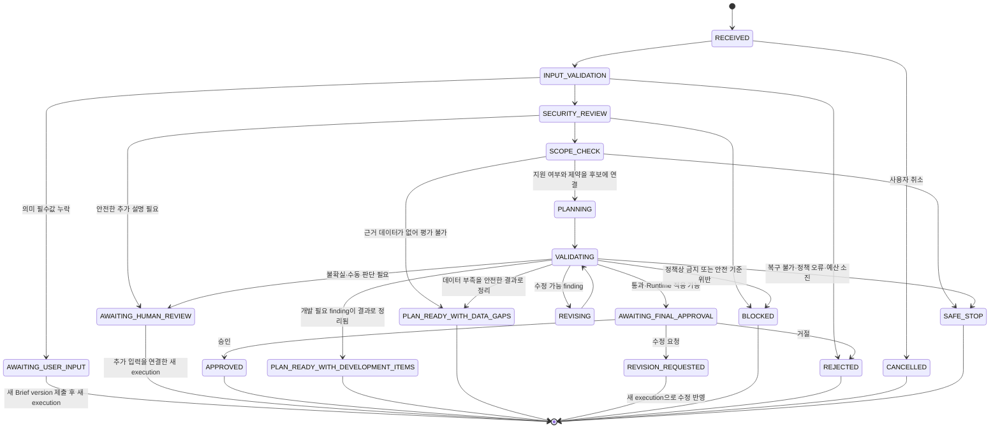

# 기획안 멀티 에이전트·오토힐링 영역 상위 설계서

> 2026-10-11 검사 후 책임 보완: Supervisor는 정상·복구·예외 종료를 결정하고 Controller는 versioned decision 저장과 command 실행을 담당한다. 단일 사용자 가정에도 전체 API 로컬 접근 제한을 적용한다. 현재 통합 완료 판정은 보류하며 [Workflow 수정 계획](기획안설계/14_Workflow_검사결과_설계보완_수정계획.md)의 계약·게이트를 하위 설계와 구현 계획에 추가 적용한다.

## 문서 상태와 위계

- 상태: 영역 상위 설계 초안. 전체 시스템 경계 아래에서 기획안 Workflow의 멀티 에이전트 협업과 복구 책임을 정의한다.
- 상위 기준: [게임 이벤트 기획·가상 게임 시스템 최상위 설계서](최상위_시스템_설계서.md)의 범위·신뢰 경계·승인 후 Runtime 경계를 따른다.
- 현재 구현 사실: [현재 구현 상태](현재_구현상태.md)와 이 문서의 `현행 기준`을 함께 본다. 본 문서는 미구현 목표를 현재 기능으로 간주하지 않는다.
- 범위: 요청 접수부터 기획안 생성·검증 결과 반환까지. 지원 범위 안의 Runtime 적용 가능 후보만 최종 승인 대기로 진행한다. 미지원 기능이 포함된 기획은 개발 필요 항목을 표시한 결과로 완료하며 Runtime에 적용할 수 없다. 승인 후 Runtime의 등록·진행·보상 복구는 별도 설계한다.
- `pre/` 보존 문서는 원문 기준 자료로만 참고한다. 새 설계 결정은 이 문서와 하위 설계에 기록한다.

## 1. 목적

이 문서는 기획안 생성 시스템에서 멀티 에이전트가 어떤 책임으로 협업하고, 오류·지원 범위 초과·보안 위험을 어떻게 분기할지 정하는 영역 상위 기준이다. Agent별 프롬프트, JSON Schema, 오류별 재시도 숫자, UI 화면, 물리 DB 구조는 후속 상세 설계에서 정한다.

설계의 중심은 두 축의 결합이다.

- **멀티 에이전트 협업:** 요청을 역할이 분리된 작업으로 수행하고, 계약에 맞는 결과를 인계·평가한다.
- **오토힐링:** 실패를 분류해 허용된 재시도·재기획·fallback을 수행하거나, 사람 검토 또는 안전 중단으로 넘긴다.

오토힐링은 Agent에게 무제한 자율 수정 권한을 주는 기능이 아니다. 정해진 Workflow, 데이터 계약, 도구 권한과 한도 안에서 동작하는 제어 기능이다.

## 2. 설계 목표와 원칙

1. 각 Agent는 역할, 입력, 출력, 허용 Tool, 실패 표현이 분명해야 한다.
2. 작업 인계는 자유 형식 대화에만 의존하지 않고 버전이 있는 계약과 실행 상태를 전달해야 한다.
3. 기획안은 게임 데이터·규칙 및 사용자 요청과 연결해 검증하고, 검증되지 않은 결과를 승인 후보로 올리지 않는다.
4. 일시적인 기술 장애와 수정 가능한 기획 오류를 구분해 각각 재시도와 재기획으로 보낸다.
5. 현재 자동 지원 범위 밖의 요청은 임의로 지원되는 것처럼 처리하지 않고, 결과에 개발 필요 항목과 영향·근거를 표시한다.
6. 보안·권한 위반은 재시도·fallback·사람 승인을 통해 우회할 수 없다.
7. 같은 입력·정책 버전·데이터 버전에 대한 복구 판단을 Trace에서 재구성할 수 있어야 한다.
8. 새 정책 또는 Agent를 더해도 상위 Workflow와 계약을 깨뜨리지 않도록 확장 접점을 둔다.
9. 재시도·중복 요청·캐시가 기획 Workflow의 상태나 게임 데이터 버전을 어긋나게 하지 않도록 권위 저장소와 보조 저장소의 책임을 구분한다.

## 3. 책임 범위와 경계

### 3.1 포함

- Event Brief 입력 검증과 의미 검증
- 게임 데이터·콘텐츠·규칙을 기준으로 지원 범위 확인
- Planner, 규칙·밸런스 검증, Critic 등 역할 기반 작업 수행
- Agent 간 Task 및 결과 handoff
- 출력 계약·도메인 규칙·요청 부합성 평가
- 허용된 자동 재시도·기획 수정·검증 재실행
- 지원 범위 초과 항목과 구현 필요 사항을 포함한 기획 결과 생성
- 보안 차단, 안전 종료, 운영자 추적 정보 생성
- 검증 통과·Runtime 적용 가능 후보의 최종 사람 승인 대기 상태 생성
- 기획 작성, 진행 시각화, 오류·로그 조회, 복구 정책의 운영자 관리 UI
- 시스템 간 호출·저장·관측을 뒷받침하는 로컬 및 운영 인프라 경계

### 3.2 제외

- 승인 전 이벤트를 Runtime에 등록하거나 게임 상태를 바꾸는 행위
- 승인 후 Runtime 등록·게임 행동·보상 원장의 재시도와 복구
- 외부 상용 게임 계정이나 경제에 쓰기 작업
- 사용자 승인만으로 보안 정책·Agent 권한·게임 규칙을 완화하는 기능
- LLM이 직접 오류 정책, 권한, 승인 결과를 결정하는 구조

지원 범위를 넘는 기능은 기획안 결과에 `NEEDS_DEVELOPMENT`로 표시하고, 필요한 게임 기능·데이터·계약·검증과 근거를 함께 제시한다. 기획 Workflow는 구현 승인을 기다리거나 코드를 직접 변경하지 않고 이 결과를 반환해 완료한다. 개발 필요 항목이 남은 결과는 `runtime_eligible=false`로 표시하고 Runtime 승인·등록 경로에서 거부한다. 기능이 구현되어 capability catalog와 계약이 갱신된 뒤에는 새 버전 기준으로 기획을 다시 생성·검증해야 한다.

## 4. 현행 기준과 목표 차이

### 4.1 현행 코드에서 확인되는 기반

현재 코드에는 Supervisor, Event Planner, Balance Rule, Critic 역할과 Workflow 라우팅이 있다. `backend/app/orchestration/routing.py`는 다음 경로를 명시적으로 구분한다.

- `mission_unreachable`, `item_not_found`, `event_brief_mismatch`: Planner 재기획, 최대 2회
- `agent_failure`, `validation_error`, `llm_timeout`: 현재 허용 Agent 재시도
- 일부 MCP Tool 오류: Tool별 재시도 또는 `get_game_rules_fallback`
- `db_connection_error`: 제한 재시도
- 그 외 분류되지 않은 오류: `SAFE_STOP`
- 기술 재시도 기본 상한은 3회이며 기획 수정 상한은 별도 카운터다.

이것은 현재 코드 경로에 대한 기준선이지, 완성된 정책 레지스트리나 운영자 편집 기능을 뜻하지 않는다. 현재 정책은 코드에 고정되어 있고, 모든 오류가 원인·장소별 코드로 세분화된 것도 아니다. Trace 전달 필드 중 정책 결정 정보가 스키마에 존재하더라도 모든 실행 경로가 이를 채우는지는 구현 확인이 필요하다.

### 4.2 목표에서 보강할 것

- 사용자 입력 오류, 모델 출력 오류, Tool 응답 오류, 보안 오류를 위치별로 구분
- Agent/Tool의 계약과 권한을 Workflow 밖의 서버 측 경계에서 강제
- 재시도 정책의 총 시간·비용 예산, 멱등성 및 재검증 조건
- 현재 자동 지원 가능 여부를 판정하는 명시적 범위 카탈로그
- 지원 범위 초과 항목을 결과에 표시하는 `PLAN_READY_WITH_DEVELOPMENT_ITEMS` 완료 경로
- 보안 의미 검증과 생성 결과 재검증, 민감정보 비노출
- 복구 결정·정책 버전·사람 판단을 빠짐없이 연결하는 관측 계약

## 5. 논리 구성과 책임



### 5.1 컴포넌트 책임

| 컴포넌트 | 책임 | 권한 경계 |
|---|---|---|
| API/요청 경계 | 행위자 인증·권한, 입력 크기·형식, 요청 멱등성, Task 상태 변경 | 사용자 ID만으로 권한을 신뢰하지 않음 |
| 운영자 UI | 기획 입력·검토·승인, Workflow 진행·로그·Trace 표시, 정책 조회·편집 | 초기 모델은 단일 사용자에게 업무 권한을 둠. 화면 상태를 실행의 권위로 삼지 않으며 서버 검증을 거침 |
| 캐시 계층(선택) | 반복 조회되는 읽기 데이터의 지연·부하 완화 | 캐시 누락·만료·장애 시 권위 원천에서 복구. 상태·승인·복구 카운터의 원본 저장소가 아님 |
| Policy Registry | 검증·승인된 선언형 복구 정책 버전의 저장·활성화·롤백 | 임의 코드 실행 금지. 보안 불변조건과 hard cap은 코드에서 강제 |
| Input Guard | 구조·타입·필수값 및 허용 범위 검증 | 입력을 검증하고 정책 지시로 승격하지 않음 |
| 의미·보안 Guard | 요청 의도, 금지 행위, 프롬프트 공격 징후, 민감정보 요청 점검 | 탐지 결과는 추가 방어층이며 Tool/API 권한 검사를 대체하지 않음 |
| Scope Checker | 현재 카탈로그와 계약으로 자동 지원 여부 및 제약을 판정 | 범위 밖 기능을 자동으로 지원 상태로 만들지 않음 |
| Workflow Controller | Supervisor 결과의 영속화, API·DB side effect 실행 | 상태·업무 ID를 독자적으로 생성하지 않음 |
| Supervisor/Router | 권위 Workflow 상태·미션/보상 ID를 관리하고 정책에 맞는 다음 Agent·Tool·복구 경로 결정 | LLM 호출 없이 결정하며 허용 목록과 hard cap을 변경할 수 없음 |
| Agent | 정해진 task에 대한 기획·검증·평가 | 자신의 권한·정책·승인 상태를 확장할 수 없음 |
| Tool/MCP Gateway | 허용된 도구·인자·데이터 버전으로 읽기 요청 실행 | 최소 권한, 인자 검증, 서버 측 권한 확인 |
| Recovery Controller | 오류 분류에 따라 허용 복구 실행 또는 중단 | 정책 Registry와 코드상 보안 불변조건을 모두 준수 |
| Human Decision Service | 범위 초과의 구현 의사결정, 기획 수정 요청·거절·최종 승인 | 보안 차단과 Tool 권한을 무효화하지 못함 |
| Trace/Repository | 단계·결정·버전·actor·결과의 상관관계 기록 | 민감 원문은 마스킹·최소 수집 |

### 5.2 UI·UX와 운영자 작업

운영자 화면은 작업을 시작하고 결과를 판단하며 장애를 조사하는 한 흐름으로 설계한다.

| 화면 영역 | 사용자에게 보여줄 정보·동작 | 상위 UX 원칙 |
|---|---|---|
| 기획 작성 | 목적·대상·기간·장소·행동·보상·영향 입력, 지원 범위 안내 | 미지원 필드와 제약을 제출 전에 알리고 입력 근거를 보존 |
| 기획 결과 | 결과 버전, 게임 데이터 근거, 검증 finding, 수정 내역 | 승인 가능한 후보와 미검증 초안을 시각적으로 구분 |
| Workflow 진행 | 완료 단계, 현재 단계, 대기 이유, 다음에 가능한 분기, Agent·Tool 결과 요약 | 실행되지 않은 조건부 단계를 확정된 단계처럼 카운트하거나 표시하지 않음 |
| 오류·운영 로그 | 오류 위치·영향, 자동 조치, 마지막 성공 단계, 사용자/운영자 조치 | 사용자 안내와 권한 제한된 상세 진단을 분리 |
| 장애 시연 | 고정된 fault scenario의 발생·감지·복구·안전 중단을 실시간 표시 | 로컬 demo mode 전용, 운영 의존성·게임 상태에 영향 없음 |
| 정책 관리 | 정책 버전·상태, 조건·조치, 시뮬레이션/영향 미리보기, 검증·활성화·롤백 | 초기는 단일 권한 사용자가 관리. 정책 제약·변경과 적용 기록은 엄격히 검증·감사 |
| 세부 정보 | Agent/Tool 입출력 요약, 검증 근거 코드, 오류 진단 | 처음에는 이해하기 쉬운 요약을 보이고, 권한이 있는 사용자가 필요 시 상세 내용을 펼침 |

진행 시각화는 고정된 전체 단계 숫자보다 실제 Workflow 상태를 기준으로 만든다. 고정 DAG의 불변 단계는 전체 구조를 보여줄 수 있지만, 오류·범위 분기·사람 판단에 따라 생기는 단계는 조건이 확인된 뒤에만 표시한다. 화면에서 정책을 바꿔도 변경이 즉시 적용되는 것이 아니라 검증·승인·활성화를 통과해야 한다.

### 5.3 정책 문서와 실행 코드의 연결

복구 정책은 사람이 검토 가능한 선언형 문서(예: 제한된 YAML/JSON Schema)로 관리하고, 실행 시점에는 검증된 Policy Registry 버전을 읽는다. 정책 파일에 Python, shell, 임의 표현식 등 코드를 넣어 실행하지 않는다.

```text
정책 초안 편집
→ 형식·조건·action·권한·한도 검증
→ 변경 영향과 대표 오류 입력 미리보기
→ 단일 권한 사용자의 활성화 결정
→ 버전 등록·활성화
→ 실행 Trace에 `recovery_policy_id/recovery_policy_version` 기록
→ 지표/오류 확인 및 필요 시 이전 버전 rollback
```

시스템은 변경 시점과 실행 시점의 정책 버전을 분리해 기록한다. 초기에는 동일한 단일 권한 사용자가 편집·활성화할 수 있지만, 안전 한도·보안 Guard·권한 경계는 편집 대상에서 제외하고 정책 검증을 반드시 통과해야 한다. 작성자·승인자 분리는 이후 RBAC 확장으로 둔다. 기본 동작은 안전 중단이며, 누락·잘못된 정책은 자동 허용이나 넓은 fallback으로 해석하지 않는다.

### 5.4 가이드 개념 적용 지도

가이드의 개념을 구현 이름만 맞추지 않고, 시스템 책임과 검증 가능한 산출물에 연결한다. 모든 workflow pattern을 기계적으로 구현하지는 않으며 사용 사례가 있는 패턴과 선택 사유를 기록한다.

| 가이드 개념 | 상위 시스템에서의 위치 | 하위 설계 산출물 |
|---|---|---|
| Role / Task | Agent 책임, 단위 작업, 소유자 | Agent 책임표·Task schema |
| Handoff | 검증된 결과와 문맥을 다음 역할에 전달 | Handoff schema·허용 전이 |
| Workflow pattern | 과업에 필요한 패턴만 선택하며 선택·미선택 근거를 기록. 순차·조건부 Router·제한된 feedback loop를 우선 검토하고 병렬화는 이점이 있을 때만 사용 | Workflow graph·선택 근거 |
| Input/Output schema | Brief, Agent payload, Tool 결과, 평가 결과 계약 | 버전된 Schema·호환 규칙 |
| MCP / Tool | 권한 제한된 데이터 조회·외부 작업 경계 | Tool catalog·인자·출처 계약 |
| Validation | 형식, 도메인 의미, 보안·권한, 결과 재검증 | Validation rule·거부 사례 |
| Evaluate / Feedback | PASS/REVISE/HUMAN/BLOCK과 수정 루프 | 평가 기준·finding·feedback schema |
| Security / Permission | 신뢰 경계, 최소 권한, 승인 역할, 안전한 secret 취급 | Threat model·권한 매트릭스 |
| Trace / Evidence | task·handoff·tool·복구·사람 결정과 근거 연결 | Trace event·evidence reference |
| Observability | 상태·오류·지연·복구·정책 버전의 운영 조회 | 로그/trace/metric·운영 화면 |
| Decision rationale | 선택된 route·정책·근거 코드와 버전 기록 | 구조화 decision record |

### 5.5 Infra·네트워크의 상위 요구

로컬·운영 환경에서 API, Workflow, Agent 외부 의존성, MCP, PostgreSQL, 선택적 Redis와 UI 사이의 연결 방향과 신뢰 경계를 정의한다. 하위 인프라 설계에서는 환경별 DNS/주소 설정, TLS와 secret 전달, 인증, 연결·요청 timeout, readiness/health check, DB migration, 네트워크 단절 시 동작, 로그·metric 수집, 백업·복구, CI/CD rollback을 구체화한다. 구성요소를 늘리는 것 자체를 목표로 하지 않고, 현재 단일 로컬 구성에서도 동일한 계약과 안전한 장애 경계를 유지한다.

## 6. 멀티 에이전트 협업 모델

### 6.1 역할과 책임 원칙

현재의 Planner, Balance Rule, Critic 역할을 출발점으로 삼는다. 세부 역할 수와 책임 변경은 Workflow 상세 설계에서 검토한다.

| 역할 | 상위 책임 | 출력 성격 |
|---|---|---|
| Supervisor/Router | 권위 상태 전이, 업무 ID 결합, 순서·handoff·허용된 복구 경로 선택 | 다음 상태·작업과 `reason_code`가 포함된 결정 결과; LLM 호출 없음 |
| Event Planner | Brief와 검증 피드백을 반영한 이벤트 초안 생성·수정 | 계약에 맞는 이벤트 기획안 후보 |
| Balance/Rule Validator | 게임 규칙·대상 달성 가능성·보상 영향을 평가 | 구조화된 판정, 근거, 위반·경고 목록 |
| Critic | 요청 부합성·완전성·근거·일관성 평가 | PASS, 수정 가능한 finding, 차단·사람 검토 finding |

에이전트가 최종 승인을 내리거나 Runtime 상태를 변경하지 않는다. 승인 권한은 사람과 권한 있는 API에 있으며, 게임 상태 판정은 게임 Runtime의 서버 계약에 속한다.

### 6.2 Task와 handoff 상위 계약

각 task handoff는 적어도 다음 정보를 전달해야 한다.

- `task_id`, `trace_id`, `workflow_id`, `attempt`, `revision_count`
- `task_type`, `assignee`, 허용된 수신 역할
- 입력 계약 버전과 검증된 입력 또는 참조 ID
- 결과 계약 버전, 결과 상태, 결과 참조 또는 구조화된 payload
- 사용한 게임 데이터/규칙 버전과 출처
- 전달하는 finding·제약·미해결 질문
- 정책상 제한된 Tool 권한과 만료 시점

Handoff는 자유 대화만으로 처리하지 않는다. 수신 Agent는 역할·계약·필수 버전·권한을 다시 확인하고 불일치는 명시 오류로 돌려보낸다.

### 6.3 평가와 피드백

평가 결과는 `PASS`, `REVISE`, `NEEDS_DEVELOPMENT`, `NEEDS_DATA`, `HUMAN_REVIEW`, `BLOCK`의 의미를 구분한다. 세부 매핑은 [기획안·게임 기능 계약](기획안설계/01_기획안_게임기능_계약_설계.md), 단계와 임계값은 [검증·평가·피드백 설계](기획안설계/03_검증_평가_피드백_설계.md)를 기준으로 한다.

- `PASS`: 필요한 형식·규칙·의미 검증이 모두 통과한 결과 후보
- `REVISE`: 원래 Brief의 허용 조건 안에서 수정할 수 있는 finding
- `NEEDS_DEVELOPMENT`: 지원되지 않는 기능을 개발 필요 항목으로 구체화해 반환하는 정상 종료 결과
- `NEEDS_DATA`: 데이터·근거 부족으로 평가를 완료할 수 없어 gap을 반환하는 종료 결과
- `HUMAN_REVIEW`: 근거·제약의 모호성 등 안전한 자동 판정이 불가능해 사람 확인이 필요한 상태
- `BLOCK`: 보안·권한 위반 또는 안전하게 계속할 수 없는 상태

수정 피드백에는 finding ID, 원인 위치, 관련 필드, 증거/규칙 참조, 수정 가능 여부를 포함한다. Agent는 검증기에서 나온 구조화 피드백을 바탕으로 수정하며, 매 수정 후 영향받은 검증과 최종 평가를 다시 수행한다.

## 7. Workflow 상태와 의사결정

### 7.1 상위 상태 모델



사용자가 실행 중 취소하면 모든 non-terminal 상태에서 `CANCELLED`로 전이한다. 상태 enum과 매핑의 상세 기준은 [Workflow 하위 설계](기획안설계/02_멀티에이전트_Workflow_설계.md)를 따른다.

초기 권한 모델은 사용자가 기획·검토·최종 승인·오류 정책 관리 권한을 함께 가진 단일 사용자 모델이다. 작성자와 승인자 분리는 이후 역할 확장으로 남긴다. 단, 사용자의 업무 권한도 보안 차단·정책 hard cap·필수 검증을 해제할 수 없다.

### 7.2 자동 지원 범위 초과 처리

Scope Checker가 현재 버전이 있는 기능 카탈로그, 게임 규칙·콘텐츠, 행동·보상 계약과 요청을 대조한다. 범위 초과는 자동으로 차단하지 않고, 기획 결과에 개발 필요 항목을 붙일 수 있는지를 판단한다.

1. 미지원 기능·데이터·행동·보상과 필요한 개발 범위를 식별한다.
2. `development_requirements[]`에 항목별 capability, 필요한 구현·데이터·계약, 근거, 영향, 검증 필요사항을 기록한다.
3. 가능한 규칙은 검증하되, 알 수 없는 값·달성 가능성·경제 영향을 임의로 추정하지 않는다. 데이터/근거가 부족하면 `NEEDS_DATA`, 실제 capability 구현이 필요하면 `NEEDS_DEVELOPMENT`로 각각 명시한다.
4. 초안으로서 의미가 있는 결과면 개발 필요 항목이 붙은 기획안으로 반환하고 `runtime_eligible=false`로 종료한다.
5. 요청 핵심을 안전하고 근거 있게 기획할 수 없거나 보안·권한 검증이 실패하면 개발 필요 표시만으로 통과시키지 않고 사람 검토 또는 `SAFE_STOP`으로 보낸다.
6. 기능이 구현되고 versioned capability·게임 규칙·계약이 갱신된 뒤 사용자가 새 작업을 실행하면, 새 버전 기준으로 전체 검증을 수행한다.

개발 필요 항목은 구현 승인이나 자동 구현을 뜻하지 않는다. 결과는 구현 담당자가 후속 작업을 판단하는 입력이며, 기획 Agent는 저장소 코드를 변경하지 않는다.

## 8. 오류·복구 정책 상위 모델

### 8.1 원인과 정책의 분리

오류 이벤트는 **무슨 일이, 어느 단계/컴포넌트에서 발생했는지** 기록한다. 복구 정책은 **현재 상태에서 어떤 조치를 허용하는지** 별도 결정한다. 오류 코드에 retry 횟수·사용자 메시지·복구 행동을 인코딩하지 않는다.

초기 코드 표기 제안은 `ERR-<CAUSE>-<LOCATION>-<ID>`다. 예: `ERR-SEC-TOOL-001`, `ERR-CONTRACT-OUTPUT-001`, `ERR-SCOPE-CHECK-001`. 이 값은 오류 유형의 고정 식별자다. 발생 건은 `task_id`, `trace_id`, 발생 시각과 시도 번호로 식별한다. 정식 namespace·코드 owner·폐기·호환 규칙은 오류 카탈로그 상세 설계에서 정한다.

### 8.2 복구 행동의 상위 집합

| 행동 | 의미 | 허용 조건의 상위 원칙 |
|---|---|---|
| `FAIL_FAST` | 잘못된 입력·확정 오류를 바로 반환 | 같은 상태로 재실행해도 해결되지 않음 |
| `RETRY_OPERATION` | 실패한 읽기/안전 작업 재호출 | transient 오류, 횟수·시간 예산, 멱등 조건 충족 |
| `RETRY_AGENT` | 지정 Agent 작업 재실행 | 모델·일시 실행 장애이며 입력·권한 문제가 아님 |
| `REVISE_PLAN` | Planner가 검증 finding을 반영해 수정 | 원래 Brief와 정책의 허용 범위 안, revision 상한 안 |
| `USE_FALLBACK` | 사전 허용 대체 데이터 경로 사용 | 데이터 의미·버전·신선도 동등성 검증, 권한 허용 |
| `REQUIRE_HUMAN` | 사람 판단 전까지 보류 | 모호한 근거·상충 요구 등 자동 판정이 안전하지 않은 경우. 단순 지원 범위 초과는 개발 필요 finding으로 반환 |
| `SAFE_STOP` | 검증되지 않은 후보 폐기/격리 후 중단 | 보안 위험, 한도 초과, 미분류 오류, 안전한 복구 불가 |

`RETRY_OPERATION`, `RETRY_AGENT`, `REVISE_PLAN`의 구체 횟수·총 소요 시간·비용 제한은 정책 상세 설계에서 정한다. 현재 코드의 기본 상한(기술 재시도 3회, 기획 수정 2회)은 현행 기준이며, 설계 승인을 거치기 전까지 새 정책의 확정값으로 간주하지 않는다.

### 8.3 오류군별 상위 처리 원칙

| 오류군 | 예시 | 상위 대응 |
|---|---|---|
| 입력 오류 | 필수값, 날짜·수량·Enum 오류 | 수정 가능한 필드 안내 후 실패. 자동 retry 금지 |
| 계약·출력 오류 | Agent JSON Schema 불일치 | 한정된 Agent 재시도 또는 출력 repair 후 재검증. 반복 실패는 안전 중단 |
| 도메인 기획 오류 | 미션 달성 불가, 없는 아이템, 요청과 불일치 | 수정 가능한 경우 재기획하고 전체 영향 검증 |
| 범위 초과 | 미지원 장소·행동·보상·이벤트 유형 | 안전하게 제안할 수 있으면 `NEEDS_DEVELOPMENT` finding을 포함해 `PLAN_READY_WITH_DEVELOPMENT_ITEMS`로 종료. Runtime 적용은 차단 |
| 일시 외부 장애 | LLM/MCP timeout, throttling, 일시 DB 연결 | 안전한 작업만 bounded retry; deadline과 총 예산 적용 |
| 데이터 신뢰·버전 오류 | 버전 불일치, 근거·출처 누락 | 섞어 쓰지 않고 보류·중단 또는 데이터 운영자 검토 |
| 보안·권한 | Prompt Injection 지시, 무권한 Tool, 비밀정보 요청 | 실행 차단·안전 기록. retry/fallback 금지. 사람 승인으로 해제 불가 |
| 복구 제어 오류 | 한도 초과, 무한 재기획, 복구 정책 누락 | 검증되지 않은 후보를 격리하고 `SAFE_STOP` |
| 추적 저장 오류 | 필수 감사/복구 기록 저장 실패 | 감사 필수 여부에 따라 중단. 기록 없는 성공 확정 금지 |
| 미분류 오류 | 원인 분류 없음, 내부 결함 | fail-closed `SAFE_STOP`, 운영자 추적 정보 생성 |

## 9. 보안·의미 검증 상위 설계

### 9.1 다층 검증

1. **형식 검증:** 타입, 필수 필드, 길이, 숫자·날짜 범위, 허용 Enum.
2. **의미 검증:** 목적·대상·기간·장소·행동·보상·영향 관계의 일관성 및 지원 가능성.
3. **보안 정책 검증:** 시스템 지침 무시, 권한 상승, 비밀정보 추출, 승인·Guard 우회, 무관한 Tool 실행 지시 등의 위험 징후.
4. **도구 경계 검증:** Agent 역할, Tool allowlist, 인자 allowlist, 호출자 권한, 승인된 Task/버전 확인.
5. **출력 검증:** 스키마뿐 아니라 게임 규칙, 출처·버전, Brief 제약, 보상·행동 계약을 재평가.
6. **실행 직전 검증:** 승인·버전·권한이 바뀔 수 있는 경계에서 서버가 다시 확인.

Prompt Injection 탐지는 완전한 분류기가 아니다. 문자열 필터나 Agent의 자기 보고만으로 안전하다고 판단하지 않으며, 실제 권한과 효과는 API/Tool/Runtime 경계에서 강제한다.

### 9.2 신뢰와 정보 흐름

- 시스템·정책 지침은 외부 입력 및 검색·게임 데이터와 분리한다.
- 사용자 텍스트, 파일, LLM 출력, MCP 결과는 신뢰되지 않은 데이터로 취급한다.
- 외부 콘텐츠에 포함된 지시문은 분석 대상 데이터일 뿐 실행 명령이 아니다.
- Agent에는 task 수행에 꼭 필요한 데이터만 전달한다.
- 운영자에게 보이는 오류 안내와 내부 진단 정보는 분리한다.
- 프롬프트 원문·API 키·비밀값·불필요한 개인정보를 Trace에 저장하지 않는다.
- 보안 finding은 일반 기획 수정으로 해소됐다고 간주하지 않는다. 정책상 보안 검증을 다시 통과해야 하며, 권한 위반은 자동 진행을 금지한다.

### 9.3 사람 판단의 한계

초기에는 한 명의 사용자가 기획·검토·최종 이벤트 승인·정책 관리 권한을 가진다고 가정한다. 작성자와 승인자를 분리하는 RBAC는 확장 시점에 추가한다. 그 사용자의 결정으로도 다음 항목을 우회할 수 없다.

- 인증·권한 검사와 Tool allowlist
- 비밀정보 보호 및 데이터 접근 통제
- 필수 Schema·게임 규칙 검사
- 승인된 결과 버전과 실제 사용 버전 일치 확인
- 자동 복구의 코드상 hard cap 및 안전 중단

## 10. 상태·Trace·감사 상관관계

기획 Workflow의 Trace는 다음 사건을 시간 순서로 연결할 수 있어야 한다.

- 요청 제출과 검증 결과
- scope 평가와 미지원 기능 목록
- Agent task 생성·시작·handoff·완료
- Tool 이름, 권한 판정, 입력/출력의 안전한 요약 및 데이터 버전
- 오류 코드, 원인 위치, 심각도/영향, attempt/revision 번호
- 적용한 정책 ID·버전·action과 판단 근거 코드
- 재검증 결과와 후보 `result_version`
- 사람 결정의 행위자·역할·시각·대상 결과 버전·사유
- 최종 상태 또는 안전 종료 원인

오류 코드와 정책 ID는 발생 건 ID를 대신하지 않는다. LLM이 생성한 설명 문자열만으로 정책 판정을 재구성하지 않는다. 민감정보를 포함할 수 있는 원문은 최소 저장·마스킹·접근 통제 기준을 상세 관측 설계에서 정한다.

### 10.1 캐시와 멱등성의 상위 원칙

- 요청 재전송으로 Task가 중복 생성되거나 승인·수정 결정이 중복 적용되지 않도록, 변경 요청에는 범위가 명확한 idempotency key와 저장된 처리 결과를 연결한다.
- Workflow 상태, 승인 결정, 복구 시도·revision 상태처럼 재시작 후에도 복구 판단에 필요한 값은 권위 있는 영속 저장소에 둔다. Redis만을 이 기록의 원본으로 사용하지 않는다.
- 이벤트 기획 범위 안의 내구성 있는 변경은 PostgreSQL 등 권위 저장소에서 멱등성 키와 결과를 원자적으로 기록하는 방식을 우선 검토한다. 정확한 unique key, 트랜잭션 경계, 만료·재사용 규칙은 API·데이터 상세 설계에서 정한다.
- Redis는 중복 확인 단축, 분산 조정, 임시 캐시 등 성능상 이점이 측정된 경우 보조 수단으로 검토한다. Redis 장애나 키 만료가 중복 변경 또는 승인 상태 유실을 만들지 않게 한다.
- 캐시는 게임 규칙·카탈로그처럼 버전 식별이 가능한 읽기 데이터부터 검토한다. Cache key에 source·data version·schema version을 포함하고, 만료·무효화·fallback 시 다른 버전을 혼합하지 않는다.
- 캐시 오류는 원본 조회로 안전하게 전환할 수 있을 때만 복구한다. 오래되었거나 버전을 확인할 수 없는 값을 사용해 검증을 통과시키지 않는다.
- Workflow의 재시도·수정 카운터는 캐시가 아니라 영속 Workflow 상태 또는 복구 가능한 Task 기록을 기준으로 한다.

### 10.2 운영자가 보는 진행·오류 정보

- UI는 Workflow의 실제 상태와 이벤트 기록으로 완료·진행·대기·차단을 표시한다. 숨겨진 단계 수를 미리 확정해 보여주지 않는다.
- 각 handoff와 복구에는 사람이 이해할 수 있는 단계명·결과 요약·결정 근거를 연결하되, 내부 프롬프트·민감한 Tool payload를 그대로 표시하지 않는다.
- 운영자는 오류 코드·발생 위치·영향·시도 횟수·적용 정책 버전·마지막 성공 지점·필요한 조치를 조회할 수 있어야 한다.
- 사용자용 안내, 운영 디버그 로그, 변경 감사 이력은 접근권한과 민감도에 따라 분리한다.

## 11. 하위 설계 문서와 순서

이 문서를 상위 기준으로 두고 상세 설계를 순차 구체화한다. 세부 문서는 [기획안 설계 라우터](기획안설계/README.md)에 모으며, 각 문서의 상태와 의존 관계도 그곳에서 관리한다. 현재 문서는 설계 기준 초안이며, 하위 설계의 미결 항목을 합의한 뒤 전체 완료 기준을 통과해야 구현 계획으로 넘어간다.

| 순서 | 하위 설계 | 이 문서에서 내려갈 결정 | 산출물 핵심 |
|---|---|---|---|
| 1 | [기획안·게임 기능 계약](기획안설계/01_기획안_게임기능_계약_설계.md) | Brief/Plan, capability, 행동·보상 링크, 개발 필요 결과 | 논리 계약·지원 범위·Runtime eligibility |
| 2 | [멀티 에이전트·Workflow](기획안설계/02_멀티에이전트_Workflow_설계.md) | 역할, task, handoff, 상태 전이, 최소 패턴 | Agent 책임·작업 계약·상태 그래프 |
| 3 | [검증·평가·피드백](기획안설계/03_검증_평가_피드백_설계.md) | 형식·의미 검증, finding, 재기획 한도 | 평가 결과·재검증·종료 기준 |
| 4 | [보안·권한](기획안설계/04_보안_권한_설계.md) | 입력 위험, Agent·Tool 경계, 초기 단일 사용자 권한 | threat model·권한 매트릭스·강제 불변조건 |
| 5 | [오류 분류·복구 정책](기획안설계/05_오류분류_복구정책_설계.md) | 원인·장소 코드, 정책 match/action, 엄격한 상한 | 오류 카탈로그·복구 결정·정책 lifecycle |
| 6 | [API·저장·Trace](기획안설계/06_API_저장_Trace_설계.md) | 상태 저장, 버전 참조, 멱등성·캐시·Trace | 논리 API·저장 모델·관측 계약 |
| 7 | [UI·UX·운영자 콘솔](기획안설계/07_UI_UX_운영자콘솔_설계.md) | 기획·진행·결과·로그·정책 관리 | 요약/상세 정보 계층·상태 표시·정책 편집 UX |
| 8 | [Infra·네트워크·운영](기획안설계/08_Infra_네트워크_운영_설계.md) | 서비스 통신, 장애 경계, secret·배포 운영 | 로컬/운영 연결·health·CI/CD 원칙 |
| 9 | [통합 검증](기획안설계/09_통합검증_설계.md) | 종단 정상·복구·중복·권한·UI 시나리오 | 증거 기준·불변조건 검증·설계 완료 게이트 |

순서는 계약·Workflow를 먼저 고정하고 평가·보안·복구를 명세한 뒤 API/Trace, UI, 운영 경계를 검증하는 흐름이다. 구현 계획서는 9개 설계가 합의되고 §13 완료 기준을 통과한 다음 별도 작성한다. 각 문서는 현재 구현 사실과 목표 설계를 구분하며, 이 초안 자체가 결정된 구현이나 테스트 완료를 뜻하지 않는다.

## 12. 미결 결정

| 결정 항목 | 현재 제안 | 확정할 상세 설계 |
|---|---|---|
| 지원 범위 Catalog의 소유자·버전 | 게임/기획 계약이 함께 제공하는 versioned capability catalog | 기획안·게임 계약 설계 |
| Agent 역할 및 분할 | 현재 Planner/Balance/Critic 역할을 기준으로 검토 | 멀티 에이전트 상세 설계 |
| 평가 단계·점수·통과 임계값 | 상위 상태만 PASS/REVISE/HUMAN/BLOCK으로 구분 | 평가 상세 설계 |
| 오류 ID namespace와 원인/장소 어휘 | `ERR-<CAUSE>-<LOCATION>-<ID>` 제안 | 오류 카탈로그 상세 설계 |
| 기술 재시도·기획 수정의 총 예산 | 기존 3회/2회를 현행값으로 보존, 목표값은 재검토 | 복구 정책 상세 설계 |
| 권한 모델 | 초기에는 단일 사용자가 업무 권한을 보유. 작성자·승인자 분리는 후속 RBAC | 보안·승인 상세 설계 |
| 의미·보안 검증 기술과 운영 화면 | 다층 검증, hard boundary는 서버 강제 | 보안·UI 상세 설계 |
| Trace 원문 보존·마스킹·보존기간 | 최소 수집, 안전한 요약 우선 | 관측·보안 상세 설계 |
| 캐시 범위와 Redis 도입 여부 | Redis는 선택적 보조 계층. 버전이 있는 읽기 데이터 캐시와 단기 중복 조회에 한정해 필요성 평가 | API·데이터·운영 상세 설계 |
| 멱등성 권위 저장소·키 정책 | 내구성 있는 변경은 PostgreSQL 등 권위 저장소에서 키·결과를 원자적으로 관리; Redis 단독 보장은 사용하지 않음 | API·데이터 상세 설계 |
| 정책 문서 포맷·활성화 절차 | 단일 권한 사용자가 활성화하되 엄격한 검증·영향 미리보기·버전·rollback 적용. 작성자·승인자 분리는 후속 | 정책 관리·보안 상세 설계 |
| 운영자 UI 정보 밀도 | 처음에는 진행 요약·결정 근거·오류 조치를 설명하고, 세부 Agent/Tool 정보를 필요 시 펼침 | UI·UX·운영자 콘솔 설계 |
| 서비스 네트워크와 운영 가용성 | 최소 서비스 연결, 안전한 timeout/health/readiness, 시크릿·TLS·장애 대응 기준 | Infra·네트워크·운영 설계 |

## 13. 하위 설계 완료 기준

하위 설계를 구현 계획으로 넘기기 전에 다음을 확인한다.

- 각 Agent의 역할, 입력·출력, handoff 대상, Tool 권한이 정의됨
- 모든 Workflow 상태와 주요 전이가 정상·복구·사람 개입·차단 경로를 포함함
- 개발 필요 finding이 기획안에 포함되고 `runtime_eligible=false`가 Runtime 경계에서 강제됨
- 초기 단일 사용자 권한 모델과 향후 작성자·승인자 분리 확장점이 문서화됨
- 오류 유형과 복구 행동이 분리되고 기본값이 안전 중단으로 정의됨
- Prompt Injection과 권한 오류가 retry/fallback/revision 경로로 새지 않음
- 복구는 결과 재검증, 데이터 버전, 멱등성, 전체 deadline/cost 제한을 가짐
- 캐시된 데이터의 원천·버전과 멱등성 결과의 권위 저장소가 정의되고, Redis 장애 시 안전 동작이 설명됨
- 화면에서 Workflow의 실제 상태·조건 분기·대기 사유·복구 근거를 오해 없이 확인할 수 있음
- 운영자 정책 변경이 스키마 검증·권한 확인·승인·버전 활성화·rollback을 거치며 실행 이력에 연결됨
- 가이드 핵심 개념별 적용 위치 또는 미적용 사유가 문서화되고, 네트워크·인프라 장애 경계가 정해짐
- Trace로 task/handoff/error/policy/human decision/result version을 연결 가능
- 현재 구현·목표 구현·미결정 내용이 분리되어 구현 계획에 추측이 남지 않음

## 14. 내부 참조

- [전체 시스템 최상위 설계](최상위_시스템_설계서.md)
- [현재 구현 상태](현재_구현상태.md)
- [하위 설계 작성 전략](하위설계_작성전략_임시.md)
- [오류 분류와 복구 정책 구성 제안](선행_분석/에러분류와_복구정책_구성_제안.md)
- [가이드 원문 스냅샷](pre/멀티_에이전트_협업_및_서비스_운영_가이드.md)
- [기획안 원문 스냅샷](pre/이벤트_기획안.md)
- [개발 기획안 원문 스냅샷](pre/개발_기획안.md)
