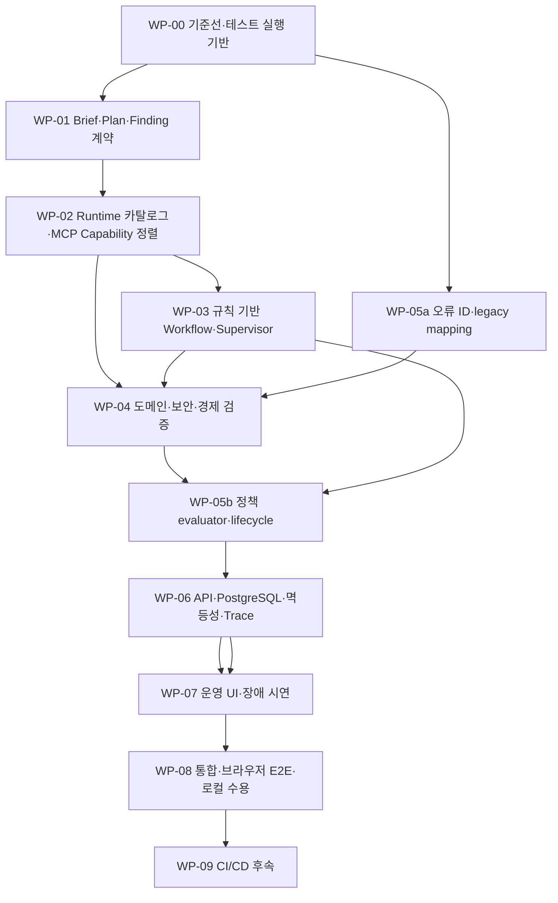

# 기획안 시스템 구현 계획서

## 1. 목적과 적용 기준

이 문서는 현재 `ikonly` checkout의 구현 상태와 [최상위 시스템 설계서](최상위_시스템_설계서.md), [기획 Workflow 상세 설계 라우터](기획안설계/README.md)에 정리한 계약을 연결하는 통합 구현 계획이다. 기능을 처음부터 다시 만드는 대신 현재 코드와 저장 데이터를 기준으로 재사용·보완·신규 작업을 구분한다.

구현 사실과 미확인 항목은 [현재 구현 상태](현재_구현상태.md)를 따른다. Agent·오류 복구·보안·API·UI·Infra 요구는 [기획안 설계 문서](기획안설계/README.md), 테스트별 수용 조건은 [통합 검증 설계 §4–7](기획안설계/09_통합검증_설계.md#4-필수-종단-시나리오)을 따른다. 가상 게임의 완료 범위는 [가상 게임 구현 계획](가상게임_구현계획서.md)과 게임 하위 설계를 따른다.

로컬 구현·검증을 우선한다. 로컬 자동 테스트가 안정화되기 전에는 CI/CD를 구현 완료의 선행 조건으로 두지 않는다. 동작 변경 시 관련 테스트를 자동화하고, 이후 단계의 통합 검증은 각 게이트에서 반복 실행한다.

## 2. 구현 목표와 범위

사용자가 이벤트 Brief를 제출하면 시스템이 버전이 고정된 게임 데이터와 Capability를 근거로 기획안을 작성·검증하고, 지원 여부·데이터 부족·개발 필요를 구분해 결과를 보여준다. 지원 가능한 결과만 사용자가 승인할 수 있고, 승인한 정확한 Plan 버전만 가상 게임 Runtime에 등록된다. workflow 진행·handoff·검증·복구·중단은 실제 상태와 Trace에 기록하고 UI에서 이해하기 쉬운 요약과 펼쳐볼 수 있는 세부 내용으로 제공한다.

포함 범위:

- 기존 Task/승인/가상 게임 Runtime 연결의 호환성을 유지하며 canonical Brief/Plan 및 버전 계약으로 점진 전환
- 게임 Runtime, MCP 조회, 검증기가 동일한 데이터·규칙·Capability 버전을 사용하도록 정렬
- 규칙 기반 Supervisor/Router, 역할별 Agent, 검증·평가·제한된 revision 및 복구
- 오류 코드·정책 버전의 검증, replay preview, 활성화·rollback과 엄격한 불변조건
- 실제 PostgreSQL을 쓰는 workflow·정책·Trace API 및 UI, 멱등성 및 캐시를 추가할 때의 안전 동작
- 읽기 전용 MCP와 도구 권한·입출력 계약·prompt injection 방어
- 로컬 전용 장애 시연, 자동 테스트 계층, 재현 가능한 로컬 실행

제외 범위:

- 실제 상용 게임 계정·서버·경제에 대한 변경과 외부 게임 연동
- MCP를 통한 write, 임의의 사용자 정의 장애 주입, 무제한 자동 수정
- 로컬 테스트 안정화 전에 수행하는 CI/CD 배포 자동화
- 사용자 단일 권한을 넘어서는 다중 작성자·승인자 역할 관리

## 3. 현재 구현에서 이어갈 것

| 영역 | 현재 사실 | 계획 |
|---|---|---|
| 가상 게임 | Phaser/Vite 화면, FastAPI 게임 API, PostgreSQL Runtime과 이벤트 적용 경로가 있다. 일부 게임 수용 기준은 재검증이 남아 있다. | 기능을 재작성하지 않는다. 남은 게임 완료 기준을 게임 계획서에서 닫고, 기존 승인 이벤트 연동을 계약 호환성 기준으로 사용한다. |
| 기존 기획 Workflow | Task 생성·승인·Trace, Agent/Guard/Retry/Fault 모듈, Mock/Backend B 실행 경로가 있다. `backend_b_mock`은 Workflow 응답만 대체하며 Task·승인·Trace·Runtime은 PostgreSQL을 사용한다. | 현재 API와 저장 데이터를 보존하는 additive migration/adapter로 canonical 계약을 붙인다. `WORKFLOW_ENGINE=mock` 결과는 게임 데이터 버전이 없어 Runtime 입력으로 인정하지 않는다. |
| 에이전트 라우팅 | 기존 `backend/app/agents/supervisor.py`에는 LLM 기반 transition/failure review가 있다. 설계 목표는 입력·상태·고정 정책으로 결정되는 규칙 기반 Supervisor/Router다. | Supervisor를 결정적 규칙 컴포넌트로 전환하고 LLM agent 설정·호출·토큰 예산에서 제외한다. Planner와 Critic 등 필요한 역할만 LLM 사용 후보로 둔다. |
| 게임 데이터·MCP | 기존 MCP와 legacy TinyHeroes/Clash 자료가 있으며, 게임 Runtime의 Opong 카탈로그와 계약이 일치하지 않는 경로가 있다. | Runtime 카탈로그를 권위 원천으로 삼고 MCP는 읽기 전용으로 정렬한다. legacy 데이터는 기존 Task 재생·호환에 격리한다. |
| 운영 UI | Streamlit 이벤트 생성·결과·운영 화면과 진행/Trace 관련 컴포넌트가 있다. | Streamlit은 As-Is/fallback으로 두고 `frontend-web/`의 Vite 운영 UI를 권장한다. 진행 단계는 이벤트에서 도출하며 전체 단계를 선고정하지 않는다. |
| 검증 | 기존 테스트는 일부 flat 구조이고 기존 Workflow·Runtime 테스트가 있다. | 기존 테스트를 잃지 않고 unit/component/integration/system/e2e로 점진 분류한다. 새 테스트에는 이 분류를 적용하고 기존 테스트는 관련 수정 시 옮긴다. |
| 배포 | 현재 CI 구성은 일부 프론트엔드에 한정되고 전체 시스템 CI/CD는 완성되지 않았다. | 로컬 게이트 안정화 뒤 저장소 전체 CI/CD로 확장한다. |

세부 commit·명령·확인 여부는 현재 구현 상태 문서가 바뀌면 함께 갱신한다. 이 표는 코드 검토 결과를 대체하지 않는다.

## 4. 작업 흐름과 의존성

순서에서 중요한 선행 조건은 다음과 같다. WP-00이 실행·DB 격리를 준비한다. WP-01과 WP-02는 Brief/Plan 및 게임 근거 계약을 고정한다. WP-03은 상태 전이와 결정 규칙을 구현한다. WP-05의 오류 ID·분류 registry 초안은 WP-04의 의미 검증 구현보다 먼저 확정해야 하며, 복구 action evaluator와 정책 생애주기는 오류 생산자(WP-03/04)와 연결한 뒤 완성한다. WP-06은 안정된 계약과 workflow event를 저장/API에 반영한 뒤 UI(WP-07)에 제공한다. WP-01~06의 상세 구현 일부는 겹쳐 진행할 수 있지만, 이 선행 산출물과 의존성은 건너뛰지 않는다. WP-08 종단 검증 전에 관련 계약과 저장소 변경이 통합되어야 한다. WP-09는 로컬 안정화 게이트를 통과한 뒤 시작한다.

## 5. 작업 패키지

완료 기준의 `E2E`, `G` ID는 [통합 검증 설계](기획안설계/09_통합검증_설계.md)의 시나리오 및 게이트를 가리킨다. 파일 경로는 현재 구조를 기준으로 한 시작점이며, 실제 모델·migration은 현행 코드와 상세 설계의 필드·제약을 대조한 뒤 추가한다.

### WP-00 — 기준선, 실행 절차, 테스트 기반

**작업:** 현재 브랜치·working tree·실행 명령·환경변수·기존 테스트/skip 목록을 기록한다. 로컬 PostgreSQL을 쓰는 테스트 DB를 개발 Runtime 데이터와 분리하고, 테스트 profile에서만 초기화되도록 한다. 기존 flat 테스트를 한 번에 옮기지 않고 새 테스트는 `unit/`, `component/`, `integration/`, `system/`, `e2e/`로 분류하며 기존 테스트는 수정 시 관련 분류로 이동한다. 매 실행에서 명령·환경·commit·adapter 사용·미검증 범위를 남긴다.

**시작 경로:** `backend/tests/`, `mcp_server/tests/`, `demo-game/tests/`, `pyproject.toml`, 기존 실행/seed 설정 및 [현재 구현 상태](현재_구현상태.md).

**필수 산출물:** 실제 저장소에서 확인한 로컬 실행 명령과 필수 환경변수, 각 테스트 suite의 포함/제외 범위, 기준선의 실패·skip 목록, 개발 DB와 disposable 테스트 DB의 연결 설정, `상세 설계 계약 → 실제 schema/API/migration/config/test 파일` 추적표를 만든다. 추적표는 경로를 추정해 완료 처리하지 않고 코드에서 확인한 파일과 새로 만들 파일을 구분한다.

**완료 기준:** 개발 DB와 테스트 DB가 구분되고, 테스트 초기화가 테스트 DB 밖에서 실행되지 않으며, 핵심 기존 테스트를 로컬에서 반복 실행할 수 있다. 기준선의 실패·skip을 새 구현의 통과로 오인하지 않는다. 기준선의 실행 명령·환경·DB 격리·계약 추적표를 문서화한다. G9 전체 통과 판정은 WP-08의 통합 수용 결과로만 한다.

### WP-01 — canonical Brief·Plan·Finding 계약

**작업:** 상세 계약 설계의 필수 필드, nullable 조건, schema version, plan/result version, evidence, 지원 상태(`runtime_eligible`), 개발 필요 항목, 데이터 부족, mission-reward link, 정책/카탈로그 버전 참조를 machine-readable schema와 서버 validator로 구현한다. 기존 `EventPlanResult` 및 Task payload에서 canonical 모델로 가는 명시적 adapter를 만들고 읽기·적용 호환성을 유지한다. legacy payload를 새 계약으로 조용히 승격하지 않는다.

**시작 경로:** `backend/app/schemas/`, `backend/app/validation/`, `backend/app/services/task_service.py`, 기존 Task 저장소 및 migration 위치. 확정 필드와 버전 규칙은 `기획안설계/01_기획안_게임기능_계약_설계.md`, `03_검증_평가_피드백_설계.md`.

**필수 산출물:** machine-readable schema 파일, Python/API validator, 구 legacy Task용 adapter, schema version 호환표, 각 상태·finding의 fixture 및 contract-to-file 추적표.

**완료 기준:** 유효·무효·구버전·미지원·근거누락 fixture가 명확한 결과를 낸다. 기존 승인 Task를 읽고 추적할 수 있으며 canonical validation 전에는 승인/적용되지 않는다. E2E-01~04, G2/G3의 계약 부분을 충족한다.

### WP-02 — 게임 데이터 권위와 MCP Capability 정렬

**작업:** 게임 Runtime과 기획 검증이 같은 버전의 catalog/ruleset/capability snapshot을 조회하도록 정렬한다. `get_event_capabilities`와 `get_event_planning_context`, `get_game_rules`, `get_item_info` 등 필요한 read tool의 입력·출력 schema, 호출 Agent/task allowlist, 권한, timeout, 오류 mapping, snapshot/version/digest를 구현한다. Scope Checker에는 capability 조회를, Rule/Balance Validator에는 콘텐츠·아이템 규칙 조회를, Planner에는 필요한 최소 read tool만 허용한다. Fallback은 snapshot ID, ruleset, event schema, capability version과 digest가 모두 일치할 때만 허용한다. Clash 사례는 공개 참고 자료/예제로 구분한다. MCP는 read-only를 유지하고 업무 write는 승인·Controller·Runtime API 경계에 남긴다. `monster_kill`을 floor clear로 간주하거나 명시적 `mission_id`가 없는 reward link는 동등 capability로 표시하지 말고 adapter를 바로잡는다.

**시작 경로:** `mcp_server/tools/`, MCP 데이터/DB 모듈, `backend/app/services/mcp_client.py`, `backend/app/services/planning_context_loader.py`, `backend/app/repositories/game_runtime.py`, `backend/app/rules/`, `demo-game` catalog/API.

**완료 기준:** catalog/rules/capability 버전이 Plan·Trace·Runtime 적용 결과에 기록된다. 각 지원 행동은 실제 Runtime adapter와 의미상 일치하고, 미지원 행동은 개발 필요로 반환된다. 다른 버전/digest의 데이터 혼합을 거부한다. E2E-02~05, E2E-16, G1/G2/G8의 데이터 계약을 충족한다.

### WP-03 — 결정적 Supervisor/Router와 Workflow 상태 전이

**작업:** 설계의 기본 패턴을 명시적 흐름으로 구현한다: Request Schema/Semantic/Security 검사 → Scope Checker → Event Planner → output contract 검사 → 결정적 Rule/Balance Validator → Critic → 서버 측 Final Consistency → 승인 대기 또는 개발 필요/데이터 부족/차단 결과. Supervisor/Router는 LLM 없이 상태·finding·error·counter·deadline·고정 policy version으로 다음 작업을 결정한다. 자연어 초안·의미 평가가 필요한 Event Planner와 Critic만 LLM Agent로 둔다. Scope Checker, Rule/Balance Validator, Controller, Supervisor/Router, Human Decision Service는 규칙/서비스 기반으로 구현한다. 수정 가능한 finding에 한해 최대 2회 bounded feedback loop를 열고, 매 수정 뒤 영향 검증과 Final Consistency를 다시 수행한다. 독립 작업의 parallel fan-out/fan-in은 MVP에 넣지 않는다. Handoff에서 task/trace/contract version/허용 도구/권한을 검사하고, 수신 Agent 실행 전에 실패를 차단한다. Workflow 진행 이벤트는 실제 state transition에서 생성한다. 취소·deadline·재시도·revision 한도를 enforce한다.

**시작 경로:** `backend/app/agents/supervisor.py`, `backend/app/agents/`, `backend/app/orchestration/{engine.py,routing.py,handoff.py,retry.py}`, `backend/app/schemas/{workflow_state.py,handoff.py}`, `backend/app/config/agents.yaml`.

**완료 기준:** LLM Supervisor review 호출과 설정이 제거되고 route/reason이 결정적으로 검증된다. 위 순차·조건 분기·bounded feedback 패턴과 정식 terminal state(사용자 입력 대기, 사람 검토, 개발 필요, 데이터 부족, 승인 대기, blocked/rejected/cancelled/safe stop)가 설계의 상태표와 일치한다. Planner/Critic 이외 역할은 LLM 호출을 하지 않는다. 불법 Handoff 및 최대 횟수 초과 실행은 수신 Agent를 호출하지 않는다. 표시된 진행 상태가 workflow event와 일치한다. G3/G7과 E2E-13을 충족한다.

### WP-04 — 입력·의미·보안·규칙 기반 경제 검증

**작업:** 형식 검증 후 prompt injection, 금지 요청, 권한 위반을 분류하고 설계 상태에 따라 `BLOCKED` 또는 `SAFE_STOP`으로 종료한다. 의미 검증은 Brief의 목표·대상·기간·장소·유저 행동·보상·행동/보상 연결을 Capability와 게임 규칙에 대조한다. `UNSUPPORTED_BY_POLICY`는 개발 필요로 포장하지 않고 `BLOCKED`로 처리한다. 영향 결과는 설계 계약의 `measured`/`calculated`/`estimated`/`unknown`을 그대로 사용한다. 경제 영향과 난이도는 버전이 고정된 실제 규칙 데이터와 결정적 계산기로 재현 가능할 때 `calculated`로 판정하고, 출처·입력·계산식/`method_ref`를 evidence에 남긴다. 관측 실측치를 쓰는 경우 provenance와 측정 시점을 붙여 `measured`로 기록한다. `estimated`는 근거 표본·가정·확률 모델로 인해 정확한 결정값이 아닌 경우에만 사용하고 그 한계를 표시한다. 근거가 없거나 계산 불가능한 값은 `unknown`으로 둔다. Planner revision 뒤 전체 검증을 다시 수행한다.

**시작 경로:** `backend/app/guards/`, `backend/app/validation/`, `backend/app/rules/game_rule_engine.py`, `backend/app/agents/{critic.py,balance_rule.py}`, capability snapshot 및 contract schema.

**선행 조건:** WP-05의 정식 오류 ID·분류 registry가 먼저 승인되어야 검증기 finding 및 오류 응답에 같은 vocabulary를 사용한다.

**완료 기준:** 보안·정책 차단은 retry/fallback/revision하지 않는다. `UNSUPPORTED_BY_POLICY`는 `BLOCKED`로, 악의적 입력과 권한 위반은 설계된 `BLOCKED`/`SAFE_STOP` 결과로 표시한다. 근거 없는 balance 계산이 성공으로 나오지 않는다. 네 가지 impact status가 상세 설계의 의미와 일치한다. 변경 후 전체 validator를 다시 통과해야 지원 가능 Plan이 된다. E2E-03/04/09, G2/G3/G8을 충족한다.

### WP-05 — 통합 오류 코드와 엄격한 복구 정책

**작업:** 예상 원인·위치별 기존 오류를 통합 오류 catalog로 매핑한다. 식별자는 설계 형식 `ERR-<CAUSE>-<LOCATION>-<ID>`를 그대로 사용하고 외부 응답에는 안정된 error code/reason만 노출한다. 먼저 정식 코드·장소 registry와 legacy alias를 만들고 WP-03/04/06의 모든 발생 지점을 매핑한다. 이후 정책은 분류·조치·재시도 조건·최대 시도·기한·수정 허용 여부·안전 종료를 schema로 정의한다. 기본 한도는 최초 호출 뒤 기술 retry 3회(총 4회), plan revision 2회, workflow 180초, 개별 LLM/MCP 호출 30초, exponential jitter 250ms~4초, workflow당 LLM 호출 최대 8회다. input/output token 및 비용 budget도 실행 설정으로 적용한다. 단가 누락은 workflow 시작을 `SAFE_STOP`으로 막고, provider 사용량을 받지 못한 경우 추정치로 대체하지 말고 null과 사유를 기록한다. DRAFT → validate → replay preview → activate → rollback 생애주기, immutable version, 감사 trace를 구현한다. 보안/권한/계약 위반은 자동 재시도하지 않는다. 일반 운영 설정으로 불변 안전 조건을 완화할 수 없게 한다.

**시작 경로:** `backend/app/orchestration/{routing.py,retry.py}`, `backend/app/fault_injection/`, `backend/app/config/security_policies.yaml`, 새 error catalog/policy schema 및 repository/API.

**분할 완료:** 오류 vocabulary/legacy mapping은 WP-04·WP-06 구현 전에 완료한다. policy evaluator와 activation/rollback은 WP-03/04 상태 이벤트 및 API/저장 계약에 연결한 후 마무리한다. 상세 정책 수치는 [오류 복구 설계](기획안설계/05_오류분류_복구정책_설계.md)의 hard cap과 provider 설정에서 공급하는 값을 구분해 구현한다.

**완료 기준:** 알려진 오류에 원인·위치·코드·정책 결정이 있고 미등록 오류는 안전 종료한다. preview는 실제 Workflow와 Runtime을 변경하지 않는다. 활성 버전은 이후 실행에만 적용되고 실행은 시작 시 버전을 고정한다. activate/rollback이 감사 가능하다. E2E-08/10/14, G4/G5를 충족한다.

### WP-06 — API·PostgreSQL·멱등성·캐시·Trace·원문 보관

**작업:** 상세 API/저장 설계의 논리 자원과 method를 구현 경로에 매핑한다: `/api/v1/event-briefs`(POST/GET), `/workflows`(POST 시작·GET 상태·POST 취소/입력 제공), `/plans`(GET 버전 조회), `/decisions`(POST), `/runtime-events`(POST 등록·GET 상태), `/recovery-policies`(GET/POST draft·validate·preview·activate·rollback), `/traces`(GET). 실제 route prefix/method가 기존 앱과 충돌하면 이름만 조정하고 설계의 동작·필드·응답 의미는 유지한다. 설계에 정의된 논리 엔터티(EventBrief, WorkflowRun, AgentTask, Handoff, EventPlan, ValidationFinding, HumanDecision, RecoveryPolicyVersion, ErrorOccurrence, TraceEvent, RuntimeRegistration, IdempotencyRecord)를 현재 DB schema 및 additive migration으로 매핑하고 기존 Task/승인/Runtime row를 보존한다. route별 request/response/error envelope·HTTP status·idempotency requirement 표와 entity-to-table/index/transaction 표를 산출물로 작성한다. workflow 결과·trace·policy version·catalog digest·usage/cost·idempotency key hash를 transaction 경계와 상관 ID로 연결한다. 쓰기는 규칙 기반 Controller/API만 수행하며 MCP는 읽기 전용이다. 같은 actor/operation/key/hash 재시도와 다른 payload conflict를 DB 권위로 구현한다. Redis는 초기 MVP 필수 구성에서 제외한다. 이후 cache를 도입하더라도 읽기 최적화로만 쓰고 권위 데이터나 멱등성 원장으로 삼지 않으며, cache miss/장애 시 DB 권위 조회 또는 명시된 제한 상태를 반환한다. prompt 및 raw LLM 응답은 제한된 저장소/권한과 30일 보존으로 관리하고 일반 Trace에는 원문 대신 참조·요약만 노출한다. DB/backup at-rest 암호화의 실제 로컬 제공 수단과 검증 증거, 원문 접근 감사·삭제 절차도 기록한다. Provider가 token/cost를 제공하지 않으면 null과 사유를 저장하고 추정하지 않는다.

**시작 경로:** `backend/app/api/`, `backend/app/repositories/`, `backend/app/services/{task_service.py,trace_service.py,idempotency_service.py,db_service.py,llm_service.py}`, DB migration 및 infra 설정. 실제 구현 경로는 WP-00의 계약-to-file 표에서 확정한다.

**필수 설정 매핑:** backend에만 저장되는 provider/model/model-config, 최대 input/output token, 가격표·가격 버전·비용 상한·통화, 실행 timeout, 개발 frontend Origin/session 방식, DB 및 prompt 제한 영역의 저장·at-rest encryption 수단을 실제 환경값과 설정 파일/secret 주입 경로로 연결한다. 비밀값 자체는 계획서에 쓰지 않는다.

**완료 기준:** API에서 실제 PostgreSQL 상태를 확인할 수 있다. 같은 scope/key/hash 재전송은 같은 결과, 다른 payload는 conflict다. transaction 실패·결과 불명·Trace 실패가 성공으로 숨겨지지 않는다. Redis/cache를 활성화한 구성에서는 부재·장애가 중복 보상이나 상태 불일치를 만들지 않는다. prompt 원문 접근·보존 규칙이 검증된다. E2E-05~07/12/14/15와, Redis/cache를 구성에 포함하는 경우 E2E-11, G1/G5/G6/G8의 저장 부분을 충족한다.

### WP-07 — 운영자 UI와 통제된 장애 시연

**구현 방식:** Streamlit은 현재 화면의 동작을 참고하고 새 운영 UI의 목표 기술로 사용하지 않는다. Streamlit은 대체 화면이 수용될 때까지 기존 기능 확인용 fallback으로만 유지한다. 기본 rerun 실행 모델에 polling·진행 이벤트·다중 화면 상태를 결합하면 UI 동작을 추적하기 어렵고, fragment를 써도 별도 상태·갱신 제어가 필요하다. 따라서 `frontend-web/`에 Vite 기반 JavaScript 모듈 UI를 두는 방안을 권장한다. Vite는 이미 게임 프로젝트에서 사용하며 별도 UI 프레임워크 의존성을 추가하지 않고 Edge용 운영 화면을 구성할 수 있다. WP-07 시작 시 Node/Vite 실행 환경과 기존 배포 영향만 확인하고 이 구성을 확정하거나 변경 근거를 기록한다. 게임 렌더러와 운영 콘솔은 분리한다. 운영 콘솔은 등록·적용 이력을, Phaser 게임은 실제 이벤트 장소·미션 진행을 보여주며 두 화면은 동일한 Runtime event/source version을 표시해 연결한다.

| 설계 화면 | 기존 참고 경로 / 구현 대상 | 화면 배치·동작 | 데이터/API 연결 | 검증 기준 |
|---|---|---|---|---|
| 기획 시작 | 참고: `frontend/pages/1_event_create.py`, `frontend/components/event_form.py`, `frontend/services/backend_client.py`; 목표: `frontend-web/src/pages/event-create.js`, `src/components/event-form.js` | 목적·대상·기간·장소·행동·보상·영향·제약 입력 → 형식 검사 결과 → 제출. 필드 오류는 입력 옆에 표시하고 중복 제출을 막는다. | `POST /api/v1/event-briefs`, `POST /api/v1/workflows`; 서버가 산출한 `brief_id`/`workflow_id` 표시 | E2E-01~04: 유효·미지원·근거 부족·형식 오류 분기 |
| 진행 상황·Trace | 참고: `frontend/pages/2_event_result.py`, `frontend/components/{workflow_status,trace_viewer,autohealing_view,recovery_summary}.py`; 목표: `src/pages/workflow-detail.js`, `src/components/{workflow-timeline,trace-panel,recovery-summary}.js` | 요약 상태와 다음 행동을 상단에 표시하고 시간순 실제 이벤트를 아래에 둔다. 재시도는 동일 단계의 attempt 번호로 보인다. 전체 단계 수를 미리 표시하지 않는다. 기술 세부정보·오류 코드·안전 요약은 접어서 연다. | `GET /workflows/{id}`, `/traces?workflow_id=...`; UI는 event stream/polling 결과를 사용하고 클라이언트가 단계를 만들어내지 않는다. | E2E-13, G7: 화면 상태·attempt·reason·Trace ID와 저장 이벤트 일치 |
| 결과 검토·개발 필요·데이터 부족·확인 대기 | 참고: `frontend/pages/2_event_result.py`, `frontend/components/event_result.py`; 목표: `src/pages/plan-result.js`, `src/components/{plan-summary,findings-panel,approval-actions}.js` | 같은 결과 화면에서 상태별 섹션을 조건부 표시한다. 지원 가능 Plan은 미션-보상·근거·영향과 승인/거절을, 개발 필요는 `required_work`·영향·수용 조건을, 데이터 부족은 누락 근거·재실행 조건을 보여준다. 사용자 확인 대기는 질문 응답을 새 Brief version/execution으로 제출한다. `runtime_eligible=false`에는 승인 버튼을 그리지 않는다. | `GET /plans/{plan_id}?version=...`, `POST /decisions`, Workflow resume/answer API; 버튼 노출 여부와 무관하게 서버가 eligibility와 version을 재검사한다. | E2E-02~05, G1/G2: 승인 대상 Plan version 고정, 미지원·데이터 부족 결과는 승인/등록 불가 |
| Runtime 등록·운영 이력 | 참고: `frontend/pages/3_ops_debug.py`; 목표: `src/pages/runtime-operations.js`; 게임 내 이벤트 경험은 `demo-game/src/main.js`, `demo-game/src/api.js`, `demo-game/src/scenes/{LobbyScene,DungeonScene,ResultScene}.js`를 검토해 필요한 변경 대상 확정 | 운영 콘솔에는 등록 성공/실패, source Task/Plan version, catalog version, 진행·보상 기록을 요약한다. 게임에서는 적용된 특별 이벤트의 장소·미션·진행 상태를 실제 장면에서 보여준다. 운영 콘솔의 링크/식별자를 통해 해당 게임 이벤트를 확인할 수 있게 한다. | `/runtime-events`, 기존 Game Runtime state/event API. source Task와 `plan_id/result_version` 매핑을 표시한다. | E2E-05/06, G1: 승인 버전과 등록 버전 동일, 새로고침 후 DB 값 유지, 중복 등록 시 중복 보상 없음 |
| 복구 정책 | 참고: `frontend/pages/3_ops_debug.py`, `frontend/components/recovery_summary.py`; 목표: `src/pages/recovery-policy.js`, `src/components/recovery-policy-editor.js` | 활성/이전 버전 목록 → draft 편집 → schema·hard cap 검사 → 오류 표본 replay preview(변경 전/후 route·영향 오류·차단 경로) → 활성화 확인 → rollback. 단일 사용자 화면으로 시작하되 보호된 불변조건은 편집 불가다. | `/recovery-policies` GET 및 draft/validate/preview/activate/rollback 동작. 모든 변경에 idempotency key와 감사 결과 표시. | E2E-10, G5: immutable version·실행 시 고정 버전·rollback 감사 Trace |
| 장애 시연 | 참고: `frontend/pages/3_ops_debug.py`, `frontend/components/{autohealing_view,trace_viewer}.py`; 목표: `src/pages/fault-demo.js`, `src/components/fault-scenario-runner.js` | scenario 선택 → 영향·기대 결과 확인 → 실행 → event timeline/attempt/정책/terminal state 확인. 실제 장애가 아닌 로컬 격리 시연임을 계속 표시한다. 임의 오류 입력 기능은 두지 않는다. | Demo API가 허용 ID만 수락하고 실제 Controller/Router/policy/Trace 경로로 격리 Workflow를 실행한다. | E2E-18, G4/G7: `01` timeout 1회 후 성공, `02` 총 4회 뒤 SAFE_STOP, `03` revision 뒤 전체 재검증; Runtime 전후 상태 동일 |

**공통 화면 상태:** 각 화면은 loading, 빈 결과, API 연결 실패, 데이터 부족, 권한/정책 차단, 진행 중, 성공, 안전 중단을 구분한다. 핵심 상태는 색상 외 텍스트/아이콘으로도 전달하고, 사용자 요약과 내부 상세 정보를 분리한다. 일반 화면에는 raw prompt, secret, stack trace를 노출하지 않는다.

**필수 산출물:** `frontend-web/index.html`, `package.json`, `vite.config.js`, `src/main.js`, `src/router.js`, `src/api/client.js`, `src/pages/`, `src/components/`, `src/styles/` 구조로 Vite app skeleton을 둔다. API client와 실제 progress event 갱신 방식(SSE 가능 여부 확인 후 polling fallback), Edge 로컬 실행 절차를 구현 착수 때 확인한다. 위 표의 목표 파일에 화면을 구현하고, 현재 Streamlit 화면은 동등 기능 수용 전까지 fallback으로 보존한 뒤 retire 여부를 결정한다. 새 운영 UI가 기존 GitHub Actions의 Streamlit 배포 설정에 미치는 변경은 CI/CD 정책에 따라 로컬 검증 안정화 후 후속 작업으로 분리한다.

**시작 경로:** 기존 동작 참고는 `frontend/app.py`, `frontend/pages/`, `frontend/components/`, `frontend/services/backend_client.py`, `frontend/styles/`; 신규 운영 UI는 `frontend-web/`; 게임 연결은 `demo-game/src/`.

**완료 기준:** 화면별 자동 계약 검사와 [UI 의미·디자인 체크리스트 UX-01~07](기획안설계/07_UI_UX_운영자콘솔_설계.md#81-의미디자인-검증-체크리스트)을 모두 기록한다. UI의 상태·버전·시도·결과는 API/Trace/DB와 일치하고, 결과 상태에 맞는 행동만 제공한다. 차단 결함은 0건이어야 하며, 검토에 사용한 Edge viewport와 상태 fixture/실 Trace ID를 남긴다. 복구 정책 draft/replay/activate/rollback은 서버 검증과 감사 기록을 거친다. 장애 시연은 정해진 fault sequence와 기대 terminal state를 보이고 Runtime event·mission·reward DB 상태를 바꾸지 않는다. E2E-02~06/10/13/18, G1/G2/G4/G5/G7/G8을 충족한다.

### WP-08 — 로컬 시스템 검증 및 수용

**작업:** WP-00의 테스트 계층에 맞춰 계약·도메인 규칙 단위 검사, Agent/Tool 경계 component 검사, 실제 PostgreSQL/MCP 통합 검사, 전체 Workflow system 검사, 브라우저 E2E를 연결한다. E2E-01~18과 G1~G9를 완료 게이트로 추적한다. 각 deterministic fault 시나리오는 3회 연속 동일 기대 결과인지 확인한다. 별도 테스트 DB/fixture를 사용하고 Edge 사용자 수용 과정에서 기존 데모 계정 DB를 임의 reset하지 않는다. 외부 LLM/provider를 쓰지 않은 검증은 deterministic adapter 사용을 기록하고 실제 provider 연동과 구분한다. 가상 게임의 남은 수용 기준은 기존 게임 계획에 따라 확인하고 중복 구현하지 않는다.

**완료 기준:** G1~G9의 증거가 있고 실패·skip·미실행 범위가 명시된다. T5 로컬 안정화는 문서화된 깨끗한 실행 절차와 별도 테스트 DB로 전체 T5 suite를 3회 연속 통과하고, 최소 1회는 서비스 중지 상태에서 문서 절차대로 재기동한 뒤 실행한 경우로 판정한다. 각 run은 같은 고정 fixture와 환경 profile을 사용하며 사용자 게임 DB를 초기화하지 않는다. 외부 provider smoke는 별도 표시하고 기본 T5 통과로 오인하지 않는다. 지원 기능·복구·안전 중단·승인 적용·DB 영속성을 자동화로 확인하며 사용자는 최종 UX/시연 수용을 수행한다.

### WP-09 — 로컬 안정화 후 CI/CD

**착수 조건:** WP-08의 T5 기준(문서화된 suite 3회 연속 통과, 서비스 재기동 포함)을 충족하고, 테스트 명령·테스트 DB·필수 환경·artifact 기준이 문서화되어야 한다. 이 조건 전에는 CI/CD를 범위에 넣지 않는다.

**작업:** 안정화된 로컬 lint/schema/unit/component/integration/system/e2e/build 명령을 GitHub Actions에 연결한다. 실패 시 artifact publish/deploy를 막고 성공 artifact에는 commit/digest를 기록한다. 배포 범위가 결정되면 AWS/Docker 경로, migration/health/readiness, 롤백을 Infra 설계 기준으로 구현한다.

**완료 기준:** 실패 gate가 publish/deploy를 차단하고 배포 health 실패 시 rollback이 재현된다. G10 증거를 추가한다. AWS target이 미결정이면 로컬/CI 단계와 배포 부분을 구분해 기록한다.

## 6. 테스트 실행 게이트

| 게이트 | 실행 시점 | 검사 범위 | 다음 단계 조건 |
|---|---|---|---|
| T0 기준선 | 작업 시작 및 구조 변경 | 기존 lint/format/test/build, 환경·skip 기록 | 기존 상태 기록 |
| T1 계약 | WP-01/02 변경마다 | schema, version, fixture, MCP 경계 | 구버전·미지원·잘못된 의미 거부 |
| T2 Workflow/보안 | WP-03/04/05 변경마다 | 결정적 route, Handoff, validator, error/policy replay | 불변조건 위반 차단, 정상 경로 통과 |
| T3 저장/통합 | WP-06 및 migration마다 | 별도 PostgreSQL, transaction, idempotency, Trace; cache가 구성된 경우 fallback | 재전송·실패 시 정합성 보장 |
| T4 UI/시스템 | WP-07 이후 | 실제 API+DB Workflow, 로그/정책/장애 시연, UX-01~07 의미·시각 체크리스트 | 화면과 persisted event 일치, 위험한 상태/CTA 오표시 0건, Runtime 불변 |
| T5 로컬 수용 | WP-08 | E2E-01~18, G1~G9, Edge 핵심 경로 | 반복 실행으로 안정화 판정 |
| T6 CI/CD | T5 통과 뒤 | 동일 명령, publish/deploy gate, health/rollback | G10 증거 확보 |

외부 provider·브라우저·DB가 없는 실행은 해당 경계의 검증으로 간주하지 않는다. 사용한 adapter와 미검증 범위를 결과에 기록한다.

## 7. 위험과 대응

| 위험 | 대응 |
|---|---|
| 기존 Task/API·승인 결과의 breaking change | canonical schema를 additive로 도입하고 legacy adapter 및 승인 Task 회귀 검증을 먼저 둔다. |
| Runtime과 기획 검증의 catalog 의미 불일치 | 동일 version/digest와 행동 단위를 확인하기 전에는 지원으로 표시하지 않는다. |
| Mock profile을 실제 agent/provider 검증으로 오해 | 실행 profile 및 adapter를 Trace/UI에 표시하고 DB 연결·외부 호출 여부를 구분한다. |
| policy UI가 안전 기준 완화 경로가 됨 | immutable version, schema/guard/replay, invariant, 감사 이벤트를 activation에 강제한다. |
| 장애 시연이 실제 게임 상태를 바꿈 | Workflow 전용 fixture namespace, demo allowlist, Runtime 상태 전후 검증으로 격리한다. |
| DB 테스트가 사용자 진행 데이터를 초기화 | 테스트 DB만 reset 권한을 갖게 하고 기존 데모 DB를 테스트 설정에 사용하지 않는다. |
| 오래된 테스트 결과를 최신 검증으로 오인 | 기존 결과는 기준선 시점으로 표시하고 변경된 계약의 최신 결과만 gate 증거로 인정한다. |
| CI/CD를 너무 일찍 시작해 환경 실패가 구현을 막음 | 로컬 test/build 안정화 이후 별도 WP-09로 시작한다. |

## 8. 완료 판정과 문서 동기화

전체 구현 완료는 WP-00~08과 G1~G9의 증거가 있고, 게임 완료 기준이 [가상 게임 구현 계획](가상게임_구현계획서.md)에서 확인된 상태다. CI/CD는 사용자가 정한 순서에 따라 로컬 안정화 후 WP-09/G10으로 별도 완료 처리한다.

각 WP 종료 시 변경 경로, migration/API/schema version, 실행 명령, 테스트 결과, 미검증 경계, 관련 commit을 [현재 구현 상태](현재_구현상태.md)에 기록한다. API·schema·오류·설정·실행 절차가 달라지면 상세 설계와 `기획안설계/README.md`도 동기화한다. `pre/` 스냅샷은 보존한다.

## 9. 참조 문서

- [최상위 시스템 설계서](최상위_시스템_설계서.md)
- [기획안 Workflow 설계 라우터](기획안설계/README.md)
- [계약 설계](기획안설계/01_기획안_게임기능_계약_설계.md)
- [멀티 에이전트·Workflow 설계](기획안설계/02_멀티에이전트_Workflow_설계.md)
- [검증·평가·피드백 설계](기획안설계/03_검증_평가_피드백_설계.md)
- [보안·권한 설계](기획안설계/04_보안_권한_설계.md)
- [오류 분류·복구 정책 설계](기획안설계/05_오류분류_복구정책_설계.md)
- [API·저장·Trace 설계](기획안설계/06_API_저장_Trace_설계.md)
- [UI·UX 운영자 콘솔 설계](기획안설계/07_UI_UX_운영자콘솔_설계.md)
- [Infra·네트워크·운영 설계](기획안설계/08_Infra_네트워크_운영_설계.md)
- [통합 검증 설계](기획안설계/09_통합검증_설계.md)
- [Runtime Capability·MCP 계약](기획안설계/10_RuntimeCapability_MCP_계약.md)
- [현재 구현 상태](현재_구현상태.md)
- [가상 게임 구현 계획](가상게임_구현계획서.md)
