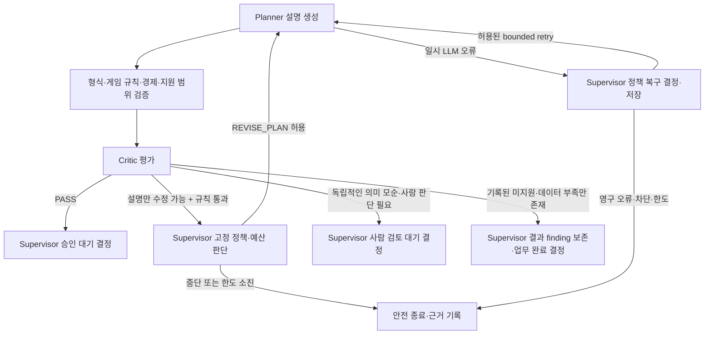

# 멀티 에이전트·Workflow 설계

## 2026-10-11 정책 복구 연결 보완

현재 구현 계약은 [정책 연결 보완 §6](15_오류대응정책_Workflow_연결_재검사.md#6-정책-연결-보완-구현)을 따른다.



MCP 조회·fallback도 동일한 분류/정책 결정 순서를 거친다. 그림의 Supervisor는 규칙 기반 결정자이며 별도 LLM Agent가 아니다. 고정 사용자 조건을 자동 수정하는 루프는 없다.

2026-10-13 보완: 지원 범위 제한만 있는 결과는 런타임 실행을 차단한 COMPLETED로 끝낸다. Critic이 기존 제한을 중복 REVIEW로 보고한 경우의 구조화 findings·서버 대조·원문 보존 조건은 [검증 설계의 최신 보완](03_검증_평가_피드백_설계.md#2026-10-13-미지원-결과와-critic-검토의-구분)을 따른다. 새로운 의미 모순이나 보안 차단을 일괄 PASS로 변경하지 않는다.

> 2026-10-11 검사 후 보완: 아래 내용은 설계 기준이며 구현 완료 선언이 아니다. 최신 보완 계약은 [Workflow 수정 계획 §3.1](14_Workflow_검사결과_설계보완_수정계획.md), 현재 사실은 [현재 구현 상태](../현재_구현상태.md)를 따른다.

## 검사 후 추가 적용 기준

실행·복구의 모든 결정은 같은 versioned 저장 경계를 사용하고 저장 성공 뒤 실행 snapshot을 갱신한다. deadline·budget·취소와 handoff 거절도 이 경계를 따른다. 코드 상태 WAITING_APPROVAL/WAITING_REVIEW와 설계 alias의 읽기 매핑을 명시한다.

구체 변경 위치·의존 순서·검증 증거는 [수정 작업 §4 및 검증 §5](14_Workflow_검사결과_설계보완_수정계획.md#4-구현-순서와-변경-범위)에 연결한다. 기존 계약과 중복되면 이번 보완의 더 엄격한 저장·접근·검증 조건을 적용한다.

## 1. 목적·현재 기준

이 문서는 [기획안·게임 기능 계약](01_기획안_게임기능_계약_설계.md)을 기준으로 Agent 역할, task 분할, handoff, 실행 패턴 및 상태 전이를 구체화한다.

현재 Backend에는 Supervisor, Event Planner, Balance Rule, Critic 경로와 오류별 routing 정책이 있다. `retry.py`의 기본값은 기술 재시도 3회, Planner 수정 2회다. canonical 기획안 경로는 새 Supervisor state reducer를 사용하기 시작했지만, 기존 `WorkflowEngine` 실행 경로는 아직 별도 상태 분기를 갖는다. 이는 목표 아키텍처의 별도 Backend가 아니라 공통 Workflow로 수렴해야 할 이전 코드 경로다. 저장소 CAS와 정책 Registry, 개발 필요 결과 상태, 운영자용 Workflow 시각화의 최신 구현 판정은 [현재 구현 상태](../현재_구현상태.md)를 따른다.

## 2. 책임과 역할

| 역할 | 입력 | 책임 | 출력/종료 상태 | 금지 |
|---|---|---|---|---|
| Workflow Controller | 요청, 작업 참조, 저장소 | Supervisor가 결정한 상태·전이·결과를 저장하고 API·DB side effect 실행 | 영속화된 Workflow snapshot과 operation 결과 | 상태 전이·업무 ID를 독자적으로 생성하거나 Agent 결과를 검증 없이 확정하지 않음 |
| Scope Checker | Brief, capability catalog/version | 각 venue/action/reward/template 지원상태 평가 | per-field capability findings | LLM 추측으로 지원 여부 판정 금지 |
| Supervisor/Router | 검증된 요청·Brief, 상태, 결과, policy ref | 권위 Workflow 상태와 전이, 미션·보상 ID 연결, 다음 작업·handoff·복구 경로 결정 | 상태 snapshot, 구조화 route decision과 `reason_code` | LLM Agent가 아니며, 규칙·정책·권한·hard limit 생성/변경 금지 |
| Event Planner | 검증된 Brief, data snapshot, findings | 이벤트 초안 생성·허용 범위 수정 | Event Plan candidate | 지원되지 않는 기능을 지원된 것으로 작성 금지 |
| Balance/Rule Validator | Plan, rules/data version | 가능성·조건·보상 영향·제약 평가 | `PASS`/`REVISE`/`HUMAN_REVIEW`/`BLOCK` finding | 미확인 값을 사실처럼 추정 금지 |
| Critic | Brief, Plan, validation/evidence | 요청 적합성·완전성·근거·일관성 평가 | 평가 finding 및 결론 | 정책 판정·최종 승인 대행 금지 |
| Human Decision Service | 검증된 결과/version | 최종 이벤트 승인·수정요청·거절; 운영 정책 활성화 | actor·decision·time audit | 보안 차단을 해제할 수 없음 |

## 3. Task와 Handoff 계약

각 Agent invocation은 다음 공통 context를 받는다.

```yaml
task_id: string
workflow_id: string
trace_id: string
task_type: string
assignee: agent_id
attempt: integer
revision_count: integer
input_contract_version: string
input_ref: string
brief_ref: { id: string, version: string }
game_context: { source: string, domain_schema_version: string, event_schema_version: string,
                game_data_snapshot_id: string, game_ruleset_version: string,
                capability_catalog_version: string, balance_policy_version: string }
recovery_policy_ref: { recovery_policy_id: string, recovery_policy_version: string }
allowed_tools: [tool_id]
deadline_at: datetime
```

LLM을 사용하는 invocation은 추가로 `prompt_template_id`, `prompt_template_version`, `provider`, `model_id`, `model_config_version`, `max_input_tokens`, `max_output_tokens`를 받는다. Prompt template은 코드 저장소에서 버전 관리하고, 사용자 Brief·게임 데이터·이전 결과는 명시적 변수로 렌더링한다. 렌더링 결과와 원문 응답은 [API·저장·Trace 설계](06_API_저장_Trace_설계.md)에 따라 제한된 DB record로 저장한다. 모델 응답은 각 Agent 출력 계약 검증을 통과하기 전까지 workflow state 변경에 사용하지 않는다.

### 3.2 Supervisor 권위 데이터 계약

미션 `action_id`, 보상 `reward_id`, 미션-보상 연결 ID와 Workflow 상태의 권위자는 Supervisor다. 사용자 요청 계약은 이 내부 ID를 받지 않고, Supervisor가 검증된 입력의 항목 순서에 따라 ID를 발급해 연결한다. Planner 입력에는 이 ID를 전달하지 않으며, Planner 출력에도 ID를 요구하지 않는다. Supervisor는 순서가 보존된 설명 목록을 검증한 뒤 자신의 원본 ID를 결합한다. LLM은 요약과 설명만 제안하며 Brief 값, ID, 상태를 생성·수정하지 않는다. Controller는 Supervisor가 반환한 상태와 연결 결과를 저장하고 요청 side effect를 수행한다. `canonical-planner-input.v2` 및 `canonical-planner-output.v2`가 이 계약을 따른다.

이 책임 분배는 이번 논의에서 확정한 방향이다. 이전 상세 설계와 구현 계획은 Workflow Controller가 상태 전이·카운터를 관리하고 Supervisor가 다음 route와 복구 경로를 선택하는 것으로 나눠 적었다. 따라서 “Supervisor가 오류 대응을 결정한다”는 기존 내용은 있었지만 “Supervisor가 모든 Workflow 상태의 권위자다”는 내용은 기존 문서에 명시되어 있지 않았다.

2026-10-11 통합 구현 진행: canonical `EventBriefInput`은 ID 없이 action/reward를 받고 위치 인덱스로 연결하며, Supervisor가 서버 ID를 발급한다. canonical과 기존 Task API는 공통 `SupervisorWorkflowState` reducer로 전이·복구 결정을 내리고 trace에 정책 버전·오류 코드·근거를 반영한다. canonical lifecycle과 Task Trace 모두 version CAS 및 멱등 상태 버전 저장을 사용하며 MCP 복구 카운터도 snapshot에 반영한다. 남은 검증은 PostgreSQL 경합·중단 복구와 UI 세부 근거 표시다. 과거 “Backend B”는 동일 FastAPI backend 안의 agent Workflow 실행기 명칭이므로 별도 Backend나 배포 단위로 취급하지 않는다. 최신 진행표는 [Supervisor 상태 전이·복구 결정 통합 구현 계획](13_Supervisor_상태전이_복구결정_통합구현계획.md#9-구현-진행-및-남은-범위)과 [현재 구현 상태](../현재_구현상태.md)를 따른다.

### 3.1 Tool/MCP 호출 계약

MCP Tool catalog는 각 도구에 `tool_id/version`, `description`, `read_only`, `input_schema`, `output_schema`, `allowed_agent_ids`, `allowed_task_types`, `source_version_fields`, `timeout_seconds`, `retry_class`, `error_mapping`을 등록한다. 초기에는 `read_only=true`인 게임 규칙·카탈로그·세그먼트 기준 조회 도구만 허용한다. scope/지원 여부 확인은 Scope Checker, 규칙·밸런스 조회는 해당 Validator에만 최소 allowlist를 부여한다. Planner는 꼭 필요한 읽기 도구만 명시적으로 허용한다. 게임 지원 범위와 Tool별 실제 입력·출력 계약은 [Runtime Capability·MCP 데이터 계약](10_RuntimeCapability_MCP_계약.md)을 단일 기준으로 한다.

모든 도구 입력은 Schema와 요청 task의 게임 데이터 버전을 함께 검증하고, 응답은 출처·버전과 함께 output Schema를 검증한다. 결과가 없거나 버전이 맞지 않으면 빈 값으로 성공 처리하지 않고 `NEEDS_DATA` 또는 등록된 dependency/contract error로 반환한다. 초기 MCP의 쓰기 Tool은 없다. DB write, 정책 활성화, 승인, Runtime 적용은 MCP를 우회해 내부 API/서비스에서 Controller의 권한 검사·멱등성·transaction 경계를 거친다.

Handoff 결과는 최소 `task_id`, `from_agent`, `to_agent`, `outcome`, `output_contract_version`, `result_ref`, `findings[]`, `evidence_refs[]`, `started_at`, `completed_at`을 가진다. 크기가 큰 payload는 trace에 복사하지 않고 versioned repository ref로 전달한다.

수신자는 다음을 확인한 후 실행한다.

1. 현재 Workflow 상태에서 허용된 수신 Agent인지
2. 입력 계약 버전과 필수 필드가 맞는지
3. Brief 및 game data/rules version이 동일 작업 기준과 일치하는지
4. 도구 allowlist와 deadline이 현재 유효한지
5. 이전 결과가 revision 대상인 경우 그 finding이 명확히 전달됐는지

불일치 시 해당 task는 실행되지 않고 `HANDOFF_CONTRACT_INVALID` 계열 오류로 반환된다.

## 4. Workflow Pattern과 실행 순서

Supervisor/Router는 LLM 호출 없이 결정적 규칙 기반 컴포넌트로 구현한다. 입력은 검증된 Workflow 상태, 구조화 finding/error, 카운터, deadline, 고정된 policy version이며, 출력은 허용된 다음 상태·작업과 결정 근거 코드다. 동일 입력과 동일 policy version은 항상 같은 route를 반환해야 한다. LLM은 Event Planner와 Critic처럼 자연어 생성·의미 평가가 필요한 역할에만 사용한다.

초기 설계에서 실제로 필요한 패턴만 사용한다.

1. **Sequential:** 입력 검사 → Scope Check → Planner → Balance/Rule Validation → Critic → 결과 분기
2. **Conditional Router:** 지원 상태, 검증 결과, 보안 판정에 따라 다음 작업·terminal state 선택
3. **Bounded feedback loop:** 수정 가능한 finding을 Planner에 되돌리고 전체 영향 검증을 다시 수행. 현재 기준 수정 최대 2회, 상세 정책에서 재확정
4. **Parallel fan-out/fan-in:** 초기 필수 아님. 독립적인 게임 규칙 조회/평가가 실제 latency 이점과 안전한 merge 계약을 가질 때만 도입

Agent 간 모든 직접 호출을 그래프화하지 않는다. Controller가 상태와 handoff를 기록해 workflow timeline을 생성한다.

## 5. 상태 모델

| 상태 | 진입 조건 | 허용 다음 상태 |
|---|---|---|
| `RECEIVED` | 유효 요청이 접수됨 | `INPUT_VALIDATION`, `CANCELLED` |
| `INPUT_VALIDATION` | 기본 필드·타입·범위 검사 | `AWAITING_USER_INPUT`, `SECURITY_REVIEW`, `REJECTED` |
| `AWAITING_USER_INPUT` | Brief에 필수 사용자 입력 누락 | 새 Brief version으로 재개, `CANCELLED` |
| `SECURITY_REVIEW` | 의미·보안 Guard 처리 | `SCOPE_CHECK`, `AWAITING_HUMAN_REVIEW`, `BLOCKED`, `SAFE_STOP` |
| `SCOPE_CHECK` | catalog version 확보 | `PLANNING`, `PLAN_READY_WITH_DATA_GAPS`, `SAFE_STOP` |
| `PLANNING` | 요청·capability finding이 준비됨 | `VALIDATING`, `SAFE_STOP` |
| `VALIDATING` | schema·rules·critic 검사 | `REVISING`, `AWAITING_FINAL_APPROVAL`, `PLAN_READY_WITH_DEVELOPMENT_ITEMS`, `PLAN_READY_WITH_DATA_GAPS`, `AWAITING_HUMAN_REVIEW`, `BLOCKED`, `SAFE_STOP` |
| `REVISING` | 수정 가능 finding과 예산이 있음 | `PLANNING`, `VALIDATING` |
| `AWAITING_HUMAN_REVIEW` | 불명확한 근거/상충 조건 | 사용자 추가 입력으로 새 execution, 또는 `REJECTED`; 해소 후에는 재검증 상태로만 복귀 |
| `PLAN_READY_WITH_DATA_GAPS` | 근거 데이터가 부족해 검증을 완료할 수 없음 | terminal. 필요한 데이터·출처·재실행 조건 반환, Runtime 적용 불가 |
| `AWAITING_FINAL_APPROVAL` | 모든 required capability 지원되고 검증 통과 | `APPROVED`, `REVISION_REQUESTED`, `REJECTED` |
| `REVISION_REQUESTED` | 사용자가 승인 대기 결과에 수정을 요청 | 현재 실행은 terminal; 수정 지시와 원본 버전을 연결해 새 execution 생성 |
| `PLAN_READY_WITH_DEVELOPMENT_ITEMS` | 개발 필요 finding이 안전하게 설명됨 | terminal. Runtime 적용 불가 |
| `APPROVED` | 단일 사용자가 해당 result version 승인 | terminal for planning; 별도 Runtime apply |
| `BLOCKED`, `REJECTED`, `CANCELLED`, `SAFE_STOP` | 보안·입력·운영 판단에 따른 종료 | terminal |

`NEEDS_DEVELOPMENT`/`NEEDS_DATA`는 평가 finding/result 값이고, `PLAN_READY_WITH_DEVELOPMENT_ITEMS`/`PLAN_READY_WITH_DATA_GAPS`는 Workflow terminal state다. `HUMAN_REVIEW`는 평가 결과, `AWAITING_HUMAN_REVIEW`는 Workflow 상태다. 이 매핑은 [기획안·게임 기능 계약](01_기획안_게임기능_계약_설계.md)의 표를 단일 기준으로 유지한다. `CANCELLED`는 명시적인 사용자 취소 요청에 따른 non-terminal 상태의 전역 전이다. Schema 자체가 잘못된 요청은 `REJECTED`; Schema는 유효하지만 필수 의미 입력이 모호하거나 빠진 경우만 `AWAITING_USER_INPUT`으로 둔다.

상태명은 논리 모델이다. 기존 DB/API 열거값과 호환하는 실제 migration은 API 설계에서 정한다. 사람 수정 요청으로 재개하면 새로운 execution/revision identity를 기록하고 이전 결과·승인은 보존한다.

## 6. 결정 규칙

- capability finding은 Planner 입력에 포함한다. `NEEDS_DEVELOPMENT` finding이 사라지지 않도록 output까지 추적한다.
- 기술 오류는 허용된 task만 retry한다. 도메인 finding은 revision이며 서로 다른 카운터를 쓴다.
- `PLAN_READY_WITH_DEVELOPMENT_ITEMS`는 완성된 실행 기획과 구분되는 제안 결과다. `runtime_eligible=false`를 보존한다.
- security block은 retry/fallback/revision route에 태우지 않는다.
- 알 수 없는 route 또는 policy lookup failure는 `SAFE_STOP`한다.
- Supervisor는 상태 전이표·policy evaluator·hard limit 검사를 거쳐 다음 권위 상태와 route를 한 번에 결정한다. Controller는 그 결과를 영속화한다. 구현 시 Controller가 별도 상태 전이를 만들지 않도록 한다. Supervisor가 허용되지 않은 route를 반환하면 실행하지 않고 `SAFE_STOP`한다.

## 7. Trace와 완료 기준

각 task event에는 workflow/trace ID, Agent·Tool, state transition, contract/version, attempt/revision, result/finding, policy reference, time과 terminal decision을 연결한다. 사용자 UI에는 단계 요약을, 상세 보기에는 안전하게 마스킹된 task와 도구 결과 요약을 제공한다.

완료 기준:

- 모든 Agent 역할에 입력·출력·Tool·실패 동작이 있음
- 모든 상태에 terminal 또는 허용 전이가 정의됨
- 개발 필요 결과가 정상 종료하고 Runtime 적용과 분리됨
- 수정 루프가 전체 재검증, 버전 유지, 카운터를 가짐
- 같은 요청 재전송이 새 Task를 중복 생성하지 않음
- 개발 필요, 보안 차단, transient error, 재시도 초과 시나리오가 Trace에서 구분됨

## 8. 참조

- [계약](01_기획안_게임기능_계약_설계.md)
- [검증·평가·피드백](03_검증_평가_피드백_설계.md)
- [오류 분류·복구 정책](05_오류분류_복구정책_설계.md)
- [통합 검증](09_통합검증_설계.md)


> 2026-10-11 수정 구현 및 실제 검증 범위: [수정 계획 14 §7](14_Workflow_검사결과_설계보완_수정계획.md#7-2026-10-11-구현검증-기록)을 최신 판정으로 사용한다. 이전 완료·재개방 표기는 당시 기록이다.
