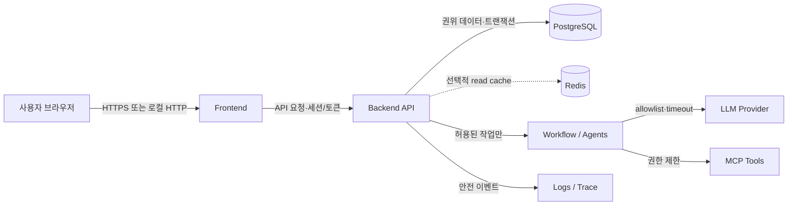

# Infra·네트워크·운영 설계

2026-10-12 최신: 도메인 없이 두 웹의 EIP로 접속하는 방식으로 확정했다. HTTPS는 웹별 내부 CA를 사용하며 사용자 PC에서 공개 루트 인증서를 신뢰해야 한다. 80/443 모두 현재 컴퓨터 공인 IP /32로 제한한다. IP 설정·Origin·실제 이미지 검증을 완료했으며 AWS 자원 생성·실제 인증서 설치·배포는 아직 수행하지 않았다. GitHub 보호 확인 전 OIDC 역할은 비활성이다. 최신 계약은 [구현 계획 24 §17](24_AWS_배포_CICD_구현계획.md#17-ip-접속https-계약-2026-10-12)을 따른다. 아래는 이전 단계 이력이다.

2026-10-12 A4 최신: Linux CI와 동일 image tar의 실제 DB/MCP/HTTPS Browser 검사 및 필수 성공·SHA/run/attempt/hash 승격 검사를 구현·로컬 검증했다. AWS 권한 없는 CI 후보만 발급하며 ECR/배포는 A5/A6 이후다. 원격 Actions 실행 확인은 남아 있다. 현재 계약/결과는 [구현 계획 24 §15](24_AWS_배포_CICD_구현계획.md#15-linux-ci동일-이미지-승격-검사-구현-2026-10-12), [검증 기록](../검증산출물/2026-10-12_LinuxCI_이미지승격_검증.md)을 따른다. 아래는 과거 단계 기록으로 보존한다.

2026-10-12 최신 후속: 운영 application/web 이미지와 여섯 service role의 strict entry·HTTPS/private proxy·MCP Host/Origin을 구현하고 실제 container로 검증했다. core 525 PASS/1 SKIP, Python inventory 70개(core 51, postgres 14, external 3, compatibility 2), JavaScript 7개. 최신 범위는 [구현 계획 24 §14](24_AWS_배포_CICD_구현계획.md#14-운영용-이미지서비스-실행-설정-구현-2026-10-12)와 [image 검증 기록](../검증산출물/2026-10-12_운영이미지_로컬검증.md)을 따른다. Linux release gate와 실제 AWS 수용은 아직 남아 있다. 아래 과거 기록은 보존한다.

2026-10-12 최신 후속: cloud 공유 maintenance/drain과 owner-only 보호 table을 구현했다. core 489 PASS/1 SKIP, Python inventory 68개(core 50, postgres 13, external 3, compatibility 2). 현재 결과와 한계는 [구현 계획 24 §13](24_AWS_배포_CICD_구현계획.md#13-공유-유지보수drain-구현-2026-10-12)을 따른다. 아래 이전 검증·설계 기록은 보존한다. 실제 AWS 수용·배포는 아직 수행하지 않았다.

> 2026-10-12 배포 계획 보충: 로컬 구현 경계는 유지하며 AWS 시연용 container/ingress/DB 격리·CI/CD·migration/rollback을 [배포 계획 23](23_AWS_배포_CICD_계획.md)로 구체화했다. 최신 권장안은 EC2 6대·private RDS·Parameter Store, 웹만 공개하고 내부 서버 outbound는 NAT 1개로 처리하는 구조다. §4에 시간당 비용, §12에 생성·최종 종료·데이터 보존 후 정리 계약을 둔다. cloud proxy 인증과 RDS DB 정체·권한/TLS 검증·초기화 기반은 구현 후 로컬 검증했다. 최신 범위는 [구현 계획 24 §12](24_AWS_배포_CICD_구현계획.md#12-rds-tlsdb-권한초기-데이터-준비-구현-2026-10-12)를 따른다. 이미지 package·Linux CI·AWS 수용·생성/삭제는 남아 있다. 아래 로컬 실행 계약을 AWS에서 그대로 충족했다고 해석하지 않는다.

> 2026-10-11 실행 경계 보완: loopback bind와 전체 업무 API의 로컬 클라이언트 검사를 함께 적용한다. 로컬 실행 worker는 DB operation owner/lease/deadline으로 중단을 추적하고 재기동 시 만료 실행을 정리한다. 자동 재개·외부 queue·Redis는 이번 필수 범위가 아니다. 상세는 [Workflow 수정 계획 §3.3~3.6](14_Workflow_검사결과_설계보완_수정계획.md)를 따른다.

## 1. 목적과 경계

AWS 작업 파일·A0~A8 순서·cloud 접근/DB baseline 보완·검증 게이트는 [AWS 구현 계획 24](24_AWS_배포_CICD_구현계획.md)에서 확인한다. 이 문서는 공통 운영 원칙, 23은 AWS 배포 계약, 24는 그 구현 계획을 담당한다.

로컬 중심 시스템이 API, PostgreSQL, 선택적 Redis, LLM/MCP dependency와 안전하게 통신하고, 장애를 격리·관찰·복구하는 기준을 정한다. 구체 AWS/Docker/GitHub Actions 구성과 운영 환경 값은 별도 구현 계획 및 배포 설계에서 실제 저장소·계정 구성을 확인한 뒤 확정한다.

## 2. 현재 구현 기준

현재 로컬 구성은 Docker Compose/PostgreSQL과 Backend, 별도 게임 API/UI를 사용하며 게임 Runtime DB와 기존 기획/Task 저장 경계가 구분되어 있다. MCP 카탈로그 연결은 별도 데이터 설정을 사용하고, Redis는 필수 서비스가 아니다. 실제 포트·실행 방법·검증 범위는 [현재 구현 상태](../현재_구현상태.md)를 기준으로 한다. 이 문서의 HTTPS, secret manager, AWS topology는 목표 운영 기준이지 현재 로컬 구성이 아니다.

## 3. 논리 통신 경로



Browser는 DB/Redis/LLM/MCP에 직접 연결하지 않는다. 외부 의존성 credential은 backend에만 둔다. MCP/LLM 결과는 신뢰할 수 없는 입력으로 취급해 schema/의미/권한 검증을 통과해야 상태 변경에 사용한다.

## 4. 네트워크·장애 경계

| 경계 | 제어 |
|---|---|
| Browser→API | Backend loopback bind, 정확한 local frontend Origin allowlist, request size 제한, server-derived 단일 operator identity, mutation CSRF 보호, 안전한 오류 응답 |
| API→DB | private/local network, 최소 권한 계정, connect/query timeout, transaction 경계 |
| API→Redis | 선택 구성, private/local network, 인증, 짧은 timeout; 실패 시 캐시 우회 |
| Agent→LLM | provider allowlist, 호출별 30초 timeout·Workflow 180초 deadline, Workflow당 최대 8회, 누적 token·비용 예산, secret masking |
| Agent→MCP | 초기에는 읽기 전용 tool allowlist·schema·권한·timeout, 네트워크 egress 제한; MCP를 통한 write 금지 |
| 서비스 간 | readiness와 liveness 구분, 재시도는 단일 controller budget 아래 제한 |

DB write 결과 불명은 idempotency 결과 조회로 해소한다. 데이터 변경은 MCP가 아니라 Workflow Controller와 내부 업무 API/서비스가 권한 확인 및 DB transaction을 통해 수행한다. Redis는 첫 로컬 MVP에서 제외하고, 추후 필요가 확인될 때만 추가한다. 도입 후 장애는 권위 데이터 조회로 전환한다. 보안·권한 오류는 네트워크 재시도나 fallback으로 우회하지 않는다. 외부 dependency 장애로 plan 검증을 수행할 수 없으면 불완전 성공으로 표시하지 않는다.

## 5. 환경·secret·배포 원칙

2026-10-12 cloud ingress 보완: `DEPLOYMENT_MODE=cloud`에서 `SERVICE_ROLE`, `CLOUD_PROXY_IDENTITIES`, HTTPS `APP_ALLOWED_ORIGINS`를 검증한다. private peer와 사이트별 proof를 확인하며 게임 proxy는 게임 API만, 시험 API는 계획 proxy의 `/api/test/*`만 허용한다. `local` 기본 접근 경계는 유지한다. RDS guard/TLS·cloud entry·production Caddy/SSM 연결은 아직 구현 전이므로 이 guard 추가만으로 AWS 배포 준비 완료를 뜻하지 않는다. 진행은 [구현 계획 24 §10](24_AWS_배포_CICD_구현계획.md#10-구현-진행로컬-검증-2026-10-12)을 따른다.

로컬·CI·운영의 설정을 분리하고 `.env` 등 개인 환경 파일과 secret을 저장소에 커밋하지 않는다. 예시 설정에는 값의 이름과 형식만 둔다. AWS 배포에는 사용자 결정에 따라 Parameter Store Standard SecureString을 사용하고 Secrets Manager는 도입하지 않는다. EC2 IAM role로 필요한 값만 조회하며 GitHub에는 parameter 이름만 둔다. OpenAI 키 외에도 DB 비밀번호가 포함된 연결 URL, 기존 live 원문 암호화 키와 cloud 인증 비밀값은 보호한다. 인증정보 없는 URL은 일반 설정이다. RDS 비공개 연결은 인증정보 보호를 대체하지 않는다. 구체 계약과 미구현 범위는 [배포 계획 23 §6.1](23_AWS_배포_CICD_계획.md#61-확정한-설정비밀값-관리-방향-2026-10-12)을 따른다.

Docker는 서비스 재현성을 높이는 수단으로 사용하되 개발/운영 구성 차이를 문서화한다. 우선 로컬 환경에서 lint·format·schema 검사·테스트·build를 반복 실행할 수 있게 안정화한다. CI/CD는 이 로컬 검증이 안정된 뒤 별도 단계로 도입하며, 필수 품질 gate 통과 후에만 artifact를 승격한다. 배포는 환경별 승인/권한을 따르고 migration 호환성, health check, rollback 기준을 둔다. 실제 파이프라인 도입 범위와 AWS 자원은 계정·현재 workflow 확인 후 결정한다.

## 6. 운영 신호와 대응

최소 운영 신호는 API 요청 성공률/지연, workflow 완료·중단률, dependency timeout, 오류 코드별 횟수, recovery action·성공률, DB pool/연결 상태, 캐시 hit/miss 및 우회, Trace 기록 실패다. 로그는 `trace_id`, `workflow_id`, `error_code`, `recovery_policy_version`으로 연계하되 민감 원문은 제외한다.

Health endpoint는 비밀·내부 상세 없이 서비스 준비 상태를 반환한다. 알림 임계값과 보존 기간은 단일 로컬 사용자 MVP에서는 간소화하고, 운영 배포 전 SLO/용량 기준으로 확정한다.

## 7. 완료 기준과 미결 사항

- 허용 네트워크 경로와 각 서비스의 책임·장애 전이가 명시됨
- Redis가 없는 구성과 Redis 장애 시에도 정합성과 idempotency가 유지됨
- secret 관리·timeout·health/readiness·재시도 budget이 정의됨
- 로컬 테스트 안정화와 CI/CD 후속 도입이 별도 단계로 구분됨
- CI/CD 착수 시 품질 게이트 및 안전한 migration/rollback의 단계가 정해짐
- 구체 AWS/Docker topology, TLS/도메인, 복구 목표, 보존기간은 실제 배포 목표 확정 후 별도 결정

## 8. 참조

[전체 시스템 최상위 설계 §13–15](../최상위_시스템_설계서.md), [API·저장·Trace](06_API_저장_Trace_설계.md), [오류 복구 정책](05_오류분류_복구정책_설계.md), [통합 검증](09_통합검증_설계.md)를 따른다.


## 로컬 Workflow 실행·검증 경계 (2026-10-11)

[수정 계획 14 §7](14_Workflow_검사결과_설계보완_수정계획.md#7-2026-10-11-구현검증-기록)을 따른다. 백엔드는 loopback에 실행하며 Docker bridge 주소를 인증 예외로 허용하지 않는다. Edge E2E의 backend도 로컬 venv Python 프로세스로 실행한다. DB는 격리된 Docker PostgreSQL, migration/pytest runner는 캐시된 테스트 이미지다. MCP HTTP 오류 opt-in fixture만 별도 격리 endpoint를 사용한다.

실행 worker는 2개, 접수 용량은 4개, 전체 deadline은 180초다. DB 예약은 process 간 공유하며 endpoint 재시도는 기존 실행을 조회한다. 15초마다 만료 정리를 하고 GET에서도 확인한다. 중단한 작업을 자동 이어 실행하지 않는다. 테스트 종료 시 스크립트가 직접 생성한 process만 종료하고 임시 환경변수를 복원한다. Playwright는 worker 1개로 실행해 같은 DB의 최신 기록 경합과 브라우저 자원 중복을 피한다.

기본 집중 검증 명령:

```powershell
.\infra\test-local.ps1 -TestPath backend/tests -TestName 'workflow_execution or recovery_with_real_repository or runtime_trace_write_recovery or planning_lifecycle_trace'
.\infra\e2e-local.ps1 -ApiPort 8015 -UiPort 5195 -Browser edge -TestName 'durable asynchronous workflow connects' -VerifyRestart
```

검증은 `eventquest_auto_test`만 대상으로 하며 사용자 DB/Edge 검토 DB는 변경하지 않는다. 명령의 성공 여부와 최종 확인 결과는 수정 계획의 기록을 확인한다. 현재 변경에 CI/CD나 Redis는 포함하지 않는다.


## 2026-10-12 migration 기반 후속 동기화

cloud runtime DDL 차단과 별도 migration CLI를 구현했다. PostgreSQL은 매 검사마다 새 임시 DB를 생성·제거해 사용자 DB를 보존한다. Python inventory 65개(core 48, postgres 12, external 3, compatibility 2), JavaScript 7개. core 453 PASS / 1 SKIP, 영향 보충 29 PASS, migration PostgreSQL 4 PASS. TLS/role/권한·bootstrap·maintenance는 미완료다. 실행 계약·실험 과정·남은 범위는 [구현 계획 24 §11](24_AWS_배포_CICD_구현계획.md#11-runtime-ddl-분리migration-기반-구현-2026-10-12)을 따른다.


## 2026-10-12 TLS·권한·bootstrap 후속 동기화

cloud DB guard·6개 role/2개 DB provision·owner 초기화와 정책 hash/audit를 구현했다. core 483 PASS / 1 SKIP, 실제 임시 TLS DB·migration 14 PASS, 기존 local 승인→게임 보상 연동 2 PASS. Python inventory 67개(core 49, postgres 13, external 3, compatibility 2), JS 7개. 시험은 CLOUD_DATABASE_TESTS=true와 기존 postgres profile의 loopback test URL을 명시해야 하며 별도의 소유 컨테이너와 자체 CA를 사용한다. 실제 RDS 수용은 아직 아니다. 운영 명령·비밀 설정·권한과 보존·실험 진단/정리·남은 범위는 [구현 계획 24 §12](24_AWS_배포_CICD_구현계획.md#12-rds-tlsdb-권한초기-데이터-준비-구현-2026-10-12)를 따른다.
