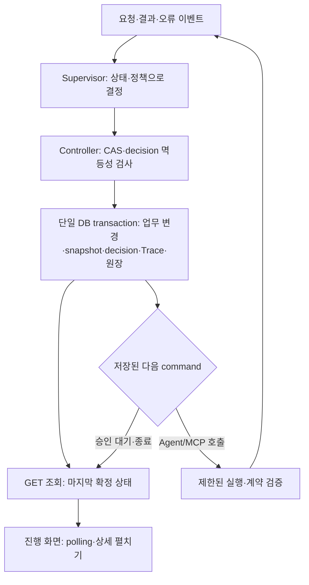

# Workflow 검사 결과·설계 보완·수정 계획

## 1. 목적과 현재 판정

2026-10-11 `ikonly` 작업 트리 검사에서 확인한 문제를 설계 보충, 구현 수정, 연결 검증으로 분리한다. 이 문서는 수정 기준·계획과 구현 후 검증 증거를 함께 관리한다. 구현 결과는 7절을 따른다. [최상위 설계](../최상위_시스템_설계서.md)의 시스템 경계와 [Supervisor 통합 계획 13](13_Supervisor_상태전이_복구결정_통합구현계획.md)의 단일 결정자 원칙을 유지한다. 해당 계획의 완료 판정은 이번 검사로 재개방한다.

- 정상 신규 기획 흐름에는 Supervisor, Planner/Critic, 결정적 규칙 검증, 승인, Runtime 등록이 연결되어 있다.
- 기존 Task 엔진을 실제 `SqlAlchemyRepository("sqlite://")`에 연결한 임시 재현에서 정상 요청은 `WAITING_APPROVAL`에 도달했지만 `agent_failure_once`, `db_connection_error_once`는 `supervisor_state_conflict`로 실패했다. DB 저장 검사는 실구현, LLM/MCP는 기존 테스트 fixture였다. PostgreSQL·외부 provider·브라우저 검증 결과로 확대 해석하지 않는다.
- 최초 검사에서는 사용자 DB·소스 코드·`pre/`를 변경하지 않았다. 이후 승인된 구현에서는 코드를 수정하고 격리 자동 검증 DB만 사용했다. 이전 테스트 성공 기록은 당시 실행 증거로 보존하지만 최신 통합 완료 근거로 사용하지 않는다.

## 2. 문제·원인·책임 매핑

| ID | 확인한 사실 | 원인 구분 | 보완할 설계 / 구현 위치 | 완료 게이트 |
|---|---|---|---|---|
| WF-01 | 복구 결정은 버전을 올리지만 nested Trace만 저장하고 저장소 CAS는 최상위 버전만 읽음 | 구현 오류·연결 검증 누락 | 02·06; `engine.py`, `workflow_service.py`, `db_service.py`, `repositories/postgres.py` | VG-01 |
| WF-02 | 승인 결정 및 Runtime 변경이 Supervisor 전이보다 먼저 별도 commit됨 | 저장 경계 상세 설계 부족 | 06·게임 이벤트 적용 계약; `canonical_planning.py`, `api/game.py`, `game/service.py`, `repositories/game_runtime.py` | VG-02 |
| WF-03 | Task 어댑터의 deadline·예산 종료는 공통 상태 전이 없이 FAILED 반환 | 설계 반영 누락 | 02·05; `workflow_service.py`, `engine.py`, `supervisor.py` | VG-03 |
| WF-04 | 기획·정책·LLM 원문 API에 게임 API와 같은 로컬 제한이 없음 | 접근 계약 구체성 부족·구현 누락 | 04·08; `main.py`, `api/planning.py`, `api/game.py` | VG-04 |
| WF-05 | 같은 저장 정책 version에 현재 코드 기본 route를 실행 시 보충함 | 유효 정책의 불변 계약 부족 | 05·06; `recovery_policy.py`, 오류 registry, migration | VG-05 |
| WF-06 | 신규 기획은 완료 후 Trace를 반환하며 화면은 실행 중 상태를 받지 않음 | 진행 표시 완료 기준·계획 부족 | 06·07; `canonical_planning.py`, `api/planning.py`, `frontend-web/src/main.js` | VG-06 |
| WF-07 | backend lifecycle과 UI가 서로 다른 Supervisor 이벤트 이름을 사용함 | 계약 구현 불일치 | 02·06·07; `canonical_planning.py`, `workflow-progress.js`, `main.js` | VG-07 |
| WF-08 | 신규 기획에는 기존 response guard 연결이 없고 입력 보안은 알려진 문구 패턴 수준 | 보안 검증 경계 누락·현재 기능 한계 | 04; `guards/response_guard.py`, canonical Agent/응답 경계 | VG-08 |
| WF-09 | 프로세스 내부 lock과 최종 결과 unique key는 있으나 생성 중 실행 예약은 공유되지 않음 | 실행 멱등성 상세 설계 부족 | 06; canonical 저장소·요청 접수 | VG-09 |

현재 Planner는 사용자가 선택한 미션·보상·게임 값을 설명하고 Critic은 의미 검토를 수행한다. 자동 밸런스 변경이나 Critic REVIEW 이후 자동 재기획을 이번 수정에 추가하지 않는다. REVIEW는 적용을 막고 사용자가 수정 후 새 요청을 제출하는 현재 계약을 유지한다. Redis는 필수 구성으로 추가하지 않는다.

## 3. 확정할 실행·저장 계약

### 3.1 상태 소유권과 복구 결정

1. Supervisor만 권위 상태·카운터·다음 action을 결정한다. Controller는 결정의 저장과 command 실행을 담당한다. 기존 Task·canonical·활성 Clash 진입점은 같은 계약을 적용하며, 사용하지 않는 경로는 명시적으로 비활성화하고 테스트한다.
2. 모든 정상 전이와 recovery decision은 하나의 동일한 저장 명령으로 처리한다. `new_version = expected_state_version + 1`을 저장소에서도 검사한다. 같은 상태를 유지하는 RETRY도 versioned decision이다.
3. 상태 snapshot, decision, Trace, 같은 경계의 멱등 결과를 한 transaction으로 저장한다. nested `supervisor_decisions`는 화면용 투영이며 CAS 권위가 아니다. 저장 성공 전 실행용 snapshot을 교체하지 않는다.
4. `decision_id`와 요청 fingerprint로 같은 결정 재저장은 기존 결과를 반환하고 다른 내용은 conflict로 거절한다. stale worker는 업무 상태를 FAILED로 덮어쓰지 않는다. 새 snapshot을 읽고 허용 여부를 재판단한다.
5. Trace 저장 실패를 기록하기 위해 같은 실패 저장 경로에 무한 재귀하지 않는다. DB가 복구되면 마지막 확정 상태와 command 원장을 조회한다. 저장 결과를 알 수 없으면 UNKNOWN을 응답하고 다음 Agent/업무 쓰기를 실행하지 않는다.
6. 코드의 `WAITING_APPROVAL`, `WAITING_REVIEW`를 실제 상태 enum의 단일 표기로 사용한다. 설계의 `AWAITING_APPROVAL`, `AWAITING_HUMAN_REVIEW`는 명시적 읽기 호환 alias로만 매핑한다. 저장/API/UI가 서로 다른 상태를 새로 발급하지 않는다.

### 3.2 승인·Runtime 적용의 원자성

로컬 MVP는 같은 PostgreSQL DB이므로 승인 결정+Supervisor 전이+Trace+멱등 결과, Runtime 등록+Supervisor APPLIED 전이+Trace+멱등 결과를 각각 한 transaction으로 처리한다. 관련 서비스/저장소가 호출자 session을 받도록 바꾸고 내부 선행 commit을 제거한다. LLM/MCP 호출 동안 DB transaction을 열어두지 않는다.

commit ACK 유실은 같은 key로 원장을 재조회하여 기존 결과를 회수한다. 업무 unique key와 exact `plan_id/result_version` 검사를 유지한다. 기존 데이터에서 실제 이벤트와 상태가 어긋나면 운영 조회에 실제 등록 사실과 `reconciliation_required`를 함께 표시한다. 조회가 전이를 임의 생성하지 않으며, 재조정 command가 실제 등록 근거로 Supervisor 결정을 요청해 기록한다. 과거 레코드를 일괄 덮어쓰거나 이벤트를 다시 적용하지 않는다.

외부 게임을 추가할 때만 outbox·별도 operation 상태·결과 확인 계약을 설계한다. 현재 내부 DB 쓰기를 외부 분산 transaction처럼 처리하지 않는다.

### 3.3 예외 종료와 중단

deadline, 호출·토큰·비용 budget, 사용자 취소, 입력/출력 계약 위반, MCP 실패, DB outcome unknown을 event registry에 매핑한다. 접수 전 거부는 Workflow를 만들지 않고 보안/접근 로그만 남길 수 있다. 접수 후에는 저장 가능한 모든 종료가 Supervisor 결정·동일 저장 경계를 거친다.

프로세스 강제 종료 시 코드를 실행해 종료 기록을 남길 수 있다고 가정하지 않는다. 생성 중 operation에 실행 owner·lease·deadline을 보존하고, 재기동 시 만료된 실행을 확인한다. 로컬 MVP는 자동 이어 실행 대신 근거를 남겨 SAFE_STOP 또는 업무 쓰기 결과 UNKNOWN/재조정 필요로 정리한다. 사용자는 새 요청으로 다시 시작한다. UNKNOWN을 실패로 단정해 보상·등록을 다시 실행하지 않는다.

### 3.4 접근·출력·컨텍스트 보안

전체 업무 API의 읽기/쓰기, 정책, 원문, fault demo에 공통 로컬 접근 제한을 적용한다. 서버는 loopback에 바인딩하며 `request.client`를 검사한다. 전달된 IP header를 인증 근거로 사용하지 않는다. Origin 없는 호출은 로컬 클라이언트일 때만 허용하고 브라우저 mutation은 기존 exact Origin 검사를 유지한다. 이번에 원격 접근 예외를 민감 API까지 확대하지 않는다. 운영자 ID는 감사 주체이며 네트워크 인증으로 표현하지 않는다.

canonical Agent 결과와 외부 MCP 텍스트도 비신뢰 데이터다. 형식·게임 의미·보안 검사를 분리하고 사용자 응답·일반 Trace로 나가기 전에 민감정보 검사를 적용한다. 중첩 context에 비밀 필드를 전달하지 않도록 검사하되 업무상 필요한 ID까지 무조건 제거하지 않는다. 원문은 기존 암호화 DB와 접근 감사 경계에 보존한다. 알려진 패턴 검사를 범용 프롬프트 공격 방어로 표시하지 않는다.

### 3.5 유효 정책과 외부 호출

실행 시 고정할 참조는 `policy_id/version`, 유효 정책 content hash, 오류 catalog version, hard-limit version이다. 활성화한 불변 정책에 없는 오류 route를 실행 중 조용히 보충하지 않는다. 새 오류를 추가하면 새 draft에서 전체 route를 검증하고 preview/활성화한다. 정책이 불완전하면 LLM/Tool 실행 전 거부한다. 기존 레코드에는 당시 hash를 알 수 없음을 명시하며 현재 기본값으로 과거 정책을 재구성하지 않는다.

MCP 읽기 권한, snapshot/digest 확인, timeout, bounded retry/fallback, LLM 호출·토큰·비용 budget과 원문 저장을 유지한다. 정책 활성화와 Agent 실행 상태는 분리하고 실행 중 active 정책 변경을 승계하지 않는다. 공유 DB의 실행 예약과 멱등 원장이 권위이며 Redis 없이도 성립해야 한다.

### 3.6 진행 API·handoff·화면

생성 요청은 DB에 operation과 Workflow 초기 상태·멱등 참조를 예약한 후 `202`와 `workflow_id`, 조회 위치를 반환하는 비동기 접수 계약으로 이행한다. 로컬 MVP는 단일 backend의 제한된 실행 worker와 DB 원장을 사용한다. 실행 중 상태는 각 확정 decision마다 저장하고 기존 GET Workflow 조회를 화면이 polling한다. `Prefer: respond-async`를 지정한 UI는 202 접수·완료 결과 조회로 이행한다. 기존 동기 호출자는 동일 예약·실행·저장 경로에서 완료까지 기다려 201을 받는 호환 계약을 유지한다.

화면은 접수 즉시 진행 페이지를 열고 마지막 확정 상태·작업·재시도·안전한 이유를 표시한다. 네트워크 재연결/새로고침은 DB 조회로 복원한다. 완료 후 조회에 정책·근거 펼쳐보기를 제공한다. 전체 단계 수를 임의의 실행 진척률로 표시하지 않는다. HTTP 응답 실패 자체를 Workflow 실패로 단정하지 않는다.

새 이벤트 정식 명칭은 `supervisor.state_transition_decided`로 통일하고 기존 `supervisor.transition_decided`는 읽기 alias로 지원한다. handoff는 같은 Workflow/Task의 sender/receiver, contract version, snapshot, 필수 입력을 실행 전에 검증하고 실패 시 수신 Agent를 실행하지 않는다. 요청·검증 거절·출력 검증·수락 기록은 영속 Trace에 연결한다. 수락이 Supervisor의 전역 상태 소유권을 Agent에게 넘긴다는 의미는 아니다.

## 4. 구현 순서와 변경 범위

FIX-01~06의 코드 변경과 FIX-07의 로컬 검증을 수행했다. 최신 증거와 남은 수용 범위는 7절을 따른다. 기존 수정 내용을 보존하고 관련 파일만 변경한다. CI/CD, 외부 게임, 신규 자동 기획 기능은 후속 범위다.

| 작업 | 선행 | 구체 변경 | 단계 완료 조건 |
|---|---|---|---|
| FIX-01 복구 저장 | 없음 | engine의 pending 결정 처리와 실제 저장소를 연결하는 실패 재현 테스트 먼저 추가; 공통 decision 저장, CAS·동일 결정 replay, 저장 후 snapshot 갱신 | VG-01; 정상/일회성 Agent·DB 오류가 승인 대기까지 도달 |
| FIX-02 업무 원자성 | FIX-01 | 승인/Runtime 저장 함수에 session 전달, 상태·Trace·원장 동시 commit, 조회 불일치 표시·재조정 command | VG-02; 저장 실패 rollback, ACK 유실 replay, 실제 효과와 상태 일치 |
| FIX-03 실행 예약·종료 | FIX-01·02 | DB operation 예약·owner/lease/deadline·command 결과, 모든 접수 후 종료 이벤트 연결, stale Task save 차단, 재기동 중단 정리 | VG-03·09; 재시도 중복 호출 차단, 만료 실행이 영원히 실행 중으로 남지 않음 |
| FIX-04 보안 경계 | 독립 | 공통 로컬 guard, canonical 응답/중첩 context 검증, 원문 접근 제한·감사 | VG-04·08; 민감 API 원격 거부, 안전 로그·암호화 원문 유지 |
| FIX-05 정책 고정 | FIX-01 | policy/catalog/limit hash·version 저장 migration, 조용한 route 보충 제거, 새 draft 활성화 절차 | VG-05; 같은 유효 정책 참조의 대응 내용이 불변 |
| FIX-06 진행·handoff UI | FIX-03 | 비동기 접수·GET 진행 조회·polling, backend/UI 이벤트 명칭 통일, handoff 검증/거절 기록, 이전 기록 alias | VG-06·07; 실제 진행·복구를 실행 중 확인하고 새로고침 복원 |
| FIX-07 연결 수용 | FIX-01~06 | 영향 단위→실제 PostgreSQL 연결→필수 API/브라우저 시나리오; docs 상태 갱신 | 아래 필수 게이트 통과와 잔여 범위 명시 |

실제 물리 테이블·migration 번호는 착수 시 기존 미커밋 migration과 대조해 충돌 없이 정한다. 변경 위치는 위 파일과 해당 테스트 계층으로 제한하고 전용 backend service로 공통 transaction 경계를 모은다. 관련 없는 리팩터링을 완료 조건에 포함하지 않는다.

## 5. 검증 기준과 증거

이 표는 필수 검증 기준이다. 실제 실행한 파일·명령·결과와 적용 범위는 7절에 기록한다. 관련 실패를 재현하는 최소 테스트부터 구현하고 단위 성공만으로 통합 완료를 선언하지 않는다.

| Gate | 계층·예정 파일 | 필수 검증 및 관찰값 |
|---|---|---|
| VG-01 | component `backend/tests/test_workflow.py`, `test_repository.py`; integration `backend/tests/integration/test_supervisor_recovery_persistence.py` | 실제 engine+adapter+repository 정상/Agent 일회성/DB 일회성/재기획/한도 소진. 각 저장 version 연속, nested 결정과 권위 상태 일치, 같은 decision replay, stale worker가 업무 상태를 덮어쓰지 않음 |
| VG-02 | integration `test_planning_lifecycle_trace.py`, `test_runtime_trace_write_recovery.py` | 업무·상태·Trace 각 저장 지점 실패 주입, rollback 뒤 변경 0건 또는 commit 뒤 전부 1건. ACK 유실 동일 키 회수, 보상/등록 중복 0건. 기존 불일치 레코드의 읽기·재조정 |
| VG-03 | unit `test_workflow_deadline.py`, `test_llm_call_budget.py`; integration `test_workflow_interruption.py` | 모든 진입점 deadline/예산/취소/오류 종료, 별도 프로세스 강제 종료·재기동. Task·snapshot·Trace·API 결과 일치 또는 명시적인 UNKNOWN, terminal 이후 Agent 실행 없음 |
| VG-04 | unit `test_planning_api.py`; integration `test_local_api_boundary.py` | 모든 업무 GET/쓰기·정책·원문·fault API의 원격 거부, 로컬 무Origin 허용, 비허용 Origin 거부, 위조 actor 및 forwarded IP 거부/무시 |
| VG-05 | unit `test_recovery_policy.py`; integration `test_recovery_policy_api.py` | active 정책 교체 중 이전 pin 유지, 누락 route 사전 거부, catalog 추가 시 새 draft 필요, 동일 hash 재현, hard block 완화 불가 |
| VG-06 | API integration `test_workflow_progress.py`; E2E `frontend-web/e2e/workflow-progress.spec.js` | 실제 PostgreSQL+API, 지연된 통제 provider로 완료 전에 PLANNING과 recovery 관찰, 새로고침/조회 실패 후 재연결, terminal 상태 복원. Edge 시각 체크리스트 별도 |
| VG-07 | frontend 계약/E2E `workflow-progress.spec.js` | 정식 이벤트와 이전 alias 모두 Supervisor lane·표시 이름·decision 상세가 일치 |
| VG-08 | unit `test_input_guard.py`, `test_canonical_planning.py`; integration `test_llm_record_storage.py` | 중첩 context의 비밀 필드, 응답 marker, 알려진 공격·정상 요청, handoff task/receiver/version/snapshot 불일치. 차단 시 다음 작업 없음; 일반 Trace에 원문 없음 |
| VG-09 | integration `test_workflow_submission_idempotency.py` | 서로 다른 process의 동일 key/hash 생성 요청: 예약 1건, 실행 1회, 동일 workflow 반환. 다른 hash 409, lease 만료 후 임의 재실행 없음 |

변경 영향에 맞는 테스트만 단계별 실행하고 최종 통합 게이트에서 전체 검증을 수행한다. 외부 live smoke는 로컬 통합 검증과 구분하고 실제 provider 설정·비용 범위에 따라 실행한다. 실제 다중 process 경합은 별도 repository instance의 순차 CAS 검사로 대체하지 않는다. 재기동 후 완료된 결과 조회와 실행 중단 복구도 서로 다른 테스트다.

완료 증거는 코드 revision/작업 트리 식별, 실행 명령, 테스트 환경, pass/fail/skip 사유, Workflow/Trace/operation ID, DB 전후 관찰, 화면 캡처·의미 체크리스트를 포함한다. `pre/`와 기존 역사적 실행 기록을 수정하지 않는다. 사용자 수용·외부 smoke 등 남은 항목과 코드 결함을 별도 표기한다.

## 6. 문서 라우터

- [02 Workflow](02_멀티에이전트_Workflow_설계.md): 상태·handoff·종료 책임
- [04 보안·권한](04_보안_권한_설계.md): 로컬 접근·context·응답 경계
- [05 오류·정책](05_오류분류_복구정책_설계.md): 복구 action·유효 정책 불변성
- [06 API·저장·Trace](06_API_저장_Trace_설계.md): transaction·멱등성·실행 예약
- [07 UI·UX](07_UI_UX_운영자콘솔_설계.md): 실행 중 표시와 상세정보
- [09 검증](09_통합검증_설계.md): 위 게이트를 기존 G1~G9에 추가 적용
- [게임 이벤트 적용 계약](../게임설계/05_이벤트적용_계약.md): 승인된 설정·실제 Runtime 데이터의 일치
- [구현 계획](../기획안_시스템_구현계획서.md), [현재 구현 상태](../현재_구현상태.md)

## 7. 2026-10-11 구현·검증 기록

후속 [정책 연결 재검사 15](15_오류대응정책_Workflow_연결_재검사.md)에서 정책과 일부 실행 경로의 누락을 확인하고 §6에서 보완 구현·최종 검증을 기록했다. 이 절은 그 이전 구현 기록이며 현재 정책 범위는 문서 15 §6을 따른다.

### 7.1 구현한 내용

| 작업 | 구현 결과 | 실제 파일·근거 |
|---|---|---|
| FIX-01 | nested 복구 결정을 권위 Trace로 펼쳐 동일 transaction에 저장. version 연속/CAS/동일 decision replay 및 잘못된 batch 전체 rollback | `schemas/workflow_state.py`, `repositories/postgres.py`, `services/db_service.py`, `test_repository.py`, `test_workflow.py` |
| FIX-02 | 공유 session 단위로 승인·상태·Trace·원장, Runtime 등록·상태·Trace·원장을 각각 함께 commit. 기존 불일치를 조회에 표시하고 명시적 재조정 | `services/unit_of_work.py`, `canonical_planning.py`, `api/game.py`, Runtime Trace integration |
| FIX-03 | PostgreSQL `workflow_operations` 예약, unique key/hash/owner/deadline, 제한 worker 2개·최대 접수 4개. 취소/만료/프로세스 중단 시 Supervisor 종료; 최종 결과와 예약 해제를 같은 transaction으로 저장 | `services/workflow_execution.py`, migration `016`, `test_workflow_execution_process.py` |
| FIX-04 | 모든 업무 API에 loopback 제한, 전달된 IP 불신·Origin 경계 유지. canonical 응답 marker·중첩 secret context·handoff sender/receiver/task/state-ref 계약 검사 | `main.py`, canonical Agents, `supervisor.py`, `handoff.py` |
| FIX-05 | pin에서 기본 route 보충 제거. 불완전 active 정책은 외부 실행 전 거부. policy/catalog/hard-limit hash 고정 및 Task/canonical Trace에 참조 저장 | `recovery_policy.py`, 정책 API integration |
| FIX-06 | UI는 `Prefer: respond-async`와 202 접수 후 GET polling. 재접속·취소·기록 재조정, 정책 누락 경로 안내. 정식 Supervisor 명칭과 이전 alias 지원; 관찰 이벤트는 실제 발생 시 저장 | planning API, `frontend-web/src/main.js`, `workflow-progress.js` |
| FIX-07 | 실 저장소 오류 재현, 영향 단위 검사, 실제 PostgreSQL 및 Edge 연결 검증 수행. 아래 환경·명령·결과를 기준으로 판정 | 테스트와 `ux-evidence/` |

기존 Task API는 입력·응답 호환 경로로 남는다. Task·Trace 쓰기도 동일 공유 session에 참여하며 저장 후 예외를 주입한 공동 rollback을 실제 PostgreSQL에서 확인했다. 권위 상태 결정은 같은 rule Supervisor를 쓰며 `FAILED`는 기존 응답의 종료 투영이다. 별도 상태 결정을 하던 Clash 표본 실행은 기본 비활성화했다. `ENABLE_ARCHIVED_CLASH_WORKFLOW=true`는 보존된 호환 검증용 opt-in이며 통합 완료 범위에 포함하지 않는다. 기본 생성 및 Clash 재기획은 외부 호출 전 거부하며 기존 결과 조회는 보존한다.

### 7.2 실제 실행 증거

검증 DB는 전용 `ikonly-test-postgres-1`의 **eventquest_auto_test**다. 사용자 게임 DB와 Edge 검토 DB를 초기화하지 않았다. 자동 테스트의 LLM은 통제 adapter, MCP는 해당 테스트가 지정한 HTTP fixture 또는 Runtime의 실제 카탈로그 조회다. 외부 OpenAI 성공 여부를 이 결과로 주장하지 않는다.

| 명령·검사 | 결과와 해석 |
|---|---|
| 로컬 `pytest` 영향 파일 8개 | 121 passed. SQLite 실제 저장소·게임 Runtime 포함; 당시 작업 트리의 결과 |
| `infra/test-local.ps1 -TestPath backend/tests` | **최종 257 passed / 11 skipped (93.41초)**. 제외 11건은 외부 LLM/MCP 전용 설정 부재다. 이전 실행은 228 passed / 15 failed / 11 skipped, 다음 실행은 242 passed / 1 failed / 11 skipped였으며 MCP 환경 누수·옛 assertion·누락-key fixture 순서를 수정한 뒤 253 passed / 11 skipped의 전체 검증이 통과했다. 이어 Task lease·공동 transaction 보충 후 최종 257 passed / 11 skipped를 확인했다 |
| 마지막 영향 재검증 `-TestName 'main_live or workflow_execution or recovery_with_real_repository or recovery_batch or runtime_trace_write_recovery or planning_lifecycle_trace or llm_record_storage or recovery_policy_api'` | **33 passed / 221 deselected**. 서로 다른 프로세스 경합·소유 프로세스 강제 종료·만료 정리, 동기/비동기 생성, 승인 및 Runtime rollback/ACK 유실, 암호화 원문 저장 포함. 테스트 후 포맷 1건을 고쳐 Ruff 전체 검사 별도 통과 |
| `playwright.workflow.config.js` | **12 passed**: 10개 결과·복구/alias·불완전 기록·실행 중 표시와 새로고침 후 polling. API 통제 fixture 기반 Edge 검사 |
| native Edge, `durable asynchronous workflow connects` | **1 passed**: 실제 PostgreSQL+API에서 202 → Planner/Critic·handoff → 승인 → 이벤트 공간 등록 → 새로고침·Runtime 미션 수 확인 |
| native Edge, `policy editor previews` 및 `fault demo recovers` | **2 passed**: 정책 preview/활성화/rollback, 오류 시연 3종 각각 3회, 게임 상태 변경 없음 |
| Task 보충 후 `-TestName 'approval or workflow or repository'` | **103 passed / 3 skipped / 162 deselected**. 별도 Task 생성 프로세스 강제 종료 → 저장 deadline 만료 → GET으로 SAFE_STOP·FAILED 복원, 늦은 결과 owner 차단 및 중복 정리 없음. memory/SQLite/PostgreSQL의 Task·Trace 공동 rollback도 통과 |
| Task 보충 후 native Edge `-TestName 'fault demo recovers'` | **1 passed**. 오류 시연 3종을 각각 3회 반복해 복구/안전 종료 Trace와 게임 상태 불변을 확인했다. testcase 30.2초, native 환경 준비를 포함한 Playwright 실행 1.8분. 생성한 API/UI process는 스크립트 종료 시 회수했다 |
| 품질 검사 | schema export current, compileall 성공, `ruff check .`와 `ruff format --check .` 통과, frontend Vite production build 통과 |

최초 전체 검사의 불필요한 HTTP 재시도 원인은 `MCP_URL`이 다른 테스트의 dotenv 로딩으로 남은 것이다. pytest 기본 fixture는 연결 값을 비우고 필요한 테스트만 주소를 지정한다. native E2E도 live `.env`의 MCP 주소가 들어오지 않도록 명시적으로 비워 통제한다. 이후 수정 확인은 영향 파일로 제한했다.

최종 native Edge 전체 검증은 **28 passed / 3 skipped**다. 기본 실행에서 제외된 3건은 MCP 장애 opt-in과 재기동 전용 두 경로다. 이어 현재 공간 계약의 재기동 전용 검증을 별도로 실행해 **1 passed**를 확인했다. 실제 backend 프로세스를 종료·재시작한 뒤 PostgreSQL에 저장된 Workflow 상태와 Runtime 등록·미션 수가 유지되는 것을 검증했다. Edge 연결 화면 증거: [등록·복원 화면](../ux-evidence/workflow-connected-desktop.png). 화면 그래프의 business observation은 해당 시점에 저장하고 동일 관찰의 최종 상세 속성만 합친다. Supervisor 전이를 전부 앞에 모아 그린 이전 캡처는 최신 순서 검증 증거로 사용하지 않는다.

### 7.3 운영·후속 경계

- 적용 migration: `backend/sql/016_workflow_execution_reservations.sql`; 기존 로컬 seed/migration 실행 경로에서 적용한다. 실행 예약 schema는 서비스에서도 존재를 확인한다.
- 사용자 DB의 기존 active 정책에 새 `ERR-SEC-OUTPUT-001` 등 route가 없으면 기획 실행은 거부된다. **복구 정책 화면에서 초안 저장 → 검증 → 미리보기 → 활성화**를 진행해야 한다. 검증 DB만 자동으로 현재 catalog를 충족하는 draft를 활성화했다. 사용자 정책을 조용히 변경하지 않았다.
- canonical API는 operation 예약을 사용한다. 기존 동기 Task/오류 시연 API도 Task JSON에 `execution_owner`와 `execution_deadline`을 저장한다. 수정 요청은 새 owner·180초 deadline을 발급한다. 만료 Task는 row lock 아래 Supervisor SAFE_STOP·FAILED 투영·Trace·owner 해제를 함께 저장한다. 마지막 결과 저장도 owner/deadline을 검사해 중단된 실행의 결과를 차단한다. 이 필드는 기존 외부 Task 응답에 노출하지 않는다. 과거 RUNNING 레코드에 deadline이 없으면 `updated_at + 180초`를 기준으로 정리한다. Task 조회·동일 키 재요청·목록 조회 및 15초 정리 loop에서 확인한다. 자동 이어 실행하지 않는다.
- 현재 canonical 실행 worker는 로컬 backend 내부 thread다. 프로세스 종료 후 이어 실행하지 않으며 DB deadline 만료 시 SAFE_STOP을 기록한다. 정리 주기는 15초이고 GET에서도 만료 확인한다. 취소는 상태와 후속 결과 반영을 막으며 이미 전송된 provider 요청 자체를 원격 취소한다고 보장하지 않는다.
- 정책·등록 outcome UNKNOWN이면 같은 key로 확인한다. 재조정은 등록 또는 지급을 반복하지 않고 저장된 승인/실제 Runtime 근거만 연결한다.
- 보안 검사는 알려진 입력/응답 패턴과 context 계약 검사다. 범용 프롬프트 공격 탐지나 원격 인증 구축으로 표현하지 않는다.
- Redis·CI/CD·외부 게임·자율 밸런스 변경·Critic REVIEW 자동 재기획은 추가하지 않았다. 외부 live provider smoke와 첫 사용자 이해도 수용은 별도다.
