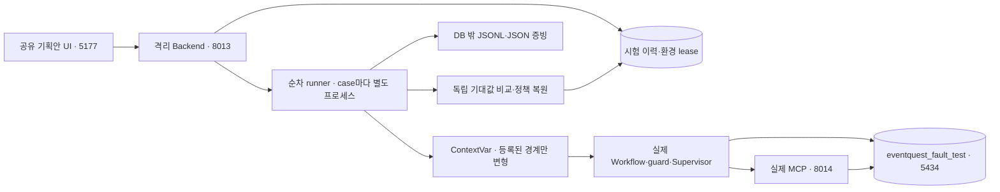

# 격리 오류 시험실 구현과 검증

기준: 2026-10-11, `ikonly` 로컬 작업. 설계 원천은 [오류 대응 시험 환경 변경 계획 §14](../오류대응_시험환경_변경계획.md#14-합의한-구현-계약-6종), 일반 Workflow 기준은 [정책 연결 재검사](15_오류대응정책_Workflow_연결_재검사.md)다. `pre/`는 수정하지 않는다.

최신 실행 변경: [프론트 통합 21](21_기획안프론트_통합구현.md). 공유 기획안 UI 5177에서 시험 API 8013/MCP 8014/DB로 연결한다. 아래 과거 실행 포트는 당시 증빙이다.

## 1. 실행 구조



- 사용자 서버와 DB를 재사용하지 않는다. 기존 `eventquest_test`, `eventquest_auto_test`, 게임 DB는 시험 대상이 아니다.
- PostgreSQL 컨테이너만 기존 `ikonly-test-postgres-1`을 공유한다. DB명·소유자·loopback·5434 포트·Compose 소유권을 검사하며 컨테이너를 중지하지 않는다.
- 기본 provider는 **결정적 adapter**다. DB/MCP/검증/상태 저장/정책 선택은 실제 시스템을 사용한다. 장애는 합성 주입이므로 실제 OpenAI 장애나 PostgreSQL 서버 중단을 재현했다고 표현하지 않는다. live provider 모드는 현재 시험 API에서 거부한다.
- 초기 실행은 동시 1개다. PostgreSQL advisory lock과 `BUSY/CLEAN/DIRTY`, owner, PID, heartbeat로 실행 환경을 통제한다. timeout은 240초다. 중단 시 재실행하지 않으며 불확실한 정리는 DIRTY로 남긴다.

## 2. 오류별 시험의 뜻

현재는 **28개 오류 코드·28개 시험 시나리오**다. 게임 규칙 조회를 `ERR-DEP-MCP-003`으로 분리했다. 아래 27개 코드 검증은 분리 전 실제 실행 기록이다. 모든 원인과 모든 위치를 임의 조합하는 API가 아니다. 등록된 유효 조합만 실행한다.

| 구분 | 실제 검증 경로 | 판정 근거 |
|---|---|---|
| Planner/Critic 출력 계약·일시/영구 LLM 오류 | 실제 Agent 호출 경계·Schema·Supervisor 복구 | 실제 오류 코드·정책 action·시도·종료 상태 |
| 설명 불일치 | Critic의 수정 가능 피드백→고정 Brief로 Planner 수정 | `RUN_AGENT`, 수정 횟수, 입력·보상 연결 불변 |
| MCP timeout/tool/응답 계약 | 실제 MCP 호출 경계와 공통 복구 loop | 실제 Trace와 호출 수, fallback에서는 실제 규칙 digest 검증 |
| 입력 형식·입력 보안 | 실제 HTTP endpoint로 변형된 요청 제출 | 실제 HTTP 422와 guard 응답. Workflow 실행 없이 차단되는 것이 정상 |
| 컨텍스트·출력 보안·Tool 권한·handoff | 실제 금지 필드·민감 marker·잘못된 인자/버전 검사 | guard/수신 계약의 실제 차단과 추가 Agent 실행 금지 |
| 지원 범위·자료 부족 | 보존된 게임 규칙으로 unsupported venue/missing content 판정 | `NEEDS_DEVELOPMENT/NEEDS_DATA` finding과 Runtime 차단. 오류 재시도 성공으로 집계하지 않음 |
| 요청 불일치·미션 달성 불가·아이템 없음 | **기존 Task 경로**의 Planner 결과와 실제 규칙·아이템 조회 | 기존 Supervisor의 수정/종료 Trace. 기준 자료는 `tinyheroes-1.0.0` DB baseline |
| 저장 연결·필수 Trace 실패 | 실제 저장 경계에서 예외 주입 | 실제 worker 검출과 안전 종료, 부분 Runtime 효과 0 |
| 쓰기 결과 불명 | 실제 기획 결과 commit 후 ACK 유실 | 저장된 결과 조회, 동일 ID 재사용, 결과 row 1개. 재등록·중복 실행 금지 |
| 복구 한도 | Planner 계약 오류 지속 | 실제 정책 시도 한도에서 종료. 원인 `ERR-CONTRACT-PLANNER-001`을 유지하며 LIMIT 코드를 꾸미지 않음 |
| 상태 충돌 | 저장된 상태에 잘못된 version으로 실제 cancel 호출 | CAS 거절, 승자 상태 불변. Workflow 내부 장애 복구 성공과 구분 |
| 예산·deadline·unknown | 실제 예산 consume/전체 제한/worker catch | 안전 종료, 실제 코드와 Trace·별도 검출 journal |

읽기·기획 시험은 승인/등록을 호출하지 않는다. 현재 화면은 canonical 기획·기존 Task·승인 후 Runtime의 정적 topology를 제공한다. 승인 후 Runtime은 `graph_only`이며 주입 위치를 활성화하지 않는다. 승인 후 Runtime의 장애 시연, 실제 DB 프로세스 중지, 실제 외부 provider 장애/비용 시험은 후속 opt-in 범위다.

## 3. API와 저장

| API | 계약 |
|---|---|
| `GET /api/test/fault-catalog` | backend 권위의 오류·경계·정적 노드/edge·유효 패턴/프로필 |
| `POST /api/test/fault-runs` | `scenario_id, pattern, first_n, profile`, 202와 Location |
| `GET /api/test/fault-runs/{id}` | 실행 상태·판정·검증 항목·주입/검출/Trace·정책 참조 |
| `POST /api/test/fault-suites` | 위 단건 요청의 `cases[]`, 순차 실행 |
| `GET /api/test/fault-suites/{id}` | 단건 결과 목록·모집단을 밝힌 집계 |
| `GET /api/test/fault-environment` | CLEAN/BUSY/DIRTY·owner·heartbeat·runner PID |

POST는 `Idempotency-Key`가 필요하다. 동일 key/본문은 동일 실행 ID, 다른 본문은 409다. 일반 API에는 fault 필드를 추가하지 않았다. 새 API는 `ENABLE_FAULT_INJECTION=true`와 `FAULT_LAB_MODE=isolated`일 때만 등록한다. 일반 설정은 404다. 기존 Task 시연의 본문·응답은 유지하되 격리 mode도 필요하다.

시험 테이블은 lab에서만 생성되는 `fault_lab_records`, `fault_lab_environment`다. 기록과 정책 데이터는 시험 DB에, 독립 증빙은 고정 경로 `backend/test-results/fault-lab/`에 둔다. 해당 경로는 Git 제외다. 출력 파일명은 서버 UUID로 고정하며 비밀값·provider 프롬프트/응답 원문을 복사하지 않는다.

프로필은 `current_active`, `retry_allowed`, `safe_stop`이다. 변경 정책은 기존 draft→validate→preview→activate 경로를 거치고 종료 후 기존 rollback으로 원래 active 버전·내용을 확인한다. 보안/권한 등 NEVER 오류에는 retry 프로필을 허용하지 않는다. 복구 한도 시나리오는 실제 Planner 원인 경로를 시험하므로 current 정책만 사용한다.

## 4. 결과를 읽는 법

- `PASS`: 주입·실제 검출·대응·시도·최종 상태·DB 효과·정책 복원이 기대값과 일치했다. 안전 종료도 PASS일 수 있다.
- `FAIL`: 실행했지만 계약과 다른 결과다. 정책의 action과 실제 action도 비교한다.
- `NOT_EXECUTED`: 앞 단계의 합법적 종료로 선택 위치에 도달하지 않았다.
- `INCONCLUSIVE`: 필요한 검출·DB·종료 증거가 부족하다.
- `ABORTED`는 lifecycle이며 위 verdict와 별개다. crash/timeout에 자동 재시도하지 않는다.

감지→처리 완료 시간은 실제 catch journal에서 단조 clock 증거를 확보한 경우만 제공한다. 증거가 없으면 null이며 전체 elapsed 시간으로 복구 시간을 대체하지 않는다. 업무 판정·입력 차단·CAS는 자동 복구율 분모에서 제외한다. 최초 호출을 포함한 attempts, 추가 retries와 plan revisions를 구분한다. 입력·업무 판정·CAS 검사와 자동 복구 성공을 혼동하지 않는다. 미매핑 Trace는 `UNMAPPED_EVENT` 경고와 원문으로 남기고, 오류 검출에 필요한 이벤트가 미매핑이면 INCONCLUSIVE다. Runtime 비교는 각 테이블의 **주 키별 row digest**로 하며 row 수만 비교하지 않는다. canonical 저장 결과는 run 소유 Workflow ID와 결과 row 수, 같은 키 재요청으로 중복을 확인한다. 독립적인 다음 콘텐츠 조회와 retry를 구별하며 retry는 실제 결정 수로 계산한다. 일부 중복 Trace annotation은 action·카운터·decision ID로 같은 결정을 식별해 비교한다.

## 5. 로컬 사용 순서

저장소 루트에서 다음을 실행한다.

```powershell
powershell -NoProfile -File infra/fault-lab-local.ps1
```

Edge에서 `http://127.0.0.1:5177` → **복구 시연** → Workflow 경로 선택 → 노드 선택 → 오류 원인/위치 선택 → 패턴/시험 정책 선택 → 실행한다. 실제 단계가 관측되면 노드가 강조된다. 묶음 시험은 개별 결과 선택으로 모든 case를 확인한다. 결과 상세와 JSON 보고서에서 기대/실제 action, 주입/검출, 전체 Trace를 확인한다. 새로고침 후 마지막 실행 ID로 결과를 다시 조회하며 같은 시험을 자동 재실행하지 않는다.

대표 확인:

1. 기획 Agent → 출력 형식 오류 → 첫 호출 1회 → 허용된 자동 복구: 실패 후 다시 생성하고 승인 대기.
2. 같은 오류 → 안전 종료 정책: 첫 실패에서 멈추지만 예상 대응이면 PASS.
3. 기획 Agent → 복구 한도 → 지속 발생 → 현재 정책: 정해진 한도에서 종료.
4. MCP → Primary 게임 규칙 오류 위치 → 허용된 자동 복구: 검증된 실제 fallback 사용.
5. 기존 Task → 기획 Agent → 미션/아이템/요청 불일치: 실제 규칙 검증 후 수정.
6. 전체 시험 버튼: 각 시나리오의 유효 패턴/프로필로 순차 실행. 안전 종료가 불가능한 업무·한도·CAS 사례는 정의된 의미를 따른다.

서버 종료와 30일 지난 완료 이력 정리는 각각 다음 명령이다. 실행 중/BUSY/DIRTY 환경에서는 종료·baseline 준비·정리를 거부한다. crash 뒤 DIRTY는 owner 종료, 정책 복원, DB 효과 확인 후 별도 운영 복구가 필요하다.

```powershell
powershell -NoProfile -File infra/fault-lab-local.ps1 -Stop
powershell -NoProfile -File infra/fault-lab-local.ps1 -CleanupHistory
```

## 6. 검증 기록

2026-10-11 실제 실행 결과:

| 검사 | 결과와 범위 |
|---|---|
| Backend 영향 회귀 | **136 passed**. 격리·oracle·provider 계약·정책 연결·Workflow·기존 API 중심 |
| 최종 시험실 단위 검사 | **45 passed**. critical Trace 미매핑 시 INCONCLUSIVE, ContextVar 격리·finally·패턴·27개 정책 계약 포함 |
| 실제 PostgreSQL/MCP 전체 등록 시나리오 | **28/28 시나리오 확인**. 마지막 전체 suite의 25 PASS + legacy `safe_stop` 매핑 보완 후 영향 3개 PASS. 모든 정책·패턴 조합을 검증했다는 뜻은 아님 |
| 추가 복구·반복 장애 | **9/9 PASS**. Planner 처음 2/3회·지속 오류, MCP 처음 2회·지속 오류·실제 fallback, Critic 처음 2회, 설명 수정 한도, 기존 미션 수정 |
| 일반 요청 격리·API 거부 | 시험 환경 **BUSY** 중 무주입 요청 정상 승인 대기, 임의 DB 필드 422, NEVER retry 422, 외부 Origin 403, 종료 후 CLEAN |
| Edge E2E | **3 passed**. 정적 그래프·승인 후 graph-only 표시·실제 복구·JSON 저장·모바일 390px·멱등성·suite 개별 조회 |
| 품질 검사 | `ruff check .`, `ruff format --check .` 통과. frontend production build 통과 |
| 보존·정리 | 사용자 DB/서버를 시험 대상으로 사용하지 않음. Runtime 항목별 digest와 정책 복원 확인. 30일 이력 cleanup은 현재 대상 0건, `pre/` 변경 없음 |

재현 명령은 저장소 루트에서 실행한다.

```powershell
backend/.venv/Scripts/python.exe -m pytest backend/tests/unit/test_fault_lab.py -q
backend/.venv/Scripts/python.exe -m backend.scripts.verify_fault_lab
```

`frontend-web/`에서:

```powershell
pnpm exec playwright test --config=playwright.fault-lab.config.js
pnpm run build
```

상세 실제 DB 증빙은 Git 제외 경로 `backend/test-results/fault-lab/`의 다음 서버 UUID로 조회한다.

- 전체 마지막 suite: `454aa4cd-cc7f-416f-8c03-8d744006f988` — 25 PASS, 3 INCONCLUSIVE. legacy의 소문자 `safe_stop` 실제 이벤트가 미매핑되어 증거 불충분으로 올바르게 처리된 기록을 보존했다.
- 해당 3개 보완 검증: `fdd07f10-c218-4cca-b297-8f54e02b37f5` — 3 PASS.
- 반복 장애/복구 suite: `cb459331-fe4d-48f4-9543-3518ea2b2df0` — 9 PASS.
- 초기에 안전 종료가 결과를 생성하지 않아야 하는 경로를 row 1개로 기대했던 oracle 오류를 수정했고 해당 7개만 재검증했다. 결과 불명 쓰기 ACK 유실은 실제 commit 이후 결과 row 1개와 재요청 중복 0을 별도로 유지한다.

UI 검토에서는 긴 집계의 모바일 가로 넘침과 실행 후 정책 선택값이 기본값으로 돌아가는 표시 오류를 수정했다. [Edge 화면 증빙](../ux-evidence/fault-lab-desktop.png)을 참고한다. 전체 프로젝트 UX 수용 검사가 완료됐다는 뜻은 아니다.

## 7. 후속 범위

승인/등록/미션/보상 쓰기 장애 fixture, 실제 DB 프로세스 종료, 외부 provider 실호출·토큰/비용 시험, 실행 중 active 정책 교체 전용 시나리오, 운영자 취소 API/UI와 DIRTY 복구 UI는 아직 제공하지 않는다. 기존 정책 pin·기존 Workflow 프로세스 종료 검사와 이 시험실의 새 시나리오 지원은 구분한다. 이 항목은 graph-only/후속 범위로 유지하며 완료 기능 또는 시험 성공으로 계산하지 않는다.

## 8. 2026-10-11 고정 Workflow 화면 보완

사용자가 실행 전부터 전체 위치를 파악하도록 격자 나열을 고정된 주 흐름·검증/평가·Supervisor 영역으로 변경했다. backend topology의 `layout/position`이 유일한 좌표 원천이며 실행·재시도·보고서 선택으로 노드가 추가되거나 이동하지 않는다.

- canonical 주 흐름: 요청 확인 → 게임 데이터 조회 → 권한/컨텍스트/인계 → 기획안 작성 → 게임 규칙/보상 검증 → 기획안 검수 → 최종 일관성 확인 → 기획안/Trace 저장 → 사람 승인 대기.
- Supervisor는 주 흐름의 순차 Agent가 아닌 상태/전이/복구 관리 영역이다. 수정, 재시도/재조회, 안전 중단 분기를 명시했다. 인계·정책 결정은 실제로 여러 단계에서 반복되며 정적 그래프의 공통 노드는 위치를 요약한다.
- 승인 대기와 안전 중단을 별도 노드로 분리했다. 실행 관측은 실제 Trace/시험 결과로만 표시하며 다른 경로의 보고서로 현재 그래프를 강조하지 않는다. 시행 전·대기 중에는 진행을 추측하지 않는다.
- 선택 순서: **업무 단계 → 해당 단계의 세부 위치 → 그 위치에서 가능한 오류 원인 → 주입 패턴/정책 → 실행**. 선택 경로와 선택 노드 테두리를 지속 표시하고 코드/함수 참조는 접힌 상세에 둔다.
- 좁은 화면에서도 같은 좌표를 유지하며 그래프 영역만 좌우로 탐색한다. 정상/수정/복구/중단의 전체 분기 설명을 펼쳐 확인할 수 있다.
- 오류 시나리오·주입 경계·실제 복구 로직·격리 API/DB는 변경하지 않았다. 기존 Task/승인 후 Runtime 지원 범위도 그대로다.

변경 영향 검증: 시험실 단위 검사 46 passed, Edge 3 passed(실행 전후 좌표 불변·선택 경로·실제 복구 포함), Ruff 검사·포맷과 frontend build 통과. 화면 증빙은 같은 [Edge 이미지](../ux-evidence/fault-lab-desktop.png)를 갱신했다.

## 9. 2026-10-11 MCP 코드 분리와 상태 저장 복구 수정

### 확인된 사용자 실패

`8de778e0-039d-478b-b5fc-ecc72812a9ab`: DB 연결 오류 첫 호출 1회/현재 활성 정책. 정책은 RETRY_OPERATION인데 worker는 바로 SAFE_STOP이었다. oracle도 progress/종료 저장 총 3회를 재시도 2회로 잘못 기대했다. 과거 결과를 보존하고 새 실행으로 검증한다.

### 수정한 계약

- `002`: 게임 규칙 이외 MCP Tool 실행 오류. `003`: Primary/대체 게임 규칙 조회 실행 오류. timeout/응답 계약 위반은 기존 DEP-MCP-001/CONTRACT-MCP-001을 유지한다. 실제 tool 이름으로 분류해 Supervisor의 허용 fallback/retry를 따른다.
- 새 `mcp_game_rules_error`를 등록해 총 28코드/28시나리오다. 과거 요청 `mcp_tool_error.rules`는 새 시나리오의 입력 alias로 보존한다.
- DB progress write: 예외 → 실제 저장 결과 조회 → 동일 commit 확인이면 완료 → 미반영/소유권/version 확인 → Supervisor의 pinned 정책 판단 → 실패한 쓰기만 제한 backoff 재시도. Workflow·Agent·게임 쓰기를 재실행하지 않는다.
- 소유권/version 변경, 결과 조회 불가, 제약조건 오류는 반복 쓰기 금지. deadline과 정책/hard cap을 적용한다. 지속 DB 중단으로 종료 결과도 저장할 수 없으면 시험의 불확실성을 유지해야 한다. 이번 검증은 실제 DB 서버를 중지한 시험이 아니다.
- `storage.recovery_decided/resolved`에 operation ID·attempt/retry·policy version·action을 기록한다. 복구 판단 기록에서 같은 저장 API를 재귀 호출하지 않는다. Supervisor가 결정한 Workflow 상태를 보존한다.
- oracle attempts/retries는 **장애 저장 작업의 복구 시도**, boundary_calls는 기획 진행/종료 기록을 포함한 전체 저장 경계 호출이다. 최초 작업 2회/추가 재시도 1회와 전체 경계 호출 19회는 다른 값이다.
- 과거 정책의 내용/version/hash는 유지한다. 003이 없는 과거 ACTIVE/RETIRED만 002를 상속하고 원래 hash/effective hash/mapping을 기록한다. 새 DRAFT의 003은 필수다. UI와 rollback preview도 동일 상속을 사용한다.

### 영향 검사와 증거

- 실제 DB/MCP suite `172c41ae-47da-45e1-9cfb-6c56b4613ec2`: **7/7 PASS**. DB 현재 정책/안전 중단, MCP 새 코드 fallback/안전 중단, 기존 MCP retry, 결과 불명 ACK 유실 재조정, 필수 Trace 실패.
- 사용자와 동일한 DB 시험: **WAITING_APPROVAL, attempts 2, retries 1**, Runtime 불변·정책 복원·동일 키 중복 방지 통과.
- 저장 복구 단위 검사 12개: 일시 실패 1/2/3회·한도 종료, 안전 중단, commit 후 ACK 유실, 결과 조회 불가, 소유권/version 충돌, 제약조건, deadline, 코드 분리/과거 정책 불변/다른 누락 코드 거부.
- 기존 반복 평가와 fallback 실패의 기대 오류를 003으로 갱신했다. 과거 평가 보고서·Task·Trace는 덮어쓰지 않았다.
- 재검사 범위: 새 코드의 transport→정책→Trace→평가, progress 저장→재조정→정책→실제 저장, 보안/인계/Trace/예산/한도 hard stop의 기존 회귀. 제출 예약 이전 DB 실패, 사용자 승인/Runtime 쓰기의 전체 재실행, 실제 DB 서버 강제 중단은 새 자동 재실행 대상으로 확장하지 않았다.

최종 영향 회귀: **Backend 150 passed / 1 skipped**, **Edge 4 passed**, 정책 상속 안내 추가 후 해당 Edge 검사 **1 passed**. Ruff check/format과 frontend production build 통과. skip은 별도 실행 profile이 필요한 기존 MCP 검사이며 실제 DB/MCP의 위 7건과 구분한다. 시험 환경은 CLEAN으로 복원했고 사용자 테스트용 시험 서버 8013/5183/8014를 유지했다. 기존 사용자 API 8004를 이 작업으로 재시작하지 않았으므로 확인은 시험실 5183에서 한다.


## 10. 2026-10-11 시험 UI 결과 해석과 실행 경로 분리

- 기본 화면은 기획안 작성의 고정 그래프다. 위치 → 세부 경계 → 원인 → 주입 패턴/정책 순서로 선택한다. 기존 Task의 업무 검증 오류 3개는 접힌 고급 설정에서 선택한다. 승인 후 Runtime은 시험 runner가 없어 UI 선택 목록에서 제외한다.
- 결과의 **주입한 오류 → 검출 결과 → 정책 결정 → 최종 상태 → 시험 판정**을 한국어로 설명한다. 주입 여부와 검출 여부는 별도 검사 근거를 사용하며, 정책 결정은 실제 결과/Trace에서 가져온다. PASS는 기대한 대응의 검증 통과이며 자동 복구 성공을 뜻하지 않는다. 기대한 안전 중단도 PASS다.
- 완료된 결과는 그래프에 자동 표시하지 않는다. **실행 경로 보기**로만 실제 관측을 강조하며 결과의 경로로 이동한다. 새 노드/경계/원인/개별 결과/기록을 선택하거나 새 시험을 요청하면 강조를 초기화한다. 숨기기와 시험 결과로 돌아가기도 제공한다. 그래프 좌표는 유지한다.
- 실행 중에는 확인되지 않은 진행 단계/애니메이션을 만들지 않는다. 묶음 시험의 완료된 개별 결과는 사용자가 선택해서 확인한다.
- 최초 시도·재시도·전체 시도, 기획 수정, 대체 조회를 구분한다. 내부 경계 호출은 접힌 원문 상세에 표시한다. 검증 항목은 한국어로 표시하며 실패 항목에는 기대값/실제값을 펼칠 수 있다.
- 카탈로그는 **오류 코드 28개 / 시험 시나리오 28개**로 표시한다. 전체 시험 버튼은 기존 Task의 3개도 포함한다고 명시한다.
- 이 브라우저 탭의 요청 기록을 sessionStorage에 최대 30개 보관해 GET 조회한다. 새 요청을 자동 실행하지 않으며 실행 중 기록 선택은 잠근다. 모든 서버 기록을 조회하는 전역 이력 API나 영구 브라우저 기록은 제공하지 않는다. 기존 FAIL 보고서는 보존한다.

검증: 변경 영향을 받는 기존 Edge 화면 검사 2개 통과(19.1초). 실제 DB/MCP를 쓰는 복구 실행, 안전 중단 묶음 결과, 좌표 불변, 기본 강조 없음/명시적 경로 보기/새 선택 초기화, 고급 Task 선택, 모바일 페이지 넘침 없음, JSON 저장을 확인했다. frontend production build 통과. 정책·복구 API는 변경하지 않아 Backend 전체 검사를 반복하지 않았다. 경로/결과 이동 버튼과 기록 조회 보완 후 동일한 영향 검사 **2 passed (20.0초)**를 다시 확인했다. 기록 조회에 추가 POST 요청이 없고, 경로에서 결과로 돌아갈 수 있음을 확인했다. 최종 frontend build도 통과했다.

## 11. 2026-10-11 정밀 시험 실행 준비

판정/표시/측정 보완과 독립 명세 대조 도구를 추가했다. [18 시험표 §7](18_오류주입_시험표.md#7-2026-10-11-실행-준비-보완), [준비 결과보고서](../검증산출물/장애시험_결과보고서.md)에 현재 구현과 증빙을 기록했다. 주요 구현 파일은 `backend/tests/support/fault_lab_precision.py`, `backend/scripts/prepare_fault_precision.py`, 기존 runner와 UI다. 실제 committed state publication와 실제 Supervisor failure input의 시험용 관측 hook을 추가했으며 격리 context 밖에서는 상태를 변경하거나 기록하지 않는다.

준비 최초 smoke의 3 FAIL은 지연된 Trace 설명의 재실행 오인 및 실제 결정/설명 row 혼동이었다. 독립 판정기 보완 후 10/10 PASS, 부족한 시간 측정 2/2 PASS. 실제 기록의 null/FAIL을 과거 시점에 덮어쓰지 않았다. canonical 전체 전이와 기존 Task의 제한된 version 증빙은 검증 범위를 구분한다. 137개 본 시험, 복합 오류, 실제 provider/DB 프로세스 장애 검증을 완료했다는 뜻은 아니다.


### 2026-10-11 본 시험 실행 결과

사전 명세 기대값은 변경하지 않고 137개 조합을 실행·독립 대조해 모두 PASS를 확인했다. 관련 단위 99, 보조 API 거절 7, Edge 검사 8개도 통과했다. 과거 준비 실패와 당시 미실행 기록은 보존하며 최신 완료 상태는 [본 시험 결과](../검증산출물/2026-10-11_단일오류_본시험결과.md)에서 확인한다. 실제 provider/복합 오류/배포 검증으로 범위를 확대하지 않는다.
