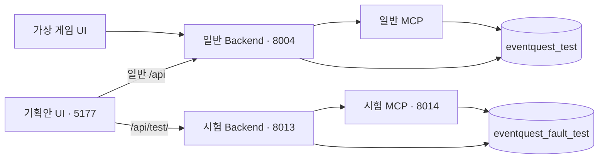

# 기획안 프론트 통합 구현·검증

기준: 2026-10-11, `ikonly`. 기획안 프론트 서버 하나에서 일반 업무와 격리 오류 시험을 제공한다. 가상 게임 프론트는 별도로 유지한다. [현재 구현 상태](../현재_구현상태.md), [시험실 계약 16](16_오류시험실_구현과_검증.md), [Infra 설계 08](08_Infra_네트워크_운영_설계.md)를 함께 참고한다.

## 1. 현재 실행 구조



DB 서버 `ikonly-test-postgres-1`은 공유하되 사용자/자동 검증/시험 DB는 각각 분리한다. 전체 서버 중단 시험은 이 격리 범위에 포함되지 않는다. MCP/Backend의 기존 업무 계약, 저장 데이터, 이전 시험 기록은 유지한다.

## 2. 요청·화면 계약

- Vite 개발 프록시는 `^/api/test(?:/|$)`를 먼저 매칭해 `EVENTQUEST_FAULT_API_TARGET`(기본 8013)으로 전송한다. 다른 `/api`는 `EVENTQUEST_API_TARGET`(기존 기본 8000)으로 전송한다. 로컬 통합 launcher는 일반 목적지를 8004로 명시한다.
- 시험 대상 미연결 시 일반 Backend로 fallback하지 않는다. 시험 화면에서 연결 실패를 안내하고 다시 연결 버튼을 제공한다. 일반 기획/정책/로그 화면은 별도 경로를 사용한다.
- `GET /api/test/fault-status`는 시험 DB 상태와 활성 정책 버전을 읽기만 한다. 정책 생성/활성화/복구를 실행하지 않는다. 이 endpoint는 기존 isolated 시험 API에만 설치된다.
- 시험 화면에 연결됨, 시험 DB, CLEAN/BUSY/DIRTY, 시험 정책 버전을 표시한다. 일반 정책 탭은 일반 DB의 정책을 관리한다. 화면의 시험 profile은 기존 시험 실행 범위에서만 적용·복원한다.
- 마지막 시험 기록 조회/새로고침은 기존 GET 경로를 유지하며 오류 주입이나 LLM 호출을 재실행하지 않는다.
- 이 라우팅은 로컬 Vite 개발 서버 설정이다. production build 자체에 reverse proxy가 포함되는 것은 아니며 배포 gateway의 같은 경로 라우팅과 접근 제한은 CI/CD에서 구성한다.

## 3. 실행·종료

일반 Backend·일반 MCP·가상 게임은 기존 실행을 유지하고 다음을 사용한다.

```powershell
powershell -NoProfile -File infra/fault-lab-local.ps1
powershell -NoProfile -File infra/planning-ui-local.ps1
```

시험 launcher는 8013/8014만 실행하며 프론트를 추가하지 않는다. `-UiPort`는 공유 프론트 Origin/접속 주소(기본 5177)를 지정한다. 공유 프론트 launcher의 `-ApiPort`, `-FaultApiPort`, `-UiPort`로 목적지와 UI 포트를 지정한다. 두 launcher는 사용 중인 포트를 덮어쓰지 않으며 환경변수를 실행 후 복원한다. 별도 5183 프론트는 종료했고 접속은 `http://127.0.0.1:5177`로 통일했다.

```powershell
powershell -NoProfile -File infra/planning-ui-local.ps1 -Stop
powershell -NoProfile -File infra/fault-lab-local.ps1 -Stop
```

소유한 PID와 command marker를 확인하며 일반 Backend/게임/DB를 종료하지 않는다. 시험 종료는 CLEAN 확인 후 진행한다. 기존 시험 state file의 UI PID도 소유권 확인 후 종료할 수 있어 이전 구성에서 이전이 가능하다.

## 4. 영향 검증

- 실제 Vite + 독립 upstream 검사 1 passed: 일반/시험 목적지, `/api/testing` 경계, 시험 POST 라우팅, 시험 upstream 실제 종료 후 500 및 일반 API 유지. 일반 Backend로 시험 fallback 없음.
- 읽기 전용 시험 상태 endpoint 단위 1 passed. 해당 Python 파일 Ruff lint/format 통과.
- Edge 통합 검사 3 passed: 실제 사용자 정책/시험 정책 분리 조회, 기존 실제 LLM 결과 GET 조회·새로고침 POST 0, 시험 상태 연결 실패 안내/재연결, 실제 시험 UI의 결정적 오류 주입→복구 PASS→CLEAN 및 일반 정책 불변.
- 연결 실패 UI 검사는 브라우저에서 503을 주입했다. upstream 실제 프로세스 종료의 프록시 동작은 별도 Node 검사다. 사용자 운영 Backend 중단·새 live LLM 생성·게임 등록을 이번 영향 검사로 수행하지 않았다.
- 기획안 production build 통과. 기존 137개/실제 LLM 19회 본 시험의 원본·보고서는 보존한다. 이번 UI 실행은 별도 영향 시험이며 본 실험 통계에 합산하지 않는다.

재현(기획안 frontend 디렉터리):

```powershell
node --test tests/proxy-routing.test.js
$env:UNIFIED_FRONT_CHECK='1'
node node_modules/@playwright/test/cli.js test --config=playwright.unified.config.js
```

통합 Edge suite는 실행 중인 5177 UI/8004 일반 API/8013 시험 API/8014 시험 MCP와 보존된 실제 결과 ID를 요구한다. 별도 프론트는 기동하지 않는다. 시험 DB에 새 결정적 시험 이력을 생성하고 profile은 원복한다. OpenAI 실호출은 하지 않는다.
