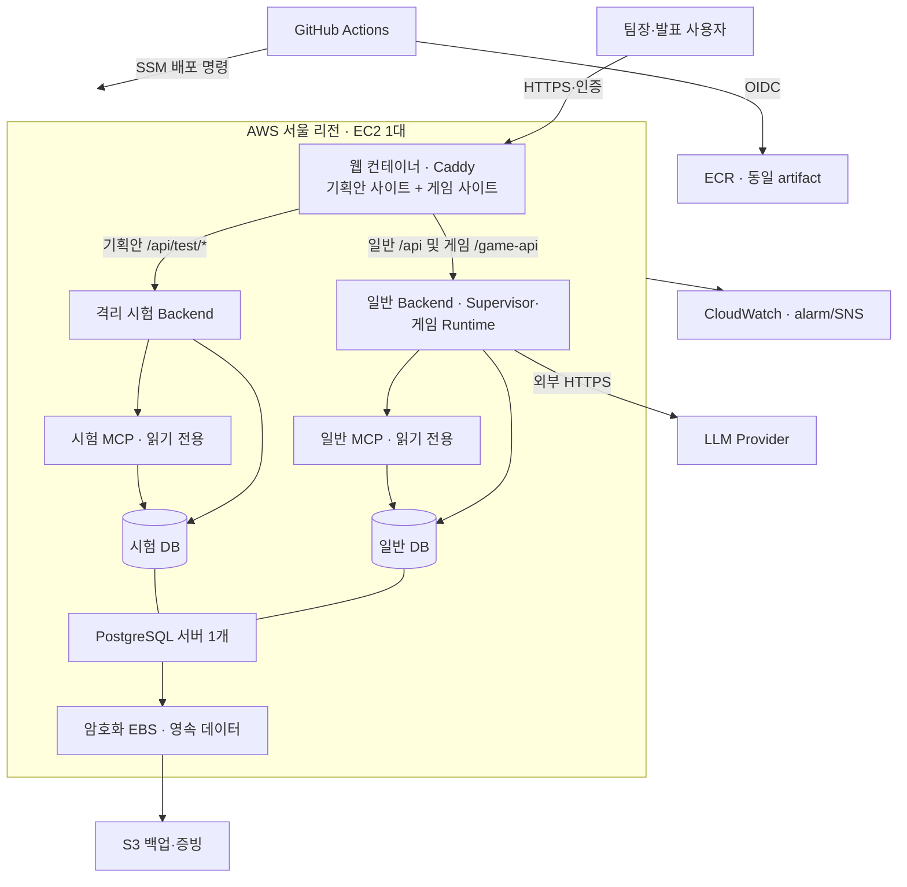
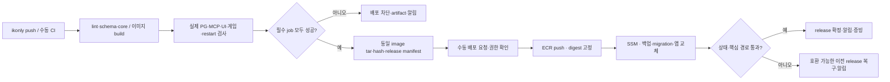

# AWS 배포·CI/CD 계획

작성: 2026-10-12, Asia/Seoul. 상태: **권장 계획, 미구현·미배포**. 코드 기준 `ikonly@2da4b41363cb6dadacc5e0bd6bb0520b143a984a`.

[최상위 설계](../최상위_시스템_설계서.md), [Infra 설계 08](08_Infra_네트워크_운영_설계.md), [프론트 통합 21](21_기획안프론트_통합구현.md), [테스트 분류 22](22_CI_테스트분류_정리.md)를 따른다. 배포는 이 계획을 바탕으로 별도 구현 후 수행한다. AWS 계정·기존 자원·실제 요금은 아직 조회하지 않았다.

## 1. 결론과 적용 범위

첫 배포는 **소규모 발표·팀장 검증 환경**으로 구성한다. 서울 리전, EC2 1대, Docker Compose, PostgreSQL 1개 서버와 서로 다른 업무/시험 DB, ECR, GitHub OIDC, SSM 배포를 권장한다. 현재 기획안 UI와 가상 게임은 정적 빌드로 제공하고 일반 Backend/MCP와 시험 Backend/MCP는 각각 다른 컨테이너로 실행한다. 첫 단계에서 Redis·RDS·ALB·EKS를 필수 서비스로 추가하지 않는다.

이는 현재 로컬 구성을 운영 환경으로 옮기는 최소안이다. 동일 호스트·DB 서버의 CPU·메모리·서버 장애는 공유한다. 논리적 시험 격리를 물리적 장애 격리나 고가용성으로 표현하지 않는다. 지속 서비스·동시 사용·DB 서버 중단 시험이 필요해지면 §11의 확장 구성을 선택한다.

### 배포 대상

| 대상 | 포함 여부 | 실행 방식 |
|---|---|---|
| `frontend-web` 현재 기획안·시험 UI | 포함 | Vite production build → 웹 컨테이너 정적 제공 |
| `demo-game/src` 현재 Phaser 가상 게임 | 포함 | Vite production build → 같은 웹 컨테이너의 별도 사이트 |
| `backend/app` 일반 기획·Supervisor·게임 Runtime | 포함 | 일반 API 컨테이너, 일반 DB 연결 |
| 동일 Backend의 격리 시험실 | 포함 | 별도 시험 API 컨테이너·환경·DB·실행 한도 |
| `mcp_server` | 포함 | 일반/시험 MCP 컨테이너 각각 실행 |
| PostgreSQL | 포함 | 서버 1개, DB·role·권한 분리, 영속 볼륨 |
| 이전 `frontend/` Streamlit 및 옛 게임 정적 엔트리 | 제외 | 신규 이미지·배포·제품 CI 대상 아님 |
| Redis / 외부 상용 게임 | 후속 | 현재 구현과 배포 범위에 필수 의존성을 만들지 않음 |

기획안과 게임은 서로 다른 화면/사이트지만 정적 파일을 서비스하는 서버는 하나로 줄일 수 있다. 게임 Runtime은 일반 Backend 안에 유지한다. Planner/Critic·Supervisor를 새 서버로 분리하지 않는다.

## 2. 가이드 요구사항과 제출 증거

기준은 [가이드 §3 6–7단계, 산출물 2·3 및 제출 체크리스트](../pre/멀티_에이전트_협업_및_서비스_운영_가이드.md)다.

| 요구 | 이 계획의 구현·검증 | 남길 증거 |
|---|---|---|
| 컨테이너와 배포 환경 | 웹·일반/시험 API·일반/시험 MCP·DB 경계 | 구성도, Compose 결과, 실제 이미지 digest·자원 |
| 커밋→빌드→테스트→배포 | 품질 게이트 통과한 동일 artifact 승격 | commit, Actions run/job URL, 이미지 manifest |
| 실패 시 배포 차단 | 필수 gate에 `needs`, 실패/skip도 승격 금지 | 의도적인 실패 실행, 기존 release 유지 결과 |
| 정상·에이전트·API/DB 장애 | AWS 격리 시험실 결정적 주입, 별도 제한된 live 확인 | 입력/기대/실제/시간/개입 여부/Trace |
| 복구율·평균 복구시간 | 자동 정상화와 정책상 안전 종료를 구분 | 분모·성공 조건·측정 구간 및 원본 결과 |
| 성공·실패·지연 알림 | GitHub summary/artifact, 운영 alarm·SNS | 성공/실패/지연 알림 도달 확인 |
| 상태·통신·secret·수동 개입 | HTTPS/인증, DB 권한, readiness, 백업·롤백 | 상태 검사, 접근 거부, 실제 복원 시험 |

가이드의 Kubernetes Deployment/StatefulSet 표는 예시다. 다만 `에이전트별 서비스를 컨테이너로 구성`이라는 문구와 현재 역할을 한 Backend에서 실행하는 구조는 배포 단위가 다르다. 아키텍처 산출물에 Agent 역할·handoff·권한·단일 Supervisor와 실제 컨테이너의 대응을 명시한다. 역할마다 별도 컨테이너가 필요한 평가 기준인지 확인이 필요한 경우 이 차이를 제출 전에 확인하며, 현재 구조가 그 문구를 문자 그대로 충족한다고 단정하지 않는다.

기존 로컬 137개 오류 시험과 실제 LLM 19회 결과는 유지한다. AWS에서 실행하지 않은 결과를 AWS 결과로 바꾸거나 서로 다른 시험을 합산하지 않는다. 평균 복구시간은 자동 복구 성공 사례에서 측정하고 안전 종료·장애 실패는 별도 집계한다.

## 3. 참고 workflow 비교

아래는 실제 파일을 읽은 결과이며 AWS 배포 실행 성공을 확인한 것은 아니다. GitHub connector는 접근 오류였고 Git fetch/별도 임시 clone으로 읽었다. `yejin` 원격 참조를 갱신했으며 작업 브랜치는 바꾸지 않았다.

| 참고 | 확인한 방식 | 채택·변경 |
|---|---|---|
| aidevs `07-runtime-ci.yml` | Fake 계약 검사, Compose 검사, 이미지 build; 배포 없음 | secret 없는 기본 CI와 Compose 사전 검증 채택; 현재 전체 테스트 분류로 확대 |
| aidevs `07-simple-multi-llm-33-cicd.yml` | test→`needs` deploy, OIDC/ECR/SSM, EC2 상태 확인, DB secret, main 자동 배포 선택 | OIDC·SSM·account 검증·immutable tag 채택; 자동 배포 초기 비활성, 동일 artifact 승격 |
| aidevs `07-simple-multi-llm-33-infrastructure.yml` | CloudFormation으로 2 EC2·RDS·Redis 생성/삭제 | 인프라/앱 workflow 분리 채택; 첫 배포 자원은 단일 호스트·PostgreSQL로 축소 |
| aidevs `07-weather-mcp-cicd.yml` | MCP/Backend/Frontend 3이미지, Compose·ECR·SSM·readiness | MCP 포함 배포 및 readiness 채택; 현재 코드 공유에 맞춰 application 이미지 재사용 |
| aidevs `07-weather-stateful-cicd.yml` | infrastructure/application Compose 분리, SSH·원격 source build | 데이터/앱 수명 분리는 채택; SSH key·원격 build 대신 OIDC/SSM·CI artifact |
| yejin `frontend-deploy.yml` | Streamlit syntax/build, OIDC/ECR/SSM, 8501 health | 배포 뼈대만 참조; 대상·경로·품질 게이트·HTTPS·롤백 전면 교체 |
| yejin `frontend-infrastructure.yml` | CloudFormation EC2/ECR, 수동 apply/destroy, account 검증 | IaC·검증 방식 채택; 신규 독립 stack, 데이터 Retain·삭제 분리 |

참고 코드의 개선 필요: yejin은 이전 컨테이너를 먼저 삭제하고 실패 시 복구하지 않으며, 환경 파일을 base64로 SSM 명령에 넣는다. base64는 암호화가 아니다. aidevs 33은 검사 이미지와 배포 이미지를 다시 build하며 강한 image prune을 실행한다. 참고 RDS template에는 backup retention 0과 삭제 정책 Delete가 있다. 신규 계획에서는 secret을 EC2가 직접 조회하고, release manifest·이전 이미지·DB 백업을 보존하며 데이터 자원을 자동 삭제하지 않는다.

### 출처를 고정한 참조

확인 SHA: aidevs `5c23ad535b80158636dbe4ad66336c99e8a49df4`, yejin `8e1d610238fe98f6b25e106b8272e400a5d4c7f6`.

- [aidevs 기본 CI](https://github.com/ik-e/aidevs/blob/5c23ad535b80158636dbe4ad66336c99e8a49df4/.github/workflows/07-runtime-ci.yml), [33 CI/CD](https://github.com/ik-e/aidevs/blob/5c23ad535b80158636dbe4ad66336c99e8a49df4/.github/workflows/07-simple-multi-llm-33-cicd.yml), [33 infrastructure](https://github.com/ik-e/aidevs/blob/5c23ad535b80158636dbe4ad66336c99e8a49df4/.github/workflows/07-simple-multi-llm-33-infrastructure.yml)
- [aidevs MCP 배포](https://github.com/ik-e/aidevs/blob/5c23ad535b80158636dbe4ad66336c99e8a49df4/.github/workflows/07-weather-mcp-cicd.yml), [stateful 배포](https://github.com/ik-e/aidevs/blob/5c23ad535b80158636dbe4ad66336c99e8a49df4/.github/workflows/07-weather-stateful-cicd.yml)
- [yejin 배포](https://github.com/ik-e/multi-agent-autohealing/blob/8e1d610238fe98f6b25e106b8272e400a5d4c7f6/.github/workflows/frontend-deploy.yml), [yejin infrastructure](https://github.com/ik-e/multi-agent-autohealing/blob/8e1d610238fe98f6b25e106b8272e400a5d4c7f6/.github/workflows/frontend-infrastructure.yml), [yejin template](https://github.com/ik-e/multi-agent-autohealing/blob/8e1d610238fe98f6b25e106b8272e400a5d4c7f6/infra/frontend-yejin.yml)

## 4. AWS 최소 구성과 논리 구조

| 자원 | 권장 초안 | 이유·제한 |
|---|---|---|
| 리전 | `ap-northeast-2` | 기존 참고 workflow와 동일. 계정/VPC는 사용자가 확정 |
| EC2 | Ubuntu x86_64, 초기 `t3.large` 2 vCPU/8 GiB | API·시험 자식 프로세스·DB 동시 실행 여유. 측정 전 용량 제안이며 4 GiB 축소는 부하 확인 후 |
| 저장소 | root gp3 30 GiB + 암호화 data gp3 40 GiB | DB/시험 journal/인증서/배포 이력 분리, data Retain 및 삭제 보호 |
| IP·접속 | 고정 EIP 1개, 보유 도메인의 계획/게임 subdomain | 재시작 후 URL 유지. DNS 값은 배포 전 확정 |
| ECR | web/application 2개 repository | 일반/시험 Backend와 일반/시험 MCP가 동일 application digest 재사용 |
| 네트워크 | public subnet + SG, Docker bridge 영역 분리 | 외부 ingress는 웹만, DB/MCP/API 직접 포트 비공개 |
| 비밀값 | Parameter Store SecureString, EC2 role로 읽기 | GitHub에 AWS 장기키·전체 `.env`를 보관하지 않음 |
| 운영 | CloudWatch logs/지표 + S3 백업·증빙 | 디스크·메모리·실패·복구 상태·알림 추적 |

총 장기 실행 컨테이너는 웹 1 + Backend 2 + MCP 2 + PostgreSQL 1 = **6개**다. Frontend 개발 서버·별도 게임 Python proxy 서버는 AWS에서 실행하지 않는다. AWS 서버에서 이미지 build를 하지 않는다.

`t3.large` 사양은 [AWS T3 자료](https://aws.amazon.com/ec2/instance-types/t3/)를 확인했다. 표의 요금을 서울 리전 견적으로 복사하지 않는다. 비용은 서울 EC2 실행 시간+EBS+EIP+S3/ECR+로그+도메인+LLM으로 계산하고 생성 전에 실제 견적을 확인한다. EIP는 인스턴스를 중지해도 과금된다. [공식 IPv4 요금](https://aws.amazon.com/vpc/pricing/) 참고. 월 예산과 상시 운영 여부는 미정이다.

시험은 동시 1개, 일반 workflow의 기존 worker/admission 한도를 유지한다. 초기 메모리 상한은 웹 256 MiB, 일반 API 1536 MiB, 시험 API 2048 MiB(자식 포함), MCP 각 512 MiB, DB 1024 MiB로 두고 호스트 여유를 남긴다. 실제 대표 시험에서 RSS/OOM·CPU credit·응답 지연을 측정해 조정한다. 시험 API의 CPU 제한도 두며 전체 DB 프로세스 중단은 이 호스트에서 주입하지 않는다.

## 5. 접속·네트워크·권한 계약

- `plan.<domain>`: 현재 기획안 UI, `/api/test/*` 우선→시험 API, 다른 `/api/*`→일반 API. 시험 upstream 실패 시 일반 API로 fallback 금지.
- `game.<domain>`: 현재 게임 정적 빌드, `/game-api/*`→일반 API `/api/game/*`. 게임 사이트에서는 시험/정책 API를 라우팅하지 않는다.
- Caddy HTTPS 및 단일 운영자 Basic 인증을 시연 환경에 적용한다. 기획/게임 모든 페이지와 API를 보호한다. 비밀번호 hash만 secret으로 관리하고 Authorization·인증 header·prompt 원문은 access log에서 제외한다. [Caddy 인증](https://caddyserver.com/docs/caddyfile/directives/basic_auth), [TLS 조건](https://caddyserver.com/docs/automatic-https) 참고.
- 443은 발표 접속 CIDR부터 제한한다. ACME HTTP challenge를 사용할 경우 80 공개는 인증서 challenge/HTTPS redirect만 제공한다. 22·5432·8000·8010·8013·8014는 외부에 열지 않는다. 관리 접속은 SSM으로 한다.
- Caddy 관리 포트는 외부 게시하지 않는다. Docker host network를 기본으로 쓰지 않으며, 일반/시험 데이터망은 분리하고 웹은 필요한 API망만 연결한다. 일반 API/MCP는 시험 DB credential을 받지 않는다.
- EC2 IMDSv2를 필수로 하고 bridge 컨테이너의 IMDS 접근을 차단한다. image pull/secret 조회/backup은 호스트 SSM 실행 경로의 instance role로 수행한다. 컨테이너가 공용 EC2 role credential을 가져와 다른 서비스 secret을 조회할 수 없게 한다. application 컨테이너는 Docker socket/privileged 권한 없이 실행한다.
- 현재 Backend의 loopback 검사와 브라우저 Origin 제한은 AWS 배포용 수정을 요구한다. **기본 local 모드는 그대로 보존**하고, cloud 모드에서는 전용 proxy 경로·정확한 출처·인증 증명 header를 검증한다. Caddy가 외부에서 전달된 증명 header를 삭제하고 인증 성공 후 서버 secret을 넣는다. Backend는 신뢰 proxy peer와 secret을 모두 확인한다. Uvicorn의 임의 forwarded-client 해석으로 이 검사를 우회하지 않게 한다. 넓은 사설 CIDR 허용만으로 인증을 대체하지 않는다.
- 서버 측 `OPERATOR_ACTOR_ID`와 allowlist가 결정권을 가진다. 현재 단일 사용자 전 권한 가정은 유지하되 정책 hard limit·검증·활성화 audit를 우회하지 않는다. 인증 없는 CLI나 Origin 위조도 proxy 인증을 통과하지 못한다. cloud 접근 경계 테스트가 배포 gate다.

DB 서버에는 `eventquest_demo`와 `eventquest_fault_test`를 만든다. 일반·시험 role은 비슈퍼유저이며 각각 자신의 DB/schema만 사용한다. DB별 PUBLIC CONNECT 권한도 통제한다. MCP는 대응 DB의 카탈로그 SELECT만 허용하는 별도 읽기 role을 사용한다. migration/bootstrap 전용 role은 runtime에서 제거한다. CI의 `eventquest_auto_test`는 Actions ephemeral DB에만 존재한다.

## 6. 현재 코드에서 선행 보완할 사항

| 확인한 제약 | 배포 전 작업 | 검증 기준 |
|---|---|---|
| `backend/app/main.py`가 loopback만 허용 | local/cloud ingress 모드, proxy 인증/peer/Origin 계약 추가 | local 기존 보안 회귀 유지, cloud 직접 접속·위조·미인증 거부 |
| 기존 Backend Dockerfile은 Backend만 copy; fallback은 `mcp_server` import | root context의 application image에 양쪽 package/data 포함 | 실제 이미지에서 planner/fallback/MCP module import 및 계약 확인 |
| 기존 MCP Dockerfile도 Backend rules/data가 없음 | 동일 application image에서 MCP entry command로 실행 | catalog digest·게임 rules·DB snapshot 일치 |
| 시험실이 port5434·Docker label/name·DB owner를 고정 확인 | local guard 유지 + cloud 전용 DB 정체/role/권한/환경 식별 검증 구현 | 일반 DB 연결·일반 role·오염 환경·다른 server ID는 실행 전 거부 |
| 시험 runtime이 `backend.tests.support.fault_lab_runner` 실행 | runner/precision support를 명시적으로 이미지에 포함; 일반 API에서는 비활성 | 자식 process 실행·한도·journal 저장·CLEAN 복원 확인 |
| Vite proxy는 build에 포함되지 않음 | Caddy production routing, 같은 경계의 proxy 검사 | 시험 우선 분기·게임 경로·fallback 금지·정적 asset 정상 |
| journal이 `backend/test-results/fault-lab` 파일에 저장 | 시험 전용 영속 mount와 쓰기 소유권·quota | 컨테이너 재생성 후 DB/journal 조회 가능 |
| readiness가 DB/engine 중심이며 MCP 전용 health 없음 | 배포 smoke에 MCP initialize/읽기 tool 추가 | GET `/mcp` HTTP200만으로 성공 판정하지 않음 |
| migration은 SQL 재실행/seed 중심, startup DDL 경로 존재 | ordered migration ledger/checksum/lock, startup DDL 분리 | 중복 적용·동시 배포 방지, runtime role의 최소 권한 |
| 테스트/helper가 Windows·localhost에 묶인 부분 존재 | Linux CI entrypoint와 배포 API 접근 경계의 E2E 추가 | CI Python3.11/Chromium 검증, 로컬 Edge 회귀 보존 |

**Docker socket을 시험 컨테이너에 mount해 기존 Docker inspect를 만족시키는 방식은 사용하지 않는다.** cloud guard는 로컬 안전장치 삭제가 아니라 별도의 검증 경로다. 이미지에는 `.env`, venv, Git credentials, 과거 사용자 데이터, 임의 전체 테스트/문서 파일을 copy하지 않는다. 필요한 runtime runner/support만 whitelist로 포함한다.

일반 환경은 실제 PostgreSQL·MCP·LLM으로 실행하고 설정 누락 시 deterministic으로 조용히 바꾸지 않는다. 시험 UI는 기존 계약대로 deterministic 오류 주입을 기본 제공한다. 실제 LLM 실험은 별도 CLI/권한·횟수/비용 한도에서만 실행하며 UI 일반 시험과 구분한다. `LLM_RECORD_ENCRYPTION_KEY`는 일반/시험 각각 보존하고 배포 때마다 생성하지 않는다.

## 7. CI/CD 흐름과 GitHub 계약

### workflow 역할

| 계획 파일 | trigger·권한 | 책임 |
|---|---|---|
| `.github/workflows/ikonly-ci.yml` | `push: ikonly`, 수동; contents read | core/Ruff/schema, 실제 PG, UI fixture/Node, 이미지·DB E2E·게임·restart, artifact 저장 |
| `.github/workflows/ikonly-infrastructure.yml` | 수동 plan/apply, AWS OIDC | account/VPC/AMI/template 검증, change set 검토, 독립 stack 생성 |
| `.github/workflows/ikonly-deploy.yml` | 최초 수동만, AWS OIDC | 성공한 CI run/SHA/artifact 검증→ECR→SSM→smoke/rollback |
| `.github/workflows/ikonly-operations.yml` | 수동 start/stop/rollback/backup | 환경·CLEAN 확인, 상태·이전 release·데이터 보호 |

PR은 필수 작업 흐름으로 만들지 않는다. CI path에는 Backend/MCP/현재 두 프론트/테스트/분류 JSON/config/lockfile/infra와 workflow 변경을 포함한다. 옛 `frontend/**` 변경만으로 신규 제품 배포를 시작하지 않는다. 전역 Ruff는 당분간 기존 Python까지 검사하며 배포 이미지 포함 여부와 구분한다.

GitHub 원격 default branch는 `main`으로 확인했다. 새 `workflow_dispatch`를 Actions UI에서 사용할 수 있게 하려면 default branch에 workflow 등록 파일이 필요하다. 팀장이 최소 등록 파일을 검토해 반영한 뒤 `ikonly` ref를 선택하도록 한다. 앱 전체를 main에 통합해야 하는 뜻은 아니다. deploy job은 ref가 정확히 `refs/heads/ikonly`인지, 성공 CI SHA가 선택 SHA와 같은지, account/environment가 맞는지를 별도 검증한다. 다른 branch에서 수동 입력만으로 배포할 수 없게 한다.

초기 `AUTO_DEPLOY_ENABLED=false`, Environment `ikonly-demo`, 자원명 `multi-agent-autohealing-ikonly-demo-*`를 사용한다. yejin stack/ECR/role을 재사용하거나 삭제하지 않는다. `environment` reviewer/branch 보호 기능은 repository visibility/계정 플랜을 확인해 적용한다. 지원되지 않으면 팀장만 쓰기 권한을 가진 별도 배포 저장소를 사용하거나 보호 기능이 마련될 때까지 OIDC 배포 role을 발급하지 않는다. repository/environment subject 제한만으로 개인 사용자 권한까지 제한할 수 있다고 가정하지 않는다. **workflow_dispatch 버튼 자체가 팀장 전용 권한이라는 가정은 하지 않는다.**

OIDC trust는 정확한 repository/environment/audience 및 실제 subject 형식에 제한한다. 기존 저장소의 subject가 이름형인지 immutable ID형인지 확인 후 작성한다. 배포 concurrency는 branch별이 아니라 **target 환경 하나**로 묶고 진행 중 배포를 취소하지 않는다. 인프라 변경·앱 배포·rollback도 같은 대상 lock을 사용한다. [GitHub AWS OIDC](https://docs.github.com/en/actions/how-tos/secure-your-work/security-harden-deployments/oidc-in-aws) 참고.

CI job과 일반 배포에는 실호출 LLM key가 필요 없다. [22의 분류](22_CI_테스트분류_정리.md)를 그대로 사용하며 core·PostgreSQL·화면 fixture가 각각 검증하는 경계를 명시한다. paid external/Clash/역사적 저장 ID 조회는 기본 CI gate에서 제외한다. AWS 시연 수용 단계의 실호출은 별도 비용 한도와 기록을 둔다.

이미지는 CI에서 한 번 build해 tar/hash로 보관한다. 이미지 안의 실제 코드·데이터를 대상으로 container smoke/통합·E2E를 통과시킨 뒤 동일 tar를 load해 ECR로 push한다. deploy에서 소스를 rebuild하지 않는다. tag는 `sha-<commit>-<run>-<attempt>`, 실제 배포는 digest로 고정하며 web/application·catalog/schema/migration checksum을 release manifest로 묶는다. [ECR immutable tag](https://docs.aws.amazon.com/AmazonECR/latest/userguide/image-tag-mutability.html) 참고.

## 8. 배포·migration·rollback 절차

1. 성공 CI run·commit·artifact hash·배포 권한·계정·리전·stack 출력 확인. 같은 환경의 배포 lock 획득.
2. EC2 running/SSM online/data mount 확인. 배포 모드에 진입해 새 workflow·시험·게임 쓰기를 차단하고 진행 중 작업을 기존 deadline 안에서 drain한다. CLEAN이 아니거나 처리 중 쓰기가 남으면 배포 중단.
3. 기존 release manifest와 정책 참조·catalog·게임 상태 기준 저장. 일반/시험 DB 논리 백업을 S3에 저장하고 checksum/복원 가능 형식을 검사한다. secret은 EC2 role이 SecureString에서 가져오며 SSM command/history에 secret payload를 넣지 않는다.
4. 새 이미지 pull/설정 검증을 기존 앱 종료 전에 수행. Docker image cache에 이전 성공 release 최소 2개 보존. 자동 `image prune -af` 금지.
5. 일회성 migration command가 순서/lock/ledger/checksum을 검사한다. backward-compatible additive 변경만 자동 승격한다. bootstrap/seed는 필요한 catalog 등록만 수행하며 기존 user 진행·정책·로그를 reset하지 않는다. 시험 초기화도 시험 DB에서만 명시 실행한다.
6. 단일 호스트 첫 버전은 maintenance 동안 짧게 앱을 교체하는 방식이다. 무중단/blue-green으로 표현하지 않는다. 웹/API/MCP를 같은 release 세트로 교체하고 DB 컨테이너/data volume은 재생성하지 않는다.
7. DB readiness + 일반/시험 API + MCP initialize/tool·snapshot digest + HTTPS 인증/route·두 화면 asset 검사. 실제 상태 조회/기록 복원은 읽기 위주로 수행한다. 승인→게임 등록 쓰기는 테스트 fixture를 시험 환경에 한정하고 일반 사용자 데이터로 smoke하지 않는다.
8. 통과 시 현재 release 갱신, maintenance 해제, GitHub summary/CloudWatch/SNS에 release·시간·URL·판정 기록.
9. 실패 시 원인 기록 후 schema가 이전 앱과 호환되면 이전 manifest의 웹/API/MCP digest로 되돌리고 재검사. migration이 실패했거나 호환되지 않으면 maintenance를 유지하고 수동 조치한다. 백업 DB를 자동 덮어써 이후 사용자 쓰기를 잃지 않는다.

지속 DB 저장 데이터와 LLM 암호화 key의 복구는 앱 rollback과 다르다. DB restore는 별도 임시 DB에서 먼저 확인한 뒤 팀장이 데이터 손실 범위를 보고 결정한다. advisory lock·operation owner/lease/deadline·정책 pinning은 배포 후에도 유지한다. 중단 workflow 자동 재개는 새로 약속하지 않는다.

[SSM Run Command](https://docs.aws.amazon.com/systems-manager/latest/userguide/run-command.html)는 instance role/Agent/네트워크를 갖춘 managed node를 전제로 한다. 명령 접수만으로 배포 성공 처리하지 않고 terminal status와 앱 검증을 모두 기다린다.

## 9. 운영·백업·장애 시험

- CloudWatch log 14일, S3 배포·시험 증빙 30일, DB 일일 백업 7개+배포 직전 백업을 초안으로 한다. 암호화·bucket public block·최소 role을 적용한다. 원문 prompt는 기존 암호화 DB 정책을 따르며 로그/S3 시험 summary에 평문 복제하지 않는다.
- CPU/credit·메모리·디스크·API 5xx/지연·readiness·MCP 오류·시험 DIRTY/OOM·backup 실패를 모니터링한다. 초기 임계값과 운영 시간이 정해지면 alarm을 구체화한다. [CloudWatch alarms](https://docs.aws.amazon.com/AmazonCloudWatch/latest/monitoring/CloudWatch_Alarms.html) 참고.
- 배포 job별 timeout과 SSM timeout을 두고, 실패와 지연도 GitHub summary/artifact로 남긴다. 운영 alarm은 SNS 구독자에게 전달한다. 이메일 수신 확인은 배포 수용 기준이며 Slack 등 외부 메시지는 별도 요청 없이 연결하지 않는다.
- 백업 기준 초안 RPO 24시간/전체 호스트 복구 RTO 60분은 목표다. 새 DB에 복원·key·catalog·정책·게임 진행·시험 기록을 읽어보고 실제 시간을 기록하기 전 달성했다고 표시하지 않는다. EBS 암호화/스냅샷은 [AWS EBS 문서](https://docs.aws.amazon.com/ebs/latest/userguide/EBSFeatures.html)를 따른다. 가동 중 snapshot 하나만으로 PostgreSQL 일관 백업을 대신하지 않는다.
- AWS 시험실은 정상/일시 복구/지속 장애 안전 종료/정책 변경·원복/입력·프롬프트 공격/일반 DB 불변/조회 재실행 없음부터 수행한다. local runner의 28개 코드 대비 AWS runnable 목록·미지원 항목을 다시 명시한다. 환경이 바뀌었다고 기존 28개 전체 통과를 자동 승계하지 않는다.
- 일반 서비스에서 정상 live 기획→형식·의미 검증→사람 승인→선택 공간 게임 반영을 한정된 테스트 데이터로 확인한다. 실제 LLM key·비용 한도는 명시하고 기존 비용 상한을 임의로 확대하지 않는다.
- 실제 PostgreSQL 서버 stop·EC2 종료·디스크 고갈 같은 인프라 장애는 같은 서버의 일반 DB에 영향을 준다. 첫 공유 호스트에서는 시행하지 않으며 별도 임시 환경이 준비됐을 때 운영 복구 시험으로 구분한다.
- Infra 삭제는 앱 배포 workflow에 넣지 않는다. 앱/EC2 stack과 데이터 자원의 수명을 분리하고 EBS/S3/ECR 및 key의 보존을 기본으로 한다. 발표 후 stop과 자원 삭제는 다른 명령이며, EBS/EIP/ECR/S3 비용은 stop 후에도 남는다.

## 10. 구현 단계·파일·완료 기준

아래 파일은 **새로 만들 예정**이며 현재 존재/완료를 뜻하지 않는다. 문서는 계속 `docs/ik` 안에서 관리한다.

| 단계 | 작업 파일·대상 | 완료 조건 |
|---|---|---|
| D0 배포 계약 | 본 문서, Infra 08, 보안/시험 설계 | 계정/region/VPC/domain/budget/권한 확정, 시연 경계 승인 |
| D1 container package | `infra/aws/Dockerfile.application`, `Dockerfile.web`, `.dockerignore`, `Caddyfile`, `compose.data.yml`, `compose.application.yml` | 현재 두 UI와 API/MCP만 포함, import/fallback/runner·proxy·secret 미포함 검사 |
| D2 cloud 안전 경계 | `backend/app/main.py`, `backend/app/repositories/fault_lab.py`, 관련 config/guard·검사 | local 보호 보존, proxy 인증·DB 분리·잘못된 환경 fail closed, socket mount 없음 |
| D3 CI | `infra/ci/` Linux runner, `ikonly-ci.yml`, 테스트 inventory/CI fixture | core/PG/UI/이미지/게임/restart 통과, 실패·skip 시 승격 차단 증거 |
| D4 AWS IaC | `infra/aws/ikonly-demo.yml`, `ikonly-infrastructure.yml` | change set 확인, independent 자원·IAM/SG/data보존, SSM 등록·secret 읽기 |
| D5 CD/operation | `infra/aws/scripts/{deploy,health_check,rollback,backup}.sh`, deploy/operations workflow | 동일 artifact·digest 배포, migration·maintenance/drain·rollback·알림 검증 |
| D6 AWS 수용/보고 | `docs/ik/검증산출물/` 배포·복구/파이프라인 보고서 | 두 UI·기획/게임 DB·실제 MCP/LLM·시험 격리, 실패 차단·복원 실제 증거 |

전체 완료는 접속 URL이 열리는 것만으로 판단하지 않는다. **핵심 기능, 실제 DB·MCP·LLM 연결, 일반/시험 데이터 격리, 미인증 차단, CI 실패 배포 차단, 같은 artifact 배포, DB 보존·앱 rollback·백업 restore·알림 및 가이드 보고서**를 각각 확인한다. 기능 시험에서 수정이 생기면 코드·설계·실행 절차·시험 inventory를 함께 갱신한다.

## 11. 후속 확장과 미결 결정

| 조건 | 확장 |
|---|---|
| 시험 부하/장애를 일반 서비스에서 완전히 분리해야 함 | 시험 EC2와 시험 DB 서버를 별도 배치. 하나의 기획안 UI는 유지 |
| 장기 운영·DB 가용성/자동 backup 필요 | private RDS PostgreSQL. 동일 서버의 DB 분리는 유지 가능하며 cloud guard/TLS/권한 재검증 |
| 서비스 가용성과 다중 instance 필요 | ALB/ECS 등으로 확장, ingress·작업 예약·배포 drain 검증 |
| 캐시 이익이 실측됨 | Redis 별도 설계 후 추가. 멱등성의 DB 권위를 먼저 유지 |

아직 확인할 값은 AWS account/리전·기존 VPC/subnet/AMI, 도메인/DNS, 월 예산·운영 시간, GitHub 계정의 deployment 보호 기능, 발표 접속 범위, 알림 수신자다. 보유 환경 응답 전에는 위 권장안을 초안으로 사용하며 **AWS 자원을 생성하거나 workflow를 실행하지 않는다.** 현재 작업은 계획 작성과 근거 확인이다.
