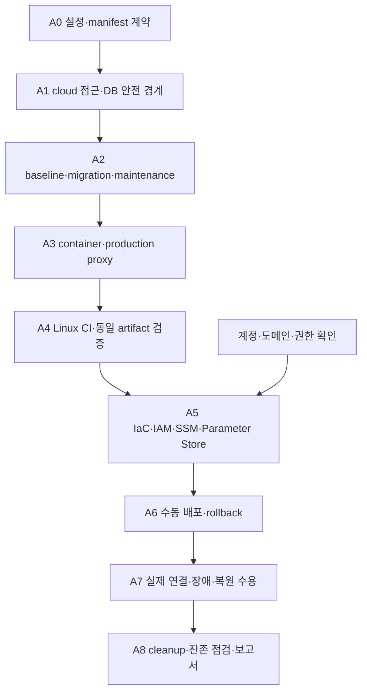
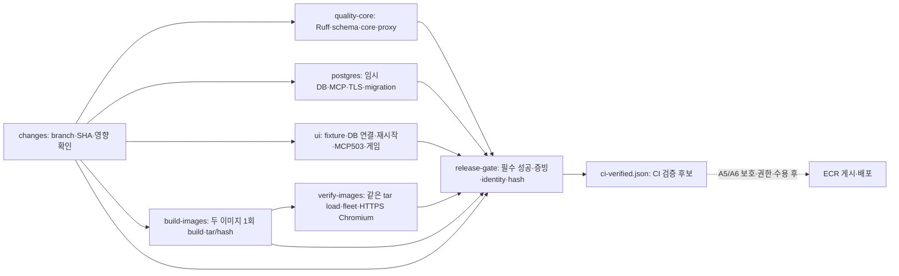

# AWS 배포·CI/CD 구현 계획

작성: 2026-10-12, Asia/Seoul. 설계 기준: `ikonly@8471249adaaa270142c9468b22937a2cd72c1cbb` 및 배포 문서 변경. 상태: **A0~A4 기반 및 A5 IaC/IAM/SSM/Parameter Store 준비 구현·로컬/실제 AWS 조회 검증, 실제 생성·전체 배포는 미완료**. 최신 진행 범위와 사용자 확정 사항은 §17, 이전 단계 기록은 §10~15를 따른다. 원격 Actions 실행 성공은 아직 확인하지 않았다.

구조·비용·종료 원칙은 [배포 설계 23](23_AWS_배포_CICD_계획.md), 테스트 선택은 [CI 분류 22](22_CI_테스트분류_정리.md), 구현 사실은 [현재 구현 상태](../현재_구현상태.md)를 따른다. 가이드의 필수 산출물은 [보존 가이드](../pre/멀티_에이전트_협업_및_서비스_운영_가이드.md)로 확인한다. 구현 담당은 팀장이다.

## 1. 목표·범위·실행 경계

현재 기획안 시스템·가상 게임·오류 시험실을 AWS에 연결해 짧게 검증·시연하고, 증빙과 복원 가능한 데이터를 남긴 뒤 실행 자원을 정리한다. 웹 2·Backend 2·MCP 2의 EC2 6대, private RDS 1개, public NAT 1개, Parameter Store, ECR/OIDC/SSM을 사용한다. Supervisor·Planner·Critic 및 게임 Runtime의 업무 책임은 현재 Backend 구조를 따른다.

단계별 파일은 §10~17에서 구현 여부를 확인한다. 계정 인증·현재 IP /32·알림·수동 종료와 도메인 없는 IP 접속을 확정했다. 최초 인프라는 로컬 AWS 자격으로 change set을 검토·적용하고, GitHub 보호 확인은 OIDC 자동 배포 활성화의 선행 조건이다. 실제 서비스 수용은 인증서 신뢰·host 설정·연결 검증까지 완료해야 한다. 계정 없이도 코드·로컬 검증 준비는 가능하다. 로컬 사용자 서버와 DB, 기존 yejin AWS 자원은 별도로 유지한다.

### 전체 완료 조건

- 동일 CI artifact로 실제 컨테이너 배포, commit/run/image digest/catalog·migration 버전 추적
- 두 HTTPS 화면에서 실제 RDS·MCP·OpenAI 연결, 기획→승인→선택 공간 등록→게임 진행·보상 저장
- 일반/시험 데이터·role·MCP 격리, cloud 인증·권한·Origin 검사, 기존 local 보호 유지
- 기존 오류 시험 목록의 AWS 지원/미지원 항목 명시 및 실행 증빙, 복구와 안전 종료의 구분
- CI 필수 게이트 실패·누락 시 배포 차단, 앱 rollback 및 새 DB 복원 실제 확인
- 알림 확인, cleanup 실행 후 EC2/RDS/NAT/EIP/불필요 volume 잔존 확인
- 가이드의 배포·장애 복구 보고서와 자동화 파이프라인 보고서 작성

## 2. 설계 점검 결과와 보완 결정

전체 배포 경계는 일관되지만 현재 코드 그대로 배포할 수는 없다. 아래 보완은 A1~A5에 포함한다.

| 발견한 문제·빠진 연결 | 결정·구현 책임 |
|---|---|
| 기존 Dockerfile이 Backend/MCP를 각각 복사해 상호 import 누락 | root context application image에 필요한 두 package·게임 규칙·runner support를 명시 포함 |
| API `/api/*` loopback 검사로 다른 EC2의 웹 proxy도 거부 | 명시적 cloud ingress 모드와 서비스별 proxy 인증. local default는 유지 |
| 시험 DB guard가 Docker inspect·localhost·5434·고정 owner 요구 | cloud guard를 별도 구현. RDS TLS hostname·DB·role·보호된 환경 식별 값으로 검증 |
| `create_all` 및 시험실 DDL이 runtime에서 실행 | 일회성 baseline/migration으로 이전. runtime DDL 없이 시작·처리 가능해야 함 |
| 보호된 RDS지만 실제 DB 권한·TLS 계약이 아직 코드화되지 않음 | CA+`sslmode=verify-full`, 일반/시험 runtime·MCP read·migration role 구분 |
| 다중 호스트 release 교체 중 혼합 버전·새 작업 가능 | DB의 공유 maintenance/배포 lock, drain 후 MCP→Backend→웹, 전체 성공 후 해제 |
| 정리 전 복원 시험과 EC2 종료 순서 연결 부족 | EC2/NAT를 제거하기 전에 별도 임시 RDS에서 snapshot/논리 백업 복원 확인. 임시 RDS도 manifest에 등록·삭제 |
| 데이터 stack Retain·cross-stack export 때문에 VPC 삭제가 막힐 수 있음 | 앱→RDS 의존성→데이터→네트워크 순으로 해제. 실제 보존 자원을 확인하고 종료용 stack 절차 사용 |
| 짧은 운영인데 일일 백업만 기다리면 증빙을 잃을 수 있음 | 첫 기획·게임 저장 확인 후 초기 백업, 배포 직전/종료 직전 백업 추가 |

예정 구성은 서비스별 격리이며 EC2·NAT Single-AZ/RDS 공유로 인한 장애 범위는 남는다. Multi-AZ·다중 replica·Redis·외부 게임·자동 DB rollback을 이번 완료 조건으로 추가하지 않는다.

## 3. 작업 순서·파일·단계 게이트



| 단계 | 생성/변경할 파일 | 구현 내용 | 통과 조건 |
|---|---|---|---|
| A0 계약 | `infra/aws/config/demo.example.json`, `schemas/{environment,release,cleanup}.schema.json` | 환경값·호스트 역할·parameter 이름·자원 소유권·종료 시간 형식 | 예시에는 비밀값 없음. 역할 6개·일반/시험·보존 대상의 명시적 매핑 |
| A1 접근·격리 | `backend/app/main.py`, 새 `config/deployment.py`, `guards/cloud_access.py`, `config/cloud_database.py`, `repositories/fault_lab.py`, `mcp_server/server.py` | local/cloud 선택, proxy·Origin·DB/TLS·MCP 접속 경계, cloud 시작 시 설정 검증 | 잘못된 peer/secret/DB/role/환경은 쓰기 전에 차단. local 회귀 통과 |
| A2 DB·배포 상태 | 새 `backend/app/deployment/{migrate,bootstrap,maintenance}.py`, `backend/sql/017_deployment_control.sql`, `repositories/{postgres,game_runtime,fault_lab}.py`, `services/{canonical_planning,workflow_execution,fault_lab_service}.py` | baseline·migration ledger/checksum/advisory lock, DDL 이전, 환경 marker, 공유 maintenance/drain | empty/기존 DB 모두 적용, 재적용·동시 적용 안전, runtime DDL 불필요, 유지보수 중 새 작업 없음 |
| A3 이미지·proxy | `infra/aws/Dockerfile.application`, `Dockerfile.web`, `Caddyfile`, `Dockerfile.application.dockerignore`, `Dockerfile.web.dockerignore`, `compose.application.yml`, `requirements.application.lock`, `requirements.ci.lock`, `scripts/start-service.sh` | root build context·Dockerfile별 ignore, Python3.11/Node 빌드, 역할별 entry, 정적 두 사이트·API proxy, non-root·volume·자원 제한 | 실제 이미지 import/MCP/runner/UI 확인, secret/venv/옛 UI 미포함, 설정 누락은 시작 실패 |
| A4 CI | `.github/workflows/ikonly-ci.yml`, `infra/ci/{run-python,run-ui,verify-images}.sh`, `infra/ci/compose.yml`, `frontend-web/playwright.production.config.js` | 분류별 Linux CI, ephemeral PG, 실제 production image·proxy E2E, image tar·hash·manifest | 필수 gate 전부 성공, LLM 키·AWS credential 불필요, 실패/누락/필수 skip 승격 차단 |
| A5 IaC | `infra/aws/stacks/{network,data,application,access,observability}.yml`, `ssm/IkonlyDeploy.yml`, `scripts/{preflight,bootstrap-host,export-environment,load-parameters}.sh`, `ikonly-infrastructure.yml` | EC2 6·RDS·NAT·SG·IAM/OIDC·SSM·로그·백업, change set·resource manifest | read-only preflight→plan 확인→apply, SSM 6대·RDS private·role별 parameter 범위 확인 |
| A6 CD | `infra/aws/scripts/{deploy,health-check,rollback,backup}.sh`, `.github/workflows/ikonly-deploy.yml` | 검증한 tar ECR push, digest release, maintenance/drain·순차 교체·migration·rollback | 재빌드 없음, SSM terminal success+앱 smoke, 중간 실패 시 이전 호환 release 또는 maintenance 유지 |
| A7 AWS 수용 | `infra/aws/scripts/{acceptance,restore-check}.sh`, 테스트 fixture/보고서 | 실제 live 연결·선택 공간 등록, 격리 오류 시험·알림·복원 | §8의 AWS 게이트 증빙, 임시 복원 DB까지 정리 목록 포함 |
| A8 운영·정리 | `infra/aws/scripts/{operations,cleanup}.sh`, `.github/workflows/ikonly-operations.yml`, `docs/ik/검증산출물/` 보고서 | start/stop/backup/rollback/cleanup-plan/apply/purge-data, 잔존 조회·보고 | 실행 자원 제거·백업/key 보존·재실행 가능·잔존 비용 목록 출력 |

각 단계는 관련 코드·검사·문서를 함께 로컬 커밋한다. 새 검사 파일/함수는 `infra/test-suites.json`에 등록한다. 파일 번호 017은 구현 시 다른 작업과 충돌하면 다음 빈 번호로 조정하고 링크/ledger를 함께 갱신한다.

## 4. 실행·설정·권한 계약

### 4.1 서비스 역할과 포트

호스트 역할은 `plan-web`, `game-web`, `main-api`, `fault-api`, `main-mcp`, `fault-mcp`로 고정한다. Backend 컨테이너는 양쪽 모두 내부 8000, MCP 컨테이너는 양쪽 모두 내부 8010(`/mcp`)을 사용한다. 호스트가 다르므로 시험용 8013/8014를 AWS 필수 포트로 유지하지 않는다. DB는 5432, 웹은 80/443이며 Caddy 관리 포트는 공개하지 않는다.

- 웹→API: 사설 endpoint, origin·proxy identity 검증. 계획 웹은 일반/시험 경로, 게임 웹은 `/api/game/*` 경로만 허용
- API→MCP: 대응 사설 endpoint만 허용. MCP transport의 Host/Origin 방어도 실제 사설 주소에 맞춰 명시 설정
- API/MCP→RDS: endpoint DNS·CA 검증, `sslmode=verify-full`. raw IP를 인증서 hostname 대신 사용하지 않음
- Backend/MCP 컨테이너는 Docker socket·IMDS credential 접근 없이 실행. host role이 ECR pull·parameter fetch·backup을 담당

### 4.2 기존 환경변수와 새 설정

| 구분 | 이름·계약 |
|---|---|
| 기존 일반 실행 | `DATABASE_URL`, `MCP_URL`, `OPENAI_MODEL`, `OPENAI_API_KEY`, `LLM_RECORD_ENCRYPTION_KEY`, `OPERATOR_ACTOR_ID`, `APP_ALLOWED_ORIGINS` |
| 기존 모드 | 일반 `CANONICAL_PLANNING_MODE=live`, 필요한 호환 경로 `WORKFLOW_ENGINE=agent_live`. 시험은 deterministic이며 OpenAI 키 미주입 |
| 기존 시험 | `FAULT_LAB_MODE=isolated`, `DATABASE_URL=POSTGRES_TEST_URL`은 시험 RDS DB/role을 명시. cloud guard가 확인하고 일반 CI의 local destructive guard는 유지 |
| 기존 MCP | `MCP_DATABASE_URL`, `MCP_HOST=0.0.0.0`, `MCP_PORT=8010`. DB catalog 사용과 Host/Origin allowlist 명시 |
| 구현한 cloud ingress 설정 | `DEPLOYMENT_MODE=cloud`, `SERVICE_ROLE`, `CLOUD_PROXY_IDENTITIES` (사이트별 `peers` IP 목록·`secret`), `APP_ALLOWED_ORIGINS`의 HTTPS 출처 |
| 구현한 cloud DB 설정 | `DEPLOYMENT_ENVIRONMENT_ID`, `RDS_EXPECTED_ENDPOINT`, `EXPECTED_DATABASE_ROLE`, `DATABASE_AUTO_CREATE=false`. URL은 정확한 role/DB/5432 endpoint와 `sslmode=verify-full`, 존재하는 절대 경로 `sslrootcert`를 포함. §12의 고정 역할을 사용 |
| owner/bootstrap 전용 설정 | `MIGRATION_DATABASE_URL`, `RDS_BOOTSTRAP_DATABASE_URL`, `RDS_BOOTSTRAP_USER`, `DATABASE_ROLE_PASSWORDS`(6개 role별 비밀번호 JSON). runtime에 주입하지 않음 |
| 구현한 저장 위치 | 시험 API의 `FAULT_LAB_JOURNAL_DIR=/var/lib/eventquest/fault-lab`, 웹 Caddy `/data`·`/config` 영구 volume. manifest/backup host 경로는 후속 IaC/운영 단계 |

API와 MCP의 cloud 시작은 `.env` 로딩을 생략하고 DB 경계를 확인한다. API module 실행은 cloud에서 0.0.0.0으로 bind하며 forwarded header 해석을 끈다. DB 누락·잘못된 권한/marker·카탈로그·활성 정책은 시작 또는 readiness에서 실패한다. production image의 역할별 entry·main live/LLM 설정 검증·MCP Host/Origin 설정은 §14에서 구현·로컬 검증했다. 실제 AWS 설정/호스트에서는 아직 수용하지 않았다.

### 4.3 parameter·IAM 매핑

경로 prefix는 `/multi-agent-autohealing/ikonly-demo/`이며 실제 값은 Git·artifact·SSM command·로그에 넣지 않는다.

| parameter 영역 | 읽는 주체 |
|---|---|
| `shared/openai-api-key` | 일반 API host role. 제한된 live 시험은 별도 수동 실행 주체만 허용 |
| `main/runtime-database-url`, `main/llm-record-key` | 일반 API host role |
| `fault/runtime-database-url`, `fault/llm-record-key` | 시험 API host role. 일반 key·DB 접근 금지 |
| `main/mcp-database-url` / `fault/mcp-database-url` | 각각 일반/시험 MCP host role |
| 사이트별 BasicAuth hash·proxy 증명 | 해당 웹과 검증할 API role만 허용. 게임 proxy 권한을 정책/시험 API로 확대하지 않음 |
| migration/bootstrap/master credential | bootstrap/migration 실행 역할만 허용. runtime 환경 파일에는 넣지 않음 |

Standard SecureString + AWS 관리형 SSM KMS key를 기본으로 한다. 별도 고객 관리형 key가 필요해지면 IAM·보존·비용을 재검토한다. 앱 원문 암호화 key와 AWS KMS key는 별개다. RDS의 Secrets Manager 자동 password 관리 기능은 켜지 않는다. DB master 비밀번호도 Parameter Store에서 관리하며, IaC에 전달할 때 지원하는 SecureString 참조/호스트 bootstrap 방식을 확인하고 평문 template 출력이나 CLI argument에 넣지 않는다.

deploy role은 지정 ECR repository push와 지정 호스트·배포용 SSM document만 사용한다. 임의 `AWS-RunShellScript`로 root 명령을 실행할 권한을 일반 배포 role에 주지 않는다. infrastructure role은 별도로 두고 iam:PassRole 대상과 환경 소유권을 제한한다. 관리 IAM 권한과 DB 로그인 권한은 별개다. GitHub 배포 권한 제한은 설계 23 §7을 따른다.

bootstrap/migration은 maintenance 상태의 일반 API 호스트에서 일회성 container로 실행한다. 전용 operations 권한으로 작업 중에만 제한된 bootstrap/migration instance profile을 적용해 필요한 parameter를 조회하고, 작업 후 임시 환경 파일을 제거하고 일반 profile로 복귀한 것을 확인한다. master credential은 최초 DB/role 생성 때만 조회하며 이후 migration은 DB owner credential만 사용한다. 일반 앱 컨테이너에는 주입하지 않는다. profile 변경·복귀 실패는 배포 실패로 기록하고 maintenance를 유지한다. 정상 운영 호스트 6대에 별도 상시 migration 서버를 추가하지 않는다.

## 5. DB 초기화·migration·maintenance

1. 별도 bootstrap 주체가 `eventquest_demo`, `eventquest_fault_test`와 migration owner/runtime/MCP reader role을 만든다. runtime은 SUPERUSER·CREATEDB·CREATEROLE·schema CREATE·migration role 상속을 갖지 않는다. PUBLIC CONNECT와 schema 권한을 명시한다.
2. DB별 `deployment_identity` marker에 환경 ID·DB 용도를 기록하고 schema 버전은 checksum migration ledger로 확인한다. marker와 migration ledger는 runtime SELECT만 허용한다. 시험 guard는 expected endpoint/TLS·current_database/current_user·marker·role 속성을 모두 확인하며 환경변수 하나로 통과시키지 않는다.
3. 현재 SQL 001~016과 ORM model을 비교해 누락된 workflow/trace/시험 테이블까지 baseline manifest에 포함한다. `backend/sql`과 MCP legacy SQL을 중복 실행하지 않는다. 현재 Opong catalog 경로를 기준으로 migration·seed 목록을 고정한다.
4. empty DB는 baseline→순차 migration, 기존 DB는 schema/version fingerprint 확인→baseline 등록→미적용 migration 순서다. checksum 불일치·알 수 없는 schema·동시 적용은 중단한다. seed는 기존 user 상태·정책을 reset하지 않는다.
5. 최초 활성 오류 정책은 승인된 기준 버전을 검증 후 bootstrap audit로 등록한다. 정책이 없거나 invalid이면 readiness를 실패시키며 기본 정책으로 조용히 넘어가지 않는다. 재배포는 기존 활성 정책을 임의로 교체하지 않는다.
6. `create_all`/fault DDL의 cloud 실행을 제거한다. local/SQLite 테스트가 필요한 경우 local 설정에서만 보존한다. migration role은 앱 프로세스에 남기지 않는다.
7. 배포 lock과 DB maintenance 상태는 모든 Backend process가 공유한다. 새 workflow·시험·게임/정책 mutation을 차단하고 상태 조회는 유지한다. 진행 중 예약/lease/deadline과 실제 처리 종료를 확인해 drain한다. timeout이면 교체를 중단한다.

TLS 기준은 [AWS RDS SSL 문서](https://docs.aws.amazon.com/AmazonRDS/latest/UserGuide/UsingWithRDS.SSL.html)를 따른다. 실제 schema baseline은 A2에서 비교해 확정하며 SQL 파일이 존재한다는 이유만으로 모든 runtime 테이블이 갖춰졌다고 판단하지 않는다.

## 6. CI·artifact·수동 CD 계약

### 필수 CI job

| job | 검사 범위 | 운영 의존성 |
|---|---|---|
| `quality-core` | 전역 Ruff lint/format, schema export 비교, inventory, core·Node proxy | 없음 |
| `postgres` | CI disposable PG, local profile의 PG parameter·원자성·restart·MCP | CI 임시 DB/MCP만 사용 |
| `ui` | 기존 fixture·연결·게임·durable restart, Linux Chromium | CI 임시 API·DB·UI |
| `build-images` | application/web 한번 build, digest 후보·tar/hash | AWS·LLM 키 없음 |
| `verify-images` | tar load, production Caddy route·실제 image API/MCP/DB·두 화면 | CI disposable 환경 |
| `release-gate` | 모든 필수 job 결과·SHA·artifact hash 확인 | AWS 권한 없음 |

core의 의도된 PostgreSQL parameter skip은 postgres/local job에서 실행 결과가 있어야 한다. 필수 job 자체의 skip 또는 필요한 사례 누락은 승격 실패다. 외부 유료 호출/Clash/과거 run ID 조회는 기본 CI에 넣지 않는다. 느린 문제를 피하려고 테스트를 중복 실행하지 않고 실패 단계의 artifact·로그를 보존한다. 영향 검사만 수행한 결과는 전체 release gate 통과로 취급하지 않는다.

`release.json`에는 source SHA, CI run/attempt, 두 tar hash, 게시 후 ECR digest, migration/catalog/schema checksum, 서비스별 image 역할, 이전 release ID를 기록한다. 환경 manifest의 EC2/RDS 자원 ID는 image release와 분리한다. CI에서 검사한 tar를 load→ECR push하고 CD에서 rebuild하지 않는다.

CD는 `ikonly`의 성공한 지정 CI SHA만 선택한다. 전체 대상 lock 아래 backup→maintenance/drain→호환 migration→MCP/API/웹 교체→smoke→release 확정 순서다. SSM command 접수나 instance running만으로 성공 처리하지 않는다. 하나라도 실패하면 이전 호환 release 세트를 복구하거나 maintenance를 유지한다. DB 백업 자동 덮어쓰기는 하지 않는다.

새 workflow의 default branch 등록은 팀장이 최소 등록 파일을 검토·반영해야 한다. deployment 보호 기능을 확인하기 전에는 AWS OIDC 배포 role을 발급/사용하지 않는다. 초기 자동 CD는 비활성이다.

### 6.1 push 기반 변경 영향 배포 (2026-10-12 확정)

초기 AWS 배포·rollback을 수동 확인한 뒤 `AUTO_DEPLOY_ENABLED=true`로 전환하면 `ikonly` push의 성공 CI에서 영향받는 서버를 자동 업데이트한다. 규칙은 `infra/aws/change_rules.json`, 판별 코드는 `infra/aws/deployment_impact.py`에서 관리한다. 필요한 web/application image만 build하고 선택된 역할만 새 digest로 교체한다. 선택하지 않은 역할은 이전 검증 digest를 유지한다.

| 변경 영역 | 업데이트할 역할 |
|---|---|
| 기획안 제품 UI | `plan-web` |
| 게임 제품 UI | `game-web` |
| Backend 업무 코드 | `main-api`, `fault-api` |
| MCP server entry | `main-mcp`, `fault-mcp` |
| MCP tool/fallback | Backend/MCP 4개 (Backend가 tool을 import함) |
| 공유 게임 규칙/schema/catalog·SQL | 의존성이 있는 6개 전체. SQL은 migration 먼저 수행 |
| image·공통 의존성·proxy | 해당 image를 사용하는 영향 역할 전체 |
| 문서·순수 테스트 | 제품 업데이트 없음. 테스트/품질 변경은 CI 수행 |
| IaC/IAM/SG/운영 설정 | 수동 infrastructure 적용·호환 확인 전 자동 앱 배포 차단 |
| 미분류 코드 | 전체 검사·역할 후보로 확대하고 수동 검토 요구 |

CI 후보는 push before→after로 판별할 수 있으나 **실제 배포는 해당 환경의 마지막 성공 release SHA→배포할 SHA**로 다시 판별한다. 실패/미배포 push나 대기 실행 교체 때문에 변경을 누락하지 않는다. 신규 환경은 최초 전체 배포다. rename/delete는 양쪽 경로를 반영한다. 이력 불명·비조상 release·오래된 SHA의 자동 덮어쓰기는 거부한다.

환경 lock 안에서 release를 다시 읽는다. GitHub concurrency만으로 FIFO나 모든 중간 push 배포를 보장하지 않는다. release manifest에는 변경 역할의 새 digest와 유지 역할의 기존 digest·source SHA를 기록한다. 공통 계약/migration 변경은 함께 배포하고 전체 smoke 전에는 성공 기준점을 갱신하지 않는다.

선택하지 않은 검사 job은 허용된 skip이며, **필수로 선택된 검사**가 실패/skip/누락되면 승격을 차단한다. infrastructure·정리·rollback과 자동 배포도 같은 target lock을 사용한다. 문서만 바뀐 push는 AWS 인증/배포를 하지 않는다. 초기 CI 기반을 구현했다고 production image·DB·E2E gate가 완료된 것으로 취급하지 않는다.

알림 수신 주소는 사용자가 확인했다. 실제 환경 설정에 주입하며 예시 파일에는 placeholder만 둔다. AWS 계정은 실행 직전 사용자 인증 세션에서 확인할 예정이고 도메인/DNS는 아직 확인 전이다.

## 7. 생성·정리 명령 계약

예정 script는 공통 `--environment-manifest`, `--account`, `--region`, `--environment-id`를 받고 실제 값과 대조한다. operation마다 phase/status/resource ID/started_at/finished_at/잔존 항목을 비밀값 없이 기록한다. `plan`은 조회만 하고 `apply`는 plan hash와 대상 목록이 일치할 때 수행한다. unknown 상태·소유권 불명은 삭제하지 않는다.

| operations 모드 | 실행 내용 |
|---|---|
| `start` | 필요한 NAT/route/SSM 경로 확인→RDS→MCP/API→웹→전체 smoke. 이전 stop 환경에서만 수행 |
| `stop` | 새 쓰기 차단·drain→앱/EC2·RDS 중지. 남는 NAT/EIP/저장 비용과 RDS 자동 재시작 시점 출력 |
| `backup` | 일반/시험 DB 논리 백업·snapshot·journal/증빙, 완료·checksum·암호화 key 참조 기록 |
| `rollback` | 이전 호환 release 선택, maintenance/drain, 순차 재배포·smoke |
| `cleanup-plan` | 삭제/보존/공유 자원과 잔여 비용 항목 출력. 실제 삭제 없음 |
| `cleanup-apply` | 백업/복원 확인→EC2→RDS→NAT→EIP→stack 의존성/네트워크 정리, 잔존 조회 |
| `purge-data` | 보존 기한 경과·복원 필요 없음 확인 후 선택한 데이터/key·이미지·로그 제거 |

### 안전한 종료에서 추가로 확인할 것

- 최초 생성 중 실패해도 이미 생성된 resource manifest를 저장한다. 정상 배포 완료 전에 cleanup이 필요할 수 있다.
- restore-check용 임시 RDS는 별도 이름·태그·역할이며 일반 RDS를 덮어쓰지 않는다. 검사 완료 후 임시 RDS도 삭제한다.
- 실제 RDS 삭제 완료를 기다린 뒤 data stack의 DB subnet group/SG 참조와 cross-stack export를 해제한다. VPC 삭제는 마지막이다. Retain한 snapshot/key/S3/ECR는 실행 RDS를 보존해야 한다는 뜻이 아니다.
- SSM·백업·증빙 전송·호스트 journal 추출이 끝난 뒤 NAT를 삭제한다. NAT 완료 후 EIP를 따로 해제한다.
- cleanup 중 timeout/권한 실패는 `PARTIAL`로 기록하고 남은 ID와 다음 phase를 출력한다. 같은 plan으로 다시 실행할 때 이미 삭제된 대상은 완료로 처리한다.
- snapshot/key는 우선 7일, 로그 14일, 제출 증빙 30일 보존한다. 증빙에 암호화 DB 원문을 포함하면 해당 key 보존 기간도 늘린다. 보존 기간 변경은 manifest에 기록한다.

RDS 삭제·snapshot 완료 기준은 [AWS 삭제 문서](https://docs.aws.amazon.com/AmazonRDS/latest/UserGuide/USER_DeleteInstance.html)를 따른다. 보존 데이터 삭제는 별도 수동 operation으로 수행한다.

## 8. 검증 기준과 필수 증거

아래는 **작성/실행할 검사 계획**이며 이번 문서 작업에서 실행하지 않았다. 검증 결과는 local/CI/AWS를 구분한다.

| 게이트 | 구체 기준 | 남길 증거 |
|---|---|---|
| VG-A1 접근 | 잘못된 proxy peer/secret·외부 위조 header·Origin·게임 경로의 정책/시험 호출 거부, 정상 요청 허용 | unit/API·production proxy 결과 |
| VG-A2 DB 경계 | 일반/시험/mcp role의 반대 DB 및 쓰기 거부, TLS hostname/CA·marker mismatch 차단, runtime DDL 불가 | 허용/거부 SQL 결과, cloud guard 회귀 |
| VG-A3 migration | empty/기존 baseline, 재적용, checksum 충돌, 동시 lock, 실패 rollback, 기존 user·정책 불변 | migration ledger·전후 상태 |
| VG-A4 이미지 | package/import/runner·MCP initialize/read catalog·두 정적 화면, secret 미포함 | 실제 tar/hash·컨테이너 로그·UI trace |
| VG-A5 CI/CD | 실패/필수 skip/다른 SHA·artifact hash 차단, 같은 image 승격 | Actions job/run URL·release manifest |
| VG-A6 live 업무 | 실제 LLM 기획 근거·검증·승인·선택 공간만 개방·클리어/최초 보상/DB 유지 | workflow/runtime ID·Trace·게임/DB 전후 값·호출/token/비용 |
| VG-A7 오류 시연 | 현 catalog의 AWS runnable 목록, 대표 transient 복구·지속 오류 안전 종료·정책 원복, 일반 DB 불변, 조회 재실행 없음 | input/expected/actual/시간/개입·정책 버전·독립 oracle |
| VG-A8 복원·rollback | 앱 교체 실패 후 기존 release 복귀, 신규 RDS snapshot 복원과 원문 key 복호화·게임/정책 상태 확인 | rollback/restore log·측정 시간·임시 자원 삭제 |
| VG-A9 운영 | 알림 수신·메모리/CPU credit/디스크·장애·backup 관찰, maintenance 동안 새 mutation 0 | 수신 확인·metric·작업 종료 기록 |
| VG-A10 정리 | stop와 cleanup 구분, 실패 재실행, 다른 환경 제외, 실행 EC2/RDS/NAT/EIP/불필요 volume 없음 | cleanup plan/phase report·보존/잔존 목록 |

단위/API 검사는 `backend/tests/`의 기존 분류에 배치하고, production E2E는 `frontend-web/`에서 두 화면을 다룬다. IaC/cleanup은 AWS 응답 fixture로 계획·순서·실패 재실행을 검사한 뒤 실제 AWS 환경에서 수용한다. fixture만 통과하면 실제 삭제까지 검증됐다고 표현하지 않는다. 기획안·게임 디자인은 기존 UI/게임 수용 기준을 유지한다.

실제 LLM은 정상 생성 1회부터 확인하고 필요한 복구 사례만 별도 실행한다. 기존 승인된 호출·token·비용 상한 안에서 수행하며 CI 재시도에 paid 호출을 넣지 않는다. 실제 RDS/NAT 중단 시험은 공유 시연 환경에서 하지 않는다.

## 9. 문서·산출물·진행 관리

작업 후 `현재_구현상태.md`에 단계/commit/실행 환경/결과/미완료 이유를 기록하고 23의 설계 차이·08 Infra·22 inventory 기준과 동기화한다. 역사적 로컬 결과와 `pre/`는 보존한다.

AWS 수용 시 `docs/ik/검증산출물/<실제 실행일>_AWS_배포장애복구_보고서.md`, `<실제 실행일>_AWS_CICD_파이프라인_보고서.md`, `<실제 실행일>_AWS_정리결과.md`를 작성한다. AWS object ID와 release digest를 포함하되 credential·원문 prompt는 기록하지 않는다. 보고서에는 복구율/MTTR 정의·실패/안전 종료·수동 개입·보존 목록을 분리한다.

### 현재 체크포인트 (최신 상세 §17)

- [x] 네트워크·시간당 기본 비용·짧은 운영 및 정리 방향 합의
- [x] 코드와 설계의 배포 제약 대조, 선행 보완과 예정 파일·검증 게이트 작성
- [x] A0~A4 코드 및 로컬/container/Linux 검증 (원격 Actions 실행은 별도)
- [x] AWS account 인증·현재 공인 IP /32·알림·수동 종료 확인
- [x] A5 IaC/IAM/SSM/Parameter 준비·실제 AWS template 조회 검증
- [x] 도메인 없는 EIP 접속·내부 CA HTTPS 계약 확정
- [ ] 실제 웹 CA 신뢰 설치·GitHub 보호·subject/execution 권한 확인
- [ ] A5 실제 생성/host 수용 및 A6~A8 배포·복원·정리·보고서

지금 작성한 계획은 AWS 생성/삭제 승인이나 실제 성공 기록을 대신하지 않는다. 단계별 실행 범위를 확인하고 실패한 gate를 해결한 뒤 다음 단계로 진행한다.

## 10. 구현 진행·로컬 검증 (2026-10-12)

### 구현한 범위

- `infra/aws/change_rules.json`, `deployment_impact.py`: 역할별 영향·필요 image/site·migration·수동 검토 후보. full SHA와 ancestry 확인, rename/delete 양쪽 반영, push/deployed baseline 구분. 판별 결과는 항상 `deployment_authorized=false`이며 배포 권한/검증을 대신하지 않는다.
- `infra/aws/contracts.py`, `schemas/` 3개: environment/release/cleanup 모델과 JSON Schema export. 역할 6개·API/MCP 일반/시험 image 일치·보존/삭제 대상 중복·다른 환경 자원·시간대·parameter 이름 범위를 모델로 검증한다. 필드 간 불변조건은 Pydantic 모델 검증도 필요하다.
- `infra/aws/config/demo.example.json`: 계정/도메인/종료 시점 미정 표시, 비밀값 없는 사양 예시. 실제 환경 manifest로 바로 적용하는 파일이 아니다.
- `.github/workflows/ikonly-ci.yml`: `ikonly` push/수동 CI, 영향 artifact·Ruff/schema/core·선택 웹 build 및 planning proxy 검사. AWS credential/배포 job이 없다. 마지막 summary는 **CI foundation이며 production 승격 불가**라고 표시한다.
- `backend/app/guards/cloud_access.py`, `main.py`: cloud 모드의 private peer+사이트별 proof 검증, 일반/시험 API 분기, 게임 proxy의 정책/시험 경로 차단, 정확한 HTTPS Origin. `x-forwarded-for`를 검증 peer로 사용하지 않는다. default local 검사 유지.
- core 검사 2개 파일/42개 실행 사례와 inventory 등록. 현재 Python 분류는 63개 파일(core 47, postgres 11, external 3, compatibility 2)이며 JS 파일 7개는 유지한다.

### 검증 결과

| 검사 | 실제 결과·범위 |
|---|---|
| 새 영향/manifest·cloud ingress 검사 | 42개 사례, 최종 core 전체에 포함해 PASS |
| core 전체 | **448 PASS / 1 SKIP, 25.22초**. skip은 기존 PostgreSQL parameter이며 이번 작업에서 postgres profile은 재실행하지 않음 |
| Ruff lint / format | 전체 PASS, Python 275개 format 확인 |
| 업무 schema / 배포 schema | check 모두 PASS |
| 두 프론트 frozen install·production build | 로컬 PASS. 게임의 기존 chunk 크기 경고 유지 |
| Node proxy | 1 PASS, 시험 upstream 실패 시 일반 API로 fallback 금지 |
| workflow YAML·권한/branch 구조 | 로컬 parsing·구조 검사 PASS. GitHub Actions 실행 결과 아님 |

초기 신규 rename 검사는 임시 fixture의 목적 디렉터리가 없어 실패했으며 mkdir를 추가한 후 통과했다. 제품 로직 실패를 검사를 삭제해 우회한 것은 아니다. core·새 검사에는 실제 LLM 호출이 없다. 기존 사용자 서버·DB·원격 branch는 재시작/변경하지 않았다. 로컬 pnpm은 11.25.0이며 workflow의 pnpm 10/Linux 경로는 실제 Actions에서 아직 검증하지 않았다.

### 남은 작업

현재 A0의 manifest/영향 계약, A1의 proxy ingress, A4의 기본 CI만 구현했다. **시험 RDS guard·DB TLS·runtime DDL 이전·migration/maintenance·production image/PG/E2E gate·IaC·CD/rollback·정리 script는 미구현**이다. 실제 배포 전 마지막 성공 release baseline 재판별/target lock도 아직 deploy 경로에 연결하지 않았다. 자동 CD는 아직 활성화할 수 없다.

알림 수신 정보는 확인했으며 AWS 실행 시 사용자 인증 세션에서 계정/권한을 확인할 예정이다. 이 문서와 로컬 성공 결과를 AWS 배포·복원·정리 성공으로 해석하지 않는다.


## 11. Runtime DDL 분리·migration 기반 구현 (2026-10-12)

### 현재 구현

A2의 첫 단계로 `backend/app/config/deployment.py`를 추가했다. `DEPLOYMENT_MODE=cloud`에서는 Workflow repository, canonical planning, 실행 예약, 게임 repository와 시험실 초기화의 런타임 CREATE/ALTER를 실행하지 않는다. local 기본 동작은 유지하며, 알 수 없는 mode 또는 cloud에서 DATABASE_URL 누락은 거부한다. 이 코드 분기는 DB 권한 설정을 대신하지 않는다.

`backend/app/deployment/migrate.py`는 명시적으로 실행하는 PostgreSQL migration 명령이다. Workflow ORM의 초기 DDL과 시험실 초기 DDL을 `deployment/sql/`에 고정하고, 기존 `backend/sql/001~016`을 순서대로 적용한다. 일반 17개/시험 18개 ledger 항목이며, 새로운 SQL은 번호를 이어 추가한다. 적용한 baseline/SQL은 수정하지 않는다. 환경·main/fault marker, checksum ledger, transaction advisory lock을 사용한다. public schema에 적용하며, 같은 migration의 재실행은 기록·업무 데이터를 변경하지 않는다. 실패하면 전체 transaction을 rollback한다.

추적되지 않은 기존 public table/view가 있으면 **명시적인 baseline 채택 절차가 필요하다는 오류로 중단**한다. 현재 채택 명령은 구현하지 않았고 기존 로컬 DB에 이 명령을 적용하지 않았다. 신규 RDS DB에 우선 사용할 수 있는 기반이다. 게임 catalog seed·활성 정책 bootstrap·migration owner/runtime/read-only MCP role 생성·권한 revoke는 아직 구현하지 않았다. 시험실 cloud RDS 경로도 아직 기존 Docker guard에서 차단된다.

### 실행 계약

저장소 루트에서 다음 명령은 DB에 연결하지 않고 적용 파일 이름과 checksum만 출력한다.

```powershell
backend/.venv/Scripts/python.exe -m backend.app.deployment.migrate --purpose main --environment ikonly-demo
```

실제 적용은 별도 소유자 접속값을 `MIGRATION_DATABASE_URL`에 주입한 뒤 위 명령에 `--apply`를 추가한다. 시험 DB에는 `--purpose fault`를 사용한다. 비밀 URL을 명령 인자·문서·로그에 기록하지 않는다. 현재 CLI는 cloud TLS/role/접속 대상 검증을 통합하기 전이므로 아직 AWS 배포에 연결하지 않는다. CI 변경 판별은 `backend/app/deployment/**`를 migration 및 전체 6역할 영향으로 분류한다.

### 실제 검증·실험 기록

- 신규 단위 검사 5 PASS: local/cloud DDL 분기, 명시적 게임 schema 생성 요청 차단, planning/실행 예약 DDL 차단, 잘못된 mode·cloud 메모리 fallback 거부, migration 목록.
- core 전체 **453 PASS / 1 SKIP, 25.75초**. 이후 영향 판별 보충과 단위 검사 대상 재검사 **29 PASS**.
- 실제 PostgreSQL migration 검사 **4 PASS, 최종 6.90초**: main/fault 최초 적용·재적용·업무 행 보존, 다른 환경 marker 거부, checksum 변조 거부, 기존 미추적 DB 보존, 실패 전체 rollback, 동시 실행 직렬화.
- 기존 `ikonly-test` 컨테이너의 접속 설정을 프로세스 내부에서만 사용해 `migration_test_<uuid>` DB를 새로 만들고 finally에서 제거했다. 사용자 일반/시험 DB는 변경하지 않았다. 자동 시험용 DB는 접속 및 임시 DB 생성의 출발점으로만 사용했다. `MIGRATION_TEST_URL`은 loopback·test 이름 검사를 통과해야 한다.
- 초기 검사에서 저장소 경로 계산과 SQLAlchemy CursorResult의 dict 변환 문제를 발견해 수정했다. PostgreSQL profile의 명시적 test URL도 설정한 뒤 재실행했다. 검사를 제거해 회피하지 않았다.
- Ruff 전체 lint/format 및 diff 확인을 수행했다. 실제 LLM 호출, AWS 자원 생성, 사용자 서버 재시작, push는 하지 않았다.

현재 inventory는 Python 65개 파일(core 48, postgres 12, external 3, compatibility 2), JavaScript 7개다. 다음은 A1의 RDS TLS·DB/role/marker guard 및 A2의 owner/runtime 권한·bootstrap·기존 baseline 채택·공유 maintenance이며, A2 전체 완료로 표시하지 않는다.


## 12. RDS TLS·DB 권한·초기 데이터 준비 구현 (2026-10-12)

### 구현 경계

- `backend/app/config/cloud_database.py`: cloud의 정확한 서울 RDS endpoint DNS·DB명·로그인 role·5432 포트, verify-full·절대 CA 파일 경로를 검증한다. hostaddr/service/options 등 libpq URL override를 거부한다. 실제 서버의 TLS, current_database/current_user/DB owner, 비상속 role 속성·membership, 반대 DB CONNECT 금지, 비시스템 schema CREATE·TEMPORARY 금지, 앱 relation/sequence 소유자, 보호 table 쓰기 금지, marker·현재 전체 ledger·카탈로그·활성 정책을 읽기 전용으로 확인한다. 연결 timeout 5초, 확인 SQL statement timeout 5초/lock timeout 3초다.
- API 시작과 readiness, MCP 시작, 시험실 store의 cloud 연결에 guard를 연결했다. 시험 store는 cloud에서 local Docker/5434 owner 검사 대신 이 검증을 사용하며, local 검사와 일반 CI destructive DB guard는 유지한다. 시험 API는 URL=POSTGRES_TEST_URL, isolated·deterministic·오류 주입 허용, OpenAI 키 미주입을 요구한다.
- MCP primary lookup은 cloud에서 DB 설정 누락을 seed로 바꾸지 않는다. API 내부의 동일 tool read는 자기 DB의 runtime 계정으로 읽는다. 명시적으로 버전/digest를 확인하는 정책 기반 fallback은 기존 계약을 유지한다.
- `deployment/provision.py`: master 전용 일회성 역할·DB 생성. 6개 login은 LOGIN/NOINHERIT/NOSUPERUSER/NOCREATEDB/NOCREATEROLE/NOREPLICATION/NOBYPASSRLS. DB ACL 작업 동안 owner SET 권한을 확보·사용하고 원래 SET 상태로 복귀한다. 기존 role 속성·membership 또는 DB owner가 다르면 거부한다. 기존 password는 자동 회전하지 않는다. CREATE DATABASE는 transaction 밖 작업이므로 중간 실패 시 일부 역할/DB가 남을 수 있으며, 검증 후 재실행한다. 임의로 기존 자원을 삭제하지 않는다.
- `deployment/bootstrap.py`: owner 접속·환경 marker·전체 ledger 확인 후 하나의 transaction에서 seed·정책·권한을 준비한다. 재배포에서는 catalog ID/digest/내용·버전 일치 확인, 기존 user·재화·성장·활성 정책 보존. 정책은 검토한 후보 파일의 정규화 SHA256과 안전 검증을 통과한 경우에만 최초 ACTIVE로 등록하고 actor/hash audit를 남긴다. 기존 활성 정책이 없거나 invalid이면 교체하지 않고 거부한다. 반환값에 승인 후보 hash와 실제 활성 policy hash를 구분한다.
- `recovery_policy.list_policies()`의 cloud 조회는 초기 정책을 자동 생성하지 않는다. legacy seed 명령의 cloud DDL 경로는 explicit migration/bootstrap을 안내하며 중단한다. `seed_game_runtime.seed_records()`는 DDL 없이 기존 유저의 누락 inventory도 시작 수량으로 채우지 않는다.

### DB·role·권한

| 용도 | DB | migration owner | API runtime | MCP reader |
|---|---|---|---|---|
| 일반 | eventquest_demo | eventquest_main_owner | eventquest_main_runtime | eventquest_main_mcp |
| 시험 | eventquest_fault_test | eventquest_fault_owner | eventquest_fault_runtime | eventquest_fault_mcp |

PUBLIC의 DB CONNECT/TEMPORARY, public schema 권한과 table/sequence/function 권한을 제거한다. API는 자기 업무 table의 SELECT/INSERT/UPDATE/DELETE와 sequence USAGE/SELECT만 갖는다. catalog 2개와 marker/ledger는 SELECT만 갖는다. MCP는 catalog와 marker/ledger의 SELECT만 갖고 사용자·정책·원문·로그 table은 읽지 못한다. 반대 용도 계정의 DB 권한은 provision에서 제거한다. 새 객체는 기본 권한으로 열리지 않으며 migration 뒤 bootstrap 권한 적용을 다시 수행해야 한다. 앱 계정에는 owner membership과 DDL/DB 생성·role 관리 권한을 부여하지 않는다.

### 초기 데이터·정책

기획안 시스템과 게임이 사용하는 Opong snapshot 1.3.0/1.4.0/1.5.0, 현재 게임 규칙의 demo user·시작 재화, 기존 get_game_rules health 경로에 필요한 tiny_heroes catalog를 준비한다. 신규 유저만 시작 재화를 받고 기존 유저의 재화·성장은 재설정하지 않는다. 일반/시험 DB 각각 독립적으로 초기화한다.

`backend/data/cloud_bootstrap_policy_v1.json`은 현재 카탈로그의 **28개 오류 코드**에 대한 초기 후보이며, 승인 hash는 정렬 key·UTF-8·compact JSON을 기준으로 계산한다. 현재 후보 hash는 `b175379609f2f9615b5b1f49c9140a66c945dd0c11f00e57b927bf708b9fa61b`다. `Get-FileHash`의 파일 byte hash와 다르다. 후보 파일·hash를 제공하는 것 자체가 AWS에서 정책을 승인·활성화했다는 뜻은 아니다. 실제 실행자는 검토한 hash를 전달해야 한다.

### 운영 실행 순서

아직 AWS에서 실행하지 않았다. bootstrap/master URL과 6개 독립 password는 Parameter Store에서 일회성 작업 프로세스에 주입한다. 비밀번호는 최소 32자이며 서로 달라야 한다. 기존 role password와 주입값이 달라지면 자동 변경하지 않고 접속 실패를 해결해야 한다.

```powershell
backend/.venv/Scripts/python.exe -m backend.app.deployment.provision --apply
backend/.venv/Scripts/python.exe -m backend.app.deployment.migrate --purpose main --environment ikonly-demo --apply
$approvedPolicyHash = '검토한_정규화_SHA256_64자리'
backend/.venv/Scripts/python.exe -m backend.app.deployment.bootstrap --purpose main --environment ikonly-demo --policy-file backend/data/cloud_bootstrap_policy_v1.json --approved-policy-sha256 $approvedPolicyHash
```

provision은 DEPLOYMENT_MODE=cloud와 RDS_BOOTSTRAP_DATABASE_URL/RDS_BOOTSTRAP_USER/DATABASE_ROLE_PASSWORDS를 사용한다. migration/bootstrap은 각 DB owner의 MIGRATION_DATABASE_URL을 사용한다. 일반 작업 후 owner URL을 시험 DB로 바꾸고 `--purpose fault`로 migration/bootstrap을 반복한다. `DEPLOYMENT_ENVIRONMENT_ID`, exact endpoint·role, auto-create=false와 runtime 또는 MCP URL은 서비스별로 주입한다. URL에 password를 넣는 명령 인자·문서·CI 로그를 만들지 않는다. CA bundle은 이후 image/deploy 단계에서 공식 AWS 파일과 무결성을 확인해 공급해야 하며 현재 실제 RDS CA 파일을 배포한 상태는 아니다.

### 검증·실험

- 최종 core **483 PASS / 1 SKIP, 26.38초**. 최초 신규 URL/ingress 검사 48 PASS, 이후 영향·inventory·URL 검사 75 PASS. paid LLM 호출 없음.
- 실제 TLS PostgreSQL의 cloud 경계 **10개 사례**와 앞 단계 migration **4개 사례**, 합계 **14 PASS, 17.73초**. valid TLS·잘못된 CA/hostname 거부, main/fault API/MCP의 실제 로그인, DDL/보호 데이터 변경/원문 조회/반대 DB CONNECT 거부, marker/권한 불일치, 초기화 재실행 보존·잘못된 승인 hash·변형 catalog·invalid 기존 정책 거부, missing 정책 조회의 자동 활성화 금지, non-superuser provision 및 SET 원복을 확인했다.
- 실제 AWS RDS가 아닌 새 postgres:16-alpine 컨테이너·자체 시험 CA다. fixture만 localhost로 연결 주소를 고정하고 certificate hostname 검증은 유지한다. production URL 계약은 hostaddr를 계속 거부한다. 계정·RDS endpoint·AWS CA·SG·IAM·실제 RDS master 특성은 AWS 수용 단계에서 따로 확인해야 한다.
- 초기 검사에서 접속 대기가 있었고 대기 process와 자신이 만든 컨테이너만 정리했다. faulthandler로 psycopg 연결 대기를 확인했다. fixture timeout과 IPv4 hostaddr 고정 후 50.21초→17.67초로 단축했고 최종 검사는 17.73초다. 이것만으로 실제 RDS 장애 원인을 확정하지 않는다. 시험 코드의 파일 Path import 누락도 고쳐 다시 통과했다.
- local seed 변경 영향 확인을 위해 자동 시험 DB `eventquest_auto_test`에서 기존 기획 승인→게임 등록·최초 보상 경로 **2 PASS, 4.30초**. 사용자 일반/시험 DB는 변경하지 않았다. 임시 TLS 컨테이너/volume·test credential 파일, migration 임시 DB를 제거했고 사용자 서버는 재시작하지 않았다.
- Ruff lint/format, diff, inventory를 확인한다. Python inventory 67개(core 49, postgres 13, external 3, compatibility 2), JavaScript 7개. 실제 GitHub Actions·AWS 생성/배포·push 결과로 표현하지 않는다.

### 남은 범위

A1 DB 경계와 A2 신규 DB 초기화 기반은 로컬에서 구현·검증했다. 기존 미추적 DB의 baseline 채택, 공유 maintenance/drain, production image·MCP Host/Origin·live entry 검증, Linux CI/production E2E·IaC·CD/복원/정리는 남아 있다. AWS 인증이 필요한 단계에는 사용자 로그인 세션을 연다. 아직 계정 인증이나 AWS 자원 생성은 수행하지 않았다.

TLS 설정은 [AWS RDS PostgreSQL SSL](https://docs.aws.amazon.com/AmazonRDS/latest/UserGuide/PostgreSQL.Concepts.General.SSL.html), 권한과 SET 복귀는 [PostgreSQL 16 권한 함수](https://www.postgresql.org/docs/16/functions-info.html), [Role membership](https://www.postgresql.org/docs/16/role-membership.html), [Default privileges](https://www.postgresql.org/docs/16/sql-alterdefaultprivileges.html)를 확인했다.


## 13. 공유 유지보수·drain 구현 (2026-10-12)

### 동작과 권한

`backend/sql/017_deployment_maintenance.sql`을 추가했다. 기존 baseline/001~016/checksum은 수정하지 않았으며 현재 ledger는 일반 18개·시험 19개다. 이미 ledger로 추적한 직전 버전은 017만 추가 적용할 수 있고, 기존 업무 데이터와 초기화 여부를 보존한다. **ledger 없는 기존 DB의 명시적 baseline 채택은 아직 미구현**이다. 신규 RDS를 준비하는 데 이 채택 절차는 필요하지 않다.

`deployment_maintenance`의 enabled/release_id/changed_at은 DB owner만 변경한다. runtime과 MCP는 SELECT만 가능하며 bootstrap의 보호 table grant와 실제 cloud 권한 검사에 포함했다. API 프로세스별 메모리가 아니라 대응 DB의 동일 행과 advisory lock을 사용한다. 일반·시험 DB는 독립된 행을 가진다.

`backend/app/guards/maintenance.py`는 cloud의 `/api/*` POST/PUT/PATCH/DELETE 등 변경 요청을 업무 handler 실행 전에 검사한다. 인증 peer/Origin 검사 뒤에 실행되며, 전체 응답·요청 background task 완료까지 shared transaction advisory lock을 유지한다. 유지보수 enable은 exclusive lock을 확보한 뒤 flag를 commit하므로 이미 처리 중인 요청과 경합해도 새 요청을 잘못 통과시키지 않는다. 읽기·liveness/readiness는 유지하고, 기존 작업의 결과 저장·중단 reconciliation은 계속 진행한다. 조회 중 기존 작업 상태를 정리하는 동작까지 모두 SQL 읽기 전용으로 바꾼 것은 아니다.

- 유지보수 중 변경 요청: 503 `DEPLOYMENT_MAINTENANCE`, Retry-After 5초. 동일 멱등 키로 재시도한다.
- 접수 상태 DB 확인 실패: 503 `DEPLOYMENT_ADMISSION_UNAVAILABLE`. 실제 유지보수 중이라고 단정하지 않고 handler를 실행하지 않는다.
- 오류 코드는 배포 접수 경계용이다. 기획 Workflow의 28개 오류 정책 카탈로그에 주입/복구 오류로 추가하지 않았다.
- handler 예외·요청 취소 시에도 lock/connection을 반환한다. DB gate 연결은 NullPool이며 다음 요청에 상태를 새로 확인한다. local 기본 경로에는 gate를 적용하지 않는다.

`backend/app/deployment/maintenance.py`의 owner CLI는 status/enable/drain/disable을 제공한다. release_id 소유권이 다르면 변경/해제를 거부한다. drain은 실제 실행 중 HTTP mutation lock, ACCEPTED/RUNNING 기획 예약, RUNNING/RETRYING 과거 Task, QUEUED/RUNNING 시험 기록과 시험 환경 CLEAN 여부를 함께 확인한다. lease/deadline이 지났다는 이유만으로 작업이 끝났다고 계산하지 않는다. 기존 reconciliation 또는 운영자 확인 후 실제 terminal 상태가 저장되어야 한다. DIRTY 시험 환경을 자동 정리하거나 증빙을 삭제하지 않는다.

기본 drain 대기는 60초, 허용 범위는 0~600초다. 각 상태 조회와 DB 연결도 timeout을 둔다. drain timeout·배포 실패 시 enabled 상태를 자동 해제하지 않는다. disable은 동일 release_id와 완전한 drain을 요구한다. 앱 배포·smoke 성공 여부는 후속 CD가 확인한 뒤 해제 명령을 호출해야 하며, 이 CLI만으로 앱 교체 성공을 보증하지 않는다.

### 운영 명령과 배포 연결

실제 RDS에서는 아직 실행하지 않았다. cloud/TLS owner 환경을 구성한 후 저장소 루트에서 실행한다. 비밀값을 인자에 넣지 않는다.

```powershell
backend/.venv/Scripts/python.exe -m backend.app.deployment.maintenance status --purpose main --environment ikonly-demo
backend/.venv/Scripts/python.exe -m backend.app.deployment.maintenance enable --purpose main --environment ikonly-demo --release-id release-001
backend/.venv/Scripts/python.exe -m backend.app.deployment.maintenance drain --purpose main --environment ikonly-demo --release-id release-001 --timeout 60
backend/.venv/Scripts/python.exe -m backend.app.deployment.maintenance disable --purpose main --environment ikonly-demo --release-id release-001
```

DEPLOYMENT_MODE=cloud, MIGRATION_DATABASE_URL(대응 DB owner), RDS_EXPECTED_ENDPOINT를 사용한다. DB marker가 --environment/--purpose와 일치해야 한다. CLI는 owner의 환경/접속 대상 검증을 수행하며 app role에 owner credential을 주입하지 않는다. 실제 배포 흐름은 **양쪽 DB enable → 양쪽 drain → backup/migration/bootstrap/교체/smoke → 양쪽 disable** 순서로 연결한다. 한쪽 enable/drain/교체가 실패해도 먼저 활성화한 다른 DB를 자동 해제하지 않는다. 아직 CD/SSM 경로에 연결한 상태는 아니다. 최초 017 적용 전에는 대응 runtime 서버를 시작하지 않고 owner migration/bootstrap을 먼저 완료한다.

### 로컬 검증과 실험 기록

- core 전체 **489 PASS / 1 SKIP, 24.76초**. 유지보수 단위 검사 6 PASS: local 호환, 정상 요청, 유지보수 차단, handler 예외, 요청 취소, DB 실패의 안전한 오류 표시.
- 실제 자체 CA/TLS PostgreSQL에서 기존 경계·초기화와 유지보수·migration 회귀를 수행했다. 최종 **18 PASS, 18.28초**(TLS/권한/bootstrap/maintenance 13개 + migration 5개)를 확인했다. 일반/시험 API와 MCP의 maintenance row 쓰기 거부, 진행 중 shared lock과 enable의 경합, release 소유권, timeout 후 enabled 보존, queued 시험·DIRTY 환경의 drain 거부, 직전 추적 baseline의 017 추가 적용을 포함한다.
- 처음 PG 명령은 explicit isolated POSTGRES_TEST_URL이 없어 실행 전 차단됐다. 기존 검증된 실행 wrapper로 자동 시험 DB 환경을 구성해 실행했다. 첫 core 실행 도중 새 검사 함수를 보충해 inventory 로딩 시점 차이로 1 FAIL/486 PASS/1 SKIP이 발생했다. 코드·inventory 저장을 마친 뒤 전량 재실행해 위 결과를 확인했다. 중간 실패 기록을 삭제하거나 검사를 제외하지 않았다.
- 사용자 서버와 일반/시험 DB는 변경하지 않았다. 자동 시험 DB를 출발점으로 만든 임시 migration DB와 소유권 label이 있는 TLS container/volume은 fixture finally에서 제거한다. AWS 인증·자원 생성·배포·유료 LLM 호출·push는 수행하지 않았다.
- Python inventory는 68개 파일(core 50, postgres 13, external 3, compatibility 2), JavaScript 7개다. Ruff와 inventory/diff를 확인한다.

### 다음 단계

A2의 신규 DB migration/bootstrap와 공유 maintenance/drain 기반을 구현했다. A2 전체 완료 조건 중 미추적 기존 DB 채택은 남아 있다. 다음은 A3 production application/web 이미지·역할별 entry·MCP Host/Origin·live 설정 검증이며, 이어 A4 Linux/실제 이미지 gate를 구성한다. 계정이 필요한 A5 AWS preflight/IaC 단계에서 사용자 인증 세션을 연다. 현재 로컬 결과를 실제 RDS/IAM/AWS 배포 성공으로 표현하지 않는다.


## 14. 운영용 이미지·서비스 실행 설정 구현 (2026-10-12)

### 이미지와 역할

`infra/aws/Dockerfile.application`은 repository root context에서 Backend/MCP·게임 데이터·SQL·deployment/seed 명령·실제 오류 시험 runner/precision helper를 포함한다. 네 application role이 같은 image를 사용한다. `Dockerfile.web`은 Node22/pnpm10.33.0의 frozen install로 두 화면을 빌드하고, Caddy의 WEB_SITE가 plan/game 중 하나를 선택한다. 옛 Streamlit frontend는 포함하지 않는다.

Python3.11 slim-bookworm, Node22 bookworm-slim, Caddy2 alpine의 base digest를 고정했다. `requirements.application.in/lock`은 pytest/Ruff를 제외하고 모든 Python 전이 의존성을 version/hash로 고정한다. `requirements.ci.in/lock`은 application lock을 constraint로 사용하고 pytest/Ruff만 추가한다. pip-tools7.5.3/Linux Python3.11로 생성했다. CI lock은 준비했지만 기존 GitHub workflow를 이 lock과 production gate로 전환한 단계는 아니다.

AWS 서울 공식 CA bundle은 build 중 HTTPS로 받아 SHA256 `913fb5b814f17af79d4c1622584a8d0ceddf5b0d76fe353d0c7d1186cdd6b229`과 일치하는 경우에만 `/opt/certs/rds-ca.pem`에 넣는다. 파일이 갱신되면 자동 수용하지 않고 hash를 검토·갱신한다. 실제 runtime URL의 sslrootcert는 이 경로를 사용한다. 자체 시험 CA는 fixture에서만 별도 read-only 파일로 mount한다.

| host role | image | entry/내부 포트 | 필요 영구 volume |
|---|---|---|---|
| main-api | application | start-service.sh → production 검증 → backend.app.main / 8000 | 없음. 상태/암호화 원문은 RDS |
| fault-api | application | 동일 entry, isolated/deterministic / 8000 | `/var/lib/eventquest/fault-lab` |
| main-mcp / fault-mcp | application | production 검증 → mcp_server.server / 8010 | 없음 |
| plan-web / game-web | web | start-web.sh → Caddy / 8080·8443 | `/data`, `/config` |

모두 UID/GID10001이며 read-only root, cap_drop ALL, no-new-privileges, tmpfs·memory/CPU/pid limit·bounded Docker log·grace period 설정을 준비했다. Caddy file capability는 high port 실행에 필요하지 않아 제거했다. Dockerfile별 ignore가 allowlist를 사용하며 .env·key·venv·node_modules·옛 UI·전체 시험/결과 디렉터리를 복사하지 않는다. application에는 요청 처리에 필요한 runner helper 두 파일만 포함한다. Linux script line ending도 고정했다.

### 시작 검증·통신

`backend/app/config/production.py`와 `deployment/service.py`는 cloud mode와 정확한 네 role을 요구한다. main-api는 canonical live/agent_live, 명시적 OpenAI key/model·암호화 key·operator ID/allowlist·token/cost/pricing version을 요구한다. DB 경계 및 원문 저장 table/key도 시작 전에 확인한다. 설정이 없거나 mock mode이면 서버를 시작하지 않는다. key/model 존재 검사는 실제 OpenAI 인증·모델 호출 성공을 보증하지 않으며 A7에서 실제 정상 호출을 확인해야 한다.

fault-api는 deterministic/agent_mcp·injection=true·isolated·자기 POSTGRES_TEST_URL과 고정 writable journal volume을 요구하며 OpenAI key를 거부한다. MCP는 자기 reader URL만 받고 API URL·OpenAI/원문 key를 거부한다. 모든 service는 owner/master/AWS credential과 OpenAI endpoint override를 거부하며 .env 로딩을 하지 않는다. IMDS의 SDK 자동 조회를 끄지만 이것만으로 네트워크 접근을 차단한 것은 아니다. 실제 host firewall/IMDS/IAM 경계는 A5에서 설정·검증한다.

MCP는 MCP_HOST=0.0.0.0/MCP_PORT=8010, exact MCP_ALLOWED_HOSTS(private hostname/IP:8010)와 MCP_ALLOWED_ORIGINS(http private API:8000)를 요구하고 DNS rebinding 보호를 명시적으로 활성화한다. wildcard/public hostname은 거부한다. `/health/ready`는 실제 DB guard를 사용하고 provider를 호출하지 않는다. MCP HTTP 자체 인증은 추가하지 않았으며 대응 API만 접속하는 private SG는 A5 계약이다. main/fault의 endpoint·SG·reader를 따로 매핑해야 한다.

게임 API는 cloud의 main-api 역할에서 인증된 ingress를 받으며, fault-api는 GAME_RUNTIME_ALLOW_REMOTE를 설정해도 게임 role로 바뀌지 않는다. local loopback 기본 동작은 유지한다.

Caddy는 두 사이트의 HTTPS BasicAuth와 1MB 입력 제한을 사용한다. 계획 사이트의 `/api/test`와 `/api/test/*`는 시험 API, 나머지 `/api/*`는 일반 API이며 시험 실패 시 일반 API로 fallback하지 않는다. 게임 사이트의 `/game-api/*`는 `/api/game/*`로만 변환하고 직접 `/api/*`는 차단한다. 사용자 Authorization을 upstream에서 제거하고 사이트별 proxy identity/key를 덮어쓴다. Caddy admin과 config autosave를 끄며 key/hash는 이미지·번들에 넣지 않는다. HTTP80은 HTTPS443으로 redirect한다. 컨테이너 8443을 외부 redirect 포트로 노출하지 않는다.

### 실제 host 실행 계약

`compose.application.yml`은 host private bind IP와 role port만 publish한다. `compose.fault.yml`은 fault-api의 journal volume만 추가하며, MCP나 main-api에 시험 journal을 mount하지 않는다. `compose.web.yml`은 host80/443을 container8080/8443으로 매핑한다. 실제 AWS host에서 아직 실행하지 않았다.

```sh
# fault-api host에서만 준비한다. container는 root로 실행하지 않는다.
install -d -m 700 -o 10001 -g 10001 /var/lib/eventquest/fault-lab
# plan-web/game-web host에서만 준비한다.
install -d -m 700 -o 10001 -g 10001 /var/lib/eventquest/caddy-data /var/lib/eventquest/caddy-config

# 별도 host 환경 파일에 image digest/role-scoped env_file 경로/bind/port를 주입한다.
docker compose --env-file /etc/eventquest/compose.env -f infra/aws/compose.application.yml up -d
# fault-api만 추가 override 사용
docker compose --env-file /etc/eventquest/compose.env -f infra/aws/compose.application.yml -f infra/aws/compose.fault.yml up -d
docker compose --env-file /etc/eventquest/compose.env -f infra/aws/compose.web.yml up -d
```

Compose 연결 변수는 APPLICATION_IMAGE/APPLICATION_ENV_FILE/PRIVATE_BIND_IP/SERVICE_PORT 또는 WEB_IMAGE/WEB_ENV_FILE이다. 실제 deploy는 검증한 ECR digest를 설정해야 한다. Compose의 비어 있음 검사가 digest 출처·승격을 대신하지 않는다. env_file은 host-only mode600이며 Parameter Store의 role별 값에서 구성한다. 실제 parameter fetch·host bootstrap/SSM/IAM은 A5에서 구현할 예정이다.

웹 환경은 SERVICE_ROLE, DEPLOYMENT_MODE=cloud, PUBLIC_DOMAIN, ACME_EMAIL, WEB_USERNAME/WEB_PASSWORD_HASH, MAIN_API_UPSTREAM/MAIN_PROXY_KEY를 사용한다. plan-web만 FAULT_API_UPSTREAM/FAULT_PROXY_KEY를 추가한다. upstream은 private IP 또는 .internal endpoint의 8000이며 두 proof/endpoint가 달라야 한다. 공개 domain·DNS/80/443 도달성은 실제 certificate 발급 전에 확인한다. 로컬 image 검증만 DEPLOYMENT_MODE=verification과 *.localhost를 사용하며 실제 public 인증서 발급·AWS 동작을 대체하지 않는다.

### 검증·한계·다음 단계

core 최종 **525 PASS / 1 SKIP**, 실제 TLS/권한/migration **18 PASS**, 실제 운영 이미지 통합 **2 PASS / 84.64초**. production configuration 검사와 실제 두 이미지의 여섯 역할을 검증했다. HTTP→HTTPS/BasicAuth·static JS/game art·MCP Host/Origin·직접 API 접근 거부·game DB 조회·shared maintenance·시험 자식 process/기록/restart/fallback 금지를 포함한다. 상세 실행 결과·digest·중간 실패/해결은 [운영 이미지 로컬 검증 기록](../검증산출물/2026-10-12_운영이미지_로컬검증.md)을 따른다.

A3 이미지와 service entry의 로컬 준비를 완료했다. 다음은 **A4 Linux CI·실제 image/PG/E2E gate·source SHA/digest/artifact·release-gate**이며, 그 뒤 A5 AWS 인증 세션에서 account/권한/도메인과 IaC를 확인한다. 현재 이미지 tag는 로컬 검증용이고 ECR push/배포 완료가 아니다. 실제 LLM/RDS/ACME/SG/IMDS/SSM·배포/복원/정리의 AWS 수용은 아직 남아 있다.

## 15. Linux CI·동일 이미지 승격 검사 구현 (2026-10-12)

### 실행과 승격 구조

`.github/workflows/ikonly-ci.yml`을 A4 검사로 전환했다. 모든 job은 Ubuntu24.04이며 Python3.11·hash 고정 CI lock을 사용한다. Node22/pnpm10.33.0·frozen lock과 Chromium을 사용하며 Actions 참조도 확인한 commit SHA로 고정했다. AWS credential·OIDC 권한·OpenAI key를 요구하지 않는다. 기존 yejin workflow는 변경하지 않았다.



문서만 변경되면 제품 검사와 이미지 job을 skip하며 승격 artifact를 발급하지 않는다. 코드/시험/설정 변경의 CI에는 전체 필수 그룹과 두 이미지를 사용한다. 이는 두 화면과 여섯 역할을 검증하기 위한 A4 선택이며, A6의 **영향 역할만 배포**하는 계약을 변경하지 않는다. 현재 build 단계에서는 한쪽 이미지만 생성하는 최적화를 사용하지 않는다.

### 실행 파일과 검사 책임

| 파일 | 책임 |
|---|---|
| `infra/ci/run-python.sh` | 전역 품질·core 또는 PostgreSQL 그룹, 별도 core DB parameter |
| `infra/ci/database.sh`, `compose.yml` | job/run/attempt별 임시 loopback DB, 무작위 비밀번호, seed·정책 정합성, 종료 trap |
| `infra/ci/collect.py` | 실행 전 pytest 함수/클래스/parameter ID 수집 |
| `infra/ci/ui.py`, `run-ui.sh`, `playwright.ci.config.js` | 소유 API·503 endpoint, Chromium 연결 28/재시작 1/게임 2/503 1, 선택 title 목록과 JUnit |
| `infra/ci/verify-images.sh`, `playwright.production.config.js`, `production-images.spec.js` | tar load 이후 실제 private fleet·인증된 HTTPS 화면·격리 복구 시연 |
| `infra/ci/gate.py` | candidate 생성, tar/load identity 검증, 시험 receipt, 최종 승격 검사 |
| `infra/ci/Dockerfile.runner` 및 ignore | Windows에서 Linux 검사 재현용 도구 이미지. 운영 이미지나 배포 서비스가 아님 |

UI fixture는 표현/디자인/상태 분기의 기존 검사를 유지한다. 연결·승인·게임 등록·재시작·MCP503은 실제 임시 DB/API를 거친다. 운영 image Browser 검사는 실제 DB/catalog/MCP와 두 Caddy 화면을 사용한다. 유료 LLM·Clash·과거 실험 ID 조회·archived compatibility는 기본 CI에서 선택하지 않는다.

### Artifact와 실패 차단

- `candidate.json`: source SHA, run ID/attempt, schema/migration/catalog source fingerprint, application/web tag·image ID·tar 파일 hash. 아직 ECR manifest digest가 아니다.
- suite receipt + JUnit: 수집된 각 Python parameter와 등록 함수의 실행, UI list-mode의 선택 title, 필수 skip/실패/누락 검사를 수행한다. core의 정확한 PostgreSQL parameter skip 1개만 허용하고 DB job에서 해당 parameter를 요구한다.
- build artifact의 두 tar를 verify job에서 load하며 rebuild하지 않는다. loaded image ID와 `org.opencontainers.image.revision`을 대조한다. image receipt는 검사한 candidate hash도 기록한다.
- `release-gate`는 `always()`로 실행해 여섯 필수 job이 모두 success인지 먼저 확인한다. 같은 SHA/run/attempt의 tar·candidate·receipt·JUnit을 내려받아 hash와 identity를 다시 대조한다. 실패/취소/필수 skip/누락/다른 실행/변조는 승격 실패다.
- 통과할 때만 `ci-verified.json`을 게시한다. `ci_verified=true`지만 `deployment_authorized=false`다. infrastructure/미분류 변경의 `manual_review_required`도 유지한다. GitHub artifact 보존은 7일이며 tar는 추가 압축 없이 전송한다.

이 파일은 §6의 실제 환경 `release.json`과 구분되는 **CI 후보 manifest**다. 실제 CI provenance는 신뢰할 workflow/branch와 GitHub run 메타데이터를 A6에서 확인해야 한다. A5에서 deployment 보호·OIDC/IAM을 구성하고 A6에서 같은 tar를 ECR에 push한 뒤 ECR digest를 기존 ReleaseManifest에 연결한다. CI 성공만으로 AWS 변경 권한을 발급하지 않는다.

### 확인 결과와 남은 단계

로컬 Linux 최종 core **546 PASS / 1 SKIP**, PostgreSQL **52 PASS**, 원자성 parameter **3 PASS**, Node proxy **1 PASS**, 기존 Chromium **32 PASS**, 실제 image fleet **2 PASS**와 내부 HTTPS Browser **3 PASS**를 확인했다. 승격 거부 조건 21개는 core에 포함된다. 실제 tar와 보고서의 release-gate 재현·actionlint·전역 Ruff/schema도 통과했다.

profile hook이 기본 pytest ignore 처리를 막던 문제와 오래된 MCP503 UI 응답 기대를 수정했다. Node localhost 해석 차이는 Chromium same-origin 조회로 해결했다. 자세한 결과·중간 실패·이미지 ID/해시·격리/정리 근거는 [Linux CI·이미지 승격 검증](../검증산출물/2026-10-12_LinuxCI_이미지승격_검증.md)을 따른다.

**A4 코드·로컬 연결 검증 완료, 원격 Actions 실행은 push 후 확인 필요**. push·ECR 게시·AWS 인증/배포는 수행하지 않았다. 다음 구현은 A5 IaC/IAM/SSM/Parameter Store와 AWS preflight이며 인증이 필요할 때 사용자 세션을 연다. 실제 public TLS·RDS·OpenAI·SG·IMDS·배포/rollback/복원/정리는 후속 AWS 수용 범위다.


## 16. IaC·IAM·SSM·Parameter Store 구성 (2026-10-12)

### 최신 확정과 구현 범위

사용자 AWS 로그인을 완료하고 IAM user/계정을 확인했다. 접근 허용 범위는 현재 로컬 컴퓨터의 공인 IPv4 `/32`다. 사용자가 종료할 때 수동으로 정리하는 방식으로 변경했으므로 `termination_mode=manual`, `stop_after=null`을 허용한다. 기존 scheduled manifest의 종료 시각/시간대 검증은 유지한다. 아직 도메인이 없다는 답변에 따라 실제 자원 생성은 보류했다. 실제 값은 Git 제외 로컬 config에만 기록한다. 이전 절의 필수 종료 예정 시각 요구는 이 결정으로 대체한다.

`infra/aws/iac.py`와 5개 stack은 독립 VPC/1 NAT/2 웹 EIP/6 EC2/private RDS, SG 통신 경계, 역할별 profile/ECR/고정 SSM document, 로그/SNS/S3·기본 경보를 정의한다. `infrastructure.py`는 조회 preflight→change set 생성→review→검토 hash 대조 apply를 구현한다. 실행 요청과 stack 완료를 구분하며 다른 계정/환경·unknown 소유권·다른 template/parameter·불완전 change set을 거부한다. `export_environment.py`의 실패 snapshot과 완료 manifest, `verify_infrastructure.py`의 SSM/IMDS/private RDS/IAM 범위 조회를 추가했다.

Parameter Store SecureString 최초 import는 `put_parameters.py`, Linux host의 자기 역할 secret 조회·0600 atomic env file은 `parameters.py`와 `scripts/load-parameters.sh`로 관리한다. 기존 key/password의 자동 덮어쓰기·회전은 없다. bootstrap과 migration profile을 분리해 후자는 master 값에 접근하지 않는다. 관리형 AmazonSSMManagedInstanceCore의 wildcard Parameter 읽기를 그대로 상속하지 않고 필요한 agent/channel 권한과 정확한 Parameter ARN을 분리했다. RDS master는 지원되는 고정 version SecureString 참조를 사용하며 값은 template/CLI argv/로그에 넣지 않는다.

새 `ikonly-infrastructure.yml`은 account-free 검사 workflow다. 기존 `quality-core`에도 생성 일치·hash-locked cfn-lint를 연결했으므로 실패하면 image 승격이 차단된다. OIDC trust 후보는 exact repo/environment/audience이며 기본 생성은 false다. GitHub 조회에서 PRIVATE/default main, `ikonly-demo` environment 404로 보호 기능을 확인하지 못했다. 기존 AWS GitHub provider는 조회만 했다. 보호·subject·execution identity 확인 전 OIDC 발급/사용과 원격 plan/apply는 미완료로 둔다. GitHub infrastructure role 후보의 execute/PassRole 권한은 아직 주지 않았다.

### 확인 결과와 남은 경계

신규 계약 18개와 기존 schema/영향 검사 33개: Windows **51 PASS**. 5개 template의 cfn-lint 및 실제 AWS validate-template 모두 PASS, actionlint PASS. Linux 최초 core는 **561 PASS/1 SKIP**, 최종 수동 종료/CLI 보완 후 결과는 [A5 검증 기록](../검증산출물/2026-10-12_IaC_IAM_SSM_구성검증.md#2-실제-검증-결과)을 따른다. Python inventory 72개(core 53, postgres 14, external 3, compatibility 2), JS 8개다. 앱/DB/UI 변경은 없어서 PG/UI/image 전체를 반복하지 않았다.

공식 Ubuntu 24.04 amd64 AMI와 서울 PostgreSQL 16 제공 버전, 인프라 주요 8개 동작의 현재 IAM user simulation을 실제 조회했다. 이는 실제 RunInstances/RDS 생성·quota·조직 정책·host decrypt 수용을 대신하지 않는다. `ikonly-demo-*` stack은 없다. 조회/로컬 기록은 `test-results/aws-a5/`이며 secret은 기록하지 않았다.

**A5 실제 생성/SSM 6대/private RDS/host decrypt·DB 초기화 수용은 아직 미완료**다. 도메인/DNS, GitHub 보호 설정과 권한 연결 확인 후 검토 가능한 change set을 만들고 적용한다. A6 release helper·동일 tar ECR·host config·maintenance/배포/rollback, 메모리/디스크 agent·앱 로그 전송, A7 실제 연결/알림/복원, A8 역순 정리는 후속 단계다. `IkonlyDeploy`는 A6 helper가 설치되기 전에는 의도적으로 실행 실패한다. 자세한 실행 계약·실험 과정·현재 한계는 [A5 검증 기록](../검증산출물/2026-10-12_IaC_IAM_SSM_구성검증.md)을 따른다.

## 17. IP 접속·HTTPS 계약 (2026-10-12)

도메인/DNS 확보를 배포 선행 조건에서 제외한다. 기획안·게임 화면은 각 웹 EC2의 독립 EIP로 접속한다. 초기 인프라 계획은 `access_mode=ip`, `https_mode=internal`, 두 `*_public_ip=null`로 가능하다. 실제 공개 전에 두 IP를 함께 확정하며 사설 주소·중복·한쪽만 설정된 값은 거부한다. 기존 domain 입력은 호환용으로 유지하되 현재 배포 경로는 IP다.

| 변경 파일 | 계약 |
|---|---|
| `infra/aws/infrastructure.py`, `config/demo.example.json` | IP 방식과 EIP 할당 전 계획 검증 |
| `infra/aws/web_endpoints.py` | 완료·소유 stack과 EIP의 host 연결/소유 tag 조회 후 설정 산출. 조회만 수행 |
| `scripts/start-web.sh`, `Caddyfile` | `PUBLIC_HOST`, `WEB_ACCESS_MODE=ip`, `HTTPS_MODE=internal`; 내부 CA, SNI 없는 IP 클라이언트 기본 인증서 선택 |
| `iac.py`, `stacks/network.yml` | 웹 80/443 모두 `OperatorCidr`. HTTP는 HTTPS 전환 용도 |
| Backend `cloud_access.py` | 정확한 HTTPS Origin 검사; 경로·query·사용자 정보·fragment 거부 |

application stack 완료 뒤 `python -m infra.aws.web_endpoints --config <로컬-config> --output <로컬-endpoints>`로 두 EIP와 웹 설정을 산출한다. main-api Origin은 두 `https://<EIP>`, fault-api는 기획안 EIP만 사용한다. 산출은 배포 성공을 뜻하지 않으며 A6 host 설정 생성·배포 과정에 연결해야 한다. Parameter Store의 역할별 secret 계약은 유지한다.

웹마다 별도 CA가 있으므로 실제 host의 `/data/caddy/pki/authorities/local/root.crt` 두 개만 SSM 인증된 경로로 가져와 SHA-256 지문을 대조한 뒤 Windows `Cert:\CurrentUser\Root`에 등록한다. 개인 키와 CA 저장소 전체는 전송하지 않는다. 실제 host가 아직 없으므로 현재 PC에 시험용 CA를 설치하지 않았다. A6에서는 `/data`·`/config`를 지속 볼륨으로 유지하고 교체/rollback 시에도 재사용해야 한다. 정리 시 이번 환경에서 추가한 인증서의 thumbprint를 기록·제거한다. 신뢰 저장소 설치를 생략하면 Edge 경고가 발생하므로 실제 수용 기준에 포함한다.

GitHub 보호/OIDC는 최초 로컬 인프라 생성과 별도 게이트다. 자동 배포는 보호·subject 확인 후 활성화한다. 향후 domain+ACME로 변경할 경우 challenge/DNS와 SG 정책도 다시 설계해야 하며 현재 HTTP 제한을 자동으로 해제하지 않는다.

단위 39 PASS, 두 웹 실제 이미지 IP TLS·미신뢰/주소 불일치 차단·로그인·HTTP 전환·재시작 후 CA 보존 1 PASS. 최초 시험에서 SNI 없는 IP TLS 선택 실패를 확인하고 `default_sni`로 수정했다. 자세한 증빙과 미완료 범위는 [IP 접속 검증 기록](../검증산출물/2026-10-12_IP접속_HTTPS_구성검증.md)을 따른다. AWS 자원 생성·실제 CA 설치·외부 EIP 접속·API/DB/LLM 연결은 이번 시험 결과에 포함되지 않는다.


## 18. 초기 실제 배포 수용 (2026-10-12)

A5 인프라 생성과 A6 초기 서비스 배포·DB/MCP/OpenAI·공개 HTTPS/Edge 연결을 수용했다. 실행 소스는 `1599e31`, CI `38199197230`의 동일 이미지다. 두 웹의 actual CA는 사용자 Windows Root에 설치됐고 main/fault DB 점검 모드를 해제했다. 이 결과는 §17 작성 당시의 준비 결과를 갱신한다. 접속·배포 보완·비밀값을 제외한 시험 결과와 미완료 자동 CD/복원/정리는 [실제 배포 기록](../검증산출물/2026-10-12_AWS_실제배포_진행기록.md#최종-배포연결-수용)을 따른다.
