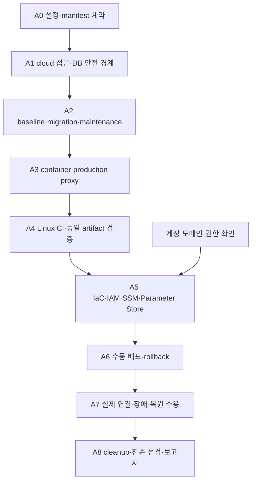

# AWS 배포·CI/CD 구현 계획

작성: 2026-10-12, Asia/Seoul. 설계 기준: `ikonly@8471249adaaa270142c9468b22937a2cd72c1cbb` 및 배포 문서 변경. 상태: **영향 판별·manifest·CI 기반·cloud proxy ingress 구현, 전체 배포는 미구현**. 실제 진행 범위와 결과는 §10을 따른다.

구조·비용·종료 원칙은 [배포 설계 23](23_AWS_배포_CICD_계획.md), 테스트 선택은 [CI 분류 22](22_CI_테스트분류_정리.md), 구현 사실은 [현재 구현 상태](../현재_구현상태.md)를 따른다. 가이드의 필수 산출물은 [보존 가이드](../pre/멀티_에이전트_협업_및_서비스_운영_가이드.md)로 확인한다. 구현 담당은 팀장이다.

## 1. 목표·범위·실행 경계

현재 기획안 시스템·가상 게임·오류 시험실을 AWS에 연결해 짧게 검증·시연하고, 증빙과 복원 가능한 데이터를 남긴 뒤 실행 자원을 정리한다. 웹 2·Backend 2·MCP 2의 EC2 6대, private RDS 1개, public NAT 1개, Parameter Store, ECR/OIDC/SSM을 사용한다. Supervisor·Planner·Critic 및 게임 Runtime의 업무 책임은 현재 Backend 구조를 따른다.

이 계획의 파일 이름은 **구현 예정 경로**다. 현재 실행 명령처럼 안내하지 않는다. 실제 AWS 단계는 account·도메인·DNS 권한·접속 CIDR·알림 수신자·종료 시점·GitHub deployment 보호 기능을 확인한 뒤 진행한다. 도메인이나 계정 없이도 A0~A4의 코드·로컬 검증 준비는 가능하다. 로컬 사용자 서버와 DB, 기존 yejin AWS 자원은 별도로 유지한다.

### 전체 완료 조건

- 동일 CI artifact로 실제 컨테이너 배포, commit/run/image digest/catalog·migration 버전 추적
- 두 HTTPS 화면에서 실제 RDS·MCP·OpenAI 연결, 기획→승인→선택 공간 등록→게임 진행·보상 저장
- 일반/시험 데이터·role·MCP 격리, cloud 인증·권한·Origin 검사, 기존 local 보호 유지
- 기존 오류 시험 목록의 AWS 지원/미지원 항목 명시 및 실행 증빙, 복구와 안전 종료의 구분
- CI 필수 게이트 실패·누락 시 배포 차단, 앱 rollback 및 새 DB 복원 실제 확인
- 알림 확인, cleanup 실행 후 EC2/RDS/NAT/EIP/불필요 volume 잔존 확인
- 가이드의 배포·장애 복구 보고서와 자동화 파이프라인 보고서 작성

## 2. 설계 점검 결과와 보완 결정

전체 배포 경계는 일관되지만 현재 코드 그대로 배포할 수는 없다. 아래 보완은 A1~A5에 포함한다.

| 발견한 문제·빠진 연결 | 결정·구현 책임 |
|---|---|
| 기존 Dockerfile이 Backend/MCP를 각각 복사해 상호 import 누락 | root context application image에 필요한 두 package·게임 규칙·runner support를 명시 포함 |
| API `/api/*` loopback 검사로 다른 EC2의 웹 proxy도 거부 | 명시적 cloud ingress 모드와 서비스별 proxy 인증. local default는 유지 |
| 시험 DB guard가 Docker inspect·localhost·5434·고정 owner 요구 | cloud guard를 별도 구현. RDS TLS hostname·DB·role·보호된 환경 식별 값으로 검증 |
| `create_all` 및 시험실 DDL이 runtime에서 실행 | 일회성 baseline/migration으로 이전. runtime DDL 없이 시작·처리 가능해야 함 |
| 보호된 RDS지만 실제 DB 권한·TLS 계약이 아직 코드화되지 않음 | CA+`sslmode=verify-full`, 일반/시험 runtime·MCP read·migration role 구분 |
| 다중 호스트 release 교체 중 혼합 버전·새 작업 가능 | DB의 공유 maintenance/배포 lock, drain 후 MCP→Backend→웹, 전체 성공 후 해제 |
| 정리 전 복원 시험과 EC2 종료 순서 연결 부족 | EC2/NAT를 제거하기 전에 별도 임시 RDS에서 snapshot/논리 백업 복원 확인. 임시 RDS도 manifest에 등록·삭제 |
| 데이터 stack Retain·cross-stack export 때문에 VPC 삭제가 막힐 수 있음 | 앱→RDS 의존성→데이터→네트워크 순으로 해제. 실제 보존 자원을 확인하고 종료용 stack 절차 사용 |
| 짧은 운영인데 일일 백업만 기다리면 증빙을 잃을 수 있음 | 첫 기획·게임 저장 확인 후 초기 백업, 배포 직전/종료 직전 백업 추가 |

예정 구성은 서비스별 격리이며 EC2·NAT Single-AZ/RDS 공유로 인한 장애 범위는 남는다. Multi-AZ·다중 replica·Redis·외부 게임·자동 DB rollback을 이번 완료 조건으로 추가하지 않는다.

## 3. 작업 순서·파일·단계 게이트



| 단계 | 생성/변경할 파일 | 구현 내용 | 통과 조건 |
|---|---|---|---|
| A0 계약 | `infra/aws/config/demo.example.json`, `schemas/{environment,release,cleanup}.schema.json` | 환경값·호스트 역할·parameter 이름·자원 소유권·종료 시간 형식 | 예시에는 비밀값 없음. 역할 6개·일반/시험·보존 대상의 명시적 매핑 |
| A1 접근·격리 | `backend/app/main.py`, 새 `config/deployment.py`, `guards/cloud_access.py`, `config/cloud_database.py`, `repositories/fault_lab.py`, `mcp_server/server.py` | local/cloud 선택, proxy·Origin·DB/TLS·MCP 접속 경계, cloud 시작 시 설정 검증 | 잘못된 peer/secret/DB/role/환경은 쓰기 전에 차단. local 회귀 통과 |
| A2 DB·배포 상태 | 새 `backend/app/deployment/{migrate,bootstrap,maintenance}.py`, `backend/sql/017_deployment_control.sql`, `repositories/{postgres,game_runtime,fault_lab}.py`, `services/{canonical_planning,workflow_execution,fault_lab_service}.py` | baseline·migration ledger/checksum/advisory lock, DDL 이전, 환경 marker, 공유 maintenance/drain | empty/기존 DB 모두 적용, 재적용·동시 적용 안전, runtime DDL 불필요, 유지보수 중 새 작업 없음 |
| A3 이미지·proxy | `infra/aws/Dockerfile.application`, `Dockerfile.web`, `Caddyfile`, `Dockerfile.application.dockerignore`, `Dockerfile.web.dockerignore`, `compose.application.yml`, `requirements.application.lock`, `requirements.ci.lock`, `scripts/start-service.sh` | root build context·Dockerfile별 ignore, Python3.11/Node 빌드, 역할별 entry, 정적 두 사이트·API proxy, non-root·volume·자원 제한 | 실제 이미지 import/MCP/runner/UI 확인, secret/venv/옛 UI 미포함, 설정 누락은 시작 실패 |
| A4 CI | `.github/workflows/ikonly-ci.yml`, `infra/ci/{run-python,run-ui,verify-images}.sh`, `infra/ci/compose.yml`, `frontend-web/playwright.production.config.js` | 분류별 Linux CI, ephemeral PG, 실제 production image·proxy E2E, image tar·hash·manifest | 필수 gate 전부 성공, LLM 키·AWS credential 불필요, 실패/누락/필수 skip 승격 차단 |
| A5 IaC | `infra/aws/stacks/{network,data,application,access,observability}.yml`, `ssm/IkonlyDeploy.yml`, `scripts/{preflight,bootstrap-host,export-environment,load-parameters}.sh`, `ikonly-infrastructure.yml` | EC2 6·RDS·NAT·SG·IAM/OIDC·SSM·로그·백업, change set·resource manifest | read-only preflight→plan 확인→apply, SSM 6대·RDS private·role별 parameter 범위 확인 |
| A6 CD | `infra/aws/scripts/{deploy,health-check,rollback,backup}.sh`, `.github/workflows/ikonly-deploy.yml` | 검증한 tar ECR push, digest release, maintenance/drain·순차 교체·migration·rollback | 재빌드 없음, SSM terminal success+앱 smoke, 중간 실패 시 이전 호환 release 또는 maintenance 유지 |
| A7 AWS 수용 | `infra/aws/scripts/{acceptance,restore-check}.sh`, 테스트 fixture/보고서 | 실제 live 연결·선택 공간 등록, 격리 오류 시험·알림·복원 | §8의 AWS 게이트 증빙, 임시 복원 DB까지 정리 목록 포함 |
| A8 운영·정리 | `infra/aws/scripts/{operations,cleanup}.sh`, `.github/workflows/ikonly-operations.yml`, `docs/ik/검증산출물/` 보고서 | start/stop/backup/rollback/cleanup-plan/apply/purge-data, 잔존 조회·보고 | 실행 자원 제거·백업/key 보존·재실행 가능·잔존 비용 목록 출력 |

각 단계는 관련 코드·검사·문서를 함께 로컬 커밋한다. 새 검사 파일/함수는 `infra/test-suites.json`에 등록한다. 파일 번호 017은 구현 시 다른 작업과 충돌하면 다음 빈 번호로 조정하고 링크/ledger를 함께 갱신한다.

## 4. 실행·설정·권한 계약

### 4.1 서비스 역할과 포트

호스트 역할은 `plan-web`, `game-web`, `main-api`, `fault-api`, `main-mcp`, `fault-mcp`로 고정한다. Backend 컨테이너는 양쪽 모두 내부 8000, MCP 컨테이너는 양쪽 모두 내부 8010(`/mcp`)을 사용한다. 호스트가 다르므로 시험용 8013/8014를 AWS 필수 포트로 유지하지 않는다. DB는 5432, 웹은 80/443이며 Caddy 관리 포트는 공개하지 않는다.

- 웹→API: 사설 endpoint, origin·proxy identity 검증. 계획 웹은 일반/시험 경로, 게임 웹은 `/api/game/*` 경로만 허용
- API→MCP: 대응 사설 endpoint만 허용. MCP transport의 Host/Origin 방어도 실제 사설 주소에 맞춰 명시 설정
- API/MCP→RDS: endpoint DNS·CA 검증, `sslmode=verify-full`. raw IP를 인증서 hostname 대신 사용하지 않음
- Backend/MCP 컨테이너는 Docker socket·IMDS credential 접근 없이 실행. host role이 ECR pull·parameter fetch·backup을 담당

### 4.2 기존 환경변수와 새 설정

| 구분 | 이름·계약 |
|---|---|
| 기존 일반 실행 | `DATABASE_URL`, `MCP_URL`, `OPENAI_MODEL`, `OPENAI_API_KEY`, `LLM_RECORD_ENCRYPTION_KEY`, `OPERATOR_ACTOR_ID`, `APP_ALLOWED_ORIGINS` |
| 기존 모드 | 일반 `CANONICAL_PLANNING_MODE=live`, 필요한 호환 경로 `WORKFLOW_ENGINE=agent_live`. 시험은 deterministic이며 OpenAI 키 미주입 |
| 기존 시험 | `FAULT_LAB_MODE=isolated`, `DATABASE_URL=POSTGRES_TEST_URL`은 시험 RDS DB/role을 명시. cloud guard가 확인하고 일반 CI의 local destructive guard는 유지 |
| 기존 MCP | `MCP_DATABASE_URL`, `MCP_HOST=0.0.0.0`, `MCP_PORT=8010`. DB catalog 사용과 Host/Origin allowlist 명시 |
| 구현한 cloud ingress 설정 | `DEPLOYMENT_MODE=cloud`, `SERVICE_ROLE`, `CLOUD_PROXY_IDENTITIES` (사이트별 `peers` IP 목록·`secret`), `APP_ALLOWED_ORIGINS`의 HTTPS 출처 |
| 나머지 cloud 설정(예정) | `DEPLOYMENT_ENVIRONMENT_ID`, `RDS_EXPECTED_ENDPOINT`, `EXPECTED_DATABASE_ROLE`, `DATABASE_AUTO_CREATE=false`. 개별 proxy proof는 host에서 `CLOUD_PROXY_IDENTITIES`로 묶어 주입 |
| 새 저장 위치(예정) | `FAULT_LAB_JOURNAL_DIR`, deployment manifest·certificate 저장 위치. host volume 경로는 고정 whitelist |

구현한 ingress 설정과 나머지 예정 설정을 구분한다. cloud entry는 `.env` 파일 없이 주입 환경을 먼저 검증하고 앱을 import하도록 구현할 예정이다. 현재 `python -m backend.app.main`의 로컬 `.env` 요구 경로를 그대로 cloud entry로 쓰지 않는다. cloud에서 DB/live 설정 누락을 메모리 저장소·mock으로 조용히 전환하지 않도록 후속 시작 검증이 필요하다.

### 4.3 parameter·IAM 매핑

경로 prefix는 `/multi-agent-autohealing/ikonly-demo/`이며 실제 값은 Git·artifact·SSM command·로그에 넣지 않는다.

| parameter 영역 | 읽는 주체 |
|---|---|
| `shared/openai-api-key` | 일반 API host role. 제한된 live 시험은 별도 수동 실행 주체만 허용 |
| `main/runtime-database-url`, `main/llm-record-key` | 일반 API host role |
| `fault/runtime-database-url`, `fault/llm-record-key` | 시험 API host role. 일반 key·DB 접근 금지 |
| `main/mcp-database-url` / `fault/mcp-database-url` | 각각 일반/시험 MCP host role |
| 사이트별 BasicAuth hash·proxy 증명 | 해당 웹과 검증할 API role만 허용. 게임 proxy 권한을 정책/시험 API로 확대하지 않음 |
| migration/bootstrap/master credential | bootstrap/migration 실행 역할만 허용. runtime 환경 파일에는 넣지 않음 |

Standard SecureString + AWS 관리형 SSM KMS key를 기본으로 한다. 별도 고객 관리형 key가 필요해지면 IAM·보존·비용을 재검토한다. 앱 원문 암호화 key와 AWS KMS key는 별개다. RDS의 Secrets Manager 자동 password 관리 기능은 켜지 않는다. DB master 비밀번호도 Parameter Store에서 관리하며, IaC에 전달할 때 지원하는 SecureString 참조/호스트 bootstrap 방식을 확인하고 평문 template 출력이나 CLI argument에 넣지 않는다.

deploy role은 지정 ECR repository push와 지정 호스트·배포용 SSM document만 사용한다. 임의 `AWS-RunShellScript`로 root 명령을 실행할 권한을 일반 배포 role에 주지 않는다. infrastructure role은 별도로 두고 iam:PassRole 대상과 환경 소유권을 제한한다. 관리 IAM 권한과 DB 로그인 권한은 별개다. GitHub 배포 권한 제한은 설계 23 §7을 따른다.

bootstrap/migration은 maintenance 상태의 일반 API 호스트에서 일회성 container로 실행한다. 전용 operations 권한으로 작업 중에만 제한된 bootstrap/migration instance profile을 적용해 필요한 parameter를 조회하고, 작업 후 임시 환경 파일을 제거하고 일반 profile로 복귀한 것을 확인한다. master credential은 최초 DB/role 생성 때만 조회하며 이후 migration은 DB owner credential만 사용한다. 일반 앱 컨테이너에는 주입하지 않는다. profile 변경·복귀 실패는 배포 실패로 기록하고 maintenance를 유지한다. 정상 운영 호스트 6대에 별도 상시 migration 서버를 추가하지 않는다.

## 5. DB 초기화·migration·maintenance

1. 별도 bootstrap 주체가 `eventquest_demo`, `eventquest_fault_test`와 migration owner/runtime/MCP reader role을 만든다. runtime은 SUPERUSER·CREATEDB·CREATEROLE·schema CREATE·migration role 상속을 갖지 않는다. PUBLIC CONNECT와 schema 권한을 명시한다.
2. DB별 `deployment_identity` marker에 환경 ID·DB 용도·schema 버전을 기록한다. marker와 migration ledger는 runtime SELECT만 허용한다. 시험 guard는 expected endpoint/TLS·current_database/current_user·marker·role 속성을 모두 확인하며 환경변수 하나로 통과시키지 않는다.
3. 현재 SQL 001~016과 ORM model을 비교해 누락된 workflow/trace/시험 테이블까지 baseline manifest에 포함한다. `backend/sql`과 MCP legacy SQL을 중복 실행하지 않는다. 현재 Opong catalog 경로를 기준으로 migration·seed 목록을 고정한다.
4. empty DB는 baseline→순차 migration, 기존 DB는 schema/version fingerprint 확인→baseline 등록→미적용 migration 순서다. checksum 불일치·알 수 없는 schema·동시 적용은 중단한다. seed는 기존 user 상태·정책을 reset하지 않는다.
5. 최초 활성 오류 정책은 승인된 기준 버전을 검증 후 bootstrap audit로 등록한다. 정책이 없거나 invalid이면 readiness를 실패시키며 기본 정책으로 조용히 넘어가지 않는다. 재배포는 기존 활성 정책을 임의로 교체하지 않는다.
6. `create_all`/fault DDL의 cloud 실행을 제거한다. local/SQLite 테스트가 필요한 경우 local 설정에서만 보존한다. migration role은 앱 프로세스에 남기지 않는다.
7. 배포 lock과 DB maintenance 상태는 모든 Backend process가 공유한다. 새 workflow·시험·게임/정책 mutation을 차단하고 상태 조회는 유지한다. 진행 중 예약/lease/deadline과 실제 처리 종료를 확인해 drain한다. timeout이면 교체를 중단한다.

TLS 기준은 [AWS RDS SSL 문서](https://docs.aws.amazon.com/AmazonRDS/latest/UserGuide/UsingWithRDS.SSL.html)를 따른다. 실제 schema baseline은 A2에서 비교해 확정하며 SQL 파일이 존재한다는 이유만으로 모든 runtime 테이블이 갖춰졌다고 판단하지 않는다.

## 6. CI·artifact·수동 CD 계약

### 필수 CI job

| job | 검사 범위 | 운영 의존성 |
|---|---|---|
| `quality-core` | 전역 Ruff lint/format, schema export 비교, inventory, core·Node proxy | 없음 |
| `postgres` | CI disposable PG, local profile의 PG parameter·원자성·restart·MCP | CI 임시 DB/MCP만 사용 |
| `ui` | 기존 fixture·연결·게임·durable restart, Linux Chromium | CI 임시 API·DB·UI |
| `build-images` | application/web 한번 build, digest 후보·tar/hash | AWS·LLM 키 없음 |
| `verify-images` | tar load, production Caddy route·실제 image API/MCP/DB·두 화면 | CI disposable 환경 |
| `release-gate` | 모든 필수 job 결과·SHA·artifact hash 확인 | AWS 권한 없음 |

core의 의도된 PostgreSQL parameter skip은 postgres/local job에서 실행 결과가 있어야 한다. 필수 job 자체의 skip 또는 필요한 사례 누락은 승격 실패다. 외부 유료 호출/Clash/과거 run ID 조회는 기본 CI에 넣지 않는다. 느린 문제를 피하려고 테스트를 중복 실행하지 않고 실패 단계의 artifact·로그를 보존한다. 영향 검사만 수행한 결과는 전체 release gate 통과로 취급하지 않는다.

`release.json`에는 source SHA, CI run/attempt, 두 tar hash, 게시 후 ECR digest, migration/catalog/schema checksum, 서비스별 image 역할, 이전 release ID를 기록한다. 환경 manifest의 EC2/RDS 자원 ID는 image release와 분리한다. CI에서 검사한 tar를 load→ECR push하고 CD에서 rebuild하지 않는다.

CD는 `ikonly`의 성공한 지정 CI SHA만 선택한다. 전체 대상 lock 아래 backup→maintenance/drain→호환 migration→MCP/API/웹 교체→smoke→release 확정 순서다. SSM command 접수나 instance running만으로 성공 처리하지 않는다. 하나라도 실패하면 이전 호환 release 세트를 복구하거나 maintenance를 유지한다. DB 백업 자동 덮어쓰기는 하지 않는다.

새 workflow의 default branch 등록은 팀장이 최소 등록 파일을 검토·반영해야 한다. deployment 보호 기능을 확인하기 전에는 AWS OIDC 배포 role을 발급/사용하지 않는다. 초기 자동 CD는 비활성이다.

### 6.1 push 기반 변경 영향 배포 (2026-10-12 확정)

초기 AWS 배포·rollback을 수동 확인한 뒤 `AUTO_DEPLOY_ENABLED=true`로 전환하면 `ikonly` push의 성공 CI에서 영향받는 서버를 자동 업데이트한다. 규칙은 `infra/aws/change_rules.json`, 판별 코드는 `infra/aws/deployment_impact.py`에서 관리한다. 필요한 web/application image만 build하고 선택된 역할만 새 digest로 교체한다. 선택하지 않은 역할은 이전 검증 digest를 유지한다.

| 변경 영역 | 업데이트할 역할 |
|---|---|
| 기획안 제품 UI | `plan-web` |
| 게임 제품 UI | `game-web` |
| Backend 업무 코드 | `main-api`, `fault-api` |
| MCP server entry | `main-mcp`, `fault-mcp` |
| MCP tool/fallback | Backend/MCP 4개 (Backend가 tool을 import함) |
| 공유 게임 규칙/schema/catalog·SQL | 의존성이 있는 6개 전체. SQL은 migration 먼저 수행 |
| image·공통 의존성·proxy | 해당 image를 사용하는 영향 역할 전체 |
| 문서·순수 테스트 | 제품 업데이트 없음. 테스트/품질 변경은 CI 수행 |
| IaC/IAM/SG/운영 설정 | 수동 infrastructure 적용·호환 확인 전 자동 앱 배포 차단 |
| 미분류 코드 | 전체 검사·역할 후보로 확대하고 수동 검토 요구 |

CI 후보는 push before→after로 판별할 수 있으나 **실제 배포는 해당 환경의 마지막 성공 release SHA→배포할 SHA**로 다시 판별한다. 실패/미배포 push나 대기 실행 교체 때문에 변경을 누락하지 않는다. 신규 환경은 최초 전체 배포다. rename/delete는 양쪽 경로를 반영한다. 이력 불명·비조상 release·오래된 SHA의 자동 덮어쓰기는 거부한다.

환경 lock 안에서 release를 다시 읽는다. GitHub concurrency만으로 FIFO나 모든 중간 push 배포를 보장하지 않는다. release manifest에는 변경 역할의 새 digest와 유지 역할의 기존 digest·source SHA를 기록한다. 공통 계약/migration 변경은 함께 배포하고 전체 smoke 전에는 성공 기준점을 갱신하지 않는다.

선택하지 않은 검사 job은 허용된 skip이며, **필수로 선택된 검사**가 실패/skip/누락되면 승격을 차단한다. infrastructure·정리·rollback과 자동 배포도 같은 target lock을 사용한다. 문서만 바뀐 push는 AWS 인증/배포를 하지 않는다. 초기 CI 기반을 구현했다고 production image·DB·E2E gate가 완료된 것으로 취급하지 않는다.

알림 수신 주소는 사용자가 확인했다. 실제 환경 설정에 주입하며 예시 파일에는 placeholder만 둔다. AWS 계정은 실행 직전 사용자 인증 세션에서 확인할 예정이고 도메인/DNS는 아직 확인 전이다.

## 7. 생성·정리 명령 계약

예정 script는 공통 `--environment-manifest`, `--account`, `--region`, `--environment-id`를 받고 실제 값과 대조한다. operation마다 phase/status/resource ID/started_at/finished_at/잔존 항목을 비밀값 없이 기록한다. `plan`은 조회만 하고 `apply`는 plan hash와 대상 목록이 일치할 때 수행한다. unknown 상태·소유권 불명은 삭제하지 않는다.

| operations 모드 | 실행 내용 |
|---|---|
| `start` | 필요한 NAT/route/SSM 경로 확인→RDS→MCP/API→웹→전체 smoke. 이전 stop 환경에서만 수행 |
| `stop` | 새 쓰기 차단·drain→앱/EC2·RDS 중지. 남는 NAT/EIP/저장 비용과 RDS 자동 재시작 시점 출력 |
| `backup` | 일반/시험 DB 논리 백업·snapshot·journal/증빙, 완료·checksum·암호화 key 참조 기록 |
| `rollback` | 이전 호환 release 선택, maintenance/drain, 순차 재배포·smoke |
| `cleanup-plan` | 삭제/보존/공유 자원과 잔여 비용 항목 출력. 실제 삭제 없음 |
| `cleanup-apply` | 백업/복원 확인→EC2→RDS→NAT→EIP→stack 의존성/네트워크 정리, 잔존 조회 |
| `purge-data` | 보존 기한 경과·복원 필요 없음 확인 후 선택한 데이터/key·이미지·로그 제거 |

### 안전한 종료에서 추가로 확인할 것

- 최초 생성 중 실패해도 이미 생성된 resource manifest를 저장한다. 정상 배포 완료 전에 cleanup이 필요할 수 있다.
- restore-check용 임시 RDS는 별도 이름·태그·역할이며 일반 RDS를 덮어쓰지 않는다. 검사 완료 후 임시 RDS도 삭제한다.
- 실제 RDS 삭제 완료를 기다린 뒤 data stack의 DB subnet group/SG 참조와 cross-stack export를 해제한다. VPC 삭제는 마지막이다. Retain한 snapshot/key/S3/ECR는 실행 RDS를 보존해야 한다는 뜻이 아니다.
- SSM·백업·증빙 전송·호스트 journal 추출이 끝난 뒤 NAT를 삭제한다. NAT 완료 후 EIP를 따로 해제한다.
- cleanup 중 timeout/권한 실패는 `PARTIAL`로 기록하고 남은 ID와 다음 phase를 출력한다. 같은 plan으로 다시 실행할 때 이미 삭제된 대상은 완료로 처리한다.
- snapshot/key는 우선 7일, 로그 14일, 제출 증빙 30일 보존한다. 증빙에 암호화 DB 원문을 포함하면 해당 key 보존 기간도 늘린다. 보존 기간 변경은 manifest에 기록한다.

RDS 삭제·snapshot 완료 기준은 [AWS 삭제 문서](https://docs.aws.amazon.com/AmazonRDS/latest/UserGuide/USER_DeleteInstance.html)를 따른다. 보존 데이터 삭제는 별도 수동 operation으로 수행한다.

## 8. 검증 기준과 필수 증거

아래는 **작성/실행할 검사 계획**이며 이번 문서 작업에서 실행하지 않았다. 검증 결과는 local/CI/AWS를 구분한다.

| 게이트 | 구체 기준 | 남길 증거 |
|---|---|---|
| VG-A1 접근 | 잘못된 proxy peer/secret·외부 위조 header·Origin·게임 경로의 정책/시험 호출 거부, 정상 요청 허용 | unit/API·production proxy 결과 |
| VG-A2 DB 경계 | 일반/시험/mcp role의 반대 DB 및 쓰기 거부, TLS hostname/CA·marker mismatch 차단, runtime DDL 불가 | 허용/거부 SQL 결과, cloud guard 회귀 |
| VG-A3 migration | empty/기존 baseline, 재적용, checksum 충돌, 동시 lock, 실패 rollback, 기존 user·정책 불변 | migration ledger·전후 상태 |
| VG-A4 이미지 | package/import/runner·MCP initialize/read catalog·두 정적 화면, secret 미포함 | 실제 tar/hash·컨테이너 로그·UI trace |
| VG-A5 CI/CD | 실패/필수 skip/다른 SHA·artifact hash 차단, 같은 image 승격 | Actions job/run URL·release manifest |
| VG-A6 live 업무 | 실제 LLM 기획 근거·검증·승인·선택 공간만 개방·클리어/최초 보상/DB 유지 | workflow/runtime ID·Trace·게임/DB 전후 값·호출/token/비용 |
| VG-A7 오류 시연 | 현 catalog의 AWS runnable 목록, 대표 transient 복구·지속 오류 안전 종료·정책 원복, 일반 DB 불변, 조회 재실행 없음 | input/expected/actual/시간/개입·정책 버전·독립 oracle |
| VG-A8 복원·rollback | 앱 교체 실패 후 기존 release 복귀, 신규 RDS snapshot 복원과 원문 key 복호화·게임/정책 상태 확인 | rollback/restore log·측정 시간·임시 자원 삭제 |
| VG-A9 운영 | 알림 수신·메모리/CPU credit/디스크·장애·backup 관찰, maintenance 동안 새 mutation 0 | 수신 확인·metric·작업 종료 기록 |
| VG-A10 정리 | stop와 cleanup 구분, 실패 재실행, 다른 환경 제외, 실행 EC2/RDS/NAT/EIP/불필요 volume 없음 | cleanup plan/phase report·보존/잔존 목록 |

단위/API 검사는 `backend/tests/`의 기존 분류에 배치하고, production E2E는 `frontend-web/`에서 두 화면을 다룬다. IaC/cleanup은 AWS 응답 fixture로 계획·순서·실패 재실행을 검사한 뒤 실제 AWS 환경에서 수용한다. fixture만 통과하면 실제 삭제까지 검증됐다고 표현하지 않는다. 기획안·게임 디자인은 기존 UI/게임 수용 기준을 유지한다.

실제 LLM은 정상 생성 1회부터 확인하고 필요한 복구 사례만 별도 실행한다. 기존 승인된 호출·token·비용 상한 안에서 수행하며 CI 재시도에 paid 호출을 넣지 않는다. 실제 RDS/NAT 중단 시험은 공유 시연 환경에서 하지 않는다.

## 9. 문서·산출물·진행 관리

작업 후 `현재_구현상태.md`에 단계/commit/실행 환경/결과/미완료 이유를 기록하고 23의 설계 차이·08 Infra·22 inventory 기준과 동기화한다. 역사적 로컬 결과와 `pre/`는 보존한다.

AWS 수용 시 `docs/ik/검증산출물/<실제 실행일>_AWS_배포장애복구_보고서.md`, `<실제 실행일>_AWS_CICD_파이프라인_보고서.md`, `<실제 실행일>_AWS_정리결과.md`를 작성한다. AWS object ID와 release digest를 포함하되 credential·원문 prompt는 기록하지 않는다. 보고서에는 복구율/MTTR 정의·실패/안전 종료·수동 개입·보존 목록을 분리한다.

### 현재 체크포인트

- [x] 네트워크·시간당 기본 비용·짧은 운영 및 정리 방향 합의
- [x] 코드와 설계의 배포 제약 대조, 선행 보완과 예정 파일·검증 게이트 작성
- [ ] A0~A4 구현 및 로컬/container/Linux 검증
- [ ] AWS account·도메인·접속 범위·알림·종료 시점·GitHub 보호 기능 확인
- [ ] A5~A8 구현·AWS 실행·복원·정리·보고서

지금 작성한 계획은 AWS 생성/삭제 승인이나 실제 성공 기록을 대신하지 않는다. 단계별 실행 범위를 확인하고 실패한 gate를 해결한 뒤 다음 단계로 진행한다.

## 10. 구현 진행·로컬 검증 (2026-10-12)

### 구현한 범위

- `infra/aws/change_rules.json`, `deployment_impact.py`: 역할별 영향·필요 image/site·migration·수동 검토 후보. full SHA와 ancestry 확인, rename/delete 양쪽 반영, push/deployed baseline 구분. 판별 결과는 항상 `deployment_authorized=false`이며 배포 권한/검증을 대신하지 않는다.
- `infra/aws/contracts.py`, `schemas/` 3개: environment/release/cleanup 모델과 JSON Schema export. 역할 6개·API/MCP 일반/시험 image 일치·보존/삭제 대상 중복·다른 환경 자원·시간대·parameter 이름 범위를 모델로 검증한다. 필드 간 불변조건은 Pydantic 모델 검증도 필요하다.
- `infra/aws/config/demo.example.json`: 계정/도메인/종료 시점 미정 표시, 비밀값 없는 사양 예시. 실제 환경 manifest로 바로 적용하는 파일이 아니다.
- `.github/workflows/ikonly-ci.yml`: `ikonly` push/수동 CI, 영향 artifact·Ruff/schema/core·선택 웹 build 및 planning proxy 검사. AWS credential/배포 job이 없다. 마지막 summary는 **CI foundation이며 production 승격 불가**라고 표시한다.
- `backend/app/guards/cloud_access.py`, `main.py`: cloud 모드의 private peer+사이트별 proof 검증, 일반/시험 API 분기, 게임 proxy의 정책/시험 경로 차단, 정확한 HTTPS Origin. `x-forwarded-for`를 검증 peer로 사용하지 않는다. default local 검사 유지.
- core 검사 2개 파일/42개 실행 사례와 inventory 등록. 현재 Python 분류는 63개 파일(core 47, postgres 11, external 3, compatibility 2)이며 JS 파일 7개는 유지한다.

### 검증 결과

| 검사 | 실제 결과·범위 |
|---|---|
| 새 영향/manifest·cloud ingress 검사 | 42개 사례, 최종 core 전체에 포함해 PASS |
| core 전체 | **448 PASS / 1 SKIP, 25.22초**. skip은 기존 PostgreSQL parameter이며 이번 작업에서 postgres profile은 재실행하지 않음 |
| Ruff lint / format | 전체 PASS, Python 275개 format 확인 |
| 업무 schema / 배포 schema | check 모두 PASS |
| 두 프론트 frozen install·production build | 로컬 PASS. 게임의 기존 chunk 크기 경고 유지 |
| Node proxy | 1 PASS, 시험 upstream 실패 시 일반 API로 fallback 금지 |
| workflow YAML·권한/branch 구조 | 로컬 parsing·구조 검사 PASS. GitHub Actions 실행 결과 아님 |

초기 신규 rename 검사는 임시 fixture의 목적 디렉터리가 없어 실패했으며 mkdir를 추가한 후 통과했다. 제품 로직 실패를 검사를 삭제해 우회한 것은 아니다. core·새 검사에는 실제 LLM 호출이 없다. 기존 사용자 서버·DB·원격 branch는 재시작/변경하지 않았다. 로컬 pnpm은 11.25.0이며 workflow의 pnpm 10/Linux 경로는 실제 Actions에서 아직 검증하지 않았다.

### 남은 작업

현재 A0의 manifest/영향 계약, A1의 proxy ingress, A4의 기본 CI만 구현했다. **시험 RDS guard·DB TLS·runtime DDL 이전·migration/maintenance·production image/PG/E2E gate·IaC·CD/rollback·정리 script는 미구현**이다. 실제 배포 전 마지막 성공 release baseline 재판별/target lock도 아직 deploy 경로에 연결하지 않았다. 자동 CD는 아직 활성화할 수 없다.

알림 수신 정보는 확인했으며 AWS 실행 시 사용자 인증 세션에서 계정/권한을 확인할 예정이다. 이 문서와 로컬 성공 결과를 AWS 배포·복원·정리 성공으로 해석하지 않는다.


## 11. Runtime DDL 분리·migration 기반 구현 (2026-10-12)

### 현재 구현

A2의 첫 단계로 `backend/app/config/deployment.py`를 추가했다. `DEPLOYMENT_MODE=cloud`에서는 Workflow repository, canonical planning, 실행 예약, 게임 repository와 시험실 초기화의 런타임 CREATE/ALTER를 실행하지 않는다. local 기본 동작은 유지하며, 알 수 없는 mode 또는 cloud에서 DATABASE_URL 누락은 거부한다. 이 코드 분기는 DB 권한 설정을 대신하지 않는다.

`backend/app/deployment/migrate.py`는 명시적으로 실행하는 PostgreSQL migration 명령이다. Workflow ORM의 초기 DDL과 시험실 초기 DDL을 `deployment/sql/`에 고정하고, 기존 `backend/sql/001~016`을 순서대로 적용한다. 일반 17개/시험 18개 ledger 항목이며, 새로운 SQL은 번호를 이어 추가한다. 적용한 baseline/SQL은 수정하지 않는다. 환경·main/fault marker, checksum ledger, transaction advisory lock을 사용한다. public schema에 적용하며, 같은 migration의 재실행은 기록·업무 데이터를 변경하지 않는다. 실패하면 전체 transaction을 rollback한다.

추적되지 않은 기존 public table/view가 있으면 **명시적인 baseline 채택 절차가 필요하다는 오류로 중단**한다. 현재 채택 명령은 구현하지 않았고 기존 로컬 DB에 이 명령을 적용하지 않았다. 신규 RDS DB에 우선 사용할 수 있는 기반이다. 게임 catalog seed·활성 정책 bootstrap·migration owner/runtime/read-only MCP role 생성·권한 revoke는 아직 구현하지 않았다. 시험실 cloud RDS 경로도 아직 기존 Docker guard에서 차단된다.

### 실행 계약

저장소 루트에서 다음 명령은 DB에 연결하지 않고 적용 파일 이름과 checksum만 출력한다.

```powershell
backend/.venv/Scripts/python.exe -m backend.app.deployment.migrate --purpose main --environment ikonly-demo
```

실제 적용은 별도 소유자 접속값을 `MIGRATION_DATABASE_URL`에 주입한 뒤 위 명령에 `--apply`를 추가한다. 시험 DB에는 `--purpose fault`를 사용한다. 비밀 URL을 명령 인자·문서·로그에 기록하지 않는다. 현재 CLI는 cloud TLS/role/접속 대상 검증을 통합하기 전이므로 아직 AWS 배포에 연결하지 않는다. CI 변경 판별은 `backend/app/deployment/**`를 migration 및 전체 6역할 영향으로 분류한다.

### 실제 검증·실험 기록

- 신규 단위 검사 5 PASS: local/cloud DDL 분기, 명시적 게임 schema 생성 요청 차단, planning/실행 예약 DDL 차단, 잘못된 mode·cloud 메모리 fallback 거부, migration 목록.
- core 전체 **453 PASS / 1 SKIP, 25.75초**. 이후 영향 판별 보충과 단위 검사 대상 재검사 **29 PASS**.
- 실제 PostgreSQL migration 검사 **4 PASS, 최종 6.90초**: main/fault 최초 적용·재적용·업무 행 보존, 다른 환경 marker 거부, checksum 변조 거부, 기존 미추적 DB 보존, 실패 전체 rollback, 동시 실행 직렬화.
- 기존 `ikonly-test` 컨테이너의 접속 설정을 프로세스 내부에서만 사용해 `migration_test_<uuid>` DB를 새로 만들고 finally에서 제거했다. 사용자 일반/시험 DB는 변경하지 않았다. 자동 시험용 DB는 접속 및 임시 DB 생성의 출발점으로만 사용했다. `MIGRATION_TEST_URL`은 loopback·test 이름 검사를 통과해야 한다.
- 초기 검사에서 저장소 경로 계산과 SQLAlchemy CursorResult의 dict 변환 문제를 발견해 수정했다. PostgreSQL profile의 명시적 test URL도 설정한 뒤 재실행했다. 검사를 제거해 회피하지 않았다.
- Ruff 전체 lint/format 및 diff 확인을 수행했다. 실제 LLM 호출, AWS 자원 생성, 사용자 서버 재시작, push는 하지 않았다.

현재 inventory는 Python 65개 파일(core 48, postgres 12, external 3, compatibility 2), JavaScript 7개다. 다음은 A1의 RDS TLS·DB/role/marker guard 및 A2의 owner/runtime 권한·bootstrap·기존 baseline 채택·공유 maintenance이며, A2 전체 완료로 표시하지 않는다.
