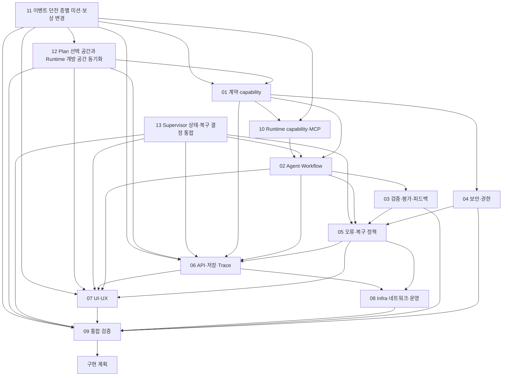

# 기획안 Workflow 하위 설계 문서

[2026-10-13 현행 코드 AWS 첫 배포](../검증산출물/2026-10-13_AWS_현행코드_첫배포_검증.md): ACTIVE·6개 서비스 수용, 실제 LLM 2회/암호화 DB 2개, 기획·게임 연결 16건과 Edge 3건 PASS. 공개 주소·CA·자원 유지·시험 한계를 먼저 확인한다. 아래 ABSENT/준비 상태는 이전 이력이다.

2026-10-13 최신: [현행 코드 CI/CD 검증](../검증산출물/2026-10-13_현행코드_CICD_마무리.md)에서 현행 source의 **707 PASS**, 동일 이미지 승인·실제 OIDC 인증 및 빈 환경 CD **INACTIVE**를 확인했다. AWS 앱은 ABSENT를 유지한다. 첫 배포·초기화·역할별 업데이트는 [운영 가이드 26](26_AWS_배포운영_실행가이드.md)을 따른다. 아래 날짜별 준비/미완료 기록은 당시 이력이며 최신 결과를 덮어쓰지 않는다.

장애 시험 지표는 [통합 검증 설계의 공통 정의](09_통합검증_설계.md#오토힐링-지표-판정)를 따른다. 최신 [보완 후 실호출 결과 §3.1](../검증산출물/2026-10-13_실제LLM_보완후_재시험결과.md#31-가이드-기준-지표와-모집단)에서는 자동 복구율 6/9=66.7%, 복구 기대 사례 성공률 6/6=100%, 안전 중단 정책 준수율 3/3=100%를 구분하며 전체 시험 PASS와 혼동하지 않는다.

AWS 구성·배포 단위·GitHub Actions·migration/rollback·가이드 제출 증거는 [AWS 배포·CI/CD 계획 23](23_AWS_배포_CICD_계획.md)에 정리했다. 참고는 aidevs/yejin workflow의 고정 SHA이며 현재 서비스의 배포 제약도 함께 기록했다.

실제 배포 구현 순서·예정 파일·cloud 보완·CI 및 정리 게이트는 [AWS 구현 계획 24](24_AWS_배포_CICD_구현계획.md)를 따른다. 초기 계획과 단계별 준비 이력이며 현재 구현·AWS 수명주기 수용 결과는 상단 최신 검증 및 운영 가이드를 따른다.

현재 테스트 목록·제거 근거·추가 검사·실행 계층·검증 결과는 [CI 테스트 분류 22](22_CI_테스트분류_정리.md)를 먼저 확인한다. 기본 검사에 실제 LLM/외부 시험과 저장 증거 조회를 섞지 않는다.

현재 기획안 UI는 5177 하나로 통합되어 일반·시험 Backend로 요청을 분리한다. [프론트 통합 구현·검증](21_기획안프론트_통합구현.md)에서 실행 방법과 격리 범위를 확인한다.

이 디렉터리는 [기획안 멀티 에이전트·오토힐링 영역 상위 설계서](../기획안_멀티에이전트_오토힐링_상위설계서.md)를 구현 가능한 계약·정책·화면·운영 설계로 구체화한다. 문서 조사와 참조는 `docs/ik/` 안에서만 한다.

## 문서 우선순위

1. [전체 시스템 최상위 설계](../최상위_시스템_설계서.md): 시스템 경계·게임 Runtime·승인 후 흐름
2. [기획안 멀티 에이전트·오토힐링 영역 상위 설계](../기획안_멀티에이전트_오토힐링_상위설계서.md): 기획 Workflow의 Agent·복구·보안·UI 책임
3. 이 디렉터리의 설계서: 세부 계약과 운영 규칙
4. 구현 계획서: 이 설계들이 합의된 후 별도 작성

현재 구현 사실과 테스트 증거는 [현재 구현 상태](../현재_구현상태.md)를 따른다. 구현되지 않은 목표를 구현 완료로 표현하지 않는다.

## 하위 설계 순서

| 순서 | 문서 | 먼저 확정할 것 |
|---|---|---|
| 01 | [기획안·게임 기능 계약](01_기획안_게임기능_계약_설계.md) | Brief, 이벤트 결과, capability 상태, 행동·보상 연결 |
| 02 | [멀티 에이전트·Workflow](02_멀티에이전트_Workflow_설계.md) | 역할, task, handoff, 상태·패턴 |
| 03 | [검증·평가·피드백](03_검증_평가_피드백_설계.md) | 형식·의미 검사, 평가 finding, 재기획 기준 |
| 04 | [보안·권한](04_보안_권한_설계.md) | 초기 단일 사용자 모델, Agent·Tool 경계, 신뢰 경계 |
| 05 | [오류 분류·복구 정책](05_오류분류_복구정책_설계.md) | 원인·장소 코드, 정책 문서, 복구 한도와 엄격한 불변조건 |
| 06 | [API·저장·Trace](06_API_저장_Trace_설계.md) | 상태 저장, 멱등성, 선택적 캐시, 추적 계약 |
| 07 | [UI·UX·운영자 콘솔](07_UI_UX_운영자콘솔_설계.md) | 기획·진행·로그·정책 관리 화면 |
| 08 | [Infra·네트워크·운영](08_Infra_네트워크_운영_설계.md) | 로컬/운영 통신 경계, 장애·비밀값·배포 운영 |
| 09 | [통합 검증](09_통합검증_설계.md) | 종단 시나리오와 설계 완료 수용 기준 |
| 10 | [Runtime Capability·MCP 데이터 계약](10_RuntimeCapability_MCP_계약.md) | Runtime catalog 권위, capability 조회, 버전·근거·Tool 입출력 계약 |
| 11 | [이벤트 던전 층별 미션·보상 계약 변경 작업](11_이벤트던전_층별_미션보상_변경작업.md) | 이벤트 기간 전체 활성, 층별 최초 클리어 보상, 사용자 입력 계약·Runtime 연동 변경 범위 |
| 12 | [기획안 선택 공간과 Runtime 개방 공간 동기화 변경 계획](12_기획안_선택공간_Runtime_개방동기화_변경계획.md) | 선택한 이벤트 공간만 Runtime·게임 화면에 열고 공간별 독립 미션·보상 처리 |
| 13 | [Supervisor 상태 전이·복구 결정 통합 구현 계획](13_Supervisor_상태전이_복구결정_통합구현계획.md) | 단일 상태 결정자, 정책 근거, 기존 Workflow 경로의 단계적 통합 |
| 14 | [Workflow 검사 결과·설계 보완·수정 계획](14_Workflow_검사결과_설계보완_수정계획.md) | 2026-10-11 미완료 판정, 저장·접근·정책·진행 계약 보완, FIX-01~07 및 VG-01~09 |

## 문서 간 의존성

## 공통 작성 규칙

- 각 문서는 목적·범위, 현재 구현 기준, 목표 결정, 흐름/표/계약, 오류·보안 고려, 미결 사항, 완료 기준을 포함한다.
- 계약 이름·상태·코드는 선행 문서에서 정의한 용어를 재사용한다. 변경이 필요하면 상위/선행 문서를 함께 고친다.
- 이 문서들은 설계 산출물이다. 코드 구현, 정책 활성화, 배포를 뜻하지 않는다.
- `pre/`는 원본 보존 자료이므로 수정하지 않는다.
- 설계 결정은 확정/제안/미결을 구분하고, 코드에서 확인된 As-Is와 목표 To-Be를 섞지 않는다.

## 구현 계획 진입 게이트

2026-10-10 상호 검토에서 Event Brief/Plan 필수성·nullable 규칙, 상태 용어, 복구 한도와 데이터 경계를 구체화했다. 로컬 MVP는 Runtime capability로 확인된 범위만 적용하고, 결정적으로 계산 가능한 게임 규칙·경제 영향은 `calculated`, 근거 있는 불확실 값은 `estimated`, 근거가 없으면 `unknown`으로 둔다. 오류 정책은 제한 편집·검증·미리보기 후 활성화하고 localhost 전용으로 시작한다. MCP는 읽기 전용이고 변경은 Controller/업무 API가 수행한다. Redis는 초기 필수 구성에서 제외한다. 렌더링 prompt와 원문 응답은 제한된 PostgreSQL 영역에 30일 보존한다. 초기 복구 한도는 최초 호출 후 retry 3회(총 4회), plan revision 2회, Workflow 180초, 개별 호출 30초, Workflow당 LLM 호출 최대 8회다. Token 및 비용 budget도 누적 계수하며 실행 설정에 provider 가격·사용량 정보를 공급해야 한다.

아래 표는 설계 결정이 아니라 구현 계획 단계에서 저장소·계정·실행 환경에 맞춰 구체 파일과 설정값으로 매핑할 항목을 추적한다.

| 구현 계획에서 매핑할 항목 | 이미 정한 기준과 구현 계획의 산출물 | 관련 문서 |
|---|---|---|
| Event Brief/Plan의 논리 데이터 계약 | 필수/null/빈 목록/버전·참조 규칙을 [01 계약](01_기획안_게임기능_계약_설계.md)에 고정. 실행 가능한 JSON Schema 파일과 DB 매핑은 구현 계획의 산출물 | [01 계약](01_기획안_게임기능_계약_설계.md), [06 API·저장](06_API_저장_Trace_설계.md) |
| 상태 전이·사용자 행동 | 승인·입력 대기·수정 요청·취소의 재개/새 실행 기준은 [02 Workflow](02_멀티에이전트_Workflow_설계.md) 및 [07 UI](07_UI_UX_운영자콘솔_설계.md)의 상태 전이를 기준으로 함. API payload/method 구현 매핑은 계획 산출물 | [02 Workflow](02_멀티에이전트_Workflow_설계.md), [07 UI](07_UI_UX_운영자콘솔_설계.md) |
| 평가 기준 | `calculated`/`estimated`/`unknown`과 finding/evaluation 상태의 의미를 [01](01_기획안_게임기능_계약_설계.md)·[03](03_검증_평가_피드백_설계.md)에서 고정. 실제 계산식은 Runtime 규칙 근거를 참조 | [03 평가](03_검증_평가_피드백_설계.md), [게임 검증·밸런스](../게임설계/07_게임검증_밸런스.md) |
| 오류 registry와 복구 budget | 오류 ID 형식은 `ERR-<CAUSE>-<LOCATION>-<ID>`로 고정. 표준 cause/location 목록과 alias는 05의 코드 registry 표를 단일 기준으로 구현하며, hard cap과 provider별 예산 수치는 실행 설정이 공급 | [05 복구](05_오류분류_복구정책_설계.md) |
| 정책 버전의 운영 기준 | 불변 버전 저장, DRAFT 검증·replay·preview, 사용자 activation, Workflow 시작 시 버전 고정, rollback 경계를 확정 | [05 복구](05_오류분류_복구정책_설계.md), [06 API·저장](06_API_저장_Trace_설계.md) |
| API·DB 경계 | 논리 자원·소유권·트랜잭션·멱등성 scope를 [06](06_API_저장_Trace_설계.md)에 확정. 저장소에 맞춘 물리 URL, SQL/ORM, JSON Schema 배치는 구현 계획 산출물 | [06 API·저장](06_API_저장_Trace_설계.md), [게임 Runtime/API](../게임설계/04_게임Runtime_API.md), [이벤트 적용](../게임설계/05_이벤트적용_계약.md) |
| 초기 인증 | localhost MVP의 서버 측 단일 actor, actor_id 위조 금지, origin/CSRF 경계를 [04](04_보안_권한_설계.md)에서 고정. 실제 개발 origin·cookie/session 방식은 구현 환경에 맞춰 계획서에 기록 | [04 보안](04_보안_권한_설계.md), [08 Infra](08_Infra_네트워크_운영_설계.md) |

위 항목 중 논리 계약과 운영 불변조건은 설계에서 결정했다. 구현 계획에는 이를 실제 저장소의 파일·API·테이블·설정에 매핑하고, provider/model 선택, 가격표·예산 수치, 개발 origin, 암호화 제공 수단처럼 환경·계정에 종속된 값만 검증된 설정으로 채운다. Redis, AWS topology, production SLO는 로컬 MVP의 선행 차단 요소가 아니며 필요 근거가 생기면 후속 설계로 다룬다. 상세 MCP 계약은 [10번 문서](10_RuntimeCapability_MCP_계약.md)를 따른다.

## 오류 정책 시험실 구현

[16 격리 오류 시험실 구현·검증](16_오류시험실_구현과_검증.md)은 [시험 환경 변경 계획 §14](../오류대응_시험환경_변경계획.md#14-합의한-구현-계약-6종)를 실제 파일·API·로컬 환경에 매핑한다. 기본 설계 문서를 대체하지 않으며 실제 지원 범위와 후속 opt-in 시험을 구별한다.

## 정밀 테스트 계획

[17 오토힐링 정밀 테스트 계획](17_오토힐링_정밀테스트_계획.md)은 「배포 및 장애 복구 보고서」의 장애 시험을 위해 실제 오류 주입·검출·분류·정책 적용·오토힐링/안전 중단·증빙을 검증하는 계획이다. 실제 실행 결과는 계획과 분리해 기록한다.

[18 오류 주입 시험표](18_오류주입_시험표.md)와 [기계 판독 명세](18_오류주입_시험명세.json)는 17 계획의 다음 단계다. 현재 시험 정책 기준의 28개 오류/137개 유효 요청 조합 및 UI 검증·공백을 기록하며, 시험 완료를 뜻하지 않는다.

정밀 시험의 준비 결과와 이후 본 시험은 [장애 시험 결과보고서](../검증산출물/장애시험_결과보고서.md)에서 추적한다.

[19 실제 LLM·통신 복구 추가 시험 계획](19_실제LLM_복구_추가시험계획.md)은 137개 완료 시험 이후의 보완 결정, 별도 실호출 경계, 토큰/비용 관리, 정상화·시연 검증과 기록 기준이다. [실제 추가 결과](../검증산출물/2026-10-11_실제LLM_복구추가시험결과.md)에서 19/19 PASS·39회 호출·Edge를 확인한다.

[20 실제 LLM 시험 실행 준비](20_실제LLM_시험실행_준비.md)는 준비 완료 상태, CLI 명령·12개 사례·누적 예산·UI 조회·암호화 증빙·정리 절차와 실제 실험에서 확인할 항목을 정리한다.

## 배포 수명주기 최신 실행 기준

첫 배포·선택 업데이트·복구·전체 초기화의 최신 구현 및 검증 범위는 [운영 가이드 26](26_AWS_배포운영_실행가이드.md)를 따른다. 기존 배포 성공 이력과 새 자동화 경로 수용 시험을 구분한다.
