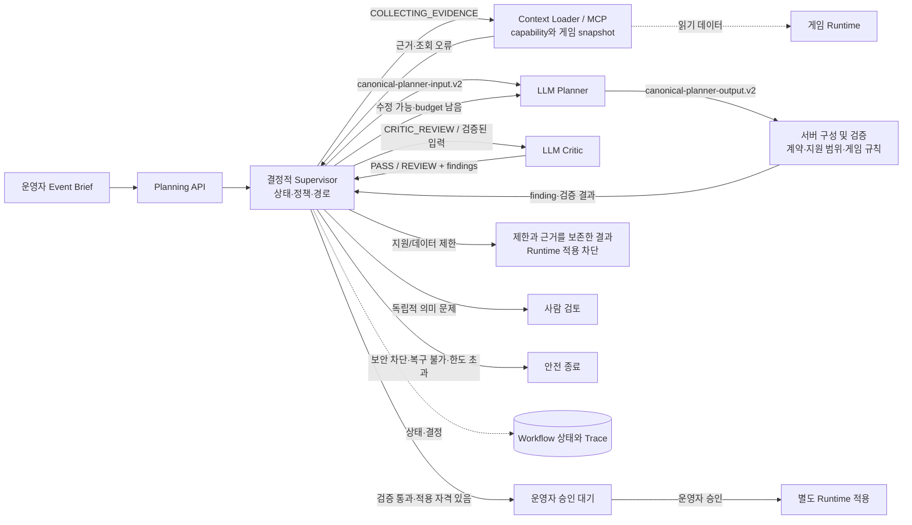
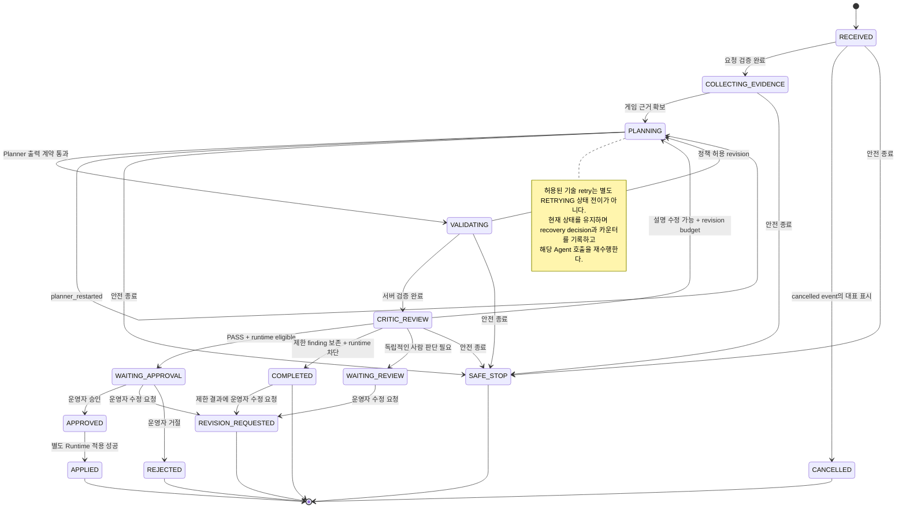

# 산출물 1: 멀티에이전트 아키텍처 설계서

기준일: 2026-10-13 (Asia/Seoul), 제출용 정리본 v1.1

대상: Canonical Event Brief 기획 Workflow의 현재 구현. 저장소에는 별도 계약을 가진 기존 Task Workflow도 있으며, 이 문서는 두 경로의 Agent를 하나의 계약으로 합쳐 설명하지 않는다.

기준 원칙: 코드와 보존된 실행 증거로 확인된 사실을 설명하며, 설계 목표나 미검증 환경 동작을 구현 완료로 취급하지 않는다.

## 1. 시스템이 다루는 도메인: Event Brief에서 Event Plan까지

운영자는 이벤트 목적, 대상, 일정, 공간, 미션, 보상과 제약을 `Event Brief`로 제출한다. 시스템은 게임 Runtime의 지원 기능과 버전이 있는 게임 데이터를 바탕으로 실행 가능한 `Event Plan`을 구성하고, 의미·규칙 검토 결과를 붙여 운영자에게 돌려준다. 운영자 승인은 별도 행위이며, 승인된 결과만 Runtime 적용 흐름으로 넘긴다.

핵심 데이터 계약은 다음과 같다.

| 개념 | 프로젝트 내 의미 | 통제 기준 |
|---|---|---|
| Event Brief | 운영자가 제출하는 이벤트 요청. `event-brief.v1` 계약 | 입력 schema, 범위 검증 및 게임 버전 참조 |
| Capability Catalog / Game Context | 기능별 지원 상태와 데이터·규칙 버전 | 서버가 조회한 catalog, snapshot, ruleset 및 policy 버전 |
| Event Plan | 미션·보상·연결·영향 평가·검증 finding을 포함하는 계획. `event-plan.v1` 계약 | 검증 결과를 담아 반환할 수 있으며, 반환 자체가 Runtime 적용 자격을 뜻하지 않음 |
| `runtime_eligible` | 계획이 현재 게임에서 Runtime 적용 자격을 갖는지 나타내는 서버 통제 필드 | 검증된 상태, 지원 capability, finding 및 개발 필요 항목에서 도출. LLM이 임의로 정하지 않음. 승인·적용 가능 여부는 이 필드와 별도 승인 절차로 판단 |
| Finding | 문제 위치·분류·심각도·근거·수정 가능성·Runtime 차단 여부 | 수정, 사람 검토, 제한 결과, 안전 종료 분기의 근거 |

이 경계가 필요한 이유는 자연어 계획의 설득력과 게임 안에서 실제 실행 가능한지를 같은 판단으로 취급할 수 없기 때문이다. Planner가 설명을 잘 작성해도 미지원 기능이나 검증 실패가 해소되지 않으면 Runtime 적용 자격은 생기지 않는다.

## 2. 협업 구조: Canonical 경로의 중앙 Supervisor와 두 LLM Agent

이 문서에서 다루는 Canonical 경로는 **Supervisor 중심의 순차 Workflow**다. 이 경로에서 LLM Agent는 계획 설명을 생성하는 Canonical Planner와 의미적 일관성을 검토하는 Canonical Critic이다. Supervisor, capability 확인, 게임 규칙·계약 검증은 결정적 서버 구성요소이며 LLM Agent가 아니다. 독립 Executor Agent와 Memory Keeper Agent는 이 경로에 구현되어 있지 않다.

저장소에는 기존 Task Workflow도 남아 있다. 이 경로는 `EventPlanner`, `BalanceRuleAgent`, `Critic` 구현과 별도 실행 코드를 사용하며, `BalanceRuleAgent`는 선택적으로 LLM 서비스를 사용한다. 따라서 아래 두 Agent의 입출력 계약과 흐름도를 기존 Task 경로까지 포함하는 전체 Agent 목록으로 해석하면 안 된다. 공통 Supervisor reducer 및 Trace 연계가 있어도 두 실행 경로의 Agent 계약이 동일한 것은 아니다.

이 구조를 선택한 이유는 게임 규칙·지원 여부·권위 상태·승인을 생성 모델에 맡기지 않으면서, 자연어 생성과 의미 검토가 필요한 부분에 모델을 제한해 쓰기 위해서다. 중앙 Supervisor가 상태와 다음 경로를 결정하므로 재기획·검토·종료 기준을 한 곳에서 감사할 수 있다. Supervisor 경로가 중단되면 해당 Workflow 진행에도 영향이 있으므로, 상태 저장과 안전 종료가 협업 흐름의 일부다.

그림은 코드에서 확인되는 논리 흐름이다.

## 3. Agent 입출력 계약과 권한

아래 계약 버전과 역할 표는 Canonical 경로에 한정한다. Agent 역할은 이름이 아니라 **받는 계약, 반환하는 계약, 반환 결과로 할 수 없는 일**로 정의한다.

| 역할 | 입력 계약 | 출력 계약 | 권한과 금지 경계 |
|---|---|---|---|
| Canonical Planner | `canonical-planner-input.v2`: Brief, capability catalog, runtime evidence. 이 세 입력의 source game version과 snapshot 일치 여부를 수신 전에 검사 | `canonical-planner-output.v2`: `summary`, `action_rationales[]`, `reward_rationales[]`, `reward_proposals[]` | 설명 및 허용된 보상 제안만 생성. workflow/task/plan/mission/reward의 권위 ID를 생성·통제하지 않음. 보상 제안에는 카탈로그 `item_id`와 `action_index`, 수량을 반환할 수 있으며 서버가 검증·연결. 지원 판정, `runtime_eligible`, 상태, 승인도 결정하지 않음 |
| 서버 Plan 구성·검증 | Brief, Planner 출력, capability·runtime evidence 및 rules | `event-plan.v1`: 권위 ID 연결, 미션·보상·finding, eligibility 포함 | 입력 schema, ID 연결, capability·게임 규칙 및 결과 불변조건을 결정적으로 확인 |
| Canonical Critic | `canonical-critic-input.v1`: Brief, 검증된 Plan, Planner 출력. Brief와 Plan의 게임 snapshot 일치를 수신 전에 검사 | `canonical-critic-output.v1`: `PASS`/`REVIEW`, `reason`, `review_note`, `repairability`, 구조화 `findings[]` | 의미 일관성 검토만 수행. Plan을 수정하거나 승인하지 않으며 게임 규칙·경제의 최종 판정자가 아님 |
| Supervisor | 현재 Workflow snapshot/version, 검증 결과·findings 또는 오류, 카운터와 고정 정책 참조 | 상태 전이·다음 action, `reason_code`, policy/rule 및 evidence 참조 | 결정적으로 재기획·retry·사람 검토·완료·안전 종료 경로 선택. 상위 정책과 hard limit을 변경하지 않음 |

Critic은 정책 평가기가 아니라 의미 검토자다. 다만 지원 제한만 있는 결과에 Critic이 같은 scope 문제를 중복 보고한 경우, 서버는 기존 finding과 조건을 대조해 그 중복을 정리할 수 있다. 독립적인 의미 모순이나 보안 차단은 이 정리 대상이 아니다.

## 4. Handoff: 계약 검증과 소유권 이전

Agent는 서로를 직접 호출하지 않는다. Workflow가 Handoff를 만들고 수신자 조건을 검사한 뒤 실행한다. 현재 Handoff 전달 필드는 다음과 같다.

| 계약 필드 | 목적 |
|---|---|
| `task_id`, `from_agent`, `to_agent`, `owner_agent` | 실행, 발신자·수신자 및 현재 소유자 식별 |
| `objective`, `inputs`, `constraints`, `expected_output` | 요청 목적, 실제 입력, 제한, 기대 출력 전달 |
| `input_contract_version` | 수신자가 요구하는 입력 계약 확인 |
| `attempt`, `retry_count`, `revision_count` | 시도와 기술 복구·내용 수정을 분리 추적 |
| `error_context` | 오류 복구 시 분류된 이전 오류 문맥 전달 |
| `state_ref` | Workflow snapshot 연결. canonical 경로에서 workflow ID 사용 |
| `handoff_status` | `REQUESTED`, `ACCEPTED`, `REJECTED` 소유권 상태 |

수신 검증 조건은 요청 상태, task ID, 발신자·수신자, state ref, contract version, 필수 입력 존재, 게임 데이터 version 일치다. 계약 검증 실패는 Handoff를 거절하고 `handoff_contract_invalid` 오류 경로로 보낸다. 입력과 Agent 출력 계약을 모두 검증한 후에 Handoff를 수락하고 소유권을 이전한다. Handoff Trace에는 task, 발신·수신 Agent, 상태, contract version이 기록된다.

Handoff dataclass는 `retry_count`와 `error_context` 필드를 지원하지만, Canonical Planner·Critic Handoff 생성부는 두 호출 모두 `retry_count=0`으로 만들고 `error_context`를 채우지 않는다. `attempt`도 현재 revision count + 1로 설정되므로 기술 재시도 회차를 뜻하지 않는다. Canonical 경로의 기술 재시도는 Agent 호출 루프가 같은 operation을 다시 수행하고 recovery decision/횟수를 Workflow 상태와 Trace에 기록한다. 따라서 이 경로에서는 재시도 시 이전 실패 원인과 수정 지시가 Handoff 입력에 포함된다고 보장하지 않는다. 자동 기획 revision은 `build_planner_revision_context`로 Critic reason을 다음 Planner 입력에 전달한다. 따라서 내용 수정 feedback의 전달과 기술 retry의 error_context 누락을 구분한다. 기존 Task 경로는 Agent context에 오류 정보를 전달할 수 있으나 별도 계약으로 판단해야 한다.

가이드 예시의 `result_ref`, `evidence_refs`, `memory_refs`는 현재 Handoff 객체의 필드가 아니다. 계획과 finding 자체에는 `evidence_refs`가 있으며, 그것은 Handoff 필드와 구분해 Event Plan 및 validation finding 계약으로 기록한다.

## 5. Supervisor가 선택하는 실행 경로

이 그림은 canonical reducer의 주요 허용 전이를 나타낸다. `cancelled`와 `safe_stop` 이벤트는 terminal이 아닌 현재 상태에서 허용되며 모든 출발 상태를 그림에 반복하지 않았다. `WAITING_REVIEW`는 reducer terminal이 아니다. 운영자 수정은 기존 기록을 `REVISION_REQUESTED`로 마감하고 새 Workflow/결과 version을 생성한다. 제한 `COMPLETED`에서도 운영자 수정 요청을 허용하는 예외가 있다.

공용 Task API의 `WorkflowStatus`에는 `RETRYING`이 있지만, 위 그림은 Canonical Supervisor reducer의 상태를 나타낸다. Canonical 복구 결정은 현재 Workflow status를 유지하면서 `state_version`과 retry counter, 결정 Trace를 갱신한다. `RETRYING` enum과 Canonical reducer 상태를 같은 상태 모델처럼 합치지 않는다.

| 결과 종류 | 처리 기준 |
|---|---|
| `WAITING_APPROVAL` | 계약·규칙 검증과 의미 검토가 통과하고 Runtime 적용 자격이 있는 결과를 승인 대기로 제공 |
| 제한 결과 / `COMPLETED` | 미지원 기능 또는 데이터 제한과 근거를 보존하며 `runtime_eligible=false` 유지 |
| 사람 검토 / `WAITING_REVIEW` | 기존 scope 제한 중복만으로 만들지 않는 독립적 의미 모순 등 사람 판단이 필요한 finding |
| retry recovery decision | 재시도가 허용된 일시적인 기술 오류. Canonical 경로는 현재 Workflow status를 유지하고 retry count와 결정 근거를 snapshot/Trace에 기록한 뒤 같은 Agent operation을 재수행 |
| revision | 수정 가능한 계획 finding에 대해 Planner가 설명을 다시 만들고 전체 검증을 재수행. revision count를 별도 증가 |
| `SAFE_STOP` | 보안 차단, 복구 불가 오류, 정책·계약 문제, budget 소진 등 안전한 진행이 불가능한 경우 |

`retry`는 호출·의존성의 일시 오류 복구이고, `revision`은 의미 finding을 반영한 기획 재작성이다. 두 카운터와 분기 조건은 다르다. Critic `PASS`는 승인이나 Runtime 적용을 의미하지 않는다. 운영자 승인 후에도 적용은 별도 Runtime 흐름이다.

## 6. 공유 상태·중간 결과·Trace

Memory Keeper Agent 대신 Workflow snapshot과 Trace를 사용한다.

| 상태/근거 | 저장·전달 방식 | 아키텍처에서의 역할 |
|---|---|---|
| Event Brief 및 결과 version | 요청/결과 계약과 version 연결 | 어떤 사용자 요청과 계획본을 검토·승인하는지 고정 |
| Game Context 및 capability version | source game version, snapshot ID, catalog/rules/policy version | Agent와 검증기가 같은 게임 기준을 사용하는지 확인 |
| Workflow state version, retry/revision counters | versioned snapshot 및 Supervisor transition event | 순서 보장, stale transition 차단, 한도 계산 |
| Handoff 및 단계 Trace | event 순서, status, Agent/tool, reason, contract version | 중간 결과 작성 주체·처리 상태·실패 경로 확인 |
| `idempotency`와 결정 참조 | API 및 저장 경계에서 키와 결과 연결 | 같은 요청 중복 실행과 승인 대상 결과 혼동 방지 |
| LLM prompt/response 원문 | 별도 암호화 저장, 접근 감사, 30일 expires_at. 저장/만료 원문 조회 시 정리 및 명시적 purge 함수. DATABASE_URL 설정 시 API lifespan이 시작 시점과 24시간마다 purge하는 정리 루프를 실행; 실제 일일 실행 성공의 운영 증거는 미확인 | 원문 검토가 필요한 제한된 감사 경로. 발표 Trace에 원문을 노출하지 않음 |

세부 payload가 큰 경우 현재 모든 Handoff가 참조값만 운반한다고 단정하지 않는다. Supervisor context 정책은 API key·password·token 류 금지 필드를 제한한다. 일반 trace는 단계·결정·근거 참조를 중심으로 하며 원문 LLM 기록은 분리된 보호 경로에 둔다.

## 7. 책임 경계와 간극 점검

| 판단 영역 | 책임자 | 점검 결과와 현재 한계 |
|---|---|---|
| 자연어 계획 설명 | Planner | 권위 데이터나 상태를 만들지 않음 |
| 의미 적합성 | Critic | Plan을 고치지 않고 검토 finding을 반환 |
| 게임 기능·규칙 적합성 | canonical Plan 구성·capability/runtime 근거 검증 경로 | LLM의 추정을 최종 판정으로 사용하지 않음 |
| 다음 Workflow 상태 | Supervisor | 저장 계층이 version check 후 영속화. Controller·Agent가 별도 권위 전이를 만들면 안 됨 |
| 게임 정보 조회/도구 수행 | Context Loader·MCP client 및 검증 서비스 | 독립 Executor Agent는 없음 |
| 상태·중간 결과 기억 | Workflow Repository·Trace | 독립 Memory Keeper Agent는 없음. 운영 백업/복원 완전성은 별도 운영 책임·증거 필요 |
| 업무 승인과 적용 | 운영자, 별도 Runtime 경로 | Critic PASS는 승인이 아니며, 실제 AWS 승인→Runtime 적용·보상/중복 방지 수용 완료; 현재 앱은 초기화해 ABSENT |
| 조직/다중 사용자 권한 | 현행 actor 및 API 접근 경로 | 완성된 기업용 역할 기반 권한 체계라고 주장할 구현 증거가 없음 |

점검 결론: Planner/Critic의 생성·검토 책임, 결정적 검증기의 도메인 판정, Supervisor의 경로 선택, 저장 계층의 영속화, 운영자의 승인은 구분돼 있다. Guide의 Executor/Memory Keeper 예시는 우리 구현의 Agent로 옮기지 않는다. 현재 확인된 책임 공백은 운영 백업·복원과 다중 사용자 역할 권한처럼 이 산출물 범위를 벗어난 운영/제품 요구다.

## 8. 구현 근거와 증거 범위

| 설명 요소 | 주요 코드 근거 |
|---|---|
| Event Brief/Plan 계약과 Runtime eligibility | `backend/app/schemas/planning.py`, `backend/app/services/canonical_planning.py` |
| Planner/Critic 입출력 계약 | `backend/app/agents/canonical_planner.py`, `backend/app/agents/canonical_critic.py` |
| Supervisor 상태와 전이 근거 | `backend/app/agents/supervisor.py`, `backend/app/services/canonical_planning.py` |
| Handoff 생성·수신 검증·Trace | `backend/app/orchestration/handoff.py`, `backend/app/services/workflow_execution.py` |
| 복구 라우팅 | `backend/app/orchestration/routing.py`, `backend/app/orchestration/retry.py`, `backend/app/services/recovery_policy.py` |
| 게임 근거·규칙 검증 | `backend/app/services/planning_context_loader.py`, `backend/app/services/mcp_client.py`, `backend/app/services/canonical_planning.py`의 capability/runtime evidence·보상/Plan 계약 검증; `backend/app/rules/game_rule_engine.py`는 기존 Task 경로의 규칙 근거 |
| 저장·멱등성·LLM 기록 | `backend/app/services/canonical_planning.py`의 `_persist`/`_persist_record`/`_lookup_idempotency`/`append_workflow_lifecycle_event`, `backend/app/services/unit_of_work.py`, `backend/app/services/llm_record_service.py`; 기존 Task는 `backend/app/repositories/postgres.py` |

이미 보존된 실행 근거는 범위와 환경을 함께 제시한다.

- [통합 후 로컬 종합 검증](검증산출물/2026-10-13_통합후_로컬종합검증.md): Python core, PostgreSQL/원자성, UI, 오류 및 Edge 경로의 해당 보고서 시험 범위.
- [실제 LLM 보완 후 재시험](검증산출물/2026-10-13_실제LLM_보완후_재시험결과.md): 실제 provider 호출이 포함된 19개 시나리오 판정과 호출/기록 증거. 19/19 PASS를 자동 복구율이라고 해석하지 않는다.
- [Actions 전체 경로 AWS 검증](검증산출물/2026-10-13_Actions_전체경로_AWS_검증.md): 실제 hosted first/update/reset, 정상 기획/승인/게임 연결 17개 확인, 137 정책/13 실호출/10 Edge 시험. 현재 ABSENT. 각 source/환경/모집단을 구분한다.

## 부록 A. 가이드 요구사항 점검

| 가이드 점검사항 | 본문 위치 | 반영 내용 |
|---|---|---|
| 프로젝트 목적·대표 시나리오 | §1 | Event Brief에서 Event Plan으로 이어지는 업무 흐름 |
| 협업 구조·선정 이유 | §2 | 중앙 Supervisor 및 결정적 검증을 택한 이유 |
| Agent 역할·책임·입력·출력 | §2–3 | Canonical 경로 실제 계약 및 별도 기존 Task 경로 범위 고지 |
| Handoff 조건·전달 데이터 | §4 | 객체 필드, receiver 검사, 실제 retry/error context 전달 차이 및 거절/수락 조건 |
| 공유 상태·메모리·중간 결과 | §6 | snapshot, version, Trace, 멱등성, 보호된 LLM 기록 |
| 정상·재시도·실패·종료 흐름 | §5 | 실제 reducer 상태, recovery decision, revision, 제한 완료, 사람 검토, safe stop |
| 역할 중복·책임 공백 점검 | §7 | Agent/서버/운영자의 겹침과 운영 한계 |

기존 설계 기준과 구현 이력은 [멀티에이전트 Workflow 설계](기획안설계/02_멀티에이전트_Workflow_설계.md), [기획안·게임 기능 계약](기획안설계/01_기획안_게임기능_계약_설계.md), [최상위 시스템 설계서](최상위_시스템_설계서.md), [과목 가이드 원문](pre/멀티_에이전트_협업_및_서비스_운영_가이드.md)을 참고한다.

## 제출본 연결과 최신 실행 범위

[필수 산출물 대문](필수산출물_README.md), [배포·장애 복구](산출물2_배포_및_장애복구_보고서.md), [파이프라인 결과](산출물3_파이프라인_구현결과_보고서.md)를 함께 읽는다. 이 문서의 Handoff retry/error_context 전달 제한은 최신 AWS 시험 PASS로 해소된 것이 아니다. Supervisor가 경로와 권위 상태를 판단하고 저장 계층이 CAS/transaction으로 영속화한다. Context 조회·Agent 호출·검증 역시 해당 실행의 권한/문맥/정책 경계 안에서 수행하며, §2 흐름도는 역할 연결이지 Supervisor가 Context 조회 이후에만 관여한다는 뜻은 아니다.

재검사 결과와 잔여 요구는 [필수 산출물 재검사](검증산출물/2026-10-13_필수산출물_재검사.md)를 따른다. 빈 placeholder 파일을 구현 근거로 사용하지 않는다.
