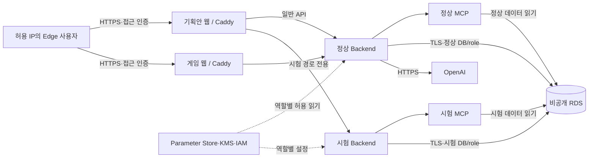

# 산출물 2: 배포 및 장애 복구 보고서

2026-10-13 최신 AWS 상태: **ACTIVE**. main source `18bd89e`를 Actions로 첫 배포했고, 실제 LLM 정상 흐름 17 PASS·RDS 암호화/SSL·Edge 3 PASS를 확인했다. [main 첫 배포·접속·증거](검증산출물/2026-10-13_main_AWS_첫배포.md). 아래 ABSENT·INACTIVE 기록은 이번 배포 전 이력이다.

2026-10-13 현행 통합·CI/CD·OIDC 기준은 `main`이다. 기존 `ikonly` source의 시험은 당시 증거로 보존한다. [main 전환·실행 결과](검증산출물/2026-10-13_main_CICD_전환과_병합.md).

기준일: 2026-10-13 (Asia/Seoul). 제출용 정리본 v1.3 (main 첫 배포 동기화). 실제 AWS 실행과 로컬 실행을 구분한다. 현재 AWS 앱은 **ABSENT / 잔존 0**이며, 아래 배포 시험은 정리 전에 수행한 기록이다.

필수 항목 기준: [보존 가이드 §4 산출물 2](pre/멀티_에이전트_협업_및_서비스_운영_가이드.md). 협업 구조는 [산출물 1](산출물1_멀티에이전트_아키텍처_설계서.md), 자동 배포는 [산출물 3](산출물3_파이프라인_구현결과_보고서.md), 제출 상태는 [필수 산출물 대문](필수산출물_README.md)을 따른다.

## 1. 목적과 실행 기준

게임 이벤트 요청에서 Planner의 설명 생성, 서버의 규칙 검증, Critic의 의미 검토, Supervisor의 정책 결정, 사람 승인 및 게임 반영까지 연결한다. 오류 발생 시 허용된 재시도·기획 수정·대체 조회로 정상화하거나, 진행이 안전하지 않으면 중단한다. 안전 중단은 자동 복구 성공으로 계산하지 않는다.

| 구분 | 실제 근거 |
|---|---|
| 배포 환경 | AWS 서울 `ap-northeast-2`, 환경 `ikonly-demo`, EC2 6개와 RDS PostgreSQL |
| 기능 시험 이미지 기준 | `e476376a1971bc6c241c32450460b9249f6f43bf`; 이후 문서 revision의 선택 업데이트에서 기능 코드 유지 |
| 정리 전송 보완 기준 | `530fd03ee8361aac3421f3f35fec0ff98c3fc4fd`, 제한된 병렬 저널 읽기 |
| 전체 실행·source·역할별 revision | [Actions 전체 경로 AWS 검증](검증산출물/2026-10-13_Actions_전체경로_AWS_검증.md), [시험 요약 JSON](검증산출물/2026-10-13_AWS_시험요약.json) |
| 최종 AWS 검사 | 2026-10-13 11:28 KST 검사 PASS; 11:30 KST 독립 재조회도 동일 결과. [공개 잔존 검사](검증산출물/2026-10-13_Actions_AWS_잔존검사.json)는 첫 최종 조회를 보존 |

## 2. 서비스·네트워크·데이터 구성

| 구성 | 상태 확인·통제 |
|---|---|
| 프론트 2개 | 동일 웹 이미지에서 역할별 실행. 기획안 화면은 일반/시험 API를 구분해 프록시하며 시험 upstream 실패를 일반 API로 넘기지 않음 |
| Backend 2개 | 정상/시험 서버 분리. 실제 승인 정책과 시험 상태/CLEAN 확인. 승인과 Runtime 적용은 서버에서 수행 |
| MCP 2개 | 정상/시험 데이터 경계 분리. 실제 MCP client 및 도구 계약으로 게임 snapshot·규칙·지원 범위 조회 |
| RDS 1개 | DB 서버 하나 안에 정상 `eventquest_demo`와 시험 `eventquest_fault_test` DB·권한 분리. TLS `verify-full`, DB identity 및 runtime 권한 검사 |
| 외부·내부 네트워크 | 웹 HTTPS 진입은 허용 IP 제한. 앱·MCP·RDS는 사설 연결; NAT를 통한 외부 API 통신. RDS public endpoint 공개 접근 없음 |
| 시크릿 | 앱 OpenAI 키는 Parameter Store SecureString. IAM 역할별 조회와 SSM 경유 KMS 복호화. 최초 키 공급은 로컬 환경에서 한시적 암호화 공급; GitHub 저장소/워크플로우 본문에 키 없음 |
| 수용 | 컨테이너 health, 서비스 연결, HTTPS CA/hostname, 실제 DB·MCP·두 웹 연결을 별도 확인. 자체 CA이며 공개 인증기관 인증서라고 표현하지 않음 |

Planner/Critic은 정상 Backend 내부의 역할이며 별도 EC2나 별도 컨테이너 Agent 서비스가 아니다. 이번 AWS 구성에는 Redis 서버가 없다. canonical 멱등성·저장·상태 이벤트는 `canonical_planning.py`의 PostgreSQL 경계로 관리하고 기존 Task 멱등성은 `repositories/postgres.py`가 담당한다. 메모리 adapter와 DB 경계를 혼동하지 않는다. 캐시·Redis 계획은 [저장·Trace 설계](기획안설계/06_API_저장_Trace_설계.md)와 구분하며 Redis 캐시 복구를 시험했다고 주장하지 않는다.

## 3. 오류 검출과 정책 대응

안정된 `ERR-원인-장소-번호` 코드, 오류 occurrence, 정책 version/hash 및 Supervisor decision을 연결한다. 원인은 카탈로그가 정의하고, 대응은 활성 정책과 hard limit이 제한한다. 실행 중 정책이 바뀌어도 해당 실행에 고정한 정책으로 판단한다.

| 오류 영역 | 검출 근거·기록 | 허용 대응과 중단 경계 |
|---|---|---|
| LLM 출력 형식 | 출력 schema validation, `planner_output_invalid`와 실제 검출 journal | 해당 코드의 정책이 허용할 때 bounded retry. 반복 실패는 SAFE_STOP |
| LLM/네트워크 호출 | provider/client 예외·timeout, 시도·호출 수·경과·토큰·비용 | 정책 허용 재시도. 한도 소진 또는 지속 오류는 추가 호출 없이 중단 |
| 계획 의미·게임 규칙 | 설명과 고정 요청/규칙 불일치, validation finding, Critic finding | 수정 가능한 경우 revision 후 재검증. 미지원은 개발 필요를 표시하고 적용 차단. 사람 판단이 필요하면 검토 대기 |
| MCP | 전송 disconnect/delay/503, 응답 schema, 도구 실행 오류. `ERR-DEP-MCP-003`은 MCP operation 오류로 분리 | retry 또는 허용된 대체 조회. 손상된 응답 계약과 보안 위반은 임의 추정으로 복구하지 않음 |
| DB·저장 | DB 연결/읽기 실패, CAS, idempotency/ACK 및 Trace 저장 검사 | 일시 읽기 실패는 정책 한도 내 retry. 결과 불명 쓰기/상태 충돌은 무조건 재실행하지 않으며 저장 상태 확인 또는 중단 |
| 보안·권한 | 입력/출력 guard, context 금지 필드, tool permission 및 handoff contract 검사 | 입력 거절·안전 중단. 재시도·폴백으로 권한 경계를 우회하지 않음 |
| 정책·실행 한도 | 정책 누락/검증 실패, version/hash, deadline/attempt/revision/call/token/cost 한도 | fail-closed. 정책은 초안→검증→미리보기→활성화/rollback; 미등록 코드는 임의 기본 정책으로 실행하지 않음 |

정확한 코드별 허용 action·횟수는 [오류 정책 설계](기획안설계/05_오류분류_복구정책_설계.md) 및 [28개 시험표](기획안설계/18_오류주입_시험표.md)를 따른다. 운영자가 모든 사용자 권한을 갖는 현행 범위와 기업용 다중 역할 권한 체계는 구분한다.

## 4. 장애 주입 방법과 개별 증거

시험 Backend의 격리 context에서 응답 데이터 변형, 호출 예외/timeout, MCP 연결·지연·HTTP 오류 등을 발생시킨다. 오류 코드만 최종 결과에 붙여 성공시키는 시험이 아니라 실제 client·검출기·Supervisor·정책 경로를 통과한다.

| 시험 묶음 | 결과 | 입력·기대·실제·시간·개입 증빙 |
|---|---|---|
| 정상 업무 | 17개 확인 PASS | 실제 OpenAI Planner/Critic 2회, 승인→선택 공간 2개 반영→첫 클리어 보상·중복 방지, 실제 RDS 원문 hash 대조 |
| 결정적 정책 시험 | 137 PASS, FAIL/INCONCLUSIVE/미실행 0 | 기본 28 / 안전 중단 27 / 재시도 허용 46 / 활성 정책 36. [사례별 증거](검증산출물/산출물2_장애시험_사례증거.json): 주입 위치/패턴/profile, 입력 fixture hash(원 fixture 식별용; 변형 후 입력 hash는 actual.fixture_digest), 기대와 실제 코드/action/횟수/상태, 시간·개입 |
| 실제 LLM·MCP 시험 | 13 PASS | 정상 4, 주입 오류 9. 27 provider 호출. 6개 정상화, 지속 오류 3개 중단. case/run/workflow ID 및 실제 결과는 [시험 요약](검증산출물/2026-10-13_AWS_시험요약.json)의 `live.rows` |
| Edge 배포 UI | 10 PASS | 정상 2 / 복구 8. Planner/Critic·복구 비교·저장 결과·모바일·새로고침 중복 방지. 스크린샷·XML·Trace는 로컬 보존 |

실호출 대표 주입: `planner_format_once`, `planner_explanation_once`, `llm_timeout_once`, `mcp_disconnect_once`, `mcp_delay_once`, `mcp_503_once`. 지속 오류는 `planner_format_always`, `llm_timeout_always`, `mcp_503_always`다. 각 오류 9건의 결과와 평균 시간을 아래 지표에 사용한다.

**시험 범위 제한:** DB 장애는 상황 주입이며 실제 RDS 중단이 아니다. LLM timeout/출력 변형은 제어된 주입으로 OpenAI 자체 장애가 아니다. 실제 LLM 시험은 배포된 기능 source의 별도 시험 자식 프로세스에서 실행했고, 시험 부모 API는 결정적 모드·키 없음 상태를 유지했다. cloud guard 사전 검증과 자식 전용 fixture를 사용한 범위는 원 보고서에 기록했다. 복합 원인 동시 주입·장기 부하·모든 보안 공격을 시험했다고 주장하지 않는다.

## 5. 가이드 지표: 통과·자동 정상화·안전 중단 분리

| 지표 | AWS 결정적 시험 | AWS 실제 LLM·MCP 시험 |
|---|---:|---:|
| 전체 시험 판정 PASS | 137/137 | 13/13 |
| 선정 오류 모집단 | 127 | 9 |
| 사전 선정 오류 기준 자동 복구율 | 51/127 = **40.1575%** | 6/9 = **66.6667%** |
| 전체 정책 주입 시험 기준 정상화율(보조 지표) | 51/137 = **37.2263%** | 정상 4건을 포함한 13개 전체는 장애 분모로 사용하지 않음 |
| 복구 기대 사례 성공률 | 51/51 = **100%** | 6/6 = **100%** |
| 평균 자동 복구시간 | **1.0262초**, 51개 측정·누락 0 | **5.2883초**, 6개 측정 |
| 지속 오류 안전 중단 준수 | 전체 정책 판정과 terminal 분포로 별도 확인 | 3/3 = **100%** |

공식: 자동 복구율 = 수동 개입 없이 정상화된 선정 장애 사례 / 선정 장애 사례. 평균 복구시간 = 검출→Workflow 처리 완료 시간의 합 / 측정한 자동 정상화 건수. 대기열·전체 test runner 실행·정책 원복 시간을 복구시간으로 대체하지 않는다.

결정적 137개에서 입력 거절·자료/개발 필요·상태 CAS의 10개를 사전에 정한 기준으로 제외했다. 제외 scenario는 `game_data_unavailable`, `input_guard_blocked`, `input_validation_error`, `supervisor_state_conflict`, `unsupported_capability`이며, 복구를 실패했다는 이유로 사후 제외한 것이 아니다. terminal은 WAITING_APPROVAL 53 / SAFE_STOP 55 / FAILED 21 / REQUEST_BLOCKED 4 / COMPLETED 4. 승인 대기 53개 중 상태 충돌 2개는 정상화 분자에 포함하지 않는다. SAFE_STOP 55/137을 자동 복구율로 바꾸지 않는다. 제외된 10개에는 실제 보안 입력 차단·상태 CAS 오류도 있으므로 51/127을 가이드의 모든 장애를 포괄한 비율로 표현하지 않는다. 원본의 사전 선정 지표는 보존하고 전체 137개 기준의 보수적 보조율도 함께 공개한다. 전체 137개에는 업무 제한 판정이 섞여 있으므로 그 보조율 역시 순수 시스템 장애만의 비율은 아니다. 실제 LLM 시험은 정상 4개를 제외한 오류 9개를 전부 분모에 포함한 6/9다.

각 실행 중 수동 복구 개입은 0이며, 캠페인 준비·정책 원복·배포 정리·취소 후 lock 해제 같은 운영 작업은 별도 기록한다. 과거 로컬 19건(6/9, 평균 5.964초)과 이번 AWS 13건(6/9, 평균 5.2883초)을 합산하지 않는다.

## 6. 실패·개선·수동 조치와 알림

| 확인 사항 | 처리·검증 | 현재 경계 |
|---|---|---|
| 최초 배포 전 경로 처리/실행 문자열 실패 | NUL 구분 UTF-8 및 embedded Python 수정 후 새 initial 성공 | 실패 run 38326013543·38326676258을 성공 수치에 넣지 않음 |
| 시험 도구 준비 실패 | 원격 문자열·이미지 제외 시험 모듈·cloud guard 조건을 보완, 별도 자식 시험 실행 | 앱 자동 복구로 집계하지 않음 |
| 정리 저널 순차 회수 병목 | 삭제 전 취소, 완료 run 소유 lock만 해제, 12KB·최대 3개 병렬 읽기와 hash 검증 후 prepare/reset 성공 | 취소 run 38334088845의 수동 운영 복구를 앱 복구율에서 제외 |
| 화면 표시 | 기능 시험 통과 | AWS 화면의 LOCAL RUNTIME 표시는 부정확. 모바일 큰 그래프 가로 이동 필요 |
| 지속 오류·정책 누락·권한 위반 | 사용자 화면에서 중단·원인·실행 기록 확인; 운영자가 원인/정책/환경을 수정한 후 새 요청 | 무한 재시도·승인 자동 우회 없음 |
| 운영 알림 | CloudWatch CPU>80%, CPU credit<10, instance status 실패, RDS free storage<3GiB: 5분×2평가, SNS email 연결 구성 | 당시 SNS 구독 PendingConfirmation. **실제 이메일 전달·지연 알림·에스컬레이션은 미검증** |

사용자 오류/복구 화면과 GitHub Actions 결과·로그는 확인했다. 이것만으로 담당자 이메일 수신이 확인됐다고 표현하지 않는다. 후속 담당자는 팀장/운영자이며 SNS 수신 승인과 통제된 알림 시험은 별도 남은 운영 점검이다. 이미 정리한 AWS 환경을 문서 작업 때문에 재생성하지 않는다.

## 7. 증거 보존·초기화·재현

정상 2건과 시험 27건의 암호화 LLM DB 기록을 공개키로 봉인해 로컬 저장하고 개인키 복호화 및 prompt/response hash를 대조했다. 총 29회, 입력 139,675 / 출력 5,843 token, 설정 가격 기준 $0.0652188이다. 실제 provider 청구서나 AWS 비용 총액이 아니다.

prepare-reset→로컬 artifact 복호화/SHA·동결 release 대조→reset→최종 artifact 복호화→독립 AWS 조회 순서를 완료했다. 앱 17개 분류와 active stack, state/lock은 모두 없음. 배포 인증 IAM 2개와 공유 GitHub OIDC는 합의한 보존 대상이다. [초기화 검사 JSON](검증산출물/2026-10-13_Actions_AWS_잔존검사.json), [배포/정리 시간](검증산출물/2026-10-13_Actions_전체경로_AWS_검증.md#최종-수용초기화와-시간)을 참조한다.

원본은 Git 제외 `test-results/aws-actions-full-2026-10-13/`에 보존한다. `evidence.json`, `live-evidence/aws-live/`, `browser-*.xml`, 화면·Trace, `llm-*-sealed.json`, `initial-evidence/`, `reset-evidence/`, `final-reset-evidence/` 및 `timing.json`이 포함된다. 암호화 개인키·원문·시크릿·접속 인증 파일은 제출 Git/발표 자료에 넣지 않는다. 공개 JSON은 비밀 없는 선별 증거이며 원본 로그 전체를 대체하지 않는다.

재현은 [팀원 로컬 가이드](팀원_로컬실행_사용자가이드.md) 또는 [Actions 운영 27](기획안설계/27_Actions_첫배포_초기화_운영.md)을 따른다. 현재 삭제된 IP를 서비스 URL로 안내하지 않는다. Windows 신뢰 인증서 삭제 보류, 다중 역할 권한, DB migration 후 자동 데이터 복원은 해결 완료로 표시하지 않는다.

## 재검사 근거

[필수 산출물 재검사](검증산출물/2026-10-13_필수산출물_재검사.md)에서 공개 137개 사례와 로컬 원본 전체, 13개 실호출 기록 및 복구 시간, Edge XML을 독립 대조했다. 51/127의 선정 기준과 51/137 보조 지표를 함께 공개하며 원본 시험 판정/집계는 변경하지 않는다.
