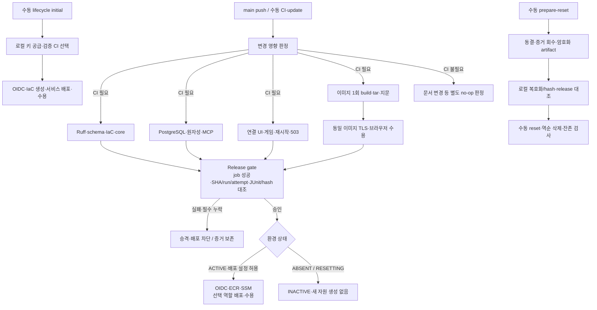

# 산출물 3: 파이프라인 구현 결과 보고서

2026-10-13 현행 통합·CI/CD·OIDC 기준은 `main`이다. 기존 `ikonly` source의 시험은 당시 증거로 보존한다. [main 전환·실행 결과](검증산출물/2026-10-13_main_CICD_전환과_병합.md).

기준일: 2026-10-13 (Asia/Seoul). 제출용 정리본 v1.2 (main 전환 동기화). 실제 Actions 첫 배포·역할별 업데이트·초기화 성공과 테스트 실패 시 배포 차단 근거를 정리한다. **알림 이메일 수신·에스컬레이션은 미검증**이다.

기준: [보존 가이드 §4 산출물 3](pre/멀티_에이전트_협업_및_서비스_운영_가이드.md), [제출 상태](필수산출물_README.md). 배포 환경/복구는 [산출물 2](산출물2_배포_및_장애복구_보고서.md)를 따른다.

## 1. 실제 파이프라인

`.github/workflows/ikonly-ci.yml`은 CI·업데이트·recover·OIDC 점검, `ikonly-lifecycle.yml`은 initial/prepare-reset/reset을 처리한다. 첫 배포/삭제는 push만으로 실행하지 않는다. 같은 환경의 배포/정리는 GitHub concurrency와 AWS operation lock으로 직렬화하며 실행 중 자동 취소하지 않는다.

## 2. 단계별 입력·출력·성공·실패 처리

| 단계 | 입력 → 출력 | 성공 조건 | 실패 처리 |
|---|---|---|---|
| 영향 판정 | base/head diff → 대상 서비스·CI 필요·수동 검토 hash | 분류 가능한 변경·누적 적용 기준 명확 | 미분류 runtime/IaC 변경은 승인 없이 배포하지 않음 |
| quality-core | source·고정 의존성·시험 inventory → JUnit/receipt | Ruff check/format, schema/IaC 일치, cfn-lint, 선택 core 통과 | 오류/누락을 숨기지 않고 gate 차단 |
| PostgreSQL | 일회성 실제 DB/MCP·fixture → PG/원자성 JUnit | 실제 저장·권한·transaction 계약 통과 | 결과 보존, 승격 금지 |
| UI | fixture·실제 DB/API/MCP·브라우저 → JUnit/Trace | connected/restart/game/fault-display/mcp503 통과 | Trace 보존, 승격 금지. 표시 fixture를 실제 LLM 시험으로 집계하지 않음 |
| 이미지 build | 고정 source/lock/Dockerfile → tar·candidate manifest | 이미지 1회 생성, SHA 및 tar 지문 기록 | 후보 미생성/불일치 시 중단 |
| 이미지 수용 | 정확한 tar → TLS 연결·production 브라우저 JUnit | build한 이미지 자체를 load해 DB/MCP/API/HTTPS 수용 | 동일 tar 수용 실패는 승인 금지 |
| release gate | job 결과·suite receipt·JUnit·manifest → ci-verified | 필수 성공, SHA/run/attempt/report hash·schema/migration/catalog 일치 | 실패·필수 skip·누락·불일치 모두 거절 |
| update | verified artifact·accepted release·선택 역할 → 새 accepted release 또는 실패 기록 | OIDC/ECR/SSM 배포, maintenance/drain, health·기능 수용 | 호환되는 이전 앱 이미지 복구 경로. migration 후 자동 DB 덮어쓰기 없음 |
| initial | 로컬 한시적 키 공급·정확한 검증 CI → 5 stack/6 host accepted | IaC·DB TLS/권한·HTTPS·서비스 수용 | 새 환경 소유권 범위의 실패 정리·암호화 증거 보존 |
| reset | 동결 환경·로컬 증거 확인 hash → RESET_COMPLETE·잔존 0 | 증거 확보 후 역순 삭제, 저장·운영 잔여 검사 | hash 불일치 시 삭제 거절, 실패 시 동일 frozen release/output으로 재개 |

CI는 Python 3.11, Ubuntu 24.04에서 실행한다. Node/pnpm과 frontend 의존성은 workflow/lock 기준이며 UI는 Playwright를 사용한다. 단위/통합/UI/image timeout과 lifecycle 120분 상한이 있다. GitHub artifact retention은 7일이므로 원본을 로컬에 내려받았다. 검증 이미지와 배포 이미지를 다시 build해 바꾸지 않는다.

## 3. 테스트 데이터·커버리지 기준

테스트 inventory는 `infra/test-suites.json`에 명시한다. 핵심 계약·함수·Supervisor/정책 경로, 실제 PG 원자성, MCP 연결, UI/시연, TLS 운영 이미지 수용을 계층별로 검사한다. 결정적 LLM fixture는 재현성과 비용 제어용이며 실제 LLM 성공 증거가 아니다. 유료 provider 호출은 [별도 배포 시험](산출물2_배포_및_장애복구_보고서.md#4-장애-주입-방법과-개별-증거)으로 수행했다.

기준은 **필수 선택 사례의 실행·통과 및 누락/불일치 차단**이다. line/branch coverage 백분율을 측정했다거나 100% 코드 커버리지를 달성했다고 주장하지 않는다. 허용 skip은 SQLite에서 제외하는 PG 원자성 parameter 1개이며 실제 PG 단계에서 3개 parameter를 모두 검사한다.

main 전환 전 source `530fd03ee8361aac3421f3f35fec0ff98c3fc4fd`의 [CI run 38334819091](https://github.com/ik-e/multi-agent-autohealing/actions/runs/38334819091), attempt 1:

| 계층 | 실제 결과 |
|---|---:|
| quality-core | 633 PASS + 명시적 허용 1 SKIP |
| PostgreSQL | 56 PASS |
| UI | 36 PASS |
| 운영 이미지 수용 | 6 PASS |
| 총합 | **731 PASS** |

다운로드한 JUnit 10개를 suite receipt 및 `ci-verified.json`의 해시와 대조했다. [CI 증거 명세](검증산출물/산출물3_CI_증거명세.json)에 source/run/attempt·suite별 건수·report hash 및 성공/실패 9개 run의 정확한 source·시작/종료 UTC·job 판정을 보존한다. 이 실행의 `ci_verified=true`와 `deployment_authorized=false`는 별개다. 환경 RESETTING이므로 deploy는 `INACTIVE`, `created_resources=false`로 완료됐다. CI 성공을 새 자원 생성으로 해석하지 않는다.

과거 source `a78f68f`의 707 PASS와 이번 731 PASS를 합산하지 않는다. 테스트 추가/변경으로 증가한 건수이며 서로 다른 source다.

### 3.1 main 전환 후 최신 CI

최신 main source `939472cd8e89e1e38d86babe7d6fcb349e338af8`의 [CI 38340602181](https://github.com/ik-e/multi-agent-autohealing/actions/runs/38340602181)은 **734 PASS / 허용 SKIP 1**, 전체 6분 6초로 성공했다. core 636·PG 56·UI 36·운영 이미지 6이며, 브랜치 출처/거절 검사 추가로 이전 core보다 3개 늘었다. release gate와 자동 deploy job은 성공했고 빈 환경 결과는 INACTIVE / created_resources=false다. [main OIDC 38340636787](https://github.com/ik-e/multi-agent-autohealing/actions/runs/38340636787)도 성공해 실제 controller 인증과 앱 잔존 17개 분류 0을 확인했다. [새 증거 명세](검증산출물/2026-10-13_main_Actions_증거.json)와 [전환 기록](검증산출물/2026-10-13_main_CICD_전환과_병합.md)이 현행 브랜치 결과이며, 위 731 및 아래 실패·AWS 배포 기록은 당시 source로 보존한다.

## 4. 테스트 실패 배포 차단의 실제 증거

[run 38307685039](https://github.com/ik-e/multi-agent-autohealing/actions/runs/38307685039)는 fault-display/production browser 시험 실패로 release-gate가 실패했고 deploy는 SKIPPED였다. 표시 fixture의 시험 서버 의존과 오래된 제목 기대값을 수정한 뒤 다음 검증 source에서 성공했다. 당시 근거·수정·최종 707 PASS는 [현행 코드 CI/CD 마무리 §2–5](검증산출물/2026-10-13_현행코드_CICD_마무리.md)에 보존한다.

이것은 source `0d71d29`의 실제 실패 후보 배포 차단 증거다. 이번 최신 source에서 같은 실패를 다시 인위적으로 발생시킨 실행이라고 표현하지 않는다. 현재 gate 코드도 필수 job의 failed/skipped/missing과 증거 불일치를 거절하며, 최신 CI가 그 계약을 검사했다.

## 5. 실제 AWS first/update/reset 결과·시간

| 작업 | Run | 전체 실행 | 실제 deploy/lifecycle job |
|---|---|---:|---:|
| 첫 배포 | [38327297896](https://github.com/ik-e/multi-agent-autohealing/actions/runs/38327297896) | 27분 31초 | 27분 31초 |
| 게임 웹 선택 | [38328823504](https://github.com/ik-e/multi-agent-autohealing/actions/runs/38328823504) | 11분 14초 | 2분 41초 |
| 기획 웹 선택 | [38329923527](https://github.com/ik-e/multi-agent-autohealing/actions/runs/38329923527) | 7분 45초 | 2분 36초 |
| API 쌍 선택 | [38332060874](https://github.com/ik-e/multi-agent-autohealing/actions/runs/38332060874) | 11분 30초 | 5분 53초 |
| MCP 쌍 선택 | [38333034711](https://github.com/ik-e/multi-agent-autohealing/actions/runs/38333034711) | 11분 58초 | 6분 36초 |
| 정리 준비 | [38334854685](https://github.com/ik-e/multi-agent-autohealing/actions/runs/38334854685) | 6분 14초 | 6분 14초 |
| 전체 초기화 | [38335674579](https://github.com/ik-e/multi-agent-autohealing/actions/runs/38335674579) | 15분 31초 | 15분 31초 |

업데이트는 선택한 역할만 교체하고 비선택 manifest·6개 instance ID를 유지했다. API/MCP는 정상·시험 쌍으로 관리하므로 각각 2개가 선택된다. 기존 기획·게임·137 정책/13 실호출 시험 저장 기록, 웹 proxy 및 CLEAN을 재조회했다. 이번 선택 업데이트는 기능 코드가 같은 새 문서 revision을 이용한 실제 image/release 교체다. 임의 기능 변경의 동작 검증으로 확대하지 않는다.

최초 사전 실패 49초/24초, 정리 준비 취소 5분 36초는 성공 실행 시간과 분리했다. 전체 시간은 실제 job 시작→마지막 종료, 대기와 job/step UTC·CloudFormation 이벤트는 [전체 경로 보고서](검증산출물/2026-10-13_Actions_전체경로_AWS_검증.md)에 기록했다. 정리 도중 실패/취소 복구는 운영 수동 조치이며 앱 오토힐링 분자에 포함하지 않는다.

## 6. 알림·에스컬레이션·검증 한계

| 항목 | 확인 상태 |
|---|---|
| CI 성공·실패의 job 결과·로그·artifact | 실제 run 링크 및 실패 차단 기록 확인 |
| release-gate Step Summary | CI 승인과 CD 조건 안내 구현 확인 |
| 지연·timeout | job/SSM 실행 상한과 결과 기록 구성 확인; 담당자 지연 통보 수신 미검증 |
| AWS 운영 알림 | CloudWatch 19 alarm 및 SNS email 구성; 실제 수신 PendingConfirmation 상태였음 |
| 담당자 에스컬레이션 | 팀장/운영자가 Actions/로그/오류 UI 확인 후 수동 조치. 자동 다단계 연락/대체 채널 및 도달 보장 미구현·미검증 |
| 배포 실패 복구 | 이전 호환 앱 복구 코드/기존 시험 근거 존재. 이번 first/update/reset 캠페인에서 고의 이미지 실패 rollback을 추가 실행하지 않음 |
| DB migration 후 복원 | 자동 snapshot 덮어쓰기 미구현. 수동 호환성 검토·데이터 손실 판단 필요 |

따라서 가이드의 “성공·실패·지연 알림과 에스컬레이션을 확인했다”는 제출 체크는 **부분 충족**이다. GitHub 결과 열람을 이메일 도달 확인으로 대체하지 않는다. 제출 문서에는 이 한계를 공개하며 사용자 승인 없이 별도 외부 메시지 발송이나 유료 AWS 재생성을 진행하지 않는다.

## 7. 운영 절차와 제출 근거

첫 배포의 로컬 단계는 키 공급과 검증 artifact 선택이며 실제 자원 생성/배포는 Actions가 수행한다. 활성 환경은 push 변경 영향 또는 수동 선택으로 업데이트하고, 전체 초기화는 로컬 증거 확인 후 Actions reset을 실행한다. [Actions 운영 27](기획안설계/27_Actions_첫배포_초기화_운영.md)이 현행 명령 기준이다. 이전 [운영 26](기획안설계/26_AWS_배포운영_실행가이드.md)의 로컬 operations는 이전 실행/복구 참고로 구분한다.

최종 AWS는 ABSENT이며 앱 17개 분류 잔존 0, IAM/OIDC만 보존했다. 원본은 `test-results/aws-actions-full-2026-10-13/`의 CI receipt/JUnit, lifecycle 암호화 artifact·로컬 복호화, 시간·독립 검사에 보존한다. 공개 Git에는 선별 JSON과 보고서만 포함한다.

## 재검사 근거

[필수 산출물 재검사](검증산출물/2026-10-13_필수산출물_재검사.md)에서 Actions API의 실제 job 판정/source/시작·종료를 재조회하고, JUnit 10개의 hash·건수와 receipt/승인 artifact를 대조했다. 필수 실행 시간은 CI 증거 명세의 UTC 필드를 기준으로 재현한다.
