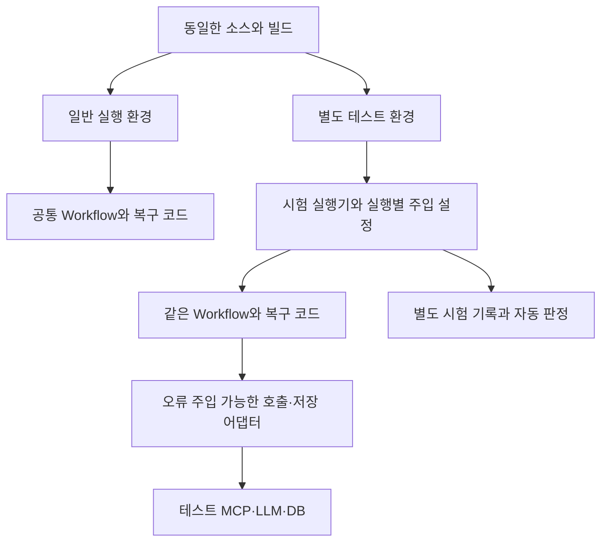

# 단계별 오류 대응 시험 환경 변경 계획

## 1. 문서 상태와 목적

- 작성일: 2026-10-11
- 갱신일: 2026-10-11, `ikonly`의 현재 작업 트리 기준. 미커밋 변경을 포함하므로 브랜치 이름만으로 재현 가능하다고 가정하지 않는다.
- 상태: 변경 계획. 이 문서에 제안한 API·시험 기록·주입 지점·자동 판정은 아직 구현된 기능이 아니다.
- 목적: Workflow의 실제 실행 위치에서 오류를 발생시키고, 오류 감지·분류·Supervisor 결정·복구·종료·데이터 보존을 검증한다.
- 기본 결정: 업무 코드를 복사해 별도 시스템을 개발하지 않는다. 동일한 Workflow·검증·복구 정책·저장 코드를 별도 테스트 환경에서 실행한다.
- 문서 위치: 사용자 지정 작업 공간인 `docs/ik/`.

관련 기준:

- [오류 분류·복구 정책 설계](기획안설계/05_오류분류_복구정책_설계.md)
- [통합 검증 설계](기획안설계/09_통합검증_설계.md)
- [Supervisor 상태 전이·복구 결정 통합 구현 계획](기획안설계/13_Supervisor_상태전이_복구결정_통합구현계획.md)
- [Workflow 진행 기록 UI](workflow-progress-ui-plan.md)
- [현재 구현 상태](현재_구현상태.md)
- [정책 연결 보완 및 실제 Planner 계약 수정](기획안설계/15_오류대응정책_Workflow_연결_재검사.md#6-정책-연결-보완-구현)
- [과목 가이드](pre/멀티_에이전트_협업_및_서비스_운영_가이드.md)

이 계획은 앞선 진행 기록 UI 변경보다 범위가 크다. 백엔드의 테스트 전용 API, 주입 연결, 시험 기록 저장 및 실행 환경 구성이 필요하다. 기존 일반 업무 API와 저장 Trace 계약을 유지하는 것을 목표로 한다.

## 2. 확인한 현재 구조

| 현재 구현 | 확인한 내용 | 확장에 필요한 부분 |
|---|---|---|
| `backend/app/fault_injection/fault_manager.py` | 실행별 오류 종류와 1회 주입 여부 관리. 한도 소진 유형은 반복 주입 | 위치·발생 패턴·호출 차수 지정 |
| `backend/app/fault_injection/fault_types.py`, `backend/app/schemas/event.py` | 허용 오류 유형 7개 정의 | 유효한 단계와 오류의 조합 카탈로그 |
| `backend/app/api/event.py` | `POST /api/test/events/generate`, `ENABLE_FAULT_INJECTION` 검사 | 단계별 시험을 위한 별도 계약 |
| `backend/app/services/task_service.py`, `workflow_service.py` | 테스트 요청의 `fault_type`을 Task Workflow로 전달. 기본 `mock` 엔진은 이를 무시 | 일반 기획 경로 연결, 경로별 시험 구분 |
| `backend/app/services/canonical_planning.py` | 일반 기획 경로의 오류 처리·복구 실행 | 이 경로의 실제 호출·검증·저장 경계에 주입 연결 |
| `backend/app/services/recovery_execution.py`, `orchestration/routing.py` | 공통 MCP 재시도/fallback 루프, primary+fallback 공유 한도, 고정 정책에 따른 Supervisor 결정 | 실제 adapter 경계의 실패·호출 차수 관측 연결 |
| `backend/app/services/workflow_execution.py` | canonical 실행 예약, 비동기 조회, decision CAS 저장, deadline·취소·결과 회수 | 실행 owner·경합·늦은 결과·프로세스 종료 시험 연결 |
| `backend/app/services/unit_of_work.py` | 승인·Runtime·필수 Trace의 공통 transaction과 결과 불명 처리 | 쓰기 전/commit 전/ACK 유실을 서로 다른 시험으로 구분 |
| `backend/app/faults/error_catalog.py` | 오류 코드·원인·위치·재시도 분류 제공 | 시험 조합을 코드와 같은 원천에 연결 |
| `backend/app/services/recovery_policy.py` | 정책 버전 고정, action·횟수 검증, 재시도 제한 | 실행 당시 정책 snapshot과 실제 대응 비교 |
| `frontend-web/src/main.js` | 복구 시연에서 3개 시나리오 선택, Task 실행 후 Trace 조회 | 위치·원인·패턴 선택, 자동 판정, 전체 실행 |
| `frontend-web/src/workflow-progress.js` | canonical 진행 그래프, Planner 시작·실패 기록 표시, Supervisor 결정 표시 | 시험 이력과 연결; Task actor/action Trace는 별도 변환 |
| `backend/evaluation/recovery.py`, `backend/scripts/evaluate_workflow_recovery.py` | 기존 Task의 정상/기획 수정/MCP 재시도/fallback/한도 종료 5개 평가 시나리오와 보고서 | 새 canonical·정책별 기대값과 별도 시험 run/suite 연결 |

### 2.1 이번 계획의 시작 기준

- 오류 카탈로그는 현재 **27개 코드**다. legacy alias는 새로운 오류 코드로 세지 않는다. LLM transient는 llm_timeout과 같은 ERR-DEP-LLM-001에 매핑된다.
- LLM 일시/영구 오류 분류, capability 재시도, fallback 실패의 정책 재진입, canonical 설명 수정 루프, 잔여 예외 분류는 보완됐다. 이 작업을 다시 신규 구축 항목으로 잡지 않는다.
- canonical Planner는 ID 없는 설명만 반환하고 Supervisor가 위치 기반 ID를 결합한다. 실제 provider schema도 수정됐다. 응답 변형 fixture는 이 계약을 기준으로 만든다.
- 자동 설명 수정은 Critic의 PLANNER_EXPLANATION + 결정적 runtime_eligible + 정책 허용일 때만 가능하다. 고정 Brief/미지원 기능/자료 부족을 자동 수정해 통과시키지 않는다.
- 활성 정책은 오류 코드별 action/max_attempts다. phase/component 매칭, 운영자 지정 fallback, backoff 편집은 현행 계약에 없다. 코드 불변조건과 전체 LLM 예산은 정책이 완화할 수 없다.
- canonical UI 요청은 202/Workflow ID 뒤 진행 polling을 사용한다. 실행 시작/복구 결정은 실제 발생 순서대로 저장된다. 기존 Task 시연은 별도 API/Trace 경로다.
- 근거: 정책 연결 보완 당시 PostgreSQL backend 279 passed/11 external skipped, Edge 영향 E2E 2 passed. 이후 Planner schema/UI 수정 영향 검증 44 passed, PostgreSQL 3 passed, Edge 2 passed. 이는 전체 오류 시연 API나 전체 외부 서비스 장애 검증의 완료를 뜻하지 않는다.
- 신규 catalog/run/suite API, 주입 이력 저장소, 모든 오류의 UI 선택 및 자동 판정은 **미구현**이다. 기존 FaultType 7개, UI 3개, 평가 시나리오 5개를 혼동하지 않는다.

현재 정책의 action은 `FAIL_FAST`, `RETRY_OPERATION`, `RETRY_AGENT`, `REVISE_PLAN`, `SAFE_STOP`이다. RETRY의 max_attempts는 최초 실행 포함 총 1~4회(추가 재시도 최대 3회), REVISE_PLAN은 최초 기획 포함 총 1~3회(추가 수정 최대 2회)다. MCP primary/fallback도 같은 작업의 예산을 공유한다. 각 작업의 retry 카운터와 전체 Workflow LLM 예산은 별개이며 UI에서 총 시도와 추가 재시도를 섞지 않는다.

카탈로그에 오류가 존재한다는 사실만으로 모든 단계에서 그 오류를 감지·복구할 수 있다고 판정하지 않는다. 현재 Runtime 오류는 기획 Workflow 복구 정책과 별도 범위이므로 `planning.default`를 기계적으로 적용하지 않는다.

## 3. 목표와 범위

시험 단위는 **실행 경로 × 실제 주입 위치 × 오류 원인 × 발생 패턴 × 적용 정책**이다.

- 일반 기획 경로를 우선 구현하고 기존 Task 경로는 별도 식별해 유지한다.
- 모든 등록 오류에 대해 정책 판단을 검사하고, 실제 적용 가능한 위치에는 실행 시험을 연결한다.
- 위치에 도달하지 못한 시험과 주입 기능이 없는 조합을 성공으로 처리하지 않는다.
- 실제 호출 경로에 근거한 결과를 기존 연결 그래프로 보여준다.
- Runtime 등록은 테스트 DB의 준비된 승인 결과를 사용하는 별도 시험군으로 추가한다.
- 초기에는 한 실행당 한 원인을 주입한다. 복합 장애는 단일 원인 검증 후 후속 범위로 둔다.
- SSE/WebSocket은 추가하지 않는다. 기존 polling 구조를 재사용해 RUNNING/종료와 관측 기록을 표시하고, 최종 판정은 완료 후 증빙으로 확정한다.

## 4. 공통 코드와 환경 분리



- 주입 로직은 별도 모듈로 둔다. LLM·MCP·DB는 기존 인터페이스를 구현한 어댑터 또는 wrapper로 연결한다.
- 내부 검증·Handoff 등 어댑터로 처리할 수 없는 경계에만 작은 주입 연결 지점을 둔다.
- 일반 실행에는 주입하지 않는 기본 구현을 사용한다. 코드 곳곳에 시험용 분기를 추가하지 않는다.
- 동일 소스 revision과 공통 코드 경로를 기록한다. 별도 컨테이너 실행은 코드 복사본을 별도로 개발하는 의미가 아니다.
- 테스트 실행은 전용 DB·계정·외부 의존성을 사용한다. 시험 활성 플래그와 실행 대상의 테스트 환경 확인을 함께 검사한다.
- 기본은 현재 로컬 운영 방식처럼 native backend/UI/시험 runner + Docker PostgreSQL이다. 모든 서버를 새 컨테이너로 만들지 않는다. 기존 자동화는 `eventquest_auto_test`, 신규 시험실은 별도 `eventquest_fault_test`를 사용한다. 사용자 검토 DB `eventquest_test`, 사용자 게임 DB, 실행 중인 기존 자동화 DB를 초기화하지 않는다. 시험실 DB는 신규 제안이며 아직 생성하지 않았다.
- 같은 PostgreSQL 컨테이너에 자동화 DB와 검토 DB가 공존한다. DB 전체 중지·네트워크 차단은 공유 컨테이너에서 실행하지 않는다. 별도 소유권이 확인된 일회용 DB 인스턴스 또는 시험 프로세스에만 적용되는 연결 wrapper/proxy를 사용한다.
- 기존 테스트 DB 검사 함수는 loopback 호스트를 요구한다. Docker 내부 DNS 사용은 별도 컨테이너 소유권·DB 신원 검사 경로와 대조하며 검사 함수를 그대로 적용할 수 있다고 가정하지 않는다.
- 정책 변경 시험은 테스트 DB에서 수행한다. 시험 시작 후 정책이 변경되어도 실행에 고정한 버전으로 완료한다.
- 주입 설정은 Agent Context·prompt에 넣지 않는다. 실행별 상태로 보관하고 종료 시 정리한다.

`ENABLE_FAULT_INJECTION`, `WORKFLOW_ENGINE`, `POSTGRES_TEST_URL`, `DATABASE_URL`은 기존 설정이다. 새 환경변수 이름은 구현 시 필요한 항목만 확정하며 이 문서의 제안값을 현행 설정으로 표현하지 않는다.

시험의 기본 모드는 deterministic LLM 응답 fixture + 실제 테스트 DB/규칙 snapshot이다. 의존성 오류를 합성한다는 사실을 표시하고 운영 데이터 응답과 혼동하지 않는다. 실제 OpenAI 모드는 opt-in이며 비용·토큰 예산을 먼저 확인한다. API 키가 없어도 정책·검출·복구 흐름 시험을 실행할 수 있어야 한다.

## 5. 주입 위치와 오류 조합

아래는 구축 대상 표이며, 각 항목의 현재 지원 여부와 실제 함수 경계는 1단계에서 확정한다. 위치 ID는 제안이다. 모든 위치와 모든 오류를 무조건 곱하지 않는다.

| 위치 ID 예시 | 주입 대상 | 검증할 결과 |
|---|---|---|
| `request.input` | 잘못된 요청·프롬프트 공격 입력 | 실제 입력 검사, 차단 후 Agent 미실행 |
| `context.mcp_call` | timeout·연결 실패·도구 오류 | 오류 분류, 재조회, snapshot 유지 |
| `context.response` | 필드/버전/digest 위반 또는 정상 계약의 자료 부족 | 계약 위반은 ERR-CONTRACT-MCP-001 종료, 정상 형식의 부족 자료는 업무 finding. 둘을 구별 |
| `planner.llm_call` | LLM timeout·실행 오류 | 해당 Agent 재실행 범위·횟수 |
| `planner.response` | schema/cardinality 오류, ID 반환, 악의적 응답 | 실제 Planner/backend·provider 계약 대조, Agent 재시도 또는 정책 종료; 고정 Brief 변경은 허용하지 않음 |
| `handoff.payload` | 필수 Context·수신자·버전 불일치 | 계약 검사, 잘못된 전달 차단 |
| `validation.plan` | 달성 불가·보상 오류·미지원 기능 | 실제 검증 finding, 수정·검토·차단 |
| `tool.authorization` | 허용되지 않은 도구 요청 | 실제 권한 검사와 실행 차단 |
| `critic.llm_call`, `critic.response` | 호출 오류·schema 오류 | Critic 재실행과 실패 처리 |
| `critic.verdict` | HUMAN_REVIEW 또는 PLANNER_EXPLANATION의 정상 REVIEW | 사람 검토와 허용된 설명 수정 루프를 각각 검증, 승인·등록 제한 |
| `consistency.input` | Plan/Brief/연결/version 불일치 | 실제 결합·결정적 검증 함수에 연결. 독립 consistency 실행기가 있다고 가정하지 않음 |
| `plan.store` | 쓰기 전·트랜잭션 중·커밋 후 실패 | 롤백·중복 방지·결과 불명 처리 |
| `trace.store` | 필수 기록 저장 실패 | 정책대로 지속 또는 종료, 기록 누락 식별 |
| `runtime.register` | 승인·등록·Trace transaction 실패/ACK 유실 | 원자성·결과 회수·중복 방지. 신규 Runtime 정책 편집기가 구현됐다고 가정하지 않음 |
| `workflow.limits` | 시간·LLM 예산·복구 한도 초과 | 한도 초과 후 추가 호출·쓰기 방지 |

REVIEW, 미지원 기능, 데이터 부족은 업무 판정 시험으로 구분한다. 모두 시스템 장애 예외나 재시도 대상이라고 해석하지 않는다.

카탈로그에는 `route`, `target`, `fault`, 허용 패턴, 주입 방식, 예상 감지 지점, 연관 오류 코드, 정책 영역, 준비 조건, 검증 항목, 구현 상태와 제외 사유를 둔다. 오류 원인은 기존 오류 카탈로그를 참조하며 UI에서 별도 복구 규칙을 만들지 않는다.

### 5.1 전체 오류 코드의 시험 매핑

아래 `현재 근거`는 자동 테스트/실행 경계의 재사용 후보를 뜻하며 신규 시연 UI 지원을 뜻하지 않는다. `C`는 canonical, `T`는 기존 Task, `A`는 실제 HTTP 입력 검사, `S`는 저장/제어 시험이다. 이 목록을 구현할 catalog의 시작 데이터로 사용하되 함수 경계와 관측 코드가 다른 경우 기록한다.

| 코드 | 경로·위치 / 최소 시험 | 현재 근거·기대 동작 |
|---|---|---|
| ERR-INPUT-API-001 | A request.input / 필수값·범위 위반 | HTTP/Pydantic 검사 재사용. 422의 필드 detail이 이 오류 코드로 통일돼 있다고 가정하지 않음; Workflow/LLM 미실행 검사 |
| ERR-SEC-INPUT-001 | A request.input / 합성 공격 입력 | input_guard 테스트. 차단·Agent 미실행, pin 이전 거부는 정책 참조 없음 |
| ERR-SEC-OUTPUT-001 | C planner/critic.response / 금지 응답 | workflow_execution의 민감 응답 차단 테스트. 재시도·후속 Agent 금지 |
| ERR-SEC-CONTEXT-001 | C handoff.payload / 중첩 금지 정보 | Supervisor ContextPolicyError/잔여 예외 분류. 실제 guard 감지 후 종료 |
| ERR-SEC-TOOL-001 | C/T tool.authorization / 금지 tool 호출 | ToolGuard 테스트. LLM Agent는 쓰기 tool 권한을 가지지 않음; 실제 transport 미호출 |
| ERR-CONTRACT-MCP-001 | C/T context.response / JSON·필드·버전·digest 위반 | MCPContractError 및 invalid snapshot 검사. 재시도/fallback 금지 |
| ERR-CONTRACT-PLANNER-001 | C planner.response / ID·schema·개수 위반 | provider schema 대조/Planner 시작·실패 검사. 정책 RETRY_AGENT 또는 종료 |
| ERR-CONTRACT-CRITIC-001 | C critic.response / enum·필수 필드 위반 | canonical Critic 모델 검사. 정책 RETRY_AGENT 또는 종료 |
| ERR-CONTRACT-HANDOFF-001 | C handoff.payload / 수신자·version·필수 입력 위반 | validate_handoff 실제 검증. 잘못된 수신자 실행 금지 |
| ERR-SCOPE-CHECK-001 | C validation.plan / 지원 안 되는 행동·보상 | canonical scope finding/NEEDS_DEVELOPMENT. 업무 결과로 개발 필요 표시, 승인·등록 금지 |
| ERR-DATA-CONTEXT-001 | C validation.plan / 정상 계약이지만 필요한 자료 없음 | canonical NEEDS_DATA finding. 추정값으로 대체하지 않음 |
| ERR-DOMAIN-PLANNER-001 | T validation.plan / 생성 Plan과 Brief 불일치 | 기존 Task revision 재사용. C는 고정 입력 결합 구조라 같은 자동 수정 시나리오를 적용하지 않음 |
| ERR-DOMAIN-PLANNER-002 | C critic.verdict / 설명만 수정 가능 | policy_workflow_connections의 REVISE_PLAN/SAFE_STOP/한도 차등 검사. 수치·ID·조건 불변 |
| ERR-DOMAIN-RULE-001 | T validation.plan / 달성 불가 생성 미션 | 기존 mission_unreachable_once/UI. C의 고정 사용자 조건은 finding/검토로 분리 |
| ERR-DOMAIN-REWARD-001 | T validation.plan / 존재 안 하는 보상 | balance/routing 검사 재사용. C의 요청 보상은 finding 또는 개발 필요/자료 부족 결과 |
| ERR-DEP-LLM-001 | C/T planner/critic.llm_call / timeout·429·5xx | transient 분류·정책 차등 테스트. 기존 UI mcp timeout과 별개; SDK retry=0 |
| ERR-DEP-LLM-002 | C/T llm_call / 인증·설정 영구 오류 | provider 영구 오류 분류. 무조건 Agent 재시도로 완화하지 않음 |
| ERR-DEP-MCP-001 | C/T context.mcp_call / 조회·fallback timeout | 기존 UI + 공통 MCP 루프 검사. 정책 재시도/종료, primary+fallback 공유 한도 |
| ERR-DEP-MCP-002 | C/T context.mcp_call / 도구 실패 | capability 재시도·기존 primary fallback 검사. fallback 대상은 코드 allowlist |
| ERR-STORE-DB-001 | T/S plan/trace.store / 안전한 쓰기 전 연결 실패 | 기존 trace retry/저장 시험 재사용. 작업 경계가 안전할 때만 재시도; worker catch-all에서 전체 Workflow 재생 금지 |
| ERR-STORE-DB-002 | S plan/runtime.store / commit 후 ACK 유실과 조회 불가 | unit_of_work/저장 회수 검사. 실제 결과가 회수되면 성공, 회수 불가 때만 결과 불명; 무조건 이 코드 생성 금지 |
| ERR-OBS-TRACE-001 | S trace.store / 필수 Trace 실패 | runtime_trace_write_recovery의 롤백·동일 키 재실행. 업무 결과와 시험 증빙 저장소 분리 |
| ERR-CTRL-LIMIT-001 | C/T workflow.limits / 복구 한도 소진 | routing 한도 및 기존 UI 한도 시연. 현행 Trace는 최초 원인 코드+SAFE_STOP을 유지할 수 있음; 종료 코드 강제 변경 금지 |
| ERR-CTRL-STATE-001 | S state.commit / CAS 충돌 | workflow_execution 경합/CAS 검사. 이미 저장된 승자 상태 조회·늦은 쓰기 거부, 무조건 새 SAFE_STOP으로 덮어쓰지 않음 |
| ERR-CTRL-BUDGET-001 | C/T workflow.limits / 호출·토큰·비용 소진 | llm_call_budget 및 잔여 예외 분류. 후속 provider 호출 금지 |
| ERR-CTRL-DEADLINE-001 | C/T workflow.limits / deadline 초과 | workflow_deadline/실행 예약·프로세스 시험. Agent 진입 전 만료 가능, 늦은 결과 저장 금지 |
| ERR-UNKNOWN-WORKFLOW-001 | C/S worker.boundary / 미분류 예외 | classify_workflow_exception. 원인을 LLM/입력으로 오인하지 않고 안전 종료 |

Scope/data/도메인 업무 결과의 finding code와 오류 카탈로그 code는 현재 일대일 wire 계약이 아니다. `associated_error_code`는 시험 분류용 참조이며 `observed_error_code`, `observed_finding_code`, terminal status를 각각 기록한다. 실제 코드가 없으면 없다고 기록하고 성공/실패 판단 기준을 시나리오에 명시한다.

추가 불변조건 시험은 catalog 오류 수와 별도로 센다: 취소, 프로세스 종료 후 만료, Idempotency-Key 재사용, 승인 중복, 정책 실행 중 변경, 주입 없음, 동시 실행 격리. 이들은 오류 코드가 새로 존재하는 것처럼 UI에 추가하지 않는다.

### 5.2 실제 함수 경계와 재사용 테스트

| 작업 경계 | 현재 코드 | 우선 재사용할 검증 파일 |
|---|---|---|
| 요청·pin·비동기 제출 | `api/planning.py:submit_event_brief`, `workflow_execution.py:submit` | `unit/test_planning_api.py`, `unit/test_workflow_execution.py` |
| Planner/설명 수정/Critic | `canonical_planning.py:create_event_workflow`의 execute_agent/수정 루프, `agents/canonical_planner.py`, `canonical_critic.py` | `unit/test_canonical_planning.py`, `unit/test_policy_workflow_connections.py`, `unit/test_canonical_provider_schema.py` |
| MCP primary/fallback | `recovery_execution.py:_run_mcp_read_async`, `mcp_client.py`, `planning_context_loader.py` | `unit/test_policy_workflow_connections.py`, `integration/test_canonical_mcp_http_failure.py`, `test_planning_context_loader.py` |
| Context/Handoff/권한 | `agents/supervisor.py`, `workflow_execution.py:validate_handoff`, `guards/` | `unit/test_workflow_execution.py`, `unit/test_input_guard.py`, `test_guard.py`, `test_backend_b_transports.py` |
| legacy 시연 | `orchestration/engine.py`, `fault_injection/`, `evaluation/recovery.py` | `test_workflow.py`, `test_backend_b_recovery_evaluation.py`, `test_backend_b_recovery_persistence.py` |
| 저장·승인·등록 | `unit_of_work.py`, `canonical_planning.py`, `repositories/`, `game/service.py` | `integration/test_runtime_trace_write_recovery.py`, `integration/test_planning_game_runtime.py` |
| owner·CAS·취소·deadline | `workflow_execution.py:_write/read_progress/cancel/reconcile_expired` | `unit/test_workflow_execution.py`, `unit/test_workflow_deadline.py`, `integration/test_workflow_execution_process.py` |

위 테스트의 합성 실패는 Python monkeypatch/transport 제어를 포함한다. 이 증거를 UI에서 선택 가능한 주입 기능이 이미 있다는 의미로 사용하지 않는다.

## 6. 주입 방식과 발생 패턴

| 방식 | 실행 방법 | 주의점 |
|---|---|---|
| 호출 실패 | 어댑터에서 실제 코드가 처리하는 typed exception 발생 | 오류 처리 경로와 분류까지 실행 |
| 응답 변형 | 최소 필드만 제거·변경하고 실제 검증기에 전달 | 오류 코드·성공 Trace를 직접 만들어 반환하지 않음 |
| 입력 위반 | 합성 요청·Context를 실제 guard에 전달 | 시험 endpoint의 입력 검사를 우회하지 않음 |
| 쓰기 전 실패 | 실제 쓰기 호출 전에 연결·쓰기 오류 발생 | DB에 반영되지 않았는지 확인 |
| 트랜잭션 중 실패 | 일부 쓰기 이후 commit 전 오류 발생 | 원자적 롤백 여부 확인 |
| 커밋 후 응답 유실 | 테스트 DB commit 후 성공 응답 전달을 실패시킴 | 실제 반영 여부·재실행·중복 방지 검사 |
| 실제 의존성 실패 | 테스트 MCP 지연·503, DB 연결 차단 | 실제 client의 timeout·오류 mapping 검증 |
| 제어 한도 | 테스트 clock·정해진 호출 예산으로 한도 도달 | 복구 결정을 직접 대신 생성하지 않음 |

패턴은 `once`, `first_n`, `always`를 기본으로 한다. 위치별 실제 호출 횟수와 주입 횟수를 따로 센다. 재시도 시점에도 같은 실행의 설정을 유지하며 다른 실행과 카운터를 공유하지 않는다.

한도 시험은 총 시도 한도를 T로 확정한 후 T−1회 실패 뒤 정상화, T회 지속 실패 등을 검사한다. 종료 이후 호출이 없는지를 따로 확인한다. 안전 종료 정책에서는 `first_n`의 남은 횟수를 모두 주입하지 않아도 정책 종료가 정상이므로 요청 횟수와 도달한 횟수를 구별한다.

모의 오류 시험과 실제 의존성 시험은 별도 실행 모드·결과로 기록한다. 전자는 정책 흐름, 후자는 실제 client의 감지까지 검증한다. 모의 시험만으로 네트워크·DB 장애 통합 검증을 완료했다고 표현하지 않는다.

## 7. 시험 실행과 API 제안

제안 endpoint는 모두 미구현이며 `/api/test/` 아래에 둔다.

| Endpoint 제안 | 책임 |
|---|---|
| `GET /api/test/fault-catalog` | 지원 위치·원인·패턴·준비 조건 조회 |
| `POST /api/test/fault-runs` | 단건 시험 생성·실행 |
| `GET /api/test/fault-runs/{run_id}` | 실행 상태·판정·그래프 참조·증빙 조회 |
| `POST /api/test/fault-suites` | 선택 조합 묶음 실행 |
| `GET /api/test/fault-suites/{suite_id}` | 조합별 결과·검증 범위 조회 |

단건 설정 예시:

```json
{
  "route": "canonical_planning",
  "input_fixture_id": "supported_basic_plan",
  "fixture_version": 1,
  "target": "planner.llm_call",
  "fault": "timeout",
  "pattern": {"mode": "first_n", "count": 2},
  "execution_mode": "simulated_dependency"
}
```

카탈로그에 없는 조합·과도한 횟수·부적절한 대상은 실행 전에 거부한다. 요청 중복 처리를 위한 idempotency 계약도 별도로 정의한다. 시험 실행 retry와 Workflow 내부 retry를 구분하고, 종료된 시험을 자동 재실행하지 않는다.

- POST run/suite는 Idempotency-Key를 사용한다. 동일 키·동일 설정은 같은 run/suite, 동일 키·다른 설정은 409로 제안한다. API 응답은 202/run_id/조회 위치이며 상세 상태는 polling으로 조회한다. 이들은 신규 시험 API 계약이며 현재 일반 API에 추가된 것이 아니다.
- fixture는 ID/버전과 기준 snapshot digest를 함께 고정한다. 사용자가 임의 Python 코드·DB 주소·외부 URL·파일 경로를 주입 설정에 전달할 수 없게 한다.
- 기본은 시험 환경의 active 정책을 고정한다. 정책 비교 suite는 시험 DB에만 준비한 검증된 RETRY/SAFE_STOP 프로필을 사용하고 사용자 활성 정책을 변경하지 않는다. 각 case에 실제 pin한 version/hash와 검토된 expected_profile_id/version을 기록한다.
- 외부 실제 provider 재호출, DB/프로세스 종료 시험은 catalog에서 별도 준비 조건과 실행 방식을 가진다. suite 기본 선택은 결정적·비파괴 시험이다. 무조건 모든 모드를 한 번에 실행하지 않는다.

실행 순서:

1. 환경·대상·조합을 검사하고 시험 record를 먼저 생성한다.
2. 준비된 입력·DB 상태와 정책 snapshot을 확보한다.
3. 실행별 주입기를 연결해 공통 Workflow를 실행한다.
4. 주입 시점·오류 감지·정책 결정·호출·쓰기의 실제 이력을 수집한다.
5. 주입 상태를 정리하고 DB·응답·Trace와 독립 기대 조건을 비교한다.
6. 시험 결과를 저장한다. 묶음은 각 실행의 상태를 격리하고 초기에는 순차 실행한다.

Runtime 시험 준비는 테스트 DB에서 기존 승인 절차를 사용한다. 승인 검사 자체를 건너뛰지 않으며 준비 호출과 시험 대상 호출을 별도로 기록한다.

## 8. 기록과 자동 판정

업무 Trace는 기존 계약을 유지하고 시험 정보는 별도 저장소에 둔다. 테스트 전용 DB 구조의 신규 migration은 구현 단계에서 필요하다.

테스트 기록 schema는 일반 업무 startup migration과 분리하고 검증된 시험 DB에서만 설치한다. 외부 runner의 안전한 JSONL 관측 journal/최종 JSON 보고서는 DB 장애와 독립된 임시 출력 경로에 저장한다. 경로는 runner가 생성하며 요청으로 받지 않는다. DB에는 run/suite 및 보고서 참조를 저장하고, DB unavailable이면 외부 보고서를 기준으로 판정 불가/실행 실패를 반환한다. 초기 운영 보관 기간과 청소 절차는 구현 전 확정한다.

| 시험 기록 | 내용 |
|---|---|
| 실행 식별 | run·suite ID, Workflow·Task·Plan·Runtime ID(존재하는 경우) |
| 재현 정보 | 소스 revision, 공통 코드·주입 어댑터 버전, 실행 모드, 입력 fixture·snapshot |
| 정책 | 적용 영역·정책 버전·내용 digest, 기대 대응·횟수 정의 |
| 주입 이력 | target, occurrence ID, 호출 차수, 요청·실제 주입 횟수, 주입·감지 시각 |
| 관측 | 실제 오류 코드·action, 재시도·수정 횟수, 후속 호출, 저장 전후 상태 |
| 결과 | 실행 상태, 시험 판정, 업무 결과, 항목별 기대·실제 값과 사유 |
| 증빙 | 원본 Trace 참조, 안전한 관측 기록, 캡처·보고서 참조, 수동 개입 여부 |

시험 상태는 `QUEUED`·`RUNNING`·`COMPLETED`·`ABORTED` 등 실행 lifecycle이며 PASS와 구분한다. 판정은 PASS, FAIL, 미실행, 판정 불가로 둔다. 업무 결과는 복구 성공·안전 종료·차단·사람 검토 등으로 따로 기록한다.

- 정책 기대값은 실행 전 고정한 정책과 검토된 시험 정의에서 산출한다. 실제 결과를 복사해 기대값으로 삼지 않는다.
- 기대 action/상한의 계산은 검토된 시나리오 규칙과 정책 snapshot으로 한다. 시험 대상인 decide_recovery를 다시 호출한 결과만으로 기대값을 정하지 않는다. 운영자 정책이 SAFE_STOP이면 복구 성공 대신 즉시 종료·추가 호출 없음이 기대값이다.
- 감지 검사는 실제 검증기·client에서 나온 오류를 사용한다. 주입기가 요청한 오류 코드만으로 PASS를 주지 않는다.
- 위치에 도달하지 못하면 미실행이다. 주입되지 않았거나 감지되지 않은 경우 사유에 따라 FAIL 또는 판정 불가다.
- 지원하지 않는 조합은 실행 대상에서 제외 사유를 보여준다. 실행하지 않은 조합을 PASS 분모에 섞지 않는다.
- 안전 종료 정책이 지켜지면 시험 PASS지만 복구 성공 건수에는 포함하지 않는다.
- 기록 부족으로 동작을 확인할 수 없으면 판정 불가이며 시험 통과로 취급하지 않는다.

DB·Trace 저장 실패 때문에 증빙도 사라지지 않도록 시험 실행기의 관측 기록을 별도 저장 경로로 보관한다. 업무 DB 전체 연결을 차단하는 시험은 컨테이너 외부의 시험 runner가 결과를 기록해야 한다. 결과 기록까지 실패하면 화면에 시험 실행기 실패를 명시하고 복구 성공으로 표현하지 않는다.

복구 시간은 오류 감지부터 정상화 확인까지 측정한다. 주입 시각·감지 시각·정상화 시각·종료 시각을 각각 저장하고 전체 실행시간과 구분한다. 모의 지연 제거 여부도 기록한다.

## 9. 복구 시연 UI 변경

### 9.1 실행 전 정적 Workflow 그래프

전체 표현은 무한한 실행 이력·재시도 조합을 펼친다는 의미가 아니다. 선택한 실행 경로의 정상 단계, 검증·평가 분기, Supervisor, 허용된 retry/revision/fallback, 승인·등록 및 종료 분기를 고정된 노드·연결로 보여준다. 반복은 loop edge로 표시한다. 현재 기획안/기존 Task/승인·Runtime 시험 경로는 각각의 실제 구조를 가진 별도 그래프로 선택한다.

- 정적 그래프 노드는 업무 단계 ID와 catalog의 주입 target을 매핑한다. 실행 Trace에서 정적 구조를 추정하지 않고 버전 관리한 topology 정의를 사용한다.
- 노드를 선택하면 실제 주입 위치, 유효 오류 원인, 발생 패턴, 정책 영역·현재 대응·준비 조건을 표시한다. 같은 노드의 호출 전/응답 검증/저장 전 등 세부 위치도 구별한다.
- 모든 등록 코드에는 시험 방법 또는 제외 사유를 표시한다. 해당 위치에서 발생 불가능한 원인, 미구현 주입, 별도 runner가 필요한 시험을 일반 단건 버튼으로 실행 가능하게 표시하지 않는다.
- 정책 검사만 가능한 항목과 Workflow 실행 시험까지 가능한 항목을 구분한다. Scope/data finding, 취소 등 업무·제어 시험은 시스템 장애와 별도로 표시한다.
- 정책의 전체 오류를 목록에서 탐색할 수 있고 유효한 조합의 개별·묶음 실행을 제공한다. 임의 노드×원인의 모든 조합을 지원한다는 의미는 아니다.

### 9.2 실행 중·후 실제 경로 그래프

정적 구조 위에 실제 방문 단계·호출 차수·주입·감지·정책 결정·복구·종료를 강조한다. 방문하지 않은 노드는 미실행 상태로 남긴다. 상세 실행 순서는 기존 Trace 그래프로 함께 확인할 수 있게 하고 반복 시도의 카운터와 근거를 펼쳐 본다. 정적 정의와 Trace가 맞지 않으면 감추거나 결과를 만들어 채우지 않고 대응되지 않은 이벤트로 노출한다.

### 9.3 설정·결과 기능

- 실행 경로·입력 fixture를 선택한다.
- Workflow 그림의 노드 또는 목록에서 주입 위치를 선택한다.
- 해당 위치의 유효한 오류·패턴만 선택한다. 미지원 항목은 이유를 표시한다.
- 적용 정책·예상 대응·총 시도 한도·재시도 한도·준비 조건을 실행 전에 확인한다.
- 단건 실행과 선택 단계 전체 실행을 제공한다.
- 완료 후 한 카드의 주 흐름·검증 평가·Supervisor 복구 그래프에 실제 경로를 표시한다.
- 실행 중에는 기존 polling으로 진행을 표시한다. Planner 시작과 검증 전 실패도 주 흐름에 남긴다. 기존 실패의 LLM 참조 기반 표시와 시험 주입/감지 증빙을 구별한다.
- 오류 주입 표시와 실제 오류 감지 표시를 구분한다. 안전 종료·합류·사람 검토를 실제 결과대로 표시한다.
- 노드를 선택하면 위치·차수·판정 근거·관련 증빙을 확인한다.
- 묶음 결과는 위치×원인 표로 제공하고 미구현·미실행·판정 불가를 숨기지 않는다.
- 결과를 JSON 및 가이드 보고서용 표로 내보내고 캡처를 연결한다.

기존 `renderWorkflowGraph()` 재사용 여부와 시험 결과 adapter를 검토한다. Task Trace와 canonical Trace의 형태가 다르므로 공통 화면 모델에서 변환하고 업무 API 원문을 변경하지 않는다. 시험 이력에 명시된 주입·복구 연결만 더 구체적으로 표현하며 과거 일반 기록의 인과관계를 추정하지 않는다.

## 10. 변경 대상과 호환성

| 대상 | 계획 |
|---|---|
| `backend/app/fault_injection/` | 실행별 위치·패턴·카운터·주입 이력, 기존 FaultManager 호환 adapter |
| `backend/app/services/canonical_planning.py`, `backend/app/orchestration/engine.py` | 실제 경계 연결, 공통 오류 처리·정책 유지 |
| LLM·MCP·저장 인터페이스 및 구현 | 주입 wrapper와 별도 테스트 dependency 구성 |
| `backend/app/api/fault_lab.py`, `schemas/fault_lab.py`, `services/fault_lab_service.py` (신규 제안) | catalog/run/suite 계약·검증·예약·조회. 현행 planning API에 fault 필드를 추가하지 않음 |
| `backend/app/fault_injection/catalog.py`, `injector.py` (신규 제안) | 27개 코드 매핑, 유효 조합·fixture, 실행별 wrapper/ContextVar 카운터 |
| `backend/tests/support/fault_lab_runner.py` (신규 제안) | 업무 장애와 분리한 관측·보고서, 프로세스 장애 시험 제어 |
| `backend/app/repositories/fault_lab.py`, `backend/tests/support/sql/fault_lab.sql` (신규 제안) | 검증된 시험 DB 전용 run/suite 저장. 일반 startup에서 자동 설치하지 않음 |
| `frontend-web/src/main.js`, `workflow-progress.js`, `styles.css`, `fault-lab-topology.js` (신규 제안) | 실행 전 정적 topology·노드 선택, 설정·실제 실행 강조·결과·검증 현황 |
| `infra/fault-lab-local.ps1` (신규 제안) | native API/UI/runner + 기존 격리 DB 기본 실행, 소유 PID만 종료. 파괴적 의존성 시험은 별도 일회용 서비스 |

기존 `/api/test/events/generate`와 7개 `fault_type` 시나리오는 유지하고 내부에서 새 주입 설정으로 변환하는 방식을 우선한다. 기존 일반 API는 시험 설정을 받지 않는다. 현재 UI 변경만으로는 이 계획을 구현할 수 없다.

정책 action을 늘리거나 모든 쓰기 오류를 자동 재시도하도록 정책을 완화하는 작업은 포함하지 않는다. 시험에서 기존 오류 분류·정책 실행의 결함이 발견되면 별도 수정 근거와 회귀 시험을 기록한다.

## 11. 구현 순서와 검증 관문

| 단계 | 산출물 | 완료 조건 |
|---|---|---|
| 1. 위치·정책 조사 | §5.1/5.2의 27개 코드 초안 매핑을 catalog 데이터·준비 fixture로 확정 | 문서 매핑은 작성, 실행 catalog는 미구현. 업무 finding/오류 코드 차이와 실제 함수 도달 여부 확인 |
| 2. 주입 기반 | 실행별 주입기·무주입 기본 구현·호환 adapter | 실행 간 누출 없음, 기존 호출 경로 유지, 패턴·횟수 검증 |
| 3. 일반 기획 단건 | MCP·Planner·Critic·검증·Handoff 시험 | 실제 분류·대응·후속 단계 자동 판정 |
| 4. 저장·제어 시험 | DB·Trace·결과 불명·deadline·budget | 롤백·중복 방지·한도 이후 실행 금지 확인 |
| 5. UI·기록 | 기존 3개 시연 유지 + 단건 선택/설정·그래프·판정표·내보내기 | 한 카드 연결, Planner 실패 표시, 판정 근거와 원본 보존, 모바일 확인 |
| 6. 전체 조합 | suite 실행·coverage 표 | 적용 가능·구현·실행·통과 범위 구분 |
| 7. 실제 의존성·Runtime | 격리 MCP·DB 실패, 별도 Runtime 시험군 | 모의 시험과 증빙 구분, 등록 원자성·중복 방지 확인 |

구현 시 주입기 단위 시험, 실제 Workflow 통합 시험, 일반 실행 무주입 회귀 시험, 기존 시나리오 호환 시험, UI fixture·실제 테스트 API 연결 시험을 수행한다. 일반 실행에 주입이 활성화되지 않는지, 동시 실행에서 상태가 섞이지 않는지도 확인한다. 이번 문서 작업에서는 실행 시험을 수행하지 않는다.

전체 정책 검증은 두 층으로 한다. 정책 평가 층은 등록된 모든 코드와 허용·금지 action을 검사한다. 실행 층은 해당 오류가 실제 발생 가능한 위치에서 감지부터 부수 효과까지 확인한다. 정책 평가 시험만 통과한 코드와 실행 시험까지 통과한 코드를 구별한다.

## 12. 수용 기준과 보고서

- 동일 revision의 공통 Workflow·Supervisor·검증·저장 코드로 시험한다.
- 모든 등록 오류의 시험 대상·지원 상태·제외 사유를 확인할 수 있다.
- 실행 전 선택한 경로의 전체 정적 topology를 확인하고 노드→세부 주입 위치→유효 원인·패턴을 선택할 수 있다. 방문하지 않은 노드와 실제 실행 경로를 구별한다.
- 적용 가능한 위치에서 일시·지속·한도 경계 시험을 실행할 수 있다.
- 감지·오류 분류·정책 버전·action·횟수·후속 실행·데이터 상태를 근거로 판정한다.
- 보안·Handoff 계약·저장 결과 불명 오류의 재시도 금지 조건을 검증한다.
- 주입 설정이 다른 실행·Agent Context·일반 실행에 영향을 주지 않는다.
- 업무 DB가 실패해도 시험 결과의 불확실성과 증빙 상태를 확인할 수 있다.
- 기존 일반 API·Trace 계약 및 기존 복구 시연 호환성을 검증한다.
- 가이드의 입력·기대·실제·복구 시간·수동 개입·판정·증빙을 보고서로 남긴다.

지표는 대상 모집단을 명시한다. 실행 시험 통과율은 PASS÷실행 완료 후 판정 가능한 시험 수로 산출하고, 미실행·판정 불가·미지원 수를 별도로 함께 표시한다. 자동 복구율(가이드 기준)은 수동 개입 없이 정상화된 장애 시험 수÷전체 장애 주입 시험 수로 기록하며 지속 장애의 안전 중단도 분모에 포함한다. 복구 성공률(복구 기대 사례)은 사전에 복구를 기대한 시험만 대상으로 별도 계산한다. 안전 중단 정책 준수율은 기대대로 중단하고 추가 실행을 차단한 수÷사전 안전 중단 기대 수이며, 전체 장애 중 안전 중단 비중도 표시한다. 업무 판정 시험은 장애 복구율과 분리하며 평균 복구시간은 복구 성공 건만 대상으로 한다. 공통 기준은 [통합 검증 설계](기획안설계/09_통합검증_설계.md#오토힐링-지표-판정), 적용 예는 [최신 결과 §3.1](검증산출물/2026-10-13_실제LLM_보완후_재시험결과.md#31-가이드-기준-지표와-모집단)을 따른다.

공통 격리·그래프·정책·기대값·데이터·판정 계약은 사용자 동의를 반영한 §14를 따른다. 각 시나리오의 wrapper와 fixture, 정량 기대값은 구현 단계에서 해당 계약에 맞춰 작성하고 검증한다. 시도 횟수 정의와 기존 정책 action을 변경하지 않는다. 새 기능의 구현·검증이 완료되면 관련 상세 설계와 현재 구현 상태 문서를 갱신한다.

## 13. 갱신 후 우선 작업과 탐색 경로

1. §5.1을 machine-readable catalog로 옮기고 시연 불가/업무 결과/실제 정책 복구/외부 runner 전용을 구분한다. 첫 fixture는 현재 opong-data-1.5.0의 지원되는 공간·보상·ID 없는 Planner 출력이다.
2. C 경로의 Planner schema/일시 오류, MCP timeout/fallback, Critic 설명 수정/사람 검토를 단건 API에 먼저 연결한다. 기존 3개 Task 시연을 그대로 유지하면서 새 단건 UI를 붙인다.
3. 안전 종료 정책과 재시도 정책을 시험 DB에서 비교한다. 예상·실제 action/호출 수/Trace/고정 Brief를 검사하고 시험 PASS와 업무 SAFE_STOP을 함께 표시한다.
4. 저장·CAS·예산·취소·프로세스 시험과 suite/보고서를 확장한다. 실제 DB 전체 중지/외부 provider는 별도 opt-in 시험군이다.

정책·안전 경계: [연결 보완 §6](기획안설계/15_오류대응정책_Workflow_연결_재검사.md#6-정책-연결-보완-구현). provider/화면 계약: [Planner 보완 §7](기획안설계/15_오류대응정책_Workflow_연결_재검사.md#7-실제-planner-실패와-provider-계약-동기화). 검증 체계: [통합 검증](기획안설계/09_통합검증_설계.md). 구현 사실: [현재 구현 상태](현재_구현상태.md).

이번 갱신은 문서 작업이다. 신규 주입/API/DB/시연 기능을 구현하거나 장애 시험을 실행하지 않았고 사용자 정책·환경·DB를 변경하지 않았다.

## 14. 합의한 구현 계약 6종

사용자 동의에 따라 아래를 구현 기준으로 확정한다. **확정된 설계 계약이며 현재 구현 기능이라는 뜻은 아니다.** 업무 코드의 복구 판단과 결과는 실제 코드에서 얻고, 시험 runner는 관측과 비교를 담당한다.

### 14.1 일반 실행과 격리

| 조건 | 계약 |
|---|---|
| API 활성 | 신규 시험 API는 기존 ENABLE_FAULT_INJECTION=true와 새 제안 설정 FAULT_LAB_MODE=isolated를 모두 만족할 때만 등록한다. 일반 기본값에서는 미등록/404 |
| 요청 접근 | loopback 요청 및 현재 서버 운영자 권한만 허용. 외부 클라이언트는 403. 본문으로 운영자·DB·실행 서버를 선택하지 못함 |
| DB 신원 | 신규 eventquest_fault_test 이름을 정확히 allowlist하고 DATABASE_URL=POSTGRES_TEST_URL 및 기존 loopback 검사 재사용. runner가 실제 DB명/소유자와 ikonly-test 컨테이너 소유권도 확인; 불일치 시 실행 거부 |
| 실행 격리 | 각 run은 UUID·독립 Idempotency-Key·ContextVar 주입 상태를 가진다. wrapper는 해당 run context가 없으면 원래 adapter를 호출함. module global monkeypatch를 UI 실행 구현에 사용하지 않음 |
| 정리 | 주입 context는 finally에서 reset. thread/task 이동 시 해당 run context만 전달. 다른 요청에 주입 설정을 전달하지 않음 |
| 일반 API | event-briefs/승인/게임 API에 fault 설정 필드를 추가하지 않음. runner는 기존 service를 호출하거나 입력 검사 시험에서 실제 HTTP endpoint를 호출 |
| 일반 회귀 | 시험 A 실행 중 무주입 일반 요청 B가 정상 동작하고 B에 주입 이력이 없는지 검사. 미활성 환경에서 새 시험 API·설정이 사용되지 않는지 검사 |

기존 3개 시연의 요청·응답은 보존한다. 확장 시험실로 이행할 때 기존 시험 endpoint에도 동일 환경 검사를 적용하고 새 launcher로 접속한다. 일반 사용자 서버에서 신규 시험을 실행 가능하게 만드는 것을 호환성 기준으로 삼지 않는다. 권한 문제나 DB 소유권 확인 실패를 무시하는 자동 우회는 없다.

### 14.2 그래프와 실제 코드 매핑

- topology 레코드: `topology_id/version, route, nodes, edges`. 노드: `node_id, label, kind, target_ids, observed_events`. 주입 target: `target_id, boundary_ref, adapter_kind, supported_fault_ids, readiness`. `boundary_ref`는 module/callable 또는 명시적 hook ID이며 함수 존재·hook 등록을 검사한다.
- 종류는 업무 단계/검증/평가/Supervisor/저장/종료다. `canonical_planning`, `legacy_task`, `approved_runtime`는 각각 별도 topology다. 공유 노드도 경로별 target을 명시한다.
- backend가 catalog와 topology를 함께 제공하고 frontend는 이를 그린다. 제안한 fault-lab-topology.js는 렌더 adapter이며 backend 정의를 복제하는 두 번째 원천이 아니다.
- 모든 지원 target은 존재하는 노드에 연결하고 모든 edge의 양끝·node_id/target_id 중복을 검사한다. 지원 오류 목록은 §5.1의 전체 catalog code와 비교한다.
- provider 시작/성공·실패, handoff, Supervisor decision 등의 실제 이벤트를 observed_events로 매핑한다. 동일 노드의 호출/응답 검증 위치는 세부 target으로 분리한다.
- 매핑되지 않은 Trace는 원문 상세와 `UNMAPPED_EVENT`로 노출한다. 증빙에 필요한 이벤트가 매핑되지 않으면 판정 불가, 장식적/추가 이벤트만 미매핑이면 warning으로 남긴다. 구조가 존재하지 않는 target은 활성화하지 않는다.
- registry/fixture/graph 계약 검사를 UI 변경과 함께 수행한다. 그래프 자체가 정상이라는 사실만으로 실제 실행 검증을 통과시키지 않는다.

### 14.3 정책 고정과 비교

- 기본 시험은 시작 시 active 정책을 실제 pin한다. version/hash/catalog/hard-limit 참조와 expected_profile_id/version을 run에 저장한다. 정책 없음·불완전 정책이면 준비 실패로 거부하며 재시도 기본값을 임의 적용하지 않는다.
- 정책 비교 프로필은 `current_active`, `retry_allowed`, `safe_stop`이다. retry_allowed는 해당 오류 분류가 허용하는 action과 검토한 max_attempts만 사용한다. 보안/권한/결과 불명 쓰기 등 NEVER 오류에는 retry 비교가 불가함을 표시한다.
- 변경 프로필은 시험 DB에서만 기존 draft→validate→preview→activate service를 사용해 생성한다. 원래 active 참조를 기록하고 case 종료 후 기존 rollback 경로로 복원한다. 복원 실패 시 환경을 DIRTY로 표시하고 다음 case를 막는다. 사용자 정책 DB에는 접근하지 않는다.
- 초기 suite concurrency는 1이며 run/suite가 시험 환경 lease를 독점한다. 같은 DB에서 동시 정책 교체·baseline 초기화를 하지 않는다. lease는 heartbeat/owner를 기록하되 만료만으로 기존 실행이 종료됐다고 가정하지 않는다; 저장된 owner/deadline 확인 및 종료·복원 후 새 실행을 허용한다.
- 실행 중 정책 변경 확인은 별도 시험이다. 이미 시작한 Workflow의 pin은 유지하고 이후 요청만 새 정책을 사용해야 한다. active 변경 자체와 실제 복구 선택을 따로 관측한다.

### 14.4 독립 기대 결과와 관측 계약

시나리오 정의의 필수 필드:

```text
scenario_id/version, route, fixture_id/version, topology_id/version,
target_id, fault_id, pattern, expected_profile_id/version,
expected_detection, expected_actions, attempt_bounds, expected_terminal,
fixed_input_checks, forbidden_calls, expected_db_effects, required_evidence
```

- 기대값 계산은 검토된 action 허용표·작업 안전조건·pin한 정책 snapshot을 사용한다. 실제 decide_recovery·실제 action을 기대값으로 복사하지 않는다. 시나리오 정의 변경은 version을 올린다.
- 정상화/종료/사람 검토/개발 필요·자료 부족은 별도 기대 terminal이다. UI의 SAFE_STOP이라는 문구만으로 PASS를 주지 않는다.
- 주입기는 `run_id, target_id, occurrence_id, call_index, applied, timestamp`를 기록한다. detector 관측은 별도로 실제 exception type/오류 code/finding/guard 결과와 해당 occurrence의 연결 근거를 기록한다. 주입기 자신이 오류 감지 완료를 선언하지 않는다.
- 최초 호출을 포함한 attempts, 추가 retries, plan revisions, primary/fallback 호출 수를 따로 센다. 최대 시도 T와 first_n=N인 재시도 사례는 N<T일 때 N+1회 정상화, N>=T일 때 T회 후 종료를 기본으로 하되 허용 fallback과 전체 예산이 더 먼저 종료할 수 있는 case는 별도로 정의한다.
- once와 first_n은 일시 오류/허용 복구 위치에서, always는 지속 오류에서 사용한다. NEVER 오류는 최초 감지 뒤 추가 호출 0이 기대값이다. 한도 종료는 원인 오류 코드가 유지되는 현행 계약도 인정하되 코드/상태/카운터를 명시한다.
- 단조 clock으로 감지→복구 완료 시간 및 전체 시간을 측정하고 UTC 시각도 저장한다. 합성 지연과 실제 의존성 지연을 실행 모드로 구분한다. 외부 provider 호출은 별도 opt-in으로 비용/토큰을 기록한다.

### 14.5 데이터 준비·보존·정리

- launcher는 시험 DB만 생성/준비한다. 파괴적 DB 장애는 별도 일회용 인스턴스를 사용하고 공유 PostgreSQL 컨테이너를 중지하지 않는다.
- 각 case 시작 전 `opong-data-1.5.0` 기준 fixture와 baseline을 준비하고 digest를 기록한다. run의 Workflow/Task/Plan/Runtime/사용자·아이템 참조를 추적한다. 기존 데이터를 갖는 사용자 검토 DB를 baseline으로 사용하지 않는다.
- 초기 순차 모드에서 시험 DB baseline 재설정은 환경 독점과 실행중 owner 없음이 확인된 경우에만 수행한다. 승인/등록 준비도 실제 승인 절차를 사용한다. baseline을 다음 시험용으로 복원하기 전에 결과와 관측을 저장한다.
- 읽기/Agent 시험은 runtime 이벤트·진행도·보상·재화 불변을 확인한다. 승인/등록/보상 시험은 예상 효과 1회만 허용하고 재요청에서 중복 효과 0, 실패 transaction에서 부분 효과 0을 확인한다.
- DB 비교는 전체 row 수만 사용하지 않고 run 소유 ID와 baseline 항목별 상태를 검사한다. 정리되지 않은 데이터·정책이 있으면 DIRTY 환경으로 표시해 후속 실행을 막는다.
- 시험 이력과 외부 안전 journal/JSON은 30일 보관 후 명시적 cleanup 명령으로 정리한다. 진행 중인 run/lease, baseline 기준 자료는 삭제하지 않는다. 삭제 전에 출력 root의 절대 경로 경계를 검사한다. 기존 제한된 LLM 원문 보관 정책은 변경하지 않으며 journal에 키·프롬프트/응답 원문을 복사하지 않는다.

### 14.6 시험 자체의 실패와 종료

| 상황 | lifecycle / verdict | 필수 표시 |
|---|---|---|
| 준비 완료 후 주입·검출·대응·효과·증빙 일치 | COMPLETED / PASS | 업무 결과는 복구 성공·안전 종료 등을 별도로 표시 |
| 유효 시험이 기대 위치에 도달했지만 주입 안 됨, 검출 실패, 대응/효과 불일치 | COMPLETED / FAIL | 어떤 check의 기대/실제 값이 다른지 |
| 더 앞선 합법적 종료로 target 미도달 | COMPLETED / NOT_EXECUTED | 선행 종료 지점과 원인, 해당 오류 시험은 통과로 계산하지 않음 |
| guard에 의한 최초 요청 차단이 시험 목적 | COMPLETED / PASS 또는 FAIL | Workflow ID가 없어도 실제 HTTP/guard 증빙으로 판정; 미도달과 혼동하지 않음 |
| 필수 관측/DB 확인 누락 | COMPLETED / INCONCLUSIVE | 확인 불가능 항목과 보존된 근거 |
| runner 중단·시험 timeout·운영자 취소 | ABORTED / INCONCLUSIVE | 중단 원인, 자식 프로세스 상태, 부분 효과·정리 필요 여부 |
| 미지원 조합·비시험 DB·준비조건 불충족 | 실행 전 403/409/422/503 등 사유별 거부 | unsupported/environment busy/config invalid/preparation unavailable을 구별, PASS 집계 제외 |

- Workflow deadline과 시험 runner timeout은 다르다. 기본 runner 총 한도는 준비 30초 + 현행 Workflow 제한 + 관측/정리 30초로 정한다. 특수 프로세스 장애 case는 검토된 정의에 고정한 별도 한도를 사용한다. 웹 요청으로 임의 한도를 늘리지 못한다.
- runner crash 복원 시 journal의 시작/종료와 저장 owner를 대조한다. 종료 증거가 없는 run은 ABORTED/INCONCLUSIVE로 표시하고 동일 run을 자동 재실행하지 않는다. 재실행은 새 run ID로 명시적으로 요청한다.
- cleanup 실패는 독립 FAIL check이며 환경을 DIRTY로 남긴다. 이미 ABORTED/INCONCLUSIVE인 실행의 불확실성도 유지하고 suite를 중단한다.
- suite 보고서는 전체 선택/지원/거부/실행/미실행/판정 불가/PASS/FAIL 수를 함께 표시한다. PASS 비율 분모와 장애 복구율 분모를 구별하고, 기대한 안전 종료를 자동 복구 성공으로 합산하지 않는다.

### 14.7 구현 관문

다음 순서로 필요한 항목만 검증한다: (1) schema/catalog/topology·격리 guard 단위 검사, (2) wrapper와 주입·검출 관측 검사, (3) 실제 PostgreSQL 단건/정책 차등/데이터 보존 검사, (4) Edge 정적 그래프 선택→실행→결과 검사, (5) 별도 프로세스 장애·외부 의존성 opt-in 검사. 영향을 받는 검사를 우선 실행하고 최종 통합 회귀는 별도로 수행한다. 이번 계약 확정에서는 코드 구현·시험 실행·서버/DB 설정을 변경하지 않는다.

## 15. 2026-10-11 구현과 현재 범위

§14의 합의 후 구현을 진행했다. 실제 구조·파일·API·검증·실행 명령은 [시험실 구현·검증 16](기획안설계/16_오류시험실_구현과_검증.md)을 기준으로 확인한다. §14.7의 “이번 계약 확정에서는 구현하지 않는다”는 계약 확정 시점 기록이며 현재 구현 상태를 뜻하지 않는다.

- 27개 오류 코드, 28개 등록 시나리오, 실제 callable registry와 backend 권위의 topology를 구현했다. canonical/기존 Task는 시험 가능하며 승인 후 Runtime은 그래프만 제공한다.
- 별도 DB `eventquest_fault_test`, API 8013, MCP 8014, UI 5183을 사용한다. PG 공유 컨테이너는 종료하지 않는다. ContextVar와 case별 프로세스, lease·heartbeat·DIRTY, 실제 정책 활성화·복원, 멱등 실행 이력과 JSON 증빙을 구현했다.
- 기본 provider는 결정적 adapter, 게임 규칙·상태 저장과 MCP는 실제 DB/서버다. Task 전용 업무 오류 3개는 보존된 `tinyheroes-1.0.0` 자료, canonical은 `opong-data-1.5.0` 자료로 검사한다.
- 현재 runner 제한은 고정 240초(Workflow 180초 + 준비/정리 여유 60초)다. 프로세스 중단은 재실행하지 않고 ABORTED/INCONCLUSIVE와 DIRTY로 보존한다.
- 실제 서버 중단, 외부 provider 실호출 비용 시험, 승인/등록/보상 쓰기 장애 fixture, 운영자 취소와 DIRTY 자동 복구 UI, 실행 중 정책 교체 전용 시나리오는 후속 범위다. 제공되지 않는 시험을 PASS로 계산하지 않는다.

### 15.1 고정 Workflow 위치 선택 화면

사용자 요청에 따라 진행 기록의 업무 단계 의미를 활용해 실행 전부터 전체 그래프를 고정 표시한다. 단계→세부 위치→원인을 분리해 선택하며 좌표는 실행/재시도 동안 불변이다. 실제 변경과 검증은 [시험실 16 §8](기획안설계/16_오류시험실_구현과_검증.md#8-2026-10-11-고정-workflow-화면-보완)을 따른다.

### 15.2 MCP 코드 분리·상태 저장 정책 연결

DB 사용자 시험 FAIL 분석을 반영해 안전한 단일 상태 저장 재시도를 정책과 연결하고 종료 기록 저장을 복구 시도와 분리했다. MCP 게임 규칙 조회는 `ERR-DEP-MCP-003`, 현재는 28코드/28시나리오다. 과거 정책은 명시적 상속으로 pin하고 새 DRAFT는 새 코드가 필수다. 검증·과거 결과 보존은 [시험실 16 §9](기획안설계/16_오류시험실_구현과_검증.md#9-2026-10-11-mcp-코드-분리와-상태-저장-복구-수정)를 따른다.


### 15.3 결과 해석과 그래프 표시 개선 완료 (2026-10-11)

기획안 작성 그래프를 기본으로 두고 기존 Task는 고급 설정으로 이동했다. Runtime runner 미지원 흐름은 선택 목록에서 제외했다. 결과는 주입/검출/정책 결정/최종 상태/시험 판정을 구분하며, 완료 기록은 명시적인 실행 경로 보기에서만 강조한다. 새 위치·원인·결과·요청 선택 시 강조를 초기화한다. 최초 시도·재시도와 내부 경계 호출을 구분하고, 28코드/28시나리오 및 전체 시험의 기존 Task 포함 범위를 명시했다. 탭 내 최근 요청 30개의 조회를 제공한다.

구현 범위와 증거: [시험실 구현 §10](기획안설계/16_오류시험실_구현과_검증.md#10-2026-10-11-시험-ui-결과-해석과-실행-경로-분리).

### 후속 정밀 검증 계획

[오토힐링 정밀 테스트 계획](기획안설계/17_오토힐링_정밀테스트_계획.md)에 오류별 정책/한도 분기, 데이터 변형·의미 검사, 상태·저장·권한 불변조건, 실제 서비스/LLM 평가와 결과 지표를 정리했다. 현재 지원되는 시험과 추가 fixture가 필요한 시험을 구분하며, 계획 작성은 추가 구현·시험 완료를 뜻하지 않는다.
