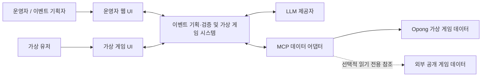
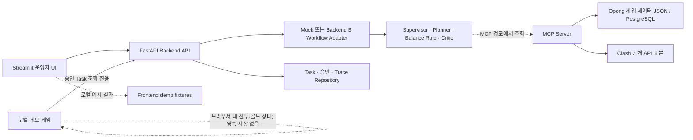
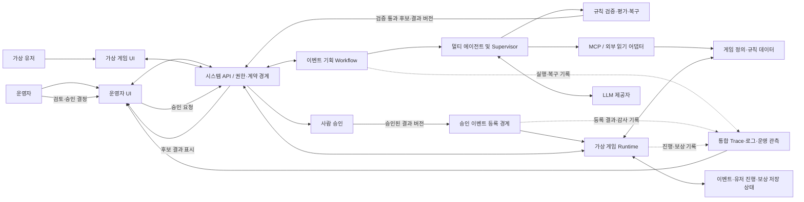

# 게임 이벤트 기획·가상 게임 시스템 최상위 설계서

## 문서 상태와 적용 기준

- 상태: 최상위 설계 기준. 시스템 목표·경계·책임은 이 문서를 따르고, 세부 구현 현황은 [현재 구현 상태](현재_구현상태.md)를 따른다.
- 설계 시작 코드 기준: `feature/backend-a-db-sequence` 커밋 `0d59c69a4254402e6d6531a17ce724763fe4ddd1`에서 분기한 `ikonly`.
- 최신 구현 확인일: 2026-10-10 (Asia/Seoul). 구현 변경은 현재 `ikonly` 작업 트리에 있으며 아직 미커밋이다.
- §6.1의 As-Is 그림과 §16의 초기 기준선 설명은 설계 시작 기준의 역사적 구성을 설명한다. 최신 Runtime 구현·검증 사실은 [현재 구현 상태](현재_구현상태.md)를 우선하며, §6.3은 현재 책임 요약으로 읽는다.

## 1. 문서 목적과 독자

이 문서는 게임 이벤트 기획·검증 시스템과 가상 게임 런타임을 포함한 전체 시스템의 목적, 경계, 논리 구성, 주요 흐름, 데이터 책임, 품질 원칙, 미결 결정을 정하는 최상위 기준이다. 팀장과 각 담당자가 시스템 전체 구조와 영역 간 책임을 함께 검토하는 데 사용한다.

이 문서는 상세 구현 명세가 아니다. API 필드, 데이터베이스 테이블, 에이전트 프롬프트, 게임 밸런스 수치, 에러별 재시도 횟수, 화면별 상호작용, 배포 명령 등은 해당 영역의 상세 설계서와 구현 계획서에서 다룬다. 하위 문서는 이 문서의 시스템 경계와 책임을 따른다. 하위 설계에서 상위 경계나 책임을 바꾸려면 이 문서의 설계 결정도 함께 갱신한다.

## 2. 시스템 목표와 성공 기준

### 2.1 목표

운영자가 게임 이벤트 기획을 요청하면, 시스템이 게임 규칙과 데이터에 근거해 초안을 생성·검증하고 오류를 제한된 방식으로 수정·재검증한다. 사람이 승인한 기획안은 가상 게임 런타임에 등록할 수 있으며, 런타임은 가상 유저의 미션 진행과 가상 보상 기록을 저장하고 운영자에게 그 상태를 보여준다.

### 2.2 사용자 관점의 목표 흐름

```text
이벤트 요청
→ 기획안 생성
→ 게임 규칙 검증 및 필요 시 수정·재검증
→ 지원 범위 내 검증 완료: 사람의 최종 승인
→ 승인된 기획안만 가상 게임에 이벤트 등록
→ 가상 유저의 미션 진행
→ 진행도와 보상 기록 확인

미지원 기능이 포함된 기획:
개발 필요 항목·근거·영향을 표시한 결과 반환 (Runtime 적용 불가)
```

### 2.3 상위 성공 기준

- 기획 결과가 원래 요청 및 선택한 게임 규칙 데이터의 버전과 연결된다.
- 규칙 검증과 품질 검토를 통과한 결과만 사람의 승인 대상으로 제시된다.
- 안전하고 근거 있는 초안 작성이 가능한 미지원 기능은 개발 필요 항목·영향이 표시된 기획 결과로 반환되며, 구현·재검증 전에는 Runtime에 등록할 수 없다.
- 승인 전 결과는 가상 게임 런타임의 활성 이벤트로 등록되지 않는다.
- 승인된 이벤트 등록, 가상 유저 진행도 변경, 보상 지급 기록이 화면 연출에만 머물지 않고 런타임의 영속 상태에 반영된다.
- 같은 등록·진행 요청의 중복 처리와 실패 후 재개 방식이 정의되어 상태가 모순되지 않는다.
- 운영자가 승인 상태, 런타임 반영 결과, 진행·보상 기록, 실패 원인을 추적할 수 있다.
- 운영자가 기획 진행을 현재 Workflow 상태에 따라 이해하고, 승인된 오류 대응 정책의 버전과 변경 이력을 확인·관리할 수 있다.
- 실제 상용 게임 계정·서버·경제에는 쓰기 작업을 하지 않는다.

정량 목표값과 수용 시험은 품질·검증 상세 설계서에서 결정한다.

## 3. 사용자와 외부 이해관계자

| 주체 | 역할 | 현재 확인 | 목표 기준 |
|---|---|---|---|
| 이벤트 기획자·운영자 | 이벤트 요청, 결과 검토, 승인·수정 요청·거절, 오류 정책 관리 | 데모 ID 기반 운영 화면과 승인 API가 있음 | 초기 설계는 단일 사용자가 모든 업무 권한을 가짐. 오류 정책은 엄격한 검증·버전·감사 대상으로 하고 보안 불변조건은 변경할 수 없음. 작성자·승인자 분리는 향후 RBAC 확장 |
| 가상 유저 | 가상 게임에서 이벤트 미션을 진행 | 현재 전투 시연은 로컬 화면 상태임 | 미션 진행 주체와 테스트용 유저 상태를 런타임 모델에 포함 |
| 관리자·운영 담당자 | 로그·Trace·오류와 런타임 상태 확인, 정책 관리 | 운영 디버그 화면과 Task Trace 조회가 있음 | 초기에는 이벤트 기획자와 동일한 단일 사용자가 이 업무를 함께 수행. 이후 역할 분리 시 권한을 나눔 |
| LLM 제공자 | 에이전트 판단·생성 수행 | Mock 및 Live 모드가 있음 | 외부 의존성으로 취급하고 결과 검증·오류 경계를 둠 |
| MCP 서버·게임 데이터 소스 | 게임 규칙·아이템·표본 데이터 제공 | Opong 데이터 Tool 및 Clash 공개 표본 Tool이 있음 | 출처·버전이 명시된 기획 입력 데이터 제공. 런타임 쓰기 권한과 분리 |
| 실제 상용 게임 | 향후 별도 검토가 필요한 외부 서비스 | Clash 공개 API 읽기 경로가 존재 | 현재 게임 설계·시연 범위에서 분석·연동하지 않으며 실제 계정·경제를 변경하지 않음 |

초기 설계는 모든 업무 권한을 가진 단일 사용자를 가정하고, 작성자·승인자·운영자 역할 분리는 후속 확장으로 둔다. 실제 인증 방식과 현재 데모 사용자 ID를 안전한 인증 경계로 대체하는 방법은 보안 상세 설계에서 정한다. 오류 정책의 허용 범위와 보안 불변조건은 이 사용자도 임의로 완화할 수 없다.

## 4. 기능 범위와 제외 범위

### 4.1 목표 범위

- 이벤트 요청 접수 및 기획안 생성
- 게임 데이터 조회와 입력·출력·도구 결과 검증
- 미션 달성 가능성, 아이템·보상 유효성, 요청 부합성 검사
- 정책 한도 안의 자동 수정·재검증과 안전 종료
- 사람의 승인·수정 요청·거절
- 승인된 기획의 가상 게임 이벤트 등록
- 가상 유저의 이벤트 참여 및 저장 상태 기반 미션 진행
- 가상 보상 기록과 운영자 조회
- 기획 워크플로우 및 게임 런타임의 Trace·로그·실패 확인
- 기획 작성·진행 시각화·로그 조회와 검증된 오류 대응 정책을 관리하는 운영자 UI
- 발표자가 시스템 경계와 자동 복구 흐름을 이해할 수 있는 시연 화면

### 4.2 명시적 제외

- 실제 상용 게임 서버에 이벤트 배포
- 실제 플레이어 계정·인벤토리·재화 변경
- Clash of Clans 등 외부 게임 계정에 미션 또는 보상을 지급
- 실제 플레이어 개인정보나 상용 게임의 비공개 운영 데이터 사용
- 가상 게임을 상용 수준의 완성된 RPG로 구현

가상 게임은 기존 구현·기획의 컨셉을 이어받는 모바일 방치형 RPG로 설계한다. MVP 콘텐츠는 스테이지, 던전, 이벤트 특별 공간(특별 던전 우선), 성장으로 좁히며, 이벤트 기획안이 등록·플레이·미션 진행·가상 보상 기록으로 적용되는 모습을 시연한다. 상세 규칙과 범위는 [가상 게임 도메인 상세 설계서](가상게임_도메인_상세설계서.md)에서 구체화한다. 외부 게임 분석·연동은 현재 범위에 포함하지 않고, 필요 시 확장 가능한 경계만 고려한다.

## 5. 시스템 경계와 외부 컨텍스트

### 5.1 경계 원칙

- 기획·검증 시스템은 승인 가능한 기획 후보를 생성하고, 승인 전에는 런타임 상태를 변경하지 않는다.
- 승인 서비스는 승인 권한과 승인된 결과 버전을 확인하고, 런타임 등록으로 넘길 수 있는 명시적 경계를 제공한다.
- 가상 게임 런타임은 등록된 이벤트, 가상 유저 진행 상태, 가상 보상 기록의 원본 책임을 가진다.
- 운영자 UI는 상태를 보여주고 명시된 API를 호출한다. 클라이언트 화면 상태만으로 승인을 만들거나 게임 진행·보상 상태를 확정하지 않는다.
- LLM과 MCP는 실패할 수 있는 외부 의존성이다. 검증되지 않은 응답이 시스템 경계를 넘어 확정 데이터가 되지 않도록 한다.
- 게임 설계 데이터와 런타임 변경 상태는 서로 구분한다. 런타임의 보상 기록은 가상 게임 안의 기록이며 실제 경제 효과가 없다.

### 5.2 시스템 컨텍스트



### 5.3 신뢰 경계

운영자 입력, 모델 출력, 외부 Tool 결과는 각각 검증 대상이다. 승인된 결과와 런타임 명령은 권한을 가진 서버 측 경로에서만 생성한다. 상용 게임 데이터는 읽기 전용 참고 자료와 가상 게임의 기준 데이터를 구분해 표시한다.

## 6. 논리 구성과 책임

### 6.1 현재 구현 구조 (As-Is)



위 그림은 기준 커밋에서 확인한 역할을 요약한다. 배포 가능한 운영 아키텍처나 목표 상태를 뜻하지 않는다. Compose 파일은 내용이 비어 있고 현재 GitHub Actions는 프론트엔드 workflow만 확인되므로, 전체 서비스 배포 구성이 완료된 것으로 간주하지 않는다.

### 6.2 목표 논리 구조 (To-Be)



가상 게임 Runtime은 UI의 표시 상태와 분리된 서버 측 책임이다. 별도 게임 서버 제품을 요구하는 뜻은 아니며, 기존 백엔드 안의 분리된 모듈과 영속 저장소로 시작할 수 있다. 프로세스·서비스 배치는 상세 아키텍처와 배포 설계에서 결정한다.

### 6.3 책임 요약

| 구성 요소 | 책임 | 현재 상태 |
|---|---|---|
| 운영자 UI | 기획 요청, 검토·승인, 상태와 Trace 표시 | Streamlit으로 일부 구현 |
| 기획 API·Task 서비스 | 요청 검증, Task 조회·삭제·승인, 멱등 요청 처리 | FastAPI 및 Task 서비스 구현 |
| 이벤트 Workflow | 역할 분리, handoff, 검증·복구, 최종 승인 대기 상태 생성 | Mock/Backend B 모드 구현; API 응답·Trace 기반 복구 반복 평가 스크립트 존재(실행 결과 미확인) |
| 게임 데이터 어댑터 | Opong 규칙·아이템·세그먼트 조회, 외부 Clash 표본 읽기 | MCP Tool 구현; 경로별 데이터가 혼재 |
| 승인 경계 | 결과 상태·권한 검증, 승인 결과 확정 | Task 승인 API가 있으며 게임 Runtime source adapter가 승인·검증·결과 버전을 다시 확인 |
| 가상 게임 Runtime | 이벤트 등록, 진행도 판정, 보상 기록의 권위 있는 상태 관리 | FastAPI `/api/game/*`와 PostgreSQL 전용 Runtime 테이블로 로컬 MVP 구현. 별도 게임 서비스 배포는 아님 |
| 가상 게임 UI | 승인 이벤트와 게임 진행 상태의 시각화·행동 입력 | Phaser/Vite UI가 로컬 Runtime과 연결되며 성장·이벤트 미션·특별 던전 상태를 표시 |
| 운영 관측 | 기획 Trace, 런타임 변경·감사 내역의 조회 | 기존 Task Trace와 함께 Runtime 이벤트 source digest, Attempt·Action ID, 진행·보상 기록을 게임 화면에서 조회 |

## 7. 핵심 흐름과 상태 원칙

### 7.1 목표 정상 흐름

1. 운영자가 Event Brief를 제출한다.
2. 입력 Guard와 Schema가 요청을 검사한다.
3. Workflow가 선택된 게임 데이터 버전을 확인한 뒤 Planner 및 검증·Critic 단계를 수행한다.
4. 오류가 있으면 정책상 허용된 복구만 수행하고 수정된 전체 후보를 재검증한다.
5. 통과 후보는 운영자 승인 대기 상태가 된다.
6. 운영자가 특정 결과 버전을 승인한다.
7. 승인 경계가 같은 승인 결과의 등록 요청을 멱등하게 전달한다.
8. Runtime은 이벤트를 등록하고 등록 상태·결과를 저장한다.
9. 가상 유저 행동 요청을 검증해 미션 진행도를 변경한다.
10. 미션 완료 조건 충족 시 가상 보상 지급 기록을 저장한다.
11. UI와 운영 관측 화면이 저장된 현재 상태와 변경 이력을 조회한다.

### 7.2 상태·버전 원칙

- 기획 Task의 실행 상태, 검수 상태, 사람 승인 상태와 게임 이벤트 등록·활성 상태를 하나의 상태 필드로 합치지 않는다.
- 기획 결과는 `result_version`, 게임 데이터 스냅샷은 `game_data_snapshot_id`, 게임 규칙은 `game_ruleset_version`, 이벤트 설정은 `event_schema_version`으로 구분해 상세 설계한다.
- 승인된 결과 버전이 바뀌면 앞선 승인이 새 버전에 자동 승계되지 않는다.
- 등록 실패가 기획 Task의 승인 기록을 지우지 않는다. 승인 상태와 런타임 등록 상태를 따로 조회할 수 있어야 한다.
- 게임 진행과 보상 기록은 같은 사용자 행동을 반복 전송해도 중복 반영되지 않도록 한다.

### 7.3 원자성 원칙

이벤트 등록 중 일부 데이터만 반영된 상태가 외부에 확정되지 않도록 등록 계약을 설계한다. 저장소가 단일 트랜잭션을 지원하면 트랜잭션을 사용하고, 여러 작업·저장 경계가 포함되면 준비/확정 상태 또는 보상 작업과 재조정 절차를 상세 설계에서 선택한다. 구현 수단은 현재 확정하지 않는다.

## 8. 데이터 영역과 소유권

| 데이터 영역 | 권위 있는 소유자 | 목적 | 설계 과제 |
|---|---|---|---|
| 게임 정의·콘텐츠·아이템·성장 기준 | 게임 데이터 카탈로그 / MCP 읽기 어댑터 | 기획 근거와 규칙 검증 | Opong 기준 원천, 버전 정책, Clash 참고자료 분리 |
| Event Brief·기획 결과·검증 결과 | 기획 Workflow / Backend Task Repository | 요청과 승인 후보 보존 | 스키마·결과 버전·출처 연결 |
| 승인과 수정 의견 | 승인 서비스 / Task Repository | 사람 결정 및 감사 증거 | 행위자 권한, 승인 대상 버전, 감사 이력 |
| 등록된 이벤트 | 가상 게임 Runtime | 실제 데모 동작 기준 | 승인 결과의 스냅샷과 등록 상태 |
| 가상 유저·미션 진행 | 가상 게임 Runtime | 가상 행동과 달성도 | 세그먼트·초기화·중복 행동 규칙 |
| 가상 보상 기록 | 가상 게임 Runtime | 완료에 따른 가상 지급 이력 | 지급 멱등성, 수량 한도, 원장 여부 |
| Trace·도구·감사 로그 | 관측/운영 영역 | 장애 조사와 변경 추적 | Workflow와 Runtime 상관관계, 민감 정보 제거 |

현재 `DATABASE_URL`이 없으면 Backend 운영 기록 저장소는 인메모리 구현을 선택하고, 설정하면 PostgreSQL 구현을 선택한다. MCP는 `MCP_DATABASE_URL` 설정 시 게임 카탈로그 PostgreSQL을 읽고, 미설정 시 JSON 기본 데이터를 사용한다. 두 설정은 각각 운영 기록과 게임 데이터 영역을 가리키며 서로 같은 저장 책임으로 취급하지 않는다. 현재 가상 게임 Runtime은 PostgreSQL에 별도 Runtime 테이블을 사용하며, 세부 적용·검증 범위는 [현재 구현 상태](현재_구현상태.md)를 따른다. 운영 환경의 백업·복구·보존 정책은 아직 결정하지 않았다.

## 9. 컴포넌트 간 계약 원칙

상세 계약은 해당 설계서에서 확정하되, 전체 시스템은 다음 원칙을 따른다.

- 각 경계는 명시적인 입력·출력 스키마, 버전, 실패 표현을 갖는다.
- 에이전트 handoff, MCP 응답, 승인 요청, 런타임 등록·진행 요청을 화면 내부 상태로 대체하지 않는다.
- 등록 요청은 승인된 Task ID와 결과 버전을 식별한다.
- 가상 유저 행동은 허용된 행동 유형과 대상 이벤트를 식별하며, 처리 결과는 진행 상태와 보상 상태를 반환한다.
- 재전송 시 같은 효과를 중복 적용하지 않도록 각 변경 요청의 중복 방지 식별자를 설계한다.
- 모델·Tool 입력과 출력은 경계에서 검증하고, LLM 설명을 권위 있는 게임 판정으로 사용하지 않는다.
- Opong 게임 데이터와 외부 공개 표본은 `source`, 수집·갱신 시각, 버전 또는 표본 식별 정보로 구분한다.

세부 JSON Schema와 API 경로·필드·오류 코드는 API 계약 및 각 하위 설계서의 책임이다.

## 10. 외부 연동과 의존성

| 의존성 | 사용 목적 | 실패 시 상위 원칙 |
|---|---|---|
| LLM 제공자 | 기획·평가·Supervisor 판단의 일부 | 구조 검증과 정책 경계를 통과하지 못하면 추측한 결과를 확정하지 않고 안전 종료 또는 허용된 재시도 |
| MCP 서버 | 가상 게임 카탈로그의 규칙·아이템·콘텐츠 조회 | 출처·버전이 확인된 데이터가 없으면 규칙 검증 통과로 처리하지 않음 |
| 운영 PostgreSQL | Task·승인·Trace 등 Backend 운영 데이터 | 영속 상태가 필요한 환경에서 DB 실패를 인메모리 성공처럼 숨기지 않음 |
| 게임 카탈로그 PostgreSQL 또는 JSON | 기획용 게임 기준 데이터 | 사용한 원천과 버전을 기록하고 일관되지 않은 버전을 섞지 않음 |
| 현재 존재하는 외부 Clash 공개 API 경로 | 기존 구현 경로로만 기록 | 현재 목표 게임의 기준 데이터나 시연 의존성으로 사용하지 않음; 추후 연동은 별도 결정·설계 대상 |

Redis, 실제 게임 API 쓰기 연동, 알림·모니터링 서비스는 현재 최상위 범위에서 필수 구성요소로 확정하지 않는다. 필요성이 입증되면 별도 설계 결정으로 추가한다.

## 11. 오류·복구·일관성 원칙

- 오류 정책은 **기획·승인 전 단계**와 **승인 후 Runtime 단계**의 영향·책임에 맞춰 분리한다.
- 사용자 입력 오류·게임 규칙 위반·외부 일시 장애·영구 설정 오류·권한 거부·부분 반영 위험을 구분한다.
- 각 복구는 반복 가능 여부, 멱등성, 데이터 버전, 사용자 승인 여부를 고려한다.
- 복구 한도 초과 또는 안전하게 재개할 근거가 없으면 작업을 멈추고 운영자가 원인을 확인할 수 있는 상태와 기록을 남긴다.
- 승인된 이벤트의 등록·진행 변경은 재시도해도 이벤트·진행·보상 상태가 중복되거나 서로 어긋나지 않아야 한다.
- 자동 복구 결정과 실제 결과를 Trace 또는 감사 로그에서 구분한다.

세부 오류 분류표, 정책 우선순위, 재시도·백오프·보상 트랜잭션은 시스템 경계와 Runtime 계약을 확인한 후 별도 오류·복구 정책 설계서에서 확정한다.

## 12. 보안·권한 원칙

- 화면의 Demo ID나 사용자가 전달한 행위자 ID만으로 실제 승인 권한을 보장한다고 간주하지 않는다.
- 승인, 등록, 진행·보상 변경의 주체와 대상 버전을 서버에서 검증한다.
- 가상 게임 Runtime 쓰기 권한을 읽기 전용 MCP 데이터 경로와 분리한다.
- LLM은 승인·보상·권한을 직접 확정하지 않고, 권한 있는 서비스가 검증된 요청만 처리한다.
- 외부 입력과 도구 응답은 신뢰할 수 없는 데이터로 취급하고 스키마 및 정책 검사 후 전달한다.
- API Key, 비밀번호, 개인 데이터, 불필요한 프롬프트 원문은 로그와 Trace에 노출하지 않는다.
- 실제 상용 게임에 쓰기를 추가하려면 이 설계서의 시스템 경계와 위험 검토를 다시 승인해야 한다.

인증 방식, RBAC 역할표, Guard 규칙, 시크릿 관리 및 감사 보존기간은 하위 보안 설계서에서 결정한다.

## 13. 운영과 관측

운영자는 최소한 다음을 확인할 수 있어야 한다.

- 어떤 Brief·게임 데이터 버전으로 기획이 생성되었는가
- 각 에이전트·Tool 단계와 검증·복구 결정의 순서 및 결과는 무엇인가
- 누구의 어떤 승인으로 어느 결과 버전이 런타임에 등록되었는가
- 이벤트 등록·유저 미션 진행·보상 기록에서 어떤 상태 변경이 일어났는가
- 실패 시 마지막 성공 상태, 안전한 재실행 가능 여부, 운영자 조치가 무엇인가
- 현재 적용된 오류 정책 버전과 운영자가 수행할 수 있는 검토·활성화·롤백은 무엇인가

현재 Backend는 Task 및 Workflow Trace 조회를 제공하고, 가상 게임 UI는 Runtime의 적용 이벤트 출처와 버전, Attempt·Action 및 보상 기록을 조회한다. 이 연결은 로컬 MVP에서 확인된 범위이며, Workflow와 Runtime 기록을 하나의 통합 추적 흐름으로 운영하는 수준은 별도 검증·설계가 필요하다. 상세 확인은 [현재 구현 상태](현재_구현상태.md)를 따른다. 로그에 비밀정보나 불필요한 입력 원문을 남기지 않는다.

## 14. 품질 속성과 제약

| 품질 속성 | 상위 설계 기준 | 하위 설계에서 정할 측정·수용 조건 |
|---|---|---|
| 정확성 | 게임 판정은 버전이 명시된 데이터와 결정적 규칙에 근거 | 규칙별 수용 사례와 데이터 버전 시험 |
| 일관성 | 승인된 결과·등록 이벤트·진행·보상 기록이 서로 추적 가능 | 상태 불일치 및 재처리 시험 |
| 복구성 | 승인 전·후 복구 경계와 중단 조건을 명확히 함 | 오류 주입별 최종 상태·복구 시간·수동 개입 기준 |
| 보안 | 입력·LLM·MCP·승인·Runtime 쓰기 경계를 분리 | 권한 거부·프롬프트 공격·비밀 유출 점검 |
| 관측 가능성 | 주요 상태 변경과 실패를 Task와 런타임 흐름에서 확인 | Trace 완전성·상관관계 수용 기준 |
| 유지보수성 | 가상 게임 규칙, Workflow, Runtime, UI의 변경 책임 구분 | 모듈 경계·계약 호환성 점검 |
| 확장성 | 새로운 이벤트·미션·게임 데이터 원천을 추가할 접점 마련 | 확장 사례와 버전 호환 설계 |
| 시연성 | 처음 보는 사람이 승인과 런타임 반영 차이를 이해 | 발표자 시나리오와 화면 검토 |
| UX 투명성 | 실제 Workflow 상태·조건 분기·대기 사유를 오해 없이 표시 | 상태별 UI 수용 기준 및 사용성 점검 |
| 정책 관리성 | 선언형 정책을 검증·승인·버전 관리·롤백 가능 | 정책 변경 권한, 활성화·감사 시나리오 |
| 운영 가능성 | 네트워크·외부 의존성·저장소 실패를 진단하고 안전하게 처리 | Health/readiness, timeout, 장애·복구 및 환경 구성 기준 |

응답시간, 동시 사용자 수, 가용성, 보존기간 등의 목표치는 팀 규모와 데모·운영 환경을 고려해 후속 품질 설계에서 결정한다.

## 15. 배포·환경·변경 관리

현재 확인한 루트에는 `infra/compose.yml`, `infra/compose.release.yml`, 배포 스크립트가 있으나 Compose 두 파일은 비어 있다. GitHub Actions는 `.github/workflows/frontend-deploy.yml` 및 `frontend-infrastructure.yml`만 확인했다. 따라서 Backend·MCP·Runtime까지 포함한 CI/CD와 AWS 배포를 현재 완료된 것으로 기술하지 않는다.

목표 환경 구성, 네트워크 경로·TLS·인증, 환경변수·시크릿 책임, 서비스 간 timeout·health/readiness, DB 마이그레이션, Runtime 데이터 초기화, 백업·복구, CI/CD 승격·롤백은 하위 Infra·네트워크·운영 설계서와 구현 계획서에서 정한다. 운영 환경에 필요한 영속 저장소와 데모 초기화 정책이 합의되기 전에는 Runtime 변경을 운영 배포로 간주하지 않는다.

구현 코드 기준 커밋 이후의 변경은 이 문서의 현재 구현 현황을 조용히 덮어쓰지 않는다. 설계에 영향이 있는 변경은 설계 차이 또는 결정 기록으로 검토하고, 상위 경계 변경이 승인되면 문서와 하위 설계를 함께 갱신한다.

## 16. 현재 상태, 목표, 주요 차이

| 영역 | 기준 커밋에서 확인한 현재 상태 | 목표 방향 | 차이·후속 결정 |
|---|---|---|---|
| 이벤트 기획 Workflow | FastAPI Task 생성, Mock/Backend B 실행 모드, 에이전트·검증·복구 흐름 존재 | 게임 데이터에 근거한 검증 가능한 기획 후보 | 기본 실행 모드와 목표 환경 모드, 지원 시나리오를 고정 |
| 데이터 도메인 | Opong용 JSON/DB 및 Clash 공개 표본 경로 공존 | 모바일 방치형 RPG의 자체 기준 데이터를 중심으로 이벤트·Runtime에서 참조 | Opong 자료에서 재사용할 범위와 권위 데이터 버전 결정. Clash 경로는 현재 게임 설계 범위에서 제외 |
| 승인 | Task API로 승인·수정 요청·거절 상태 처리 | 승인된 결과 버전을 Runtime 등록 경계로 전달 | 승인과 등록 사이의 멱등성·부분 실패·권한 계약 설계 |
| 가상 게임 화면 | 초기 기준선에서는 Task 조회와 브라우저 전투·시연 골드만 표시 | 현재는 Phaser/Vite UI가 Runtime API에서 상태를 읽고 행동 요청 | 로컬 단일 유저·결정적 전투라는 MVP 경계를 유지 |
| 미션·보상 런타임 | 초기 기준선에서는 미션/보상 변환과 영속 저장 없음 | 현재는 승인 이벤트, Day별 미션, 게임 상태, 인벤토리·보상 원장을 Runtime DB에 저장 | 장기 보존·운영 백업과 실서비스 확장은 후속 설계 |
| 운영 기록 | 초기 기준선은 Task·Trace 중심 | 현재 화면에서 적용 digest·source/data 버전과 최근 이벤트 Attempt/Action 및 RewardRecord를 조회 | 보존기간·집계·민감 정보 정책은 운영 설계에서 결정 |
| 배포 자동화 | 프론트엔드 workflow만 확인; Compose 파일은 비어 있음 | 필요한 구성 요소별 검증·배포 파이프라인 | 팀의 실제 배포 대상과 MVP 필수 범위 확정 |

표에서 `초기 기준선`은 게임 구현 전 코드 커밋을 뜻한다. 현재 브랜치의 구현 사실과 남은 완료 기준은 [현재 구현 상태](현재_구현상태.md)를 기준으로 추적한다.

코드 경로·검증 증거·잔여 범위는 [현재 구현 상태](현재_구현상태.md)에 기록한다. 이 문서는 시스템 수준 책임과 목표 경계를 유지하며, 세부 구현 변경이 상위 경계를 바꿀 때만 해당 절을 갱신한다.

## 17. 하위 설계서와 구현 계획

최상위 설계서 아래에는 가상 게임 도메인과 이벤트 기획, 멀티 에이전트, 보안·복구, 운영·배포 등 여러 시스템 영역의 설계가 이어진다. 이 중 **가상 게임 도메인 상세 설계서**는 게임 도메인의 기준 문서이며, 그 아래 게임 세부 설계서 7개를 둔다. 따라서 7개는 전체 시스템 설계서의 개수가 아니라 게임 도메인 하위 문서의 개수다. 시스템 전반의 후속 산출물과 게임 도메인 하위 설계의 경계를 아래 표에 구분한다. 설계서는 경계·계약·정책을 정하고, 구현 계획서는 작업 단위·선후 관계·완료 기준·담당을 정한다. 상세 설계 단계와 완료 게이트는 [상세 설계 작성 전략](하위설계_작성전략_임시.md)을 따르며, 기존 기획안·개발 기획안·가이드에서 재사용할 구간은 [`README.md`의 하위 설계 작성 참고 맵](README.md#하위-설계-작성-참고-맵)에서 필요한 부분만 찾아본다. `pre/` 사본은 수정하지 않는다.

| 계층 | 설계 산출물 | 다룰 범위 | 선행 관계 |
|---|---|---|---|
| 시스템 하위 설계 | 이벤트 기획 시스템 상세 설계서 | Brief·결과·승인 모델, 기획 검증과 Workflow 연결 | 최상위 목표와 게임 도메인 기준 |
| 시스템 영역 상위 설계 | [기획안 멀티 에이전트·오토힐링 상위 설계서](기획안_멀티에이전트_오토힐링_상위설계서.md) | 멀티 에이전트 협업과 복구 책임, 지원 범위 판단, 보안·사람 결정의 경계 | 전체 시스템 경계와 책임 |
| 시스템 하위 설계 | 멀티 에이전트·Workflow 상세 설계서 | role/task/handoff/schema/evaluate/feedback/trace | 기획안 멀티 에이전트·오토힐링 상위 설계 |
| 시스템 하위 설계 | API·연동 계약 설계서 | 시스템 컴포넌트 경계의 요청·응답·버전·멱등성 | 도메인 책임과 데이터 소유권 |
| 시스템 하위 설계 | 보안·권한·오류복구 설계서 | 인증·Guard·승인·오류 분류·복구·감사 | 신뢰 경계와 상태 계약 |
| 시스템 하위 설계 | 운영·관측·Infra·네트워크 설계서 | 로그·Trace·메트릭, 서비스 통신·장애 경계, 환경·CI/CD·롤백 | 컴포넌트 및 데이터 설계 |
| 시스템 하위 설계 | UI·UX·운영자 콘솔 설계서 | 기획 작성, 실제 진행 과정 시각화, 로그·근거 조회, 오류 정책 관리, 게임 시연 | 핵심 사용자 흐름·Workflow 상태·정책 권한 |
| 시스템 하위 설계 | 통합 검증 계획서 | 정상·복구·중복·권한·일관성·사용자 시나리오 | 시스템 상세 설계와 수용 기준 |
| 게임 도메인 기준 | [가상 게임 도메인 상세 설계서](가상게임_도메인_상세설계서.md) | 게임 목표·경계·최소 규칙·행동·미션·보상·논리 계약 | 최상위 설계 경계 |
| 게임 도메인 하위 1~7 | 게임 규칙, 데이터/스키마, 저장소/DB, Runtime/API, 이벤트 적용 계약, 화면/시연, 검증/밸런스 설계서 | 게임 도메인 기준을 구현 가능한 규격으로 세분화 | 가상 게임 도메인 상세 설계서 |
| 게임 구현 계획 | [가상 게임 구현 계획서](가상게임_구현계획서.md) | 가상 게임 MVP의 파일 구조, 작업 패키지, 로컬 실행, 완료 기준 | 작업별 세부 결정은 해당 WP에서 확정하며 전체 착수 차단 항목은 없음 |
| 시스템 통합 계획 | [기획안 시스템 구현 계획서](기획안_시스템_구현계획서.md) | 현재 구현 대비 전체 작업 순서, 작업 패키지, 통합 의존성, 로컬 테스트 게이트와 CI/CD 후속 조건 | 시스템 영역별 상세 설계 및 게임 Runtime 계약 |

가상 게임 범위의 구현 계획은 [가상 게임 구현 계획서](가상게임_구현계획서.md)에서 관리한다. 전체 시스템의 현재 구현 차이, 작업 패키지, 의존성, 로컬 검증 게이트와 CI/CD 후속 순서는 [기획안 시스템 구현 계획서](기획안_시스템_구현계획서.md)에서 관리한다. 게임 하위 7종의 범위와 설계 추적성은 [상세 설계 작성 전략](하위설계_작성전략_임시.md)에서 관리한다. 기획 Workflow의 계약·에이전트·검증·보안·복구·API/Trace·UI·운영·통합검증 하위 설계 9종은 [기획안 설계 라우터](기획안설계/README.md)에서 관리한다. Runtime 저장 모델과 승인 경계를 정하기 전에 오류 복구 정책을 최종 확정하지 않는다.

## 18. 미결 결정과 가정

| 항목 | 현재 가정·제안 | 결정할 문서/주체 |
|---|---|---|
| 가상 게임 기준 | 기존 이름·세계관 컨셉의 모바일 방치형 RPG. 스테이지는 1:1 전투, 승리 시 자동 진행·패배 시 최고 클리어 지점 farm, 5슬롯 외형/능력치 성장을 적용한다. 왕국 로비에 영웅 강화 루프를 둔다. 일반 던전 별무리 폐광은 무한 층 1:3 파티 전투이며 5층마다 보스+호위 2명, 이벤트 특별 던전은 승인된 유한 템플릿 전투다. 무한 도전의 탑은 제외한다. 폐광 1:3 규칙은 카탈로그/서버/UI 코드에 반영했다. 별도 실행 환경에서 층별 API 구성을 확인했으며 실제 전투 화면 수용은 남아 있다. | 게임 도메인 상세 설계와 7개 하위 설계에서 전투·성장·경제 규칙, 수치와 구현 순서를 구체화 |
| 게임 규칙·데이터 | 이벤트 계획에 직접 영향을 주므로 별도 규칙 데이터와 스키마로 관리 | 게임 하위 설계 1·2에서 규칙과 카탈로그·버전 구체화 |
| 이벤트 특별 공간 | 이벤트 설정으로 개방되는 특별 던전을 핵심 시연으로 사용 | 게임 하위 설계 1·5에서 게임 규칙과 기획안 적용 계약 구체화 |
| 유저 달성 가능성 | 이벤트 유형별 성장·해금·시도 가능량을 고려 | 게임 하위 설계 7에서 평가 입력·계산·설명 기준 구체화 |
| 재화·보상 영향 | 경제 기준에 따라 보상이 미치는 영향을 계산할 필요 | 게임 하위 설계 2·7에서 카탈로그 입력·영향 지표·밸런스 사례 구체화 |
| Opong Heroes | 기존 이름·세계관 컨셉은 계승하고 규칙 데이터는 재검토 | 게임 하위 설계 1·2에서 재사용 자산과 데이터 기준 확인 |
| 외부 게임 | 현재 분석·연동 범위에서 제외; 향후 확장을 위한 어댑터 경계만 고려 | 필요 시 별도 연동 설계 착수 결정 |
| 지원 범위 초과 기획 | 초안 작성이 가능하면 기획 결과에 개발 필요 항목·근거·영향을 표시하고 종료; `runtime_eligible=false` | 기획안·게임 계약 설계 |
| 초기 사용자 권한 | 단일 사용자에게 모든 업무 권한을 가정하되 보안·오류 정책 hard limit은 우회할 수 없음; 향후 작성자·승인자 분리 가능 | 보안·승인 상세 설계 |
| 승인 후 런타임 반영 | 목표 흐름에 포함하되 실제 상용 게임으로 쓰지 않음 | Runtime·승인 계약 설계 |
| 가상 게임 저장소 | 구현 계획에서 PostgreSQL 선택; 물리 테이블·키·인덱스·transaction 미정 | WP-02에서 논리 계약을 물리 구현으로 매핑 |
| 데모 초기화 | 계획에서 local-only seed/reset script와 Workflow 데이터 보존을 선택; 구체 명령 및 권한/API 미정 | 게임 저장소·DB 및 운영 설계 |
| 인증·권한 | 현 데모 ID는 실제 운영 권한을 보장하지 않음 | 보안 설계 |
| 배포 대상 | 현재 코드상 완성된 전 서비스 배포 파이프라인은 확인되지 않음 | 배포 설계 및 구현 계획 |
| 기준선 커밋 | `ikonly`에서 구현을 진행하며, 구현 상태 문서에 코드 기준 커밋과 확인일을 기록 | 구현 문서 담당 |

## 19. 기준 문서와 구현 근거

- 상위 제품 기획 스냅샷: [`pre/이벤트_기획안.md`](pre/이벤트_기획안.md)
- 개발 계획 스냅샷: [`pre/개발_기획안.md`](pre/개발_기획안.md)
- 프로젝트 가이드 스냅샷: [`pre/멀티_에이전트_협업_및_서비스_운영_가이드.md`](pre/멀티_에이전트_협업_및_서비스_운영_가이드.md)
- 상위 설계 전 분석 기록과 하위 설계 재사용 안내: [`README.md`의 선행 분석 자료 라우터](README.md#선행-분석-자료-라우터)
- 주요 코드 확인 경로: `backend/app/api/event.py`, `backend/app/services/task_service.py`, `backend/app/services/workflow_service.py`, `backend/app/services/clash_event.py`, `backend/app/services/db_service.py`, `mcp_server/tools/`, `frontend/pages/`, `demo-game/server.py`, `demo-game/game.js`.

이 문서의 현재 구현 진술은 계획 문서만으로 단정하지 않고 기준 커밋의 코드와 대조한다. `pre/` 문서들은 설계의 입력 자료로 복사한 스냅샷이며, 현재 구현의 증거로 단독 사용하지 않는다.

상세 상태 스냅샷: [현재 구현 상태](현재_구현상태.md).
