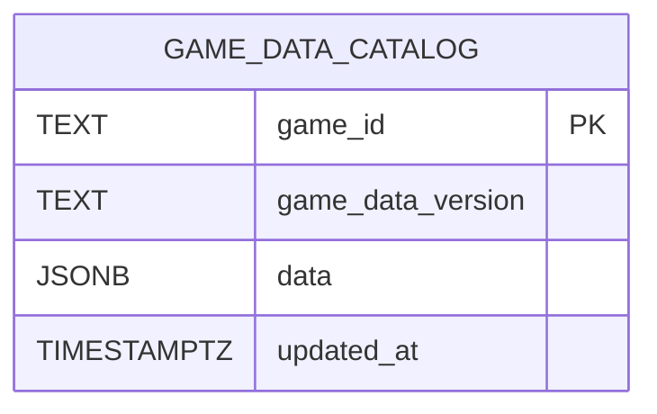

# 게임 데이터 DB 구조 (1차 연결용)

| 열 | 역할 |
| --- | --- |
| `game_id` | 게임 식별자. MVP에서는 `tiny_heroes` 한 건입니다. |
| `game_data_version` | 조회 결과와 Trace에 남길 데이터 버전입니다. |
| `data` | 기존 JSON의 `contents`, `items`, `user_segments`를 그대로 담습니다. |
| `updated_at` | 마지막 초기 데이터 적용 시각입니다. |

`001_create_game_data.sql`은 테이블을 만들고, `002_seed_game_data.sql`은 초기 데이터 한 건을 넣습니다. Seed SQL은 다시 실행해도 같은 게임 행을 갱신합니다. `data`는 JSONB이므로 콘텐츠·아이템은 별도 관계형 테이블이나 ERD 연결선으로 표현되지 않습니다.

백엔드의 작업·Trace 테이블과 물리적 외래키는 없습니다. 백엔드는 MCP 응답의 `game_data_version`과 `source`를 기록해 검증에 사용한 데이터의 출처를 남깁니다. 이 폴더의 SQL은 운영 기록 테이블을 만들거나 변경하지 않습니다.
